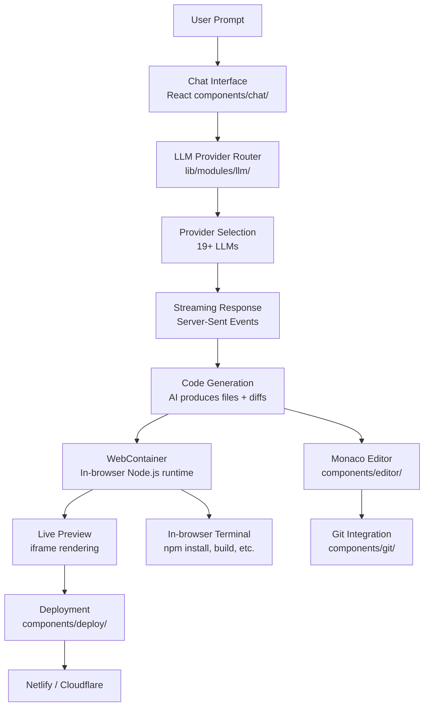
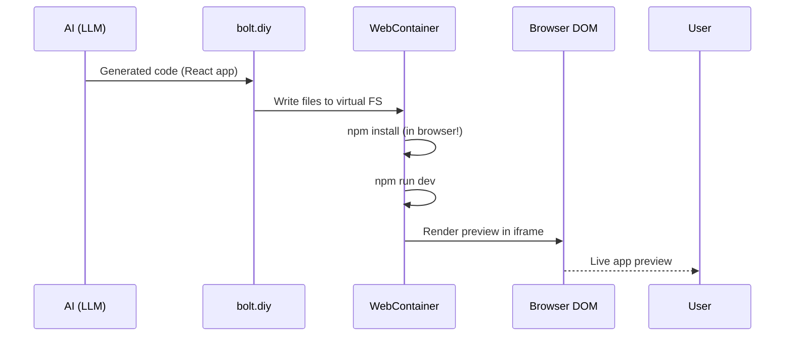

# bolt.diy — AI-Powered Full-Stack Web Development Platform

**bolt.diy lets you generate complete web applications from natural language prompts, running entirely in the browser.** Built on Remix and React, it leverages StackBlitz WebContainers to execute Node.js in the browser, supports 19+ LLM providers, and deploys to Netlify, Cloudflare, or as an Electron desktop app.

Source: `app/` — 396 TypeScript/TSX files, MIT license

## Platform Architecture



## Key Features

| Feature | Implementation | Key Files |
|---------|---------------|-----------|
| AI Chat | Streaming chat with file previews | `app/components/chat/` |
| Code Editor | Monaco editor with file tree | `app/components/editor/` |
| WebContainer | StackBlitz in-browser Node.js | `app/lib/webcontainer/` |
| LLM Providers | 19+ providers behind common interface | `app/lib/modules/llm/` |
| Git Sync | Clone, commit, push, import | `app/components/git/` |
| Deployment | Netlify, Cloudflare, Vercel | `app/components/deploy/` |
| Supabase | Database connection wizard | `app/lib/modules/supabase/` |
| Electron | Desktop app wrapper | `electron/` |
| MCP | Model Context Protocol tools | `app/lib/modules/mcp/` |
| Settings | Provider keys, model selection | `app/components/@settings/` |

## 19+ LLM Providers

```
OpenAI, Anthropic, Ollama, OpenRouter, Gemini, LMStudio,
Mistral, xAI, HuggingFace, DeepSeek, Groq, Cohere,
Together, Perplexity, Moonshot, Hyperbolic, GitHub Models,
Amazon Bedrock, Azure OpenAI
```

Each provider is configured through the Settings panel with API keys, base URLs, and model selection.

**Aha:** bolt.diy uses a "provider as plugin" pattern where each LLM provider is a self-contained module implementing a common interface. Adding a new provider requires only creating a new file in `app/lib/modules/llm/providers/` that implements the `StreamingProvider` interface — no changes to the chat component, the streaming pipeline, or the UI.

## Quick Start

```bash
# Docker (recommended)
docker compose up

# Manual
pnpm install
pnpm run dev

# Electron desktop
pnpm run electron:dev
```

## The WebContainer Revolution



**Aha:** The WebContainer runs a real Node.js process inside the browser using Service Workers and WebAssembly. This means `npm install`, `vite dev`, and even database operations run entirely client-side — no remote server needed for preview. The generated app is rendered in an iframe that connects to a local dev server running inside the WebContainer.

## Next

→ [Architecture](01-architecture.md) — Remix framework, component tree, data flow.
