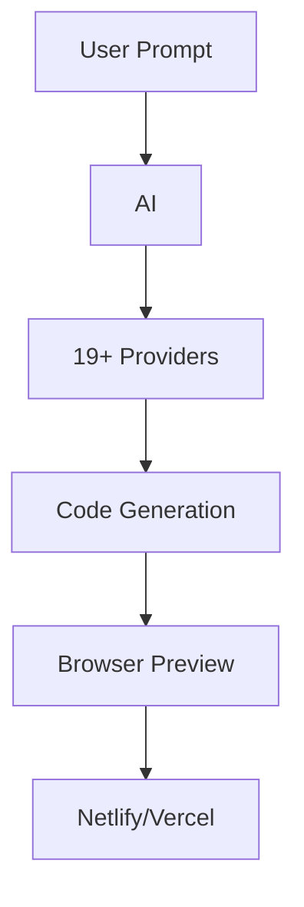

# bolt.diy — AI Web Development in Browser

**Open-source AI-powered full-stack web development, choose your LLM.**

Source: 396 TypeScript files

## Architecture



## Features

| Feature | Description |
|---------|-------------|
| 19+ LLMs | OpenAI, Anthropic, Gemini, Groq, etc. |
| In-browser | No setup needed |
| Electron app | Desktop version |
| Git | Clone/import/deploy |
| MCP | Enhanced AI integration |
| Supabase | Database support |

## Providers

OpenAI, Anthropic, Ollama, OpenRouter, Gemini, LMStudio, Mistral, xAI, HuggingFace, DeepSeek, Groq, Cohere, Together, Perplexity, Moonshot, Hyperbolic, GitHub Models, Amazon Bedrock.

## Setup

```bash
docker compose up
```

## Docs

https://stackblitz-labs.github.io/bolt.diy/
