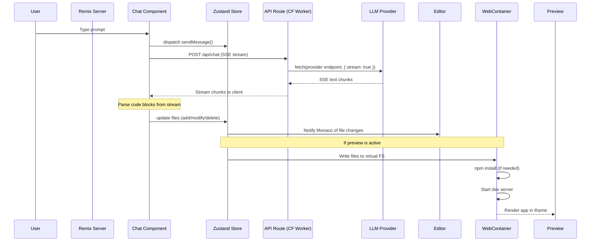

# bolt.diy Architecture — Remix Framework, Component Tree, Data Flow

**bolt.diy is a Remix v2 application with a React frontend, Cloudflare Workers backend, and Electron desktop shell.** The architecture separates concerns into: the Remix route layer (SSR + client hydration), the component tree (chat, editor, workbench, preview), the lib layer (LLM providers, WebContainer runtime, persistence, stores), and the deployment layer (Netlify, Cloudflare, Electron).

Source: `app/` — 396 files across routes, components, lib, and utils

## Directory Structure

```
bolt.diy/
├── app/
│   ├── routes/           ← Remix file-based routing (SSR)
│   │   ├── _index.tsx    ← Landing page
│   │   ├── chat.tsx      ← Main chat+editor+preview layout
│   │   ├── api.chat.ts   ← LLM proxy endpoint (Cloudflare Worker)
│   │   └── api.*.ts      ← Other API routes
│   ├── components/
│   │   ├── chat/         ← Chat messages, input, file previews
│   │   ├── editor/       ← Monaco code editor, file tree
│   │   ├── workbench/    ← Main layout: editor + preview split
│   │   ├── header/       ← Top navigation bar
│   │   ├── sidebar/      ← File explorer sidebar
│   │   ├── deploy/       ← Deployment UI
│   │   ├── git/          ← Git operations UI
│   │   ├── @settings/    ← Settings modal (providers, keys)
│   │   └── ui/           ← Shared UI primitives
│   ├── lib/
│   │   ├── modules/      ← Feature modules (LLM, Supabase, MCP)
│   │   ├── runtime/      ← WebContainer runtime management
│   │   ├── persistence/  ← LocalStorage/IndexedDB persistence
│   │   ├── stores/       ← Zustand state management
│   │   ├── hooks/        ← React hooks (useChat, useWebContainer)
│   │   ├── api/          ← Client-side API utilities
│   │   ├── .server/      ← Server-only code (LLM proxy)
│   │   └── common/       ← Shared types and constants
│   └── styles/           ← Tailwind CSS + custom styles
├── electron/             ← Electron main + preload + renderer
├── functions/            ← Cloudflare Worker entry points
└── public/               ← Static assets
```

## Data Flow



**Aha:** The LLM calls never go directly from the browser to the LLM provider. Instead, they proxy through a Cloudflare Worker (`app/routes/api.chat.ts`). This has three benefits: (1) API keys stay server-side, never exposed to the client; (2) the Worker can transform responses for any provider into a unified streaming format; (3) rate limiting and abuse prevention can be enforced at the edge.

## State Management

bolt.diy uses Zustand for state management, organized by domain:

| Store | File | Purpose |
|-------|------|---------|
| `useChatStore` | `lib/stores/chat.ts` | Messages, streaming state, conversation history |
| `useEditorStore` | `lib/stores/editor.ts` | File tree, open files, Monaco state |
| `usePreviewStore` | `lib/stores/preview.ts` | WebContainer status, preview URL |
| `useSettingsStore` | `lib/stores/settings.ts` | Provider configs, API keys (encrypted) |
| `useGitStore` | `lib/stores/git.ts` | Git status, branches, commits |
| `useDeployStore` | `lib/stores/deploy.ts` | Deployment status, provider config |

## Component Architecture

The main layout (`app/routes/chat.tsx`) renders a three-panel workbench:

```
┌─────────────────────────────────────────────────────┐
│ Header (navigation, settings, deploy button)        │
├──────────┬──────────────────────┬───────────────────┤
│ Sidebar  │ Editor (Monaco)     │ Preview (iframe)   │
│ File     │                     │                    │
│ Explorer │ [code editing area] │ [rendered app]     │
│          │                     │                    │
├──────────┴──────────────────────┴───────────────────┤
│ Chat Panel (collapsible bottom panel)               │
│ [User]: Create a todo app with React               │
│ [AI]: I'll create a todo app... [files generated]  │
│ [Input box]_________________________________ [Send] │
└─────────────────────────────────────────────────────┘
```

## Cross-References

- [LLM Providers](02-llm-providers.md) — Provider abstraction and streaming
- [Code Generation](03-code-generation.md) — AI prompt engineering and file generation
- [WebContainer Runtime](04-webcontainer-runtime.md) — In-browser Node.js execution

## Next

→ [LLM Providers](02-llm-providers.md) — How 19+ LLM providers are integrated.
