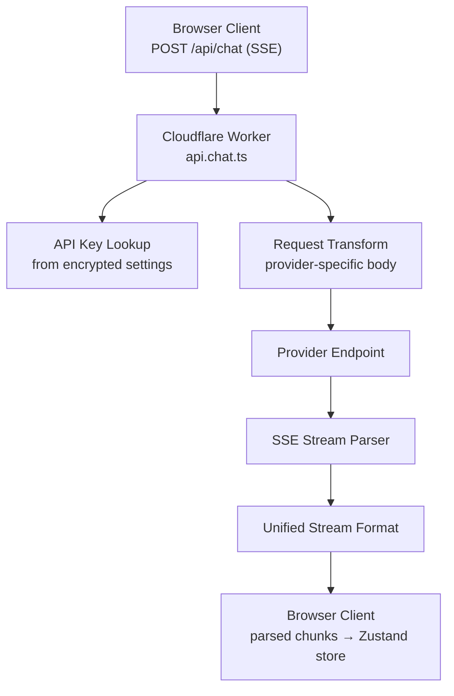

# bolt.diy LLM Providers — 19+ AI Provider Integrations

**bolt.diy abstracts 19+ LLM providers behind a common streaming interface, with server-side API key management and unified response streaming.** Each provider is a self-contained module implementing the `StreamingProvider` pattern. The LLM proxy (`app/routes/api.chat.ts`) handles authentication, request transformation, and SSE streaming to the client.

Source: `app/lib/modules/llm/`, `app/routes/api.chat.ts`

## Provider Architecture



## Provider Interface

Each provider follows a consistent pattern:

```typescript
// app/lib/modules/llm/providers/
interface LLMProvider {
    name: string
    models: string[]
    defaultModel: string
    buildRequestBody(prompt: string, model: string, apiKey: string): object
    parseChunk(chunk: string): { text: string; done: boolean }
}
```

## Provider Catalog

| Provider | Models | Key Requirements |
|----------|--------|-----------------|
| OpenAI | gpt-4o, gpt-4-turbo, gpt-3.5-turbo | API key |
| Anthropic | claude-sonnet-4, claude-opus-4 | API key |
| Gemini | gemini-2.0-flash, gemini-2.5-pro | API key |
| Ollama | Any local model | Base URL (localhost) |
| OpenRouter | 200+ models via unified API | API key |
| Groq | llama-3.3-70b, mixtral-8x7b | API key |
| DeepSeek | deepseek-chat, deepseek-reasoner | API key |
| Mistral | mistral-large, mistral-small | API key |
| xAI | grok-2 | API key |
| Together AI | 100+ open models | API key |
| HuggingFace | Various open models | API token |
| LMStudio | Any local model | Base URL (localhost) |
| Cohere | command-r-plus | API key |
| Perplexity | llama-3.1-sonar | API key |
| Moonshot | moonshot-v1 | API key |
| Hyperbolic | Various open models | API key |
| GitHub Models | GPT-4o, Claude, Phi | GitHub token |
| Amazon Bedrock | Claude, Llama, Titan | AWS credentials |
| Azure OpenAI | GPT-4, GPT-3.5 | Azure endpoint + key |

**Aha:** Providers are not hardcoded — they're discovered dynamically from the `providers/` directory. The Remix server imports all provider modules at build time and generates a provider registry. To add a new provider, you create a single file in `app/lib/modules/llm/providers/` that exports the required functions. The build process picks it up automatically — no registration step needed.

## Streaming Pipeline

```typescript
// Simplified flow from api.chat.ts
export async function action({ request }: ActionFunctionArgs) {
    const { messages, provider, model, apiKey } = await request.json()

    const providerModule = getProvider(provider)
    const body = providerModule.buildRequestBody(messages, model)

    const response = await fetch(providerModule.baseURL, {
        method: 'POST',
        headers: { 'Authorization': `Bearer ${apiKey}` },
        body: JSON.stringify(body),
    })

    // Stream response back as SSE
    return new Response(
        new ReadableStream({
            async start(controller) {
                const reader = response.body.getReader()
                while (true) {
                    const { done, value } = await reader.read()
                    if (done) break
                    const text = providerModule.parseChunk(value)
                    controller.enqueue(`data: ${JSON.stringify({ text })}\n\n`)
                }
            }
        }),
        { headers: { 'Content-Type': 'text/event-stream' } }
    )
}
```

## API Key Security

API keys are stored encrypted in the browser and decrypted only on the server:

```typescript
// app/lib/crypto.ts
export function encryptApiKey(key: string, password: string): string
export function decryptApiKey(encrypted: string, password: string): string
```

Keys are sent to the server with each request (over HTTPS) but never persisted server-side.

## Cross-References

- [Architecture](01-architecture.md) — How providers fit in the data flow
- [Code Generation](03-code-generation.md) — How LLM output becomes code

## Next

→ [Code Generation](03-code-generation.md) — AI prompt engineering and file generation.
