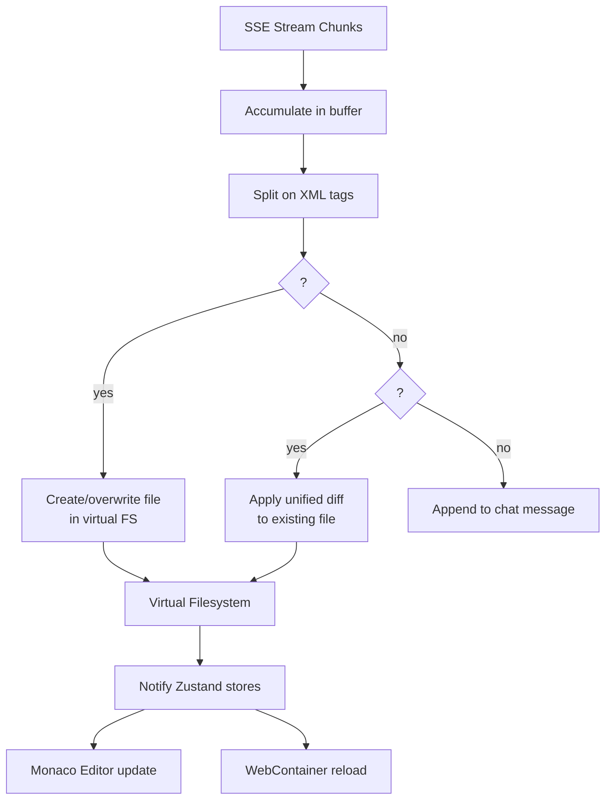

# bolt.diy Code Generation — AI-Powered File Creation and Diff Application

**bolt.diy's AI generates complete web applications by producing structured file outputs that are written to the in-browser filesystem.** The LLM is prompted with a system message that instructs it to output code in a specific XML-like format: `<file path="...">content</file>` for new files and `<diff path="...">unified diff</diff>` for modifications. These are parsed on the client, applied to the virtual filesystem, and immediately reflected in the editor and preview.

Source: `app/lib/modules/llm/prompts.ts`, `app/lib/common/`

## Prompt Engineering

The system prompt instructs the LLM to produce structured output:

```xml
<system>
You are bolt, an AI full-stack engineer. Generate complete web applications
from user prompts. Output files using this format:

<file path="src/App.tsx">
import React from 'react';
...
</file>

To modify existing files, use diffs:
<diff path="src/App.tsx">
@@ -1,5 +1,7 @@
 import React from 'react';
+import { useState } from 'react';
...
</diff>

Rules:
- Always output complete, working code
- Use modern ES modules
- Include package.json with all dependencies
- Use Tailwind CSS for styling by default
- Follow React best practices (hooks, functional components)
</system>
```

## File Parsing Pipeline



## File Generation Patterns

The LLM uses several output patterns:

### New Project Scaffold

```xml
<file path="package.json">
{
  "name": "todo-app",
  "scripts": { "dev": "vite", "build": "vite build" },
  "dependencies": { "react": "^18.3.1", "react-dom": "^18.3.1" },
  "devDependencies": { "vite": "^5.4.0", "@vitejs/plugin-react": "^4.3.0" }
}
</file>

<file path="vite.config.ts">
import { defineConfig } from 'vite'
import react from '@vitejs/plugin-react'
export default defineConfig({ plugins: [react()] })
</file>

<file path="index.html">
<!DOCTYPE html><html><body><div id="root"></div>
<script type="module" src="/src/main.tsx"></script></body></html>
</file>

<file path="src/main.tsx">
import React from 'react'
import ReactDOM from 'react-dom/client'
import App from './App'
ReactDOM.createRoot(document.getElementById('root')!).render(<App />)
</file>

<file path="src/App.tsx">
import React, { useState } from 'react'

export default function App() {
  const [todos, setTodos] = useState([])
  // ... full implementation
}
</file>
```

### Incremental Modification

```xml
<diff path="src/App.tsx">
@@ -5,6 +5,7 @@
 export default function App() {
   const [todos, setTodos] = useState([])
+  const [filter, setFilter] = useState('all')
   // ... rest of file
</diff>
```

**Aha:** The `<diff>` format uses standard unified diff syntax, which means version control operations (git diff, git apply) work natively. The generated diffs can be reviewed in the Git panel, committed, and reverted — the AI is effectively a pair programmer whose changes go through the same Git workflow as human changes.

## Error Recovery

When generated code fails to compile or run, the error is fed back to the LLM:

```typescript
// WebContainer captures build errors
const errors = await webcontainerInstance.executeCommand('npm run build')
if (errors.exitCode !== 0) {
    // Send errors back to LLM for self-correction
    sendToLLM({
        role: 'system',
        content: `Build failed with errors:\n${errors.output}\n\nPlease fix.`
    })
}
```

This creates a tight feedback loop: generate → build → error → fix → rebuild.

## Cross-References

- [LLM Providers](02-llm-providers.md) — How providers stream generation output
- [WebContainer Runtime](04-webcontainer-runtime.md) — How generated code executes

## Next

→ [WebContainer Runtime](04-webcontainer-runtime.md) — In-browser Node.js execution.
