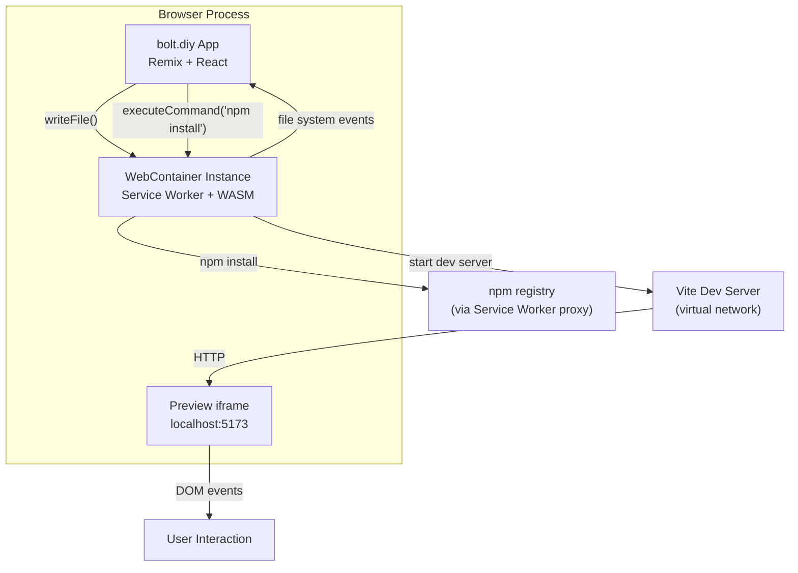

# bolt.diy WebContainer Runtime — In-Browser Node.js Execution

**WebContainers enable bolt.diy to run real Node.js processes inside the browser, using Service Workers and WebAssembly.** This means `npm install`, `vite dev`, `tsc`, and even database operations execute entirely client-side — no remote VMs, no server costs, instant preview. The generated application runs in an iframe connected to a local dev server inside the WebContainer.

Source: `app/lib/webcontainer/`, StackBlitz WebContainer API

## Architecture



## WebContainer Lifecycle

```typescript
// app/lib/webcontainer/
import { WebContainer } from '@webcontainer/api'

// 1. Boot
const instance = await WebContainer.boot()

// 2. Mount files
await instance.mount({
    'package.json': { file: { contents: '{"name": "my-app", ...}' } },
    'src/App.tsx': { file: { contents: 'export default ...' } },
    // ... all generated files
})

// 3. Install dependencies (real npm in browser!)
const install = await instance.spawn('npm', ['install'])
await install.exit  // Wait for completion

// 4. Start dev server
const dev = await instance.spawn('npm', ['run', 'dev'])
// Server listens on virtual port 5173

// 5. Get preview URL
const url = await instance.getUrl(5173)
// → 'https://random-id.webcontainer.io'

// Preview iframe
iframe.src = url
```

## Virtual Filesystem

The WebContainer provides a full POSIX-like filesystem:

```typescript
// Write files
await instance.fs.writeFile('/src/App.tsx', code)

// Read files
const contents = await instance.fs.readFile('/src/App.tsx', 'utf-8')

// Directory operations
await instance.fs.mkdir('/src/components')
const entries = await instance.fs.readdir('/src')
```

**Aha:** The virtual filesystem is ephemeral — it exists only in memory for the duration of the browser tab. When the user refreshes, the WebContainer is destroyed and must be re-booted. bolt.diy persists the file state in IndexedDB via `app/lib/persistence/`, so on refresh it can restore the entire project and re-boot the WebContainer without losing work.

## Command Execution

```typescript
// Spawn any command available in the WebContainer's Node.js environment
const process = await instance.spawn('npx', ['tsc', '--noEmit'])
process.output.pipeTo(new WritableStream({
    write(data) {
        terminal.write(data)  // Stream to in-browser terminal
    }
}))
const exitCode = await process.exit
```

The terminal component in `app/components/editor/` displays this output, giving users a real terminal experience.

## Server Proxy

The dev server inside the WebContainer can't be accessed directly from the browser. Instead, the WebContainer API provides a proxy URL:

```typescript
// The proxy URL routes through a Service Worker
// that forwards requests to the virtual network inside the WebContainer
const previewUrl = await instance.getUrl(5173)
// → 'https://{unique-id}.webcontainer.io'
```

This URL can be loaded in an iframe for the live preview or in a new tab for standalone testing.

## Cross-References

- [Architecture](01-architecture.md) — How WebContainers fit in the component tree
- [Code Generation](03-code-generation.md) — How generated files get mounted

## Next

→ [Deployment](05-deployment.md) — Deploying generated apps to production.
