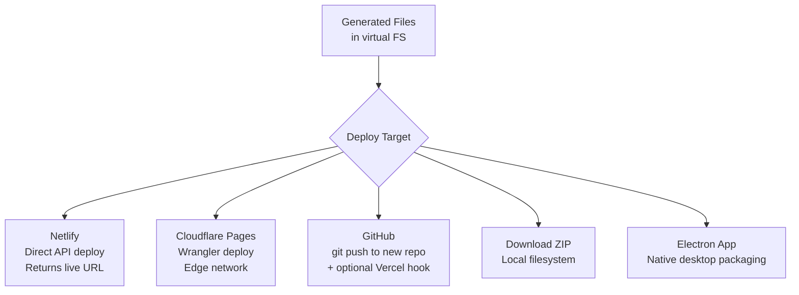

# bolt.diy Deployment — Netlify, Cloudflare, Git, and Electron

**bolt.diy supports deploying generated applications through multiple channels: one-click deploy to Netlify or Cloudflare Pages, Git push to GitHub, download as ZIP, or package as an Electron desktop app.** The deployment pipeline extracts files from the virtual filesystem, bundles them, and pushes to the selected target.

Source: `app/components/deploy/`, `electron/`

## Deployment Targets



## Netlify Deployment

```typescript
// app/components/deploy/netlify.ts
async function deployToNetlify(files: Record<string, string>, token: string) {
    // 1. Create deployment
    const deploy = await fetch(`https://api.netlify.com/api/v1/sites/${siteId}/deploys`, {
        method: 'POST',
        headers: { Authorization: `Bearer ${token}` },
    })

    // 2. Upload files
    for (const [path, content] of Object.entries(files)) {
        await fetch(deploy.deploy_url + path, {
            method: 'PUT',
            body: content,
        })
    }

    // 3. Publish
    return deploy.deploy_url
}
```

## Git Integration

```typescript
// app/components/git/
async function pushToGitHub(files: Record<string, string>, token: string) {
    // 1. Create repo via GitHub API
    // 2. Initialize git in virtual FS
    // 3. Commit all files
    // 4. Push to remote
}
```

**Aha:** The Git integration uses the WebContainer's built-in git binary. This means `git init`, `git add`, `git commit`, and `git push` are real git operations, not simulated. The generated project can be cloned, contributed to, and maintained through standard Git workflows — the AI is a contributor to a real repo.

## Electron Desktop App

```typescript
// electron/main/index.ts
const { app, BrowserWindow } = require('electron')

app.whenReady().then(() => {
    const win = new BrowserWindow({ width: 1200, height: 800 })
    win.loadURL('http://localhost:5173')  // Load bolt.diy web app
})
```

The Electron build packages bolt.diy as a standalone desktop app with:
- Native file system access (open/save projects)
- System tray integration
- Auto-update via `electron-updater`
- Native notifications

## Cross-References

- [WebContainer Runtime](04-webcontainer-runtime.md) — Where files live before deployment
- [Architecture](01-architecture.md) — How deployment fits in the component tree

## Next

→ Back to [Overview](00-overview.md) for the big picture.
