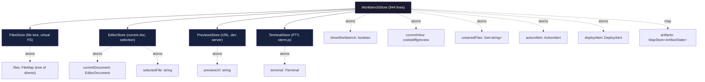
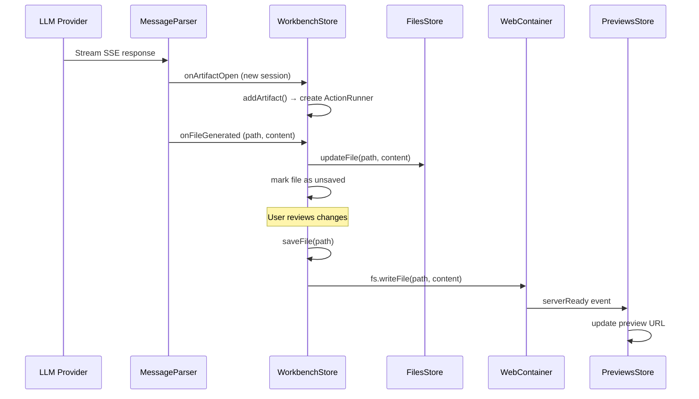

# bolt.diy State Management — nanostores, WorkbenchStore, and Reactive UI

**bolt.diy uses nanostores — a tiny 820-byte reactive store library — instead of Redux or Zustand.** This keeps the bundle small while providing atoms (single values) and maps (keyed collections) that integrate with React via `@nanostores/react`. The entire application state flows through a hierarchy of stores: `WorkbenchStore` orchestrates `FilesStore`, `EditorStore`, `PreviewsStore`, and `TerminalStore`.

Source: `app/lib/stores/` — 18 store files

## Store Hierarchy



## nanostores: Why This Choice?

Aha: nanostores is 820 bytes gzipped vs Zustand's 1.1KB, Redux's 7.5KB, or Jotai's 1.4KB. For a browser-based IDE running inside WebContainers with limited memory, every kilobyte matters. The API is deliberately minimal: `atom(value)` for single values, `map(object)` for keyed collections. No middleware, no selectors — just reactive primitives that React components subscribe to via `useStore()`.

```typescript
// app/lib/stores/workbench.ts:46-56
import { atom, map, type MapStore, type WritableAtom } from 'nanostores';

export class WorkbenchStore {
  artifacts: Artifacts = import.meta.hot?.data.artifacts ?? map({});
  showWorkbench: WritableAtom<boolean> = import.meta.hot?.data.showWorkbench ?? atom(false);
  currentView: WritableAtom<WorkbenchViewType> = import.meta.hot?.data.currentView ?? atom('code');
  unsavedFiles: WritableAtom<Set<string>> = import.meta.hot?.data.unsavedFiles ?? atom(new Set<string>());
  actionAlert: WritableAtom<ActionAlert | undefined> = atom<ActionAlert | undefined>(undefined);
  supabaseAlert: WritableAtom<SupabaseAlert | undefined> = atom<SupabaseAlert | undefined>(undefined);
  deployAlert: WritableAtom<DeployAlert | undefined> = atom<DeployAlert | undefined>(undefined);
```

## Hot Module Preservation

Aha: The `import.meta.hot?.data` pattern is critical. When Vite does HMR during development, store state would normally reset to empty. By hanging stores on `import.meta.hot.data`, the WorkbenchStore preserves its state across hot reloads — including unsaved file modifications, current view selection, and active alerts. Binary files are explicitly re-set after HMR to ensure content isn't lost:

```typescript
// app/lib/stores/workbench.ts:70-78
if (import.meta.hot) {
  import.meta.hot.data.artifacts = this.artifacts;
  import.meta.hot.data.unsavedFiles = this.unsavedFiles;
  // ... more hot data assignments
  
  // Ensure binary files are properly preserved across hot reloads
  const filesMap = this.files.get();
  for (const [path, dirent] of Object.entries(filesMap)) {
    if (dirent?.type === 'file' && dirent.isBinary && dirent.content) {
      this.files.setKey(path, { ...dirent });
    }
  }
}
```

## WorkbenchStore: The Orchestrator

The `WorkbenchStore` (944 lines) is the central coordinator. It composes four sub-stores and manages:

### Artifact System

```typescript
// app/lib/stores/workbench.ts:24-30
export interface ArtifactState {
  id: string;
  title: string;
  type?: string;
  closed: boolean;
  runner: ActionRunner;  // executes file operations against WebContainer
}
```

Each artifact is a generated application session with its own `ActionRunner`. The `ActionRunner` parses LLM output (file/diff blocks) and executes them against the WebContainer filesystem.

### View Management

Three views controlled by `currentView` atom:

| View | Purpose |
|------|---------|
| `code` | Show generated code in CodeMirror editor |
| `diff` | Show file changes as unified diff |
| `preview` | Show WebContainer-rendered application |

### File Modification Tracking

```typescript
// app/lib/stores/workbench.ts:225-256
async saveFile(filePath: string) {
  const filePathWithPrefix = path.ensureRootPrefix(filePath);
  const file = this.files.get()[filePathWithPrefix];
  if (file?.type !== 'file') return;
  
  const webContainerInstance = await webcontainer;
  await webContainerInstance.fs.writeFile(filePathWithPrefix, file.content);
  
  this.unsavedFiles.get().delete(filePathWithPrefix);
  this.unsavedFiles.set(new Set(this.unsavedFiles.get()));
  this.modifiedFiles.delete(filePathWithPrefix);
}
```

Files are tracked in a `modifiedFiles` Set. When the LLM generates new files, they're added to the virtual filesystem but not saved to WebContainer until the user explicitly saves. This gives users a chance to review and reject changes.

### File Locking

```typescript
// app/lib/stores/workbench.ts:297-342
lockFile(filePath: string) { ... }
lockFolder(folderPath: string) { ... }
unlockFile(filePath: string) { ... }
isFileLocked(filePath: string) { ... }
isFolderLocked(folderPath: string) { ... }
```

Aha: File locking prevents the LLM from overwriting files the user is actively editing. Locked files are excluded from the diff context sent to the LLM, meaning the AI won't see or modify them. This is a simple but effective collaboration mechanism between human and AI.

### Action Execution Queue

```typescript
// app/lib/stores/workbench.ts:59,82-84
#globalExecutionQueue = Promise.resolve();

addToExecutionQueue(callback: () => Promise<void>) {
  this.#globalExecutionQueue = this.#globalExecutionQueue.then(() => callback());
}
```

All actions (file writes, terminal commands, deployments) run through a single serialized queue. This prevents race conditions when the LLM generates multiple file operations simultaneously.

## Sub-Stores

### FilesStore (`app/lib/stores/files.ts`)

Manages the virtual filesystem as a `FileMap` — a tree of directory entries:

```typescript
interface FileDirent { type: 'file'; content: string; isBinary?: boolean; }
interface DirDirent { type: 'directory'; }
type FileMap = Record<string, FileDirent | DirDirent>;
```

Key operations: `updateFile()`, `deleteFile()`, `getFilesList()`, and recursive directory traversal.

### EditorStore (`app/lib/stores/editor.ts`)

Tracks the current open document and selected file in the CodeMirror editor:

```typescript
interface EditorDocument {
  filePath: string;
  content: string;
  scroll: ScrollPosition;
}
```

Manages file selection, document content synchronization with FilesStore, and scroll position restoration.

### PreviewsStore (`app/lib/stores/previews.ts`)

Tracks the WebContainer dev server URL and external preview links. Listens to WebContainer's `serverReady` event to detect when the dev server is available.

### TerminalStore (`app/lib/stores/terminal.ts`)

Manages the xterm.js terminal instance attached to the WebContainer PTY. Handles terminal creation, attachment, detachment, and resize events.

## Alert System

Three typed alert atoms provide user-facing notifications:

| Alert | Trigger | Source |
|-------|---------|--------|
| `ActionAlert` | LLM action events (errors, warnings) | `message-parser.ts` |
| `SupabaseAlert` | Supabase deployment issues | Deployment pipeline |
| `DeployAlert` | Netlify/Cloudflare deploy status | Deploy pipeline |

## Data Flow: From LLM to Screen



## Key Constants

| Value | Location | Purpose |
|-------|----------|---------|
| `WorkbenchViewType` | `workbench.ts:36` | `'code' \| 'diff' \| 'preview'` |
| `modifiedFiles: Set<string>` | `workbench.ts:57` | Tracks unsaved changes |
| `#globalExecutionQueue` | `workbench.ts:59` | Serializes all actions |
| `#reloadedMessages` | `workbench.ts:44` | Tracks messages across reloads |

## Cross-References

- [LLM Providers](02-llm-providers.md) — where the streaming responses originate
- [Code Generation](03-code-generation.md) — how LLM output becomes file/diff blocks
- [WebContainer Runtime](04-webcontainer-runtime.md) — the execution environment
- [Deployment](05-deployment.md) — deploying generated applications

Next: Read about the [WebContainer Runtime](04-webcontainer-runtime.md) to understand how the saved files become a running application.
