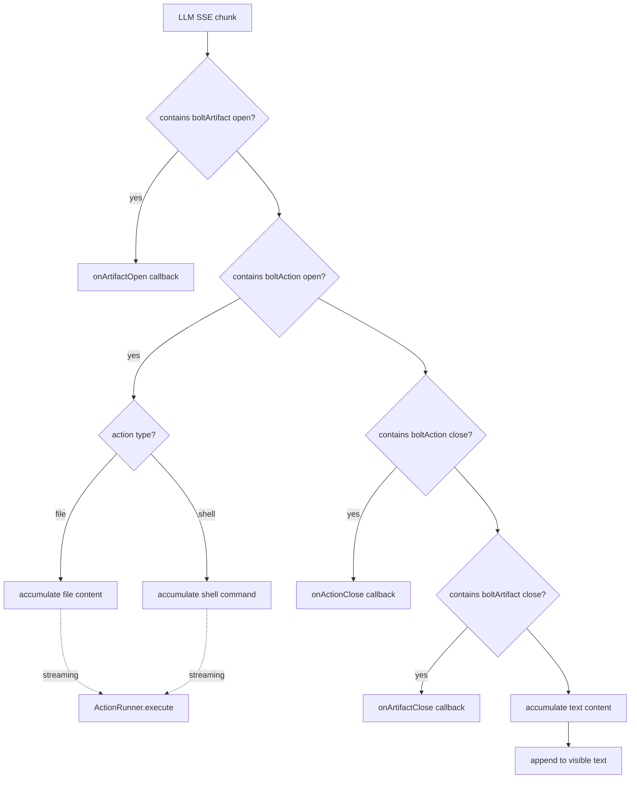
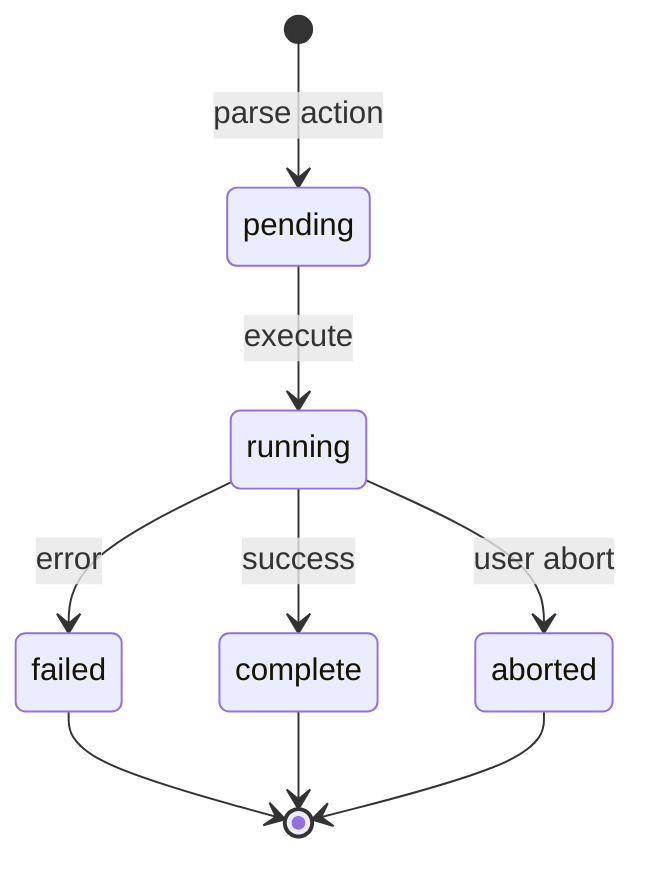

# bolt.diy Runtime — Streaming Message Parser and Action Runner

**bolt.diy parses LLM streaming responses in real-time, extracting structured file operations and shell commands from XML-like tags, then executes them against the WebContainer.** The runtime consists of two core systems: `StreamingMessageParser` (416 lines) that tokenizes the LLM output stream, and `ActionRunner` (760 lines) that executes the parsed actions.

Source: `app/lib/runtime/` — 3 files, 1,703 lines total

## Streaming Message Parser

The parser processes the LLM's SSE stream character-by-character, maintaining state across chunks to detect XML-like tags:

```typescript
// app/lib/runtime/message-parser.ts:7-10
const ARTIFACT_TAG_OPEN = '<boltArtifact';
const ARTIFACT_TAG_CLOSE = '</boltArtifact>';
const ARTIFACT_ACTION_TAG_OPEN = '<boltAction';
const ARTIFACT_ACTION_TAG_CLOSE = '</boltAction>';
```

Aha: The parser doesn't wait for the complete response — it processes incrementally as each chunk arrives. This means the UI starts showing generated code and executing file writes while the LLM is still thinking. The `MessageState` tracks position, whether we're inside an artifact or action, and a counter for unique IDs:

```typescript
// app/lib/runtime/message-parser.ts:49-56
interface MessageState {
  position: number;
  insideArtifact: boolean;
  insideAction: boolean;
  artifactCounter: number;
  currentArtifact?: BoltArtifactData;
  currentAction: BoltActionData;
  actionId: number;
}
```

### Parsing Flow



### Action Types

```typescript
// app/lib/runtime/message-parser.ts:1-2
interface FileAction {
  type: 'file';
  content: string;
  filePath: string;
}

interface ShellAction {
  type: 'shell';
  content: string;  // shell command
}
```

Each action extracted from the stream triggers `onActionOpen` → `ActionRunner.addAction()` → `ActionRunner.runAction()`. The content streams incrementally via `onActionStream` for real-time UI updates.

### Markdown Code Block Stripping

Aha: The parser handles a common LLM quirk — wrapping content in markdown code blocks. `cleanoutMarkdownSyntax()` detects when the LLM wraps file content in ``` blocks and strips the outer fence:

```typescript
// app/lib/runtime/message-parser.ts:58-67
function cleanoutMarkdownSyntax(content: string) {
  const codeBlockRegex = /^\s*```\w*\n([\s\S]*?)\n\s*```\s*$/;
  const match = content.match(codeBlockRegex);
  if (match) {
    return match[1];
  } else {
    return content;
  }
}
```

## ActionRunner: Execution Engine

The `ActionRunner` executes parsed actions against the WebContainer. Each artifact gets its own `ActionRunner` instance:

```typescript
// app/lib/runtime/action-runner.ts:37-42
export type ActionStatus = 'pending' | 'running' | 'complete' | 'aborted' | 'failed';

export class ActionRunner {
  #webcontainer: Promise<WebContainer>;
  #currentExecutionPromise: Promise<void> = Promise.resolve();
  #shellTerminal: () => BoltShell;
  actions: ActionsMap = map({});
```

### Action State Machine



### Action Execution

```typescript
// app/lib/runtime/action-runner.ts:549-555 (via WorkbenchStore._runAction)
async _runAction(data: ActionCallbackData, isStreaming: boolean) {
  const artifactId = data.artifactId;
  const artifact = this.artifacts.get()[artifactId];
  if (!artifact) unreachable('Artifact not found');
  
  const runner = artifact.runner;
  runner.addAction(data);  // register action
  runner.runAction(data);  // execute
}
```

### Shell Command Execution

Shell actions execute in the WebContainer's PTY terminal:

```typescript
// app/lib/runtime/action-runner.ts (ActionCommandError)
class ActionCommandError extends Error {
  readonly _output: string;  // full terminal output
  readonly _header: string;  // error summary
}
```

Aha: The `ActionCommandError` captures both the error header and the full terminal output separately. This lets the UI show a concise error message while still providing the full output for debugging. The error is thrown (not returned) so it propagates through the promise chain correctly.

### Global Execution Queue

```typescript
// app/lib/stores/workbench.ts:59,82-84
#globalExecutionQueue = Promise.resolve();

addToExecutionQueue(callback: () => Promise<void>) {
  this.#globalExecutionQueue = this.#globalExecutionQueue.then(() => callback());
}
```

All actions across all artifacts run through a single serialized queue. This prevents race conditions like two file writes to the same path or a `npm install` running while files are still being written.

### Sampling for Streaming Updates

```typescript
// app/lib/stores/workbench.ts:603
actionStreamSampler = createSampler(async (data, isStreaming) => { ... });
```

Aha: The `createSampler` pattern throttles streaming updates. Without it, every character from the LLM stream would trigger a UI re-render. Sampling ensures the UI updates at a reasonable rate (e.g., 60fps max) while the LLM streams continuously.

## Enhanced Message Parser

The `EnhancedMessageParser` (527 lines) extends the base parser with additional capabilities:

- Quick actions support (`<bolt-quick-actions>` tags)
- Improved markdown handling
- Better content cleaning with escaped tag handling

```typescript
// app/lib/runtime/message-parser.ts:70-73
function cleanEscapedTags(content: string) {
  return content.replace(/&lt;/g, '<').replace(/&gt;/g, '>');
}
```

Aha: HTML entity escaping is a common LLM output artifact — the model sometimes outputs `&lt;boltAction&gt;` instead of `<boltAction>`. The `cleanEscapedTags()` function normalizes this before parsing, preventing silent failures where valid action tags are missed.

## Key Data Flow

```mermaid
sequenceDiagram
    participant L as LLM Stream
    participant P as StreamingMessageParser
    participant WB as WorkbenchStore
    participant AR as ActionRunner
    participant FS as FileStore
    participant WC as WebContainer
    
    L->>P: <boltArtifact id="1" title="App">
    P->>WB: onArtifactOpen(id="1")
    WB->>AR: new ActionRunner()
    L->>P: <boltAction type="file" filePath="index.html">
    P->>WB: onActionOpen(filePath="index.html")
    WB->>AR: addAction()
    L->>P: &lt;div class="app"&gt;...
    P->>WB: onActionStream(content chunk)
    WB->>FS: updateFile (partial)
    L->>P: </boltAction>
    P->>WB: onActionClose
    WB->>AR: runAction()
    AR->>FS: commit file content
    AR->>WC: fs.writeFile("index.html")
    L->>P: </boltArtifact>
    P->>WB: onArtifactClose
```

## Integration with Stores

The runtime connects to the store system through callbacks:

| Callback | Handler | Effect |
|----------|---------|--------|
| `onArtifactOpen` | `WorkbenchStore.addArtifact()` | Creates new ArtifactState + ActionRunner |
| `onActionOpen` | `WorkbenchStore.addAction()` | Registers action in runner |
| `onActionStream` | `WorkbenchStore.actionStreamSampler` | Streams content to FileStore |
| `onActionClose` | `WorkbenchStore.runAction()` | Executes action on WebContainer |
| `onArtifactClose` | `WorkbenchStore.updateArtifact()` | Marks artifact complete |

## Cross-References

- [State Management](06-state-management.md) — how WorkbenchStore orchestrates the runtime
- [LLM Providers](02-llm-providers.md) — where the streaming responses originate
- [Code Generation](03-code-generation.md) — the prompt format that produces XML tags
- [WebContainer Runtime](04-webcontainer-runtime.md) — the execution environment

Next: Read about the [WebContainer Runtime](04-webcontainer-runtime.md) to understand how actions become running applications.
