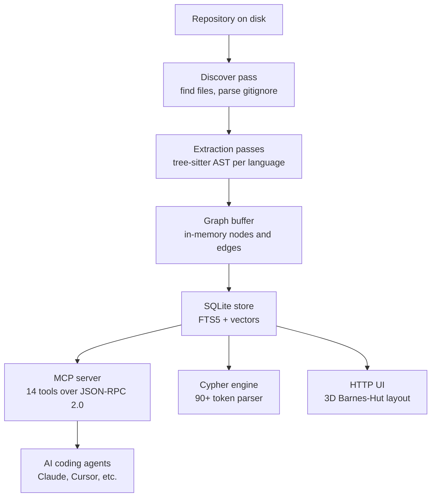
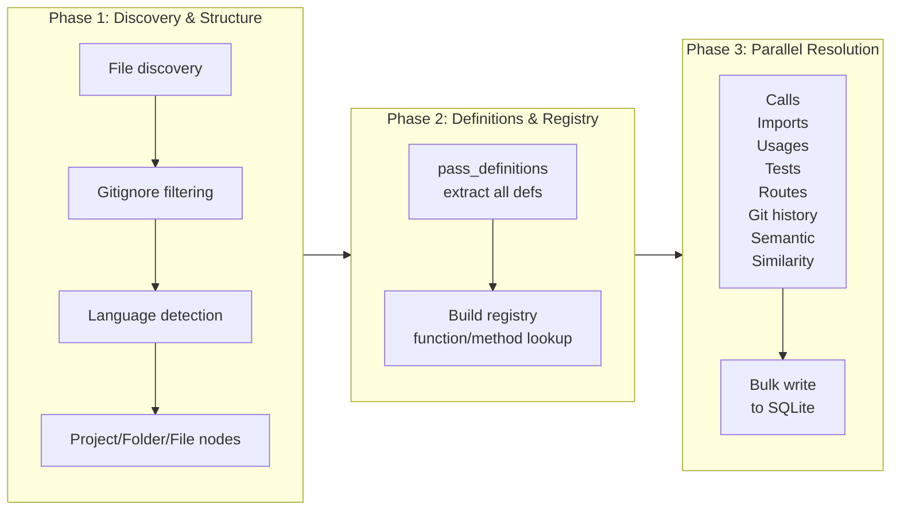

# Overview: What codebase-memory-mcp Is and Why It Exists

codebase-memory-mcp is a high-performance code intelligence engine written in pure C11 that indexes source code repositories into a property graph and exposes 14 MCP (Model Context Protocol) tools over JSON-RPC 2.0 stdio. It supports 156 programming languages via vendored tree-sitter grammars, runs an 11-signal semantic similarity ensemble, and provides a Cypher query engine with 90+ token types. The Linux kernel -- 28 million lines across 75,000 files -- indexes in 3 minutes.

## The Problem It Solves

AI coding agents need to understand codebases to answer questions, plan changes, and generate code. The standard approaches are slow and lossy: read files one by one, grep for patterns, or use an LLM context window with a token budget that exhausts before the codebase is covered. codebase-memory-mcp flips this. It pre-indexes the entire codebase into a structured knowledge graph, then answers agent queries through graph traversal, pattern matching, and semantic similarity — all in sub-millisecond time.

The MCP protocol means any compatible agent (Claude, Cursor, Windsurf, or custom) can discover and call these tools without custom integration code.

## What You Get After Indexing

After indexing a repository, the engine produces a SQLite database containing:

- **Nodes** representing functions, classes, methods, modules, files, folders, packages, and projects
- **Edges** representing CALLS, IMPORTS, USES, INHERITS, IMPLEMENTS, TESTS, HTTP_CALLS, SIMILAR_TO, and SEMANTICALLY_RELATED relationships
- **Properties** on each node (file path, line range, signature, complexity score, decorator patterns, AST profile)
- **FTS5 full-text search** index for rapid keyword matching
- **Semantic vectors** (nomic-embed-code, 768 dimensions, int8 quantized) for similarity queries
- **3D layout positions** (Barnes-Hut force-directed) for graph visualization

## Architecture at a Glance



The pipeline runs in three parallel phases. Phase 1 discovers files and parses manifests. Phase 2 extracts definitions and builds a function/method registry. Phase 3 runs 18+ extraction passes in parallel across a worker pool, resolving calls, usages, semantic edges, and infrastructure links.



## Key Numbers

| Metric | Value |
|--------|-------|
| Total source lines | 63,896 |
| Source files | 119 |
| Test files | 152 |
| Passing tests | 5,604 |
| Languages supported | 158 |
| MCP tools | 14 |
| Cypher token types | 90+ |
| Semantic signals | 11 |
| MinHash bands | 32 |
| MinHash K (hash seeds) | 64 |
| Pipeline module lines | 22,049 |
| Linux kernel index time | 3 minutes |
| Linux kernel files | 75,000 |
| Linux kernel LOC | 28,000,000 |
| Agents auto-configured | 9 |

## Quick Start: Installation

```bash
# Install into ~/.local/bin
curl -fsSL https://github.com/DeusData/codebase-memory-mcp/releases/latest/download/cbm | sudo tee /usr/local/bin/cbm >/dev/null && sudo chmod +x /usr/local/bin/cbm

# Or install via the built-in CLI
cbm install

# Run as MCP server (default mode — reads from stdin)
cbm

# Run a single tool call
cbm cli index_repository '{"path": "/path/to/repo"}'

# Check version
cbm --version
```

The binary runs as an MCP server by default, accepting JSON-RPC 2.0 requests on stdin and writing responses to stdout. stderr is reserved for logging.

## MCP Server Configuration

For Claude Code, add to `.mcp.json`:

```json
{
  "mcpServers": {
    "codebase-memory": {
      "command": "cbm",
      "args": []
    }
  }
}
```

For Cursor or other MCP-compatible editors, the same stdio configuration applies.

## Environment Variables

| Variable | Default | Description |
|----------|---------|-------------|
| `CBM_CACHE_DIR` | `~/.cache/codebase-memory-mcp` | Database storage directory |
| `CBM_WORKERS` | auto | Worker thread count (auto-detected from CPU count) |
| `CBM_LOG_LEVEL` | `info` | Log level: debug, info, warn, error, none |
| `CBM_DIAGNOSTICS` | `false` | Enable memory diagnostics output |
| `CBM_SEMANTIC_ENABLED` | off | Enable semantic embeddings |
| `CBM_UI_MAX_RENDER_NODES` | 2000 | UI node rendering cap (max 10000) |

See [CLI and Install](10-cli-install.md) for the full list and agent auto-configuration details.

## Module Map

The codebase is organized into clear module boundaries:

```
src/
  main.c                 Entry point: MCP stdio loop, CLI dispatch, install/update
  foundation/            Platform abstractions: arena, slab, mem, hash, string, log
  discover/              File discovery: gitignore parsing, language detection
  pipeline/              Pipeline orchestrator: 22 passes, worker pool, registry
  store/                 SQLite storage: nodes, edges, BFS, FTS5, Louvain
  cypher/                Query engine: lexer, recursive descent parser, planner
  mcp/                   MCP server: 14 tools, JSON-RPC 2.0, stdio I/O
  semantic/              Semantic similarity: 11-signal ensemble, AST profiles
  simhash/               MinHash + LSH: fingerprinting, band hashing
  ui/                    Graph visualization: 3D layout, HTTP server, frontend
  cli/                   CLI commands: install, uninstall, update, config
  traces/                Runtime trace ingestion for HTTP_CALLS validation
  git/                   Git context extraction
  graph_buffer/          In-memory graph buffer for indexing
  watcher/               Background auto-sync via git polling
```

See [Architecture](01-architecture.md) for the full dependency graph and layer diagram.

## The Extraction Engine

The core extraction engine lives in `internal/cbm/` and handles 156 languages through vendored tree-sitter grammars. It uses a three-tier memory model: mimalloc for global allocation, a slab allocator for tree-sitter nodes (<=64B tier), and an arena allocator for per-file extraction (64KB blocks, up to 256 blocks).

The extraction function signature is:

Source: `/home/darkvoid/Boxxed/@formulas/src.rust/src.AI/src.CodebaseMemory/codebase-memory-mcp/src/pipeline/pass_definitions.c`

```c
// Core extraction entry point — processes one file's source through tree-sitter
// Parameters: source buffer, length, language, project name, relative path, budget
int cbm_extract_file(const char *source, size_t source_len, CBMLanguage language,
                     const char *project_name, const char *rel_path, int budget,
                     cbm_gbuf_t *gbuf, cbm_registry_t *registry);
```

Aho-Corasick automaton provides a bitmask fast path for pattern matching during extraction:

Source: `/home/darkvoid/Boxxed/@formulas/src.rust/src.AI/src.CodebaseMemory/codebase-memory-mcp/internal/cbm/ac.h`

```c
// Opaque Aho-Corasick automaton type
typedef struct CBMAutomaton CBMAutomaton;

// Build an automaton from patterns
CBMAutomaton *cbm_ac_build(const char **patterns, const int *lengths, int count,
                           const uint8_t *alpha_map, int alpha_size);

// Single-text scanning (returns bitmask of matched pattern IDs)
uint64_t cbm_ac_scan_bitmask(const CBMAutomaton *ac, const char *text, int text_len);

// LZ4-compressed scanning
uint64_t cbm_ac_scan_lz4_bitmask(const CBMAutomaton *ac, const char *compressed,
                                 int compressed_len, int original_len);
```

See [Extraction](04-extraction.md) for the full extraction engine details and [Foundation Layer](02-foundation-layer.md) for memory management.

## The Semantic Similarity Engine

codebase-memory-mcp computes similarity between code nodes using an 11-signal ensemble:

1. **TF-IDF** (weight 0.20) — vocabulary overlap on metadata tokens
2. **Random Indexing** (weight 0.25) — co-occurrence within window of 5
3. **MinHash structural** (weight 0.10) — fingerprint similarity
4. **API Signature vectors** (weight 0.15) — shared callees
5. **Type Signature vectors** (weight 0.10) — shared param/return types
6. **Module proximity** (multiplier, not additive) — same directory boost, max +0.10
7. **Decorator patterns** (weight 0.05) — shared annotations
8. **Structural profile** (weight 0.10) — 25-feature AST profile
9. **Data flow** (weight 0.05) — param-to-return and param-to-condition
10. **Graph diffusion** — neighbor blending, alpha 0.3
11. **Halstead-lite** — operator/operand complexity profile

MinHash uses K=64 permutations with xxHash, LSH with 32 bands of 2 rows, and Jaccard threshold 0.95 for SIMILAR_TO edge emission.

Source: `/home/darkvoid/Boxxed/@formulas/src.rust/src.AI/src.CodebaseMemory/codebase-memory-mcp/src/simhash/minhash.h` and `/home/darkvoid/Boxxed/@formulas/src.rust/src.AI/src.CodebaseMemory/codebase-memory-mcp/src/semantic/semantic.h`

```c
// From simhash/minhash.h
#define CBM_MINHASH_K 64
#define CBM_MINHASH_MIN_NODES 30
#define CBM_MINHASH_JACCARD_THRESHOLD 0.95f
#define CBM_MINHASH_MAX_EDGES_PER_NODE 10
#define CBM_LSH_BANDS 32

// From semantic/semantic.h
enum { CBM_SEM_DIM = 768 };
enum { CBM_SEM_SPARSE_NNZE = 8 };
enum { CBM_SEM_WINDOW = 5 };
enum { CBM_SEM_MAX_OCCUR = 512 };
#define CBM_SEM_EDGE_THRESHOLD 0.75f
enum { CBM_SEM_MAX_EDGES = 10 };
enum { CBM_SEM_AST_PROFILE_DIMS = 25 };
```

The extract budget (5MB) is defined in `src/pipeline/pipeline_internal.h`:
```c
#define CBM_EXTRACT_BUDGET 5000000
```

See [Semantic Similarity](09-semantic-similarity.md) for the full algorithm.

## The Cypher Query Engine

The engine implements an openCypher read subset with 90+ token types and a recursive descent parser:

Source: `/home/darkvoid/Boxxed/@formulas/src.rust/src.AI/src.CodebaseMemory/codebase-memory-mcp/src/cypher/cypher.h`

```c
// Cypher query execution result
typedef struct {
    char **columns;       // Column names
    char **rows_json;     // Each row as JSON array string
    int num_columns;
    int num_rows;
} cbm_cypher_result_t;

// Entry point
int cbm_cypher_execute(cbm_store_t *store, const char *query, cbm_cypher_result_t *result);
```

Supported clauses: MATCH, OPTIONAL MATCH, WHERE, WITH, RETURN, ORDER BY, SKIP, LIMIT, DISTINCT, UNWIND, UNION/UNION ALL, CASE, EXISTS. See [Cypher](07-cypher.md) for the full grammar.

## Aha Moment

**Aha:** The project is pure C11, not Rust — despite living in a directory called `src.rust`. The author chose C for maximum performance control, explicit memory management, and the ability to override malloc via mimalloc. The entire tree-sitter integration, Cypher parser, MCP server, and 3D layout engine are all in C with no C++ except a single preprocessor file for macro expansion. This means zero garbage collection pauses, deterministic memory behavior, and the ability to run on resource-constrained machines.

## Cross-References

- [Architecture](01-architecture.md) for the full layer diagram and module dependencies
- [Pipeline](05-pipeline.md) for the three-phase indexing flow
- [MCP Tools](08-mcp-tools.md) for all 14 tools with examples
- [CLI and Install](10-cli-install.md) for installation and agent configuration
