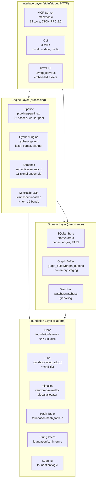
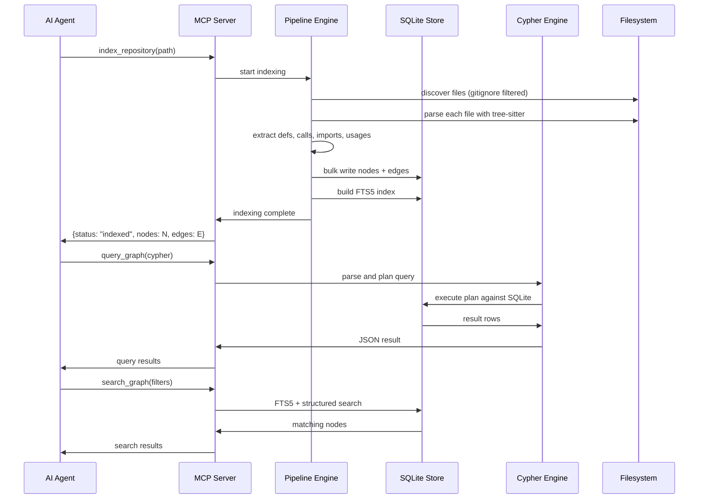

# Architecture: Layer Diagram, Module Map, and Data Flow

The codebase-memory-mcp engine is structured as four horizontal layers, each with clear dependency boundaries. Platform abstractions sit at the bottom, core processing in the middle, and the user-facing interface on top. There are no circular dependencies — every module depends only on layers below it.

## Layer Diagram



All arrows point downward. The interface layer never calls foundation directly — it goes through the engine or storage layers.

## Module Dependency Graph

```mermaid
flowchart TD
    main["main.c\nEntry point"] --> mcp["mcp/\nMCP server"]
    main --> cli["cli/\nCLI commands"]
    main --> ui["ui/\nHTTP server"]
    main --> watcher["watcher/\nAuto-sync"]

    mcp --> pipeline["pipeline/\nIndex orchestrator"]
    mcp --> store["store/\nSQLite storage"]
    mcp --> cypher["cypher/\nQuery engine"]
    mcp --> traces["traces/\nTrace ingestion"]

    pipeline --> discover["discover/\nFile discovery"]
    pipeline --> ext["internal/cbm/\nExtraction engine"]
    pipeline --> registry["pipeline/registry.c\nFunction registry"]
    pipeline --> workers["pipeline/worker_pool.c\nThread pool"]

    pipeline --> semantic["semantic/\nSimilarity ensemble"]
    pipeline --> minhash["simhash/\nMinHash/LSH"]

    store --> sqlite["SQLite3\n(amalgamation)"]
    store --> gb["graph_buffer/\nStaging buffer"]

    discover --> git["git/\nGit context"]
    discover --> lang["discover/language.c\nLanguage detection"]
    discover --> gi["discover/gitignore.c\nGitignore parser"]
    discover --> uc["discover/userconfig.c\n.cbm config"]

    ext --> ts["tree-sitter\n(vendored)"]
    ext --> ac["internal/cbm/ac.c\nAho-Corasick"]
    ext --> lz4["internal/cbm/lz4_store.c\nLZ4 compression"]
    ext --> zstd["internal/cbm/zstd_store.c\nZstd compression"]

    semantic --> nomic["vendored/nomic/\nnomic-embed-code vectors"]
    semantic --> ap["semantic/ast_profile.c\nAST structural profile"]

    ui --> layout["ui/layout3d.c\nBarnes-Hut layout"]
    ui --> httpd["ui/httpd.c\nHTTP handler"]
    ui --> cfg["ui/config.c\nUI config"]

    pipeline -.-> foundation["foundation/\nArena, slab, mem, hash, log"]
    store -.-> foundation
    ext -.-> foundation
    semantic -.-> foundation
```



The dotted lines from pipeline, store, ext, and semantic to foundation indicate that all processing modules share the same platform abstractions but do not depend on each other's foundation calls.

## Directory Structure

The project splits source into two trees: `src/` for the public-facing modules and `internal/cbm/` for the core extraction engine.

```
codebase-memory-mcp/
├── Makefile.cbm                  Build: production, test, TSan, UI, lint, security
├── src/
│   ├── main.c                    Entry: MCP stdio loop, CLI dispatch, install/update
│   ├── mcp/                      MCP server: 14 tools, JSON-RPC 2.0
│   │   ├── mcp.c
│   │   └── mcp.h
│   ├── cli/                      CLI: install, uninstall, update, config, hooks
│   │   ├── cli.c
│   │   ├── cli.h
│   │   ├── progress_sink.c
│   │   └── hook_augment.c
│   ├── store/                    SQLite storage with FTS5
│   │   ├── store.c
│   │   └── store.h
│   ├── pipeline/                 22-pass orchestrator
│   │   ├── pipeline.c
│   │   ├── pipeline_internal.h
│   │   ├── worker_pool.c
│   │   ├── registry.c
│   │   └── pass_*.c              Individual passes
│   ├── cypher/                   Cypher query engine
│   │   ├── cypher.c
│   │   └── cypher.h
│   ├── discover/                 File discovery and filtering
│   │   ├── discover.c
│   │   ├── discover.h
│   │   ├── gitignore.c
│   │   ├── language.c
│   │   └── userconfig.c
│   ├── semantic/                 11-signal similarity ensemble
│   │   ├── semantic.c
│   │   ├── semantic.h
│   │   └── ast_profile.c
│   ├── simhash/                  MinHash + LSH
│   │   ├── minhash.c
│   │   └── minhash.h
│   ├── ui/                       HTTP server and 3D visualization
│   │   ├── http_server.c
│   │   ├── httpd.c
│   │   ├── layout3d.c
│   │   ├── layout3d.h
│   │   ├── config.c
│   │   └── embedded_assets.h
│   ├── traces/                   Runtime trace ingestion
│   │   ├── traces.c
│   │   └── traces.h
│   ├── git/                      Git context extraction
│   │   ├── git_context.c
│   │   └── git_context.h
│   ├── graph_buffer/             In-memory staging
│   │   ├── graph_buffer.c
│   │   └── graph_buffer.h
│   ├── watcher/                  Background auto-sync
│   │   ├── watcher.c
│   │   └── watcher.h
│   └── foundation/               Platform abstractions
│       ├── arena.c/h             Bump allocator
│       ├── slab_alloc.c/h        Thread-local slab
│       ├── mem.c/h               RSS budget tracking
│       ├── vmem.c/h              Virtual memory helpers
│       ├── hash_table.c/h        Hash table
│       ├── str_intern.c/h        String interning
│       ├── str_util.c/h          String utilities
│       ├── log.c/h               Structured logging
│       ├── platform.c/h          OS abstraction
│       ├── constants.h           Named constants
│       ├── diagnostics.c/h       Memory diagnostics
│       ├── profile.c/h           Profiling helpers
│       ├── dump_verify.c/h       DB verification
│       └── compatibility files   compat*.c/h, win_utf8.h
└── internal/cbm/                 Core extraction engine
    ├── cbm.c/h                   Main extraction entry points
    ├── arena.c/h                 Internal arena allocator
    ├── ac.c/h                    Aho-Corasick automaton
    ├── extract_*.c               Per-concern extraction passes
    ├── grammar_*.c               64+ tree-sitter grammar shims
    ├── lz4_store.c               LZ4 compression
    ├── zstd_store.c              Zstd compression
    ├── sqlite_writer.c           Direct SQLite page writer
    ├── preprocessor.cpp          C++ macro expansion
    ├── lsp_all.c                 Unified LSP resolver
    └── vendored/                 tree-sitter, lz4, zstd, mimalloc, xxhash
```

## Data Flow: Index to Query

The end-to-end flow from repository on disk to answerable query has three major stages.



## Communication Protocols

### MCP: JSON-RPC 2.0 over stdio

The MCP server communicates via JSON-RPC 2.0 on stdin/stdout. stderr is reserved exclusively for logging.

Source: `/home/darkvoid/Boxxed/@formulas/src.rust/src.AI/src.CodebaseMemory/codebase-memory-mcp/src/mcp/mcp.c`

```c
// MCP server main loop — reads JSON-RPC from stdin, writes to stdout
// stderr reserved for logging (never write MCP responses to stderr)
int mcp_server_run(cbm_store_t *store, mcp_config_t *config);

// Tool dispatch table
typedef struct {
    const char *name;
    int (*handler)(const char *params_json, char **result_json);
} mcp_tool_t;

// 14 registered tools
static mcp_tool_t tools[] = {
    {"index_repository",   handle_index_repository},
    {"list_projects",      handle_list_projects},
    {"delete_project",     handle_delete_project},
    {"index_status",       handle_index_status},
    {"search_graph",       handle_search_graph},
    {"trace_path",         handle_trace_path},
    {"detect_changes",     handle_detect_changes},
    {"query_graph",        handle_query_graph},
    {"get_graph_schema",   handle_get_graph_schema},
    {"get_code_snippet",   handle_get_code_snippet},
    {"get_architecture",   handle_get_architecture},
    {"search_code",        handle_search_code},
    {"manage_adr",         handle_manage_adr},
    {"ingest_traces",      handle_ingest_traces},
};
```

### SQLite Storage

The store layer uses SQLite3 (amalgamation) with WAL mode, FTS5 full-text search, and bulk write optimization:

Source: `/home/darkvoid/Boxxed/@formulas/src.rust/src.AI/src.CodebaseMemory/codebase-memory-mcp/src/store/store.h`

```c
// Node in the property graph
typedef struct {
    int64_t id;
    const char *project;
    const char *label;          // Function, Class, Method, Module, File, Folder, Package
    const char *name;
    const char *qualified_name;
    const char *file_path;
    int start_line, end_line;
    const char *properties_json;
} cbm_node_t;

// Edge in the property graph
typedef struct {
    int64_t id;
    const char *project;
    int64_t source_id, target_id;
    const char *type;            // CALLS, IMPORTS, USES, INHERITS, etc.
    const char *properties_json;
} cbm_edge_t;
```

### HTTP Server

The embedded HTTP server runs on port 9749 (configurable) and serves the 3D graph visualization with embedded assets:

Source: `/home/darkvoid/Boxxed/@formulas/src.rust/src.AI/src.CodebaseMemory/codebase-memory-mcp/src/ui/http_server.c`

```c
// HTTP server entry point
int http_server_start(cbm_store_t *store, int port);

// Node rendering cap (enforced server-side)
#define CBM_UI_MAX_RENDER_NODES 2000  // default, configurable via env
```

## Performance Architecture

The engine achieves its performance through several design decisions at each layer:

**Foundation Layer:**
- Arena allocator with 64KB blocks (up to 256 blocks, ~16MB max) avoids per-allocation overhead
- Slab allocator for tree-sitter nodes matches SubtreeHeapData size (<=64B tier) with free list
- mimalloc overrides malloc/calloc/realloc globally via vendored static link

**Pipeline Layer:**
- 3-phase parallel pipeline: extract -> registry -> resolve
- Worker pool with auto-detected thread count (based on available CPU cores)
- Registry provides O(1) function lookup via hash table with string interning

**Storage Layer:**
- Bulk writes with synchronous=OFF, then restore to NORMAL
- FTS5 with custom `cbm_camel_split` tokenizer for camelCase/snake_case
- mmap_size = 64MB default for read performance
- 30+ prepared statements reused across the indexing lifecycle

**Semantic Layer:**
- nomic-embed-code vectors stored as int8 (768 dimensions)
- MinHash K=64 with xxHash — 64 permutations per node
- LSH 32 bands x 2 rows — candidate generation in O(N) not O(N^2)

## Aha Moment

**Aha:** The pipeline does not extract everything in one pass. It builds a registry of all definitions first (Phase 2), then resolves calls and imports in Phase 3 using that registry. This means cross-file resolution is a second-pass operation, not an inline decision during AST walking. The registry acts as a global symbol table that every pass consults. This two-pass design keeps the AST walker language-agnostic — the walker produces raw `raw_calls` lists, and resolution is a separate concern. If the author had tried to resolve calls inline during the AST walk, they would have needed language-specific logic for every import system (Python's module path, Go's package path, Rust's crate path, JavaScript's relative vs absolute).

## Key Design Decisions

| Decision | Why | Trade-off |
|----------|-----|-----------|
| Pure C11, not Rust | Deterministic memory, mimalloc override, no GC | Manual memory management, no borrow checker |
| SQLite, not custom graph DB | ACID, FTS5, existing tooling, zero setup | Not a native graph DB — BFS implemented in C |
| Vendored tree-sitter, not system lib | 156 grammars bundled, reproducible builds | Binary size increases with all grammars |
| Three-tier allocator | Per-use-case optimal: arena for temp, slab for tree-sitter, mimalloc for general | Complexity in memory accounting |
| LSH over brute-force Jaccard | O(N) candidate generation vs O(N^2) | May miss very similar pairs that hash to different bands |
| Embedded HTTP assets | No external dependencies, works offline | Frontend updates require recompilation |
| JSON-RPC 2.0 stdio | Works with any MCP client, no network setup | Single-threaded I/O, no concurrent connections |

## Cross-References

- [Foundation Layer](02-foundation-layer.md) for arena, slab, and mimalloc details
- [Pipeline](05-pipeline.md) for the three-phase parallel indexing flow
- [Store](06-store.md) for SQLite schema, FTS5, and bulk write optimization
- [MCP Tools](08-mcp-tools.md) for all 14 tools with full examples
- [Semantic Similarity](09-semantic-similarity.md) for the 11-signal ensemble algorithm
