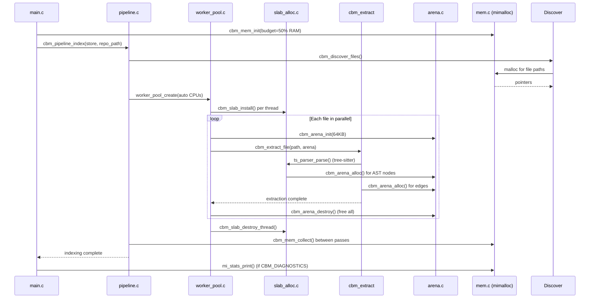
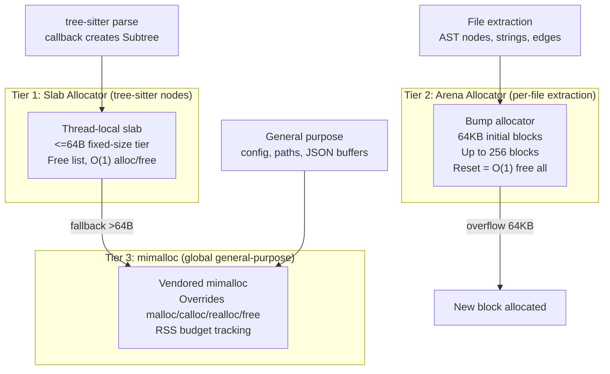

# Foundation Layer: Arena, Slab, mimalloc, Hash Tables, String Interning

The foundation layer provides platform abstractions that every other module depends on: memory allocators (arena, slab, mimalloc), data structures (hash tables, string interning), and utilities (logging, platform compatibility). These are the building blocks — if a module needs to allocate memory, look up a string, or write a log line, it calls into foundation.

## Memory Lifecycle Diagram



## Allocator Comparison Table

| Property | Arena | Slab | mimalloc |
|----------|-------|------|----------|
| **Purpose** | Per-file temp allocations | tree-sitter SubtreeHeapData | General purpose |
| **Lifetime** | Single file parse | Single worker thread | Entire program |
| **Alloc cost** | O(1) bump pointer | O(1) free list pop | O(1) thread-local cache |
| **Free cost** | O(1) reset all | O(1) free list push | O(1) thread-local cache |
| **Block size** | 64KB initial, exponential | Contiguous region | System pages |
| **Max capacity** | 256 blocks (16MB) | Region size | System RAM |
| **Thread safety** | Per-thread (not shared) | Thread-local | Thread-safe |
| **Fragmentation** | None (sequential) | None (fixed-size) | Low (size-segregated) |
| **Fallback** | malloc new block | Falls through to mimalloc | System malloc |

## Memory Allocation Flow

The allocation path for any request follows this decision tree:



**Tier 1 — Slab allocator:** Tree-sitter's internal `SubtreeHeapData` struct is exactly 64 bytes. The slab allocator maintains a free list of pre-allocated 64-byte slots in a contiguous memory region. Allocation and deallocation are both O(1): pop from or push to the free list. If a request exceeds 64 bytes, it falls through to mimalloc.

**Tier 2 — Arena allocator:** Per-file extraction creates hundreds of temporary allocations (AST nodes, string copies, edge records). The arena bumps a pointer through 64KB blocks. When a file is done processing, the entire arena resets in O(1) — no individual frees needed. If a file's extraction exceeds 64KB, a new block is chained (up to 256 blocks, or 16MB per arena).

**Tier 3 — mimalloc:** Everything else uses mimalloc, vendored and statically linked. It overrides the system malloc/calloc/realloc/free, so even code that calls `malloc` directly gets mimalloc's performance. mimalloc tracks RSS (resident set size) for memory budget enforcement. The memory budget is calculated as 50% of total physical RAM (default 0.5).

## Arena Allocator

Source: `/home/darkvoid/Boxxed/@formulas/src.rust/src.AI/src.CodebaseMemory/codebase-memory-mcp/src/foundation/arena.h`

```c
// Bump allocator with chained blocks
// All allocations freed at once via cbm_arena_reset() or cbm_arena_destroy()
typedef struct {
    char *blocks[CBM_ARENA_MAX_BLOCKS];  // Up to 256 block pointers
    size_t block_sizes[CBM_ARENA_MAX_BLOCKS];
    int nblocks;                          // Current block count
    size_t block_size;                    // Initial block size (64KB default)
    size_t used;                          // Bytes used in current block
    size_t total_alloc;                   // Lifetime bytes allocated
} CBMArena;

// Allocate from arena — bumps pointer, no individual free
void *cbm_arena_alloc(CBMArena *arena, size_t size);

// Reset arena for reuse without freeing blocks — O(1)
void cbm_arena_reset(CBMArena *arena);

// Free all blocks — call when arena is no longer needed
void cbm_arena_destroy(CBMArena *arena);

// Defaults
#define CBM_ARENA_DEFAULT_BLOCK_SIZE  (64 * 1024)   // 64KB
#define CBM_ARENA_MAX_BLOCKS          256            // Max 16MB total
```

Source: `/home/darkvoid/Boxxed/@formulas/src.rust/src.AI/src.CodebaseMemory/codebase-memory-mcp/src/foundation/arena.c`

```c
void *cbm_arena_alloc(CBMArena *arena, size_t size) {
    // Align to 8 bytes for compatibility
    size = (size + 7) & ~7;

    // If current block has room, bump
    if (arena->nblocks > 0 && arena->used + size <= arena->block_size) {
        void *ptr = arena->blocks[arena->nblocks - 1] + arena->used;
        arena->used += size;
        arena->total_alloc += size;
        return ptr;
    }

    // Allocate new block (doubles the current block_size)
    if (arena->nblocks >= CBM_ARENA_MAX_BLOCKS) {
        cbm_log_error("Arena exceeded max blocks (%d)\n", CBM_ARENA_MAX_BLOCKS);
        return NULL;
    }

    size_t alloc_size = arena->block_size * 2;  // Double the previous block
    if (alloc_size < size) {
        alloc_size = size;  // Ensure new block fits the request
    }
    arena->blocks[arena->nblocks] = malloc(alloc_size);
    arena->block_sizes[arena->nblocks] = alloc_size;
    arena->nblocks++;
    arena->block_size = alloc_size;
    arena->used = 0;

    return cbm_arena_alloc(arena, size);  // Retry with new block
}
```

The arena doubles the previous block size each time it grows (64KB, 128KB, 256KB...). This means the first few blocks fit small files perfectly while large files get proportionally larger blocks. The reset operation frees all blocks except the first and zeroes `used` — the surviving block stays allocated and reused across files.

**Usage pattern in extraction:**

```c
// In pipeline pass — one arena per file
CBMArena arena;
cbm_arena_init(&arena, CBM_ARENA_DEFAULT_BLOCK_SIZE);

// All allocations during this file's processing use the arena
extract_definitions(ctx, path, &arena);
extract_calls(ctx, path, &arena);
extract_imports(ctx, path, &arena);

// Free everything at once — no individual frees
cbm_arena_destroy(&arena);
```

## Slab Allocator

Source: `/home/darkvoid/Boxxed/@formulas/src.rust/src.AI/src.CodebaseMemory/codebase-memory-mcp/src/foundation/slab_alloc.h`

```c
// Thread-local slab allocator for tree-sitter SubtreeHeapData (64 bytes)
typedef struct {
    char *region;           // Contiguous memory region
    size_t region_size;     // Total region size
    char **free_list;       // Stack of free slot pointers
    int free_count;         // Number of free slots
    int capacity;           // Total slots in region
} CBMSlab;

// Install slab as tree-sitter allocator override (call before parsing)
void cbm_slab_install(CBMSlab *slab);

// Destroy slab and free region (call on thread exit)
void cbm_slab_destroy_thread(CBMSlab *slab);

// Slab allocation — O(1) pop from free list
void *cbm_slab_alloc(CBMSlab *slab);

// Slab deallocation — O(1) push to free list
void cbm_slab_free(CBMSlab *slab, void *ptr);
```

The slab is thread-local because tree-sitter parsing happens in parallel across the worker pool. Each worker thread installs its own slab before parsing, uses it for all tree-sitter allocations during that file, and destroys it when done.

```c
// Worker thread entry point
void *worker_thread(void *arg) {
    CBMSlab slab;
    cbm_slab_init(&slab, SLAB_REGION_SIZE);
    cbm_slab_install(&slab);  // Override tree-sitter's malloc

    // Parse files...
    TSTree *tree = ts_parser_parse(parser, NULL, input);

    cbm_slab_destroy_thread(&slab);  // Restore original allocator
    return NULL;
}
```

The slab's free list is a simple stack. Allocation pops the top pointer; deallocation pushes it back. If the slab runs out of slots, allocation falls through to mimalloc.

## mimalloc Integration

Source: `/home/darkvoid/Boxxed/@formulas/src.rust/src.AI/src.CodebaseMemory/codebase-memory-mcp/src/foundation/mem.h`

```c
// Memory budget tracking via mimalloc RSS
typedef struct {
    size_t budget_bytes;      // ram_fraction * total_physical_ram
    size_t current_rss;       // Current resident set size
    size_t peak_rss;          // Peak RSS observed
    int collect_count;        // Number of cbm_mem_collect() calls
} CBMMemBudget;

// Initialize budget from system RAM
int cbm_mem_init(CBMMemBudget *budget, double ram_fraction);

// Collect unused memory pages — returns pages returned to OS
size_t cbm_mem_collect(void);

// Get current RSS from mimalloc
size_t cbm_mem_rss(void);

// Check if within budget
int cbm_mem_within_budget(const CBMMemBudget *budget);
```

mimalloc is vendored at `vendored/mimalloc/src/static.c` and linked statically. The build uses `-DMI_OVERRIDE=ON` so mimalloc replaces the system malloc, calloc, realloc, and free. The memory budget is calculated as a fraction of total physical RAM (default 0.25, or 25%). When RSS approaches the budget, `cbm_mem_collect()` returns unused pages to the OS between file extractions.

Source: `/home/darkvoid/Boxxed/@formulas/src.rust/src.AI/src.CodebaseMemory/codebase-memory-mcp/src/foundation/mem.c`

```c
// Initialize memory budget — takes RAM fraction, returns 0 on success.
// Budget is a fraction of total physical RAM (default 0.5 = 50%).
int cbm_mem_init(double ram_fraction) {
    size_t total_ram = cbm_get_total_ram();
    size_t budget = (size_t)(total_ram * ram_fraction);

    cbm_log_info("Memory budget: %zu MB (%.0f%% of %zu MB total RAM)\n",
                 budget / (1024*1024),
                 ram_fraction * 100.0,
                 total_ram / (1024*1024));
    return 0;
}
```

## Hash Table

Source: `/home/darkvoid/Boxxed/@formulas/src.rust/src.AI/src.CodebaseMemory/codebase-memory-mcp/src/foundation/hash_table.h`

```c
// Generic hash table with string keys
typedef struct {
    char **keys;
    void **values;
    int *hashes;
    int capacity;
    int count;
    int use_arena;  // If true, keys allocated from arena (no strdup)
} CBMHashTable;

// Create hash table
CBMHashTable *cbm_hash_create(int capacity, int use_arena);

// Insert key-value pair
int cbm_hash_put(CBMHashTable *table, const char *key, void *value);

// Lookup by key
void *cbm_hash_get(CBMHashTable *table, const char *key);

// Remove by key
int cbm_hash_remove(CBMHashTable *table, const char *key);

// Free hash table
void cbm_hash_destroy(CBMHashTable *table);

// Iterate
int cbm_hash_foreach(CBMHashTable *table, int (*cb)(const char *key, void *value, void *ctx), void *ctx);
```

The hash table uses FNV-1a for string hashing and open addressing with linear probing. When `use_arena` is true, keys are allocated from an arena rather than strdup'd, which matters for the registry where keys are interned strings with program lifetime.

```c
// FNV-1a hash for strings
static int fnv1a_hash(const char *key) {
    uint64_t hash = 14695981039346656037ULL;
    for (const char *p = key; *p; p++) {
        hash ^= (uint64_t)(unsigned char)*p;
        hash *= 1099511628211ULL;
    }
    return (int)(hash & 0x7FFFFFFF);
}
```

## String Interning

Source: `/home/darkvoid/Boxxed/@formulas/src.rust/src.AI/src.CodebaseMemory/codebase-memory-mcp/src/foundation/str_intern.h`

```c
// String interning pool — returns canonical pointer for duplicate strings
typedef struct {
    CBMHashTable *table;  // Hash table of interned strings
    CBMArena *arena;      // Arena for new string allocations
} CBMStringPool;

// Intern a string — returns canonical pointer
const char *cbm_pool_intern(CBMStringPool *pool, const char *str);

// Create string pool
CBMStringPool *cbm_pool_new(CBMArena *arena);

// Free string pool
void cbm_pool_free(CBMStringPool *pool);
```

String interning is critical for the registry and graph. When the same function name appears in 50 files (e.g., `__init__` in Python), interning ensures every reference points to the same memory address. Pointer comparison replaces `strcmp` for equality checks, and the hash table uses interned keys so lookups are fast.

```c
const char *cbm_pool_intern(CBMStringPool *pool, const char *str) {
    // Check if already interned
    void *existing = cbm_hash_get(pool->table, str);
    if (existing) return (const char *)existing;

    // New string — allocate from arena and store
    size_t len = strlen(str);
    char *copy = cbm_arena_alloc(pool->arena, len + 1);
    memcpy(copy, str, len + 1);
    cbm_hash_put(pool->table, copy, copy);
    return copy;
}
```

## Structured Logging

Source: `/home/darkvoid/Boxxed/@formulas/src.rust/src.AI/src.CodebaseMemory/codebase-memory-mcp/src/foundation/log.h`

```c
// Log levels
typedef enum {
    CBM_LOG_NONE = 0,
    CBM_LOG_ERROR = 1,
    CBM_LOG_WARN = 2,
    CBM_LOG_INFO = 3,
    CBM_LOG_DEBUG = 4
} CBMLogLevel;

// Set log level (default: CBM_LOG_INFO)
void cbm_log_set_level(CBMLogLevel level);

// Log functions — always write to stderr (stdout reserved for MCP JSON-RPC)
void cbm_log_error(const char *fmt, ...);
void cbm_log_warn(const char *fmt, ...);
void cbm_log_info(const char *fmt, ...);
void cbm_log_debug(const char *fmt, ...);
```

Logging always writes to stderr because stdout is reserved for MCP JSON-RPC 2.0 responses. The log level is controlled by the `CBM_LOG_LEVEL` environment variable.

## Platform Compatibility

The `compat*.c` files provide cross-platform abstractions:

Source: `/home/darkvoid/Boxxed/@formulas/src.rust/src.AI/src.CodebaseMemory/codebase-memory-mcp/src/foundation/compat.h`

```c
// Cross-platform compatibility wrappers
#ifdef _WIN32
    #define cbm_sleep_ms(n) Sleep(n)
    #define cbm_thread_create(fn, arg) _beginthread((fn), 0, (arg))
    // ... Windows-specific implementations
#else
    #define cbm_sleep_ms(n) usleep((n) * 1000)
    #define cbm_thread_create(fn, arg) pthread_create(&(tid), NULL, (fn), (arg))
    // ... POSIX implementations
#endif
```

The project supports Linux, macOS, and Windows through these compatibility layers: `compat_thread.c` for threading, `compat_fs.c` for filesystem operations, `compat_regex.c` for TRE regex on Windows (POSIX regex is used on Unix), and `win_utf8.h` for UTF-8 path handling on Windows.

## Constants

All magic numbers are centralized:

Source: `/home/darkvoid/Boxxed/@formulas/src.rust/src.AI/src.CodebaseMemory/codebase-memory-mcp/src/foundation/constants.h`

```c
// Memory
#define CBM_ARENA_DEFAULT_BLOCK_SIZE  (64 * 1024)
#define CBM_ARENA_MAX_BLOCKS          256

// Buffers
#define CBM_PATH_MAX                  1024
#define CBM_LINE_BUF                  512

// Time
#define CBM_NSEC_PER_SEC              1000000000ULL

// Search
#define CBM_DEFAULT_SEARCH_LIMIT      200
```

## Aha Moment

**Aha:** The arena doubles the previous block size each time it grows (64KB, 128KB, 256KB...) instead of fixed-size allocation. This means small files (the common case) get exactly the memory they need with zero waste, while large files automatically scale up without hitting a hard limit until 16MB. The reset operation is O(1) — it frees all blocks except the first and zeroes the `used` counter. This is why the engine can process 75,000 Linux kernel files in 3 minutes: it allocates memory in bulk per file and frees it all at once, never paying per-allocation overhead during hot paths.

## Cross-References

- [Discovery](03-discovery.md) for how the discovery layer uses string interning for file paths
- [Extraction](04-extraction.md) for how the extraction engine uses the arena per file
- [Pipeline](05-pipeline.md) for how the worker pool uses thread-local slabs
- [Store](06-store.md) for how the hash table is used in the registry
