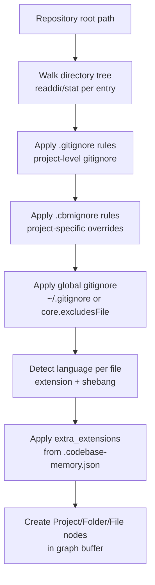
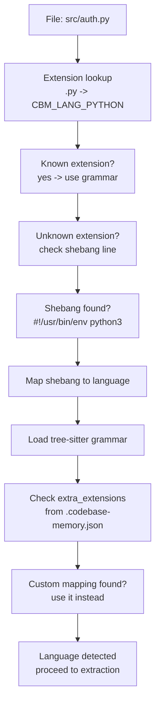

# Discovery: File Discovery, Gitignore, Language Detection, User Config

The discovery module determines which files to index, which to skip, and what language each file is written in. It parses the gitignore hierarchy (project `.gitignore`, `.codebase-memory/ignore`, global gitignore), detects languages by extension and shebang, and reads user configuration for custom extension mappings. This is the first pass in the pipeline — if a file is missed here, it never reaches extraction.

## Discovery Flow



## File Discovery

Source: `/home/darkvoid/Boxxed/@formulas/src.rust/src.AI/src.CodebaseMemory/codebase-memory-mcp/src/discover/discover.h`

```c
// File discovery context
typedef struct {
    const char *root_path;         // Repository root
    cbm_hash_table_t *ignored_dirs; // Directories to skip entirely
    cbm_hash_table_t *ignored_exts; // Extensions to skip
    cbm_hash_table_t *extra_exts;   // Custom extension mappings
    int max_depth;                  // Maximum directory depth
    int file_count;                 // Files discovered
    int ignored_count;              // Files ignored
} cbm_discover_ctx_t;

// Walk directory tree, applying gitignore and cbmignore rules
int cbm_discover_files(cbm_discover_ctx_t *ctx, cbm_array_t *out_files);

// Get relative path from root
const char *cbm_discover_rel_path(cbm_discover_ctx_t *ctx, const char *abs_path);
```

The discovery walks the directory tree using `readdir()` and applies three levels of filtering: gitignore rules, cbmignore rules, and extension-based filtering. It builds arrays of file paths (relative to the repository root) and creates structural nodes (Project, Folder, File) in the graph buffer.

## Language-to-Extension Mapping Flow



Source: `/home/darkvoid/Boxxed/@formulas/src.rust/src.AI/src.CodebaseMemory/codebase-memory-mcp/src/discover/discover.c`

```c
// Always-ignored directories (hardcoded)
static const char *always_ignored[] = {
    ".git", ".svn", ".hg",           // VCS
    "node_modules", "vendor",         // Dependency directories
    ".venv", "venv", "__pycache__",   // Python virtual environments
    ".cbm", "codebase-memory",        // Our own cache directory
    ".cache", ".cargo/registry",      // Build caches
    "target", "build", "dist",        // Build outputs
    NULL
};

// Discovery walks recursively, pruning ignored directories
int cbm_discover_files(cbm_discover_ctx_t *ctx, cbm_array_t *out_files) {
    // Walk tree depth-first
    cbm_array_push(ctx, ctx->root_path);
    while (ctx->stack_count > 0) {
        const char *dir = cbm_array_pop(ctx);
        DIR *d = opendir(dir);
        while ((entry = readdir(d)) != NULL) {
            if (is_ignored(ctx, entry->d_name)) continue;
            if (entry->d_type == DT_DIR) {
                cbm_array_push(ctx, entry_path);
            } else {
                cbm_array_push(out_files, entry_path);
            }
        }
    }
}
```

## Gitignore Parser

Source: `/home/darkvoid/Boxxed/@formulas/src.rust/src.AI/src.CodebaseMemory/codebase-memory-mcp/src/discover/gitignore.h`

```c
// Parsed gitignore rule
typedef struct {
    const char *pattern;     // The pattern string (interned)
    int pattern_len;
    int negate;              // 1 if pattern starts with !
    int dir_only;            // 1 if pattern ends with /
    int anchored;            // 1 if pattern starts with / or contains /
} cbm_gitignore_rule_t;

// Gitignore hierarchy for one repository
typedef struct {
    cbm_gitignore_rule_t *rules;
    int rule_count;
    int rule_capacity;
    const char *root_path;
} cbm_gitignore_t;

// Parse gitignore file into rules
int cbm_gitignore_parse(cbm_gitignore_t *gi, const char *path);

// Check if a path matches any rule (returns 1 if ignored)
int cbm_gitignore_match(cbm_gitignore_t *gi, const char *path, int is_dir);

// Load full gitignore hierarchy (project + global + .git/info/exclude)
int cbm_gitignore_load_hierarchy(cbm_gitignore_t *gi, const char *repo_root);
```

The gitignore parser implements the standard gitignore pattern matching semantics:

| Pattern | Meaning | Example |
|---------|---------|---------|
| `*.pyc` | Match any file ending in `.pyc` | `src/foo.pyc` is ignored |
| `build/` | Match directories named `build` | `build/` is ignored |
| `!important.py` | Negation — un-ignore | Re-ignores `important.py` |
| `/dist` | Anchored — only at root | Root-level `dist/` ignored, nested not |
| `a/**/b` | Double-star — any depth | `a/b`, `a/x/b`, `a/x/y/b` all match |
| `foo` | Unanchored — matches at any level | `foo`, `src/foo`, `a/b/foo` all match |

The parser builds a rule list from multiple sources in order:

1. Global gitignore (`core.excludesFile` from git config, or `~/.gitignore`)
2. Project-level `.gitignore` files (one per directory in the hierarchy)
3. `.git/info/exclude` (local exclusions not committed)
4. `.codebase-memory/ignore` (project-specific overrides)

```c
// Pattern matching uses fnmatch(3) for glob semantics
// Rules are evaluated in order — last matching rule wins
int cbm_gitignore_match(cbm_gitignore_t *gi, const char *path, int is_dir) {
    int ignored = 0;
    for (int i = 0; i < gi->rule_count; i++) {
        if (rule_matches(gi->rules[i], path, is_dir)) {
            ignored = gi->rules[i].negate ? 0 : 1;
        }
    }
    return ignored;
}
```

## Language Detection

Source: `/home/darkvoid/Boxxed/@formulas/src.rust/src.AI/src.CodebaseMemory/codebase-memory-mcp/src/discover/language.h`

```c
// Language ID enumeration — maps to tree-sitter grammar
typedef enum {
    CBM_LANG_UNKNOWN = 0,
    CBM_LANG_C,
    CBM_LANG_CPP,
    CBM_LANG_PYTHON,
    CBM_LANG_RUST,
    // ... 158 total language IDs
    CBM_LANG_COUNT
} CBMLanguage;

// Detect language from file extension
CBMLanguage cbm_lang_from_extension(const char *filename);

// Detect language from shebang line (#!)
CBMLanguage cbm_lang_from_shebang(const char *path);

// Get language name string
const char *cbm_lang_name(CBMLanguage lang);

// Get tree-sitter language pointer
const TSLanguage *cbm_lang_ts_language(CBMLanguage lang);
```

Language detection uses two strategies in order: extension matching and shebang detection. Extension matching covers the vast majority of cases. Shebang detection handles extensionless scripts (shell scripts, Python scripts without `.py` extension, etc.).

Source: `/home/darkvoid/Boxxed/@formulas/src.rust/src.AI/src.CodebaseMemory/codebase-memory-mcp/src/discover/language.c`

```c
// Extension-to-language mapping (excerpt -- 156 languages total)
static const struct { const char *ext; CBMLanguage lang; } ext_map[] = {
    {".c",     CBM_LANG_C},
    {".h",     CBM_LANG_C},
    {".cpp",   CBM_LANG_CPP},
    {".cc",    CBM_LANG_CPP},
    {".py",    CBM_LANG_PYTHON},
    {".pyi",   CBM_LANG_PYTHON},
    {".rs",    CBM_LANG_RUST},
    {".ts",    CBM_LANG_TYPESCRIPT},
    {".tsx",   CBM_LANG_TSX},
    {".js",    CBM_LANG_JAVASCRIPT},
    {".go",    CBM_LANG_GO},
    {".java",  CBM_LANG_JAVA},
    {".rb",    CBM_LANG_RUBY},
    {".swift", CBM_LANG_SWIFT},
    {".kt",    CBM_LANG_KOTLIN},
    {".zig",   CBM_LANG_ZIG},
    // ... 140+ more mappings
    {NULL,     CBM_LANG_UNKNOWN}
};

// Shebang detection
static const struct { const char *shebang; CBMLanguage lang; } shebang_map[] = {
    {"#!/bin/bash",   CBM_LANG_BASH},
    {"#!/usr/bin/env bash", CBM_LANG_BASH},
    {"#!/bin/sh",     CBM_LANG_SH},
    {"#!/usr/bin/python", CBM_LANG_PYTHON},
    {"#!/usr/bin/env python3", CBM_LANG_PYTHON},
    {"#!/usr/bin/env node",  CBM_LANG_JAVASCRIPT},
    {NULL, CBM_LANG_UNKNOWN}
};
```

The language detection feeds directly into tree-sitter grammar selection. Each `CBMLanguage` maps to a `TSLanguage` pointer from the vendored tree-sitter grammars.

## User Configuration

Source: `/home/darkvoid/Boxxed/@formulas/src.rust/src.AI/src.CodebaseMemory/codebase-memory-mcp/src/discover/userconfig.h`

```c
// User configuration for a project
typedef struct {
    char *extra_extensions;   // Custom extension-to-language mappings
    int extra_count;
    char *ignore_patterns;    // Additional patterns to ignore
    int ignore_count;
    int auto_index;           // Auto-index on repository open
    int auto_index_limit;     // Max files for auto-index (default 50000)
} cbm_user_config_t;

// Load user config from .codebase-memory.json
int cbm_user_config_load(cbm_user_config_t *cfg, const char *repo_root);

// Apply extra extensions to language map
int cbm_user_config_apply_extensions(cbm_user_config_t *cfg);
```

Users can customize language detection and discovery through a `.codebase-memory.json` file in the repository root:

```json
{
  "extra_extensions": {
    ".mylang": "python",
    ".custom": "typescript"
  },
  "ignore_patterns": [
    "generated/**",
    "*.min.js"
  ],
  "auto_index": true,
  "auto_index_limit": 100000
}
```

The `extra_extensions` mapping allows users to associate custom file extensions with existing language parsers. The `ignore_patterns` add to the gitignore rules for project-specific exclusions. The `auto_index` flag controls whether the engine automatically indexes on repository open, and `auto_index_limit` caps the file count to prevent runaway indexing.

## Manifest File Parsing

The discovery pass also parses manifest files to create Package nodes and understand project structure:

| Manifest File | Language Ecosystem | Parsed Fields |
|---------------|-------------------|---------------|
| `package.json` | JavaScript/TypeScript | name, dependencies, scripts |
| `Cargo.toml` | Rust | name, dependencies, features |
| `go.mod` | Go | module path, dependencies |
| `pyproject.toml` | Python | project name, dependencies |
| `requirements.txt` | Python | package list |
| `Gemfile` | Ruby | gem dependencies |
| `pom.xml` | Java/Maven | groupId, artifactId, dependencies |
| `CMakeLists.txt` | C/C++ | project name, targets |
| `Makefile` | Any | targets, dependencies |
| `tsconfig.json` | TypeScript | include, exclude paths |

Source: `/home/darkvoid/Boxxed/@formulas/src.rust/src.AI/src.CodebaseMemory/codebase-memory-mcp/src/pipeline/pass_pkgmap.c`

```c
// Parse manifest files to create Package nodes
int pass_pkgmap(cbm_pipeline_t *pipeline) {
    cbm_array_t manifests;
    cbm_array_init(&manifests);

    // Scan for known manifest files
    for (int i = 0; i < pipeline->file_count; i++) {
        const char *fname = path_basename(pipeline->files[i]);
        if (is_manifest(fname)) {
            cbm_array_push(&manifests, pipeline->files[i]);
        }
    }

    // Parse each manifest, create Package nodes
    for (int i = 0; i < manifests.count; i++) {
        parse_manifest(pipeline, manifests.items[i]);
    }
}
```

## Aha Moment

**Aha:** The discovery pass is not just file enumeration — it creates structural nodes (Project, Folder, Package, File) that become part of the knowledge graph. This means the graph knows about the directory structure itself, not just the code within files. When an agent queries "show me all functions in the `src/auth/` folder," the query uses the folder nodes as anchors, not path prefix matching. The same graph stores both structure and semantics, so traversal works uniformly across both.

## Cross-References

- [Pipeline](05-pipeline.md) for how discovery integrates into the three-phase pipeline
- [Extraction](04-extraction.md) for how detected languages map to tree-sitter grammars
- [Store](06-store.md) for how structural nodes are persisted in SQLite
- [CLI and Install](10-cli-install.md) for the `.codebase-memory.json` configuration format
