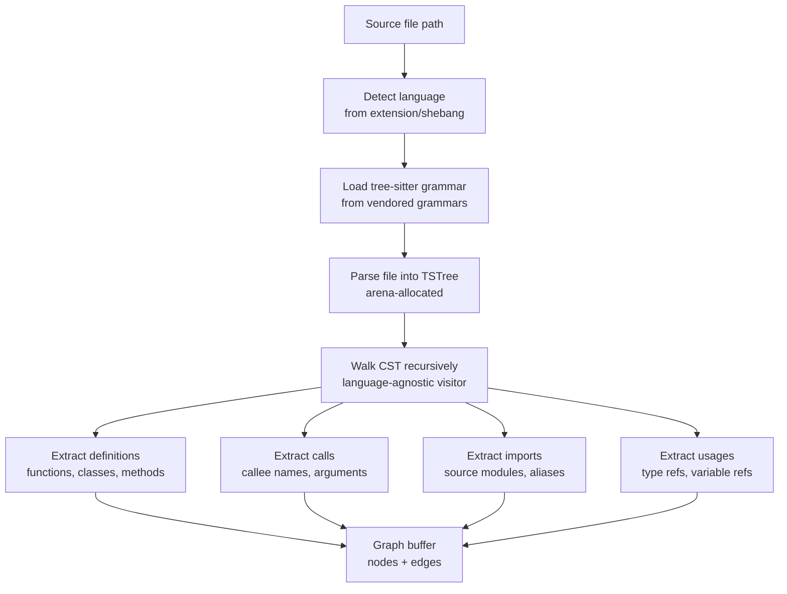
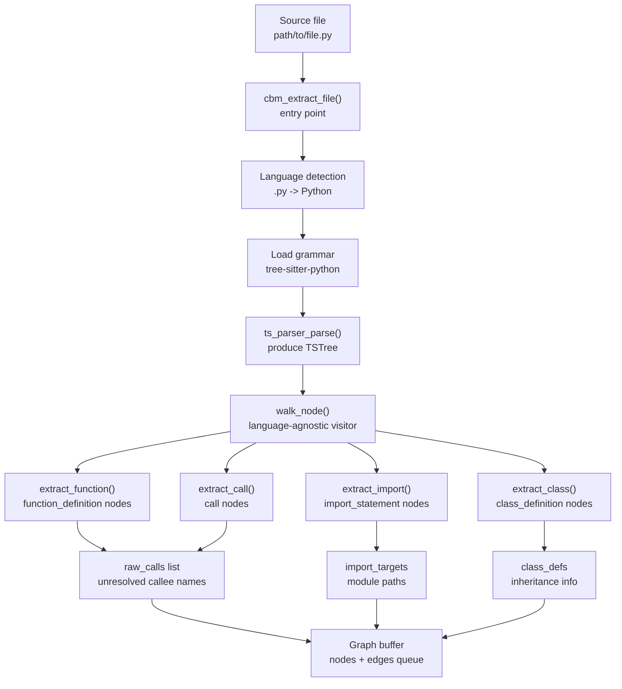

# Extraction: Core Engine, Tree-Sitter AST, 158 Language Grammars

The extraction engine is the heart of codebase-memory-mcp. It uses tree-sitter to parse source files into concrete syntax trees, then walks those trees to extract definitions, calls, imports, usages, test associations, HTTP routes, and more. It supports 158 languages through vendored tree-sitter grammars and produces a stream of nodes and edges that the pipeline writes to the SQLite store.

## Extraction Architecture



## Extraction Data Flow



## Core Extraction Entry Point

Source: `/home/darkvoid/Boxxed/@formulas/src.rust/src.AI/src.CodebaseMemory/codebase-memory-mcp/internal/cbm/cbm.h`

```c
// Extraction context — carried through one file's processing
typedef struct {
    const char *file_path;        // Absolute path to source file
    const char *rel_path;         // Relative path from repo root
    CBMLanguage language;         // Detected language
    TSLanguage *ts_lang;          // Tree-sitter language pointer
    TSTree *tree;                 // Parsed syntax tree
    TSParser *parser;             // Tree-sitter parser instance
    CBMArena *arena;              // Per-file arena for allocations
    CBMStringPool *pool;          // String interning pool
    cbm_graph_buffer_t *buffer;   // Output: nodes and edges
    int extract_budget;           // Max bytes for this file (5MB default)
    int error_count;              // Extraction error count
} cbm_ctx_t;

// Extract one file: parse, walk, emit nodes/edges
int cbm_extract_file(cbm_ctx_t *ctx, const char *path, CBMArena *arena);

// Parse file into syntax tree using tree-sitter
TSTree *cbm_parse_file(cbm_ctx_t *ctx, const char *path);

// Walk the syntax tree with the language-agnostic visitor
int cbm_walk_tree(cbm_ctx_t *ctx, TSTree *tree);
```

Source: `/home/darkvoid/Boxxed/@formulas/src.rust/src.AI/src.CodebaseMemory/codebase-memory-mcp/internal/cbm/cbm.c`

```c
int cbm_extract_file(cbm_ctx_t *ctx, const char *path, CBMArena *arena) {
    ctx->file_path = path;
    ctx->arena = arena;

    // Step 1: Detect language
    ctx->language = cbm_lang_from_extension(path);
    if (ctx->language == CBM_LANG_UNKNOWN) {
        ctx->language = cbm_lang_from_shebang(path);
    }
    if (ctx->language == CBM_LANG_UNKNOWN) {
        return CBM_SKIP;  // No grammar available
    }

    // Step 2: Load tree-sitter grammar
    ctx->ts_lang = cbm_lang_ts_language(ctx->language);
    if (!ctx->ts_lang) {
        return CBM_SKIP;
    }

    // Step 3: Parse file
    ctx->parser = ts_parser_new();
    ts_parser_set_language(ctx->parser, ctx->ts_lang);
    ctx->tree = cbm_parse_file(ctx, path);
    if (!ctx->tree) {
        ts_parser_delete(ctx->parser);
        return CBM_PARSE_ERROR;
    }

    // Step 4: Walk tree and extract
    cbm_walk_tree(ctx, ctx->tree);

    // Step 5: Clean up parser and tree
    ts_tree_delete(ctx->tree);
    ts_parser_delete(ctx->parser);
    ctx->tree = NULL;
    ctx->parser = NULL;

    return CBM_OK;
}
```

## Tree-Sitter Grammar Support

The project vendors 158 tree-sitter grammars in `internal/cbm/grammar_*.c`. Each grammar is a thin wrapper around the upstream tree-sitter grammar, providing the `TSLanguage` pointer and query definitions.

```
internal/cbm/
  grammar_python.c    Python grammar (tree-sitter-python)
  grammar_rust.c      Rust grammar (tree-sitter-rust)
  grammar_typescript.c TypeScript grammar (tree-sitter-typescript)
  grammar_javascript.c JavaScript grammar (tree-sitter-javascript)
  grammar_go.c        Go grammar (tree-sitter-go)
  grammar_java.c      Java grammar (tree-sitter-java)
  grammar_c.c         C grammar (tree-sitter-c)
  grammar_cpp.c       C++ grammar (tree-sitter-cpp)
  grammar_ruby.c      Ruby grammar (tree-sitter-ruby)
  grammar_swift.c     Swift grammar (tree-sitter-swift)
  ... 148 more
```

Each grammar file provides:

```c
// Example: grammar_python.c
const TSLanguage *tree_sitter_python(void);

// Language-specific node type names
static const char *python_function_node = "function_definition";
static const char *python_class_node = "class_definition";
static const char *python_import_node = "import_statement";
static const char *python_call_node = "call";
static const char *python_name_node = "identifier";
```

The grammar shims abstract away the differences between tree-sitter grammars. The language-agnostic walker uses `LanguageConfig` structures that map generic concepts (function node, class node, import node) to language-specific tree-sitter node type names.

## Language-AST Walker

The core walker is language-agnostic. It uses a `LanguageConfig` to translate between generic extraction concepts and language-specific tree-sitter node types:

Source: `/home/darkvoid/Boxxed/@formulas/src.rust/src.AI/src.CodebaseMemory/codebase-memory-mcp/internal/cbm/cbm.c`

```c
// Language-specific configuration for the language-agnostic walker
typedef struct {
    const char *function_node;      // "function_definition" (Python), "function_declaration" (TS)
    const char *class_node;         // "class_definition" (Python), "class_declaration" (TS)
    const char *method_node;        // "function_definition" inside class (Python)
    const char *import_node;        // "import_statement" (Python), "import_declaration" (Go)
    const char *call_node;          // "call" (most languages)
    const char *name_node;          // "identifier" (most languages)
    const char *parameter_node;     // "parameter" / "typed_parameter"
    const char *return_type_node;   // Language-specific return type node
    const char *decorator_node;     // "decorator" (Python), "@" (Java)
    const char *comment_node;       // "comment" (most languages)
    const char *string_node;        // "string" / "string_literal"
} LanguageConfig;

// Get language config for current language
const LanguageConfig *get_lang_config(CBMLanguage lang);
```

```c
// The language-agnostic recursive AST walker
static void walk_node(cbm_ctx_t *ctx, TSNode node) {
    const LanguageConfig *config = get_lang_config(ctx->language);
    const char *type = ts_node_type(node);

    // Check for function/class definitions
    if (strcmp(type, config->function_node) == 0) {
        extract_function(ctx, node);
    }
    if (strcmp(type, config->class_node) == 0) {
        extract_class(ctx, node);
    }

    // Check for calls
    if (strcmp(type, config->call_node) == 0) {
        extract_call(ctx, node);
    }

    // Check for imports
    if (strcmp(type, config->import_node) == 0) {
        extract_import(ctx, node);
    }

    // Recurse into children
    for (uint32_t i = 0; i < ts_node_child_count(node); i++) {
        TSNode child = ts_node_child(node, i);
        walk_node(ctx, child);
    }
}
```

## Per-Concept Extraction

Each extraction concern is implemented in its own file under `internal/cbm/extract_*.c`:

| File | Extracts | Node Types Created | Edge Types Created |
|------|----------|-------------------|-------------------|
| `extract_defs.c` | Functions, classes, methods, variables | Function, Class, Method, Variable | DEFINES |
| `extract_calls.c` | Function/method calls | — | CALLS |
| `extract_imports.c` | Import statements, requires | — | IMPORTS |
| `extract_usages.c` | Type references, variable usages | — | USES, TYPE_REF |
| `extract_tests.c` | Test functions, test files | Test | TESTS |
| `extract_routes.c` | HTTP route handlers | HTTPRoute | ROUTES |
| `extract_decorators.c` | Decorator/annotation patterns | — | DECORATES |
| `extract_complexity.c` | Cyclomatic complexity | — | (property on node) |

Source: `/home/darkvoid/Boxxed/@formulas/src.rust/src.AI/src.CodebaseMemory/codebase-memory-mcp/internal/cbm/extract_defs.c`

```c
// Extract a function definition from AST node
void extract_function(cbm_ctx_t *ctx, TSNode node) {
    // Get function name
    TSNode name_node = get_child_by_type(node, "identifier");
    const char *name = ts_node_text(name_node, ctx->source);

    // Get line range
    uint32_t start = ts_node_start_line(node) + 1;
    uint32_t end = ts_node_end_line(node) + 1;

    // Get parameters
    cbm_array_t params;
    extract_parameters(ctx, node, &params);

    // Get return type
    const char *return_type = extract_return_type(ctx, node);

    // Get decorators
    cbm_array_t decorators;
    extract_decorators(ctx, node, &decorators);

    // Build qualified name (e.g., "auth.digest_auth")
    char *qname = build_qualified_name(ctx, name);

    // Emit node to graph buffer
    cbm_node_t *n = cbm_buffer_add_node(ctx->buffer);
    n->label = "Function";
    n->name = cbm_pool_intern(ctx->pool, name);
    n->qualified_name = cbm_pool_intern(ctx->pool, qname);
    n->file_path = ctx->rel_path;
    n->start_line = start;
    n->end_line = end;

    // Store metadata as JSON property
    set_property(n, "params", params_json);
    set_property(n, "return_type", return_type);
    set_property(n, "decorators", decorators_json);
}
```

Source: `/home/darkvoid/Boxxed/@formulas/src.rust/src.AI/src.CodebaseMemory/codebase-memory-mcp/internal/cbm/extract_calls.c`

```c
// Extract a function call from AST node
void extract_call(cbm_ctx_t *ctx, TSNode node) {
    // Get callee name
    TSNode callee = ts_node_child(node, 0);
    const char *callee_name = ts_node_text(callee, ctx->source);

    // Member calls (obj.method) are NOT resolved cross-file
    // Only bare function names are resolved to avoid false positives
    if (is_member_call(node)) {
        return;  // Skip member calls — too many false positives
    }

    // Record raw call for later resolution
    cbm_raw_call_t *raw = cbm_arena_alloc(ctx->arena, sizeof(*raw));
    raw->callee = cbm_pool_intern(ctx->pool, callee_name);
    raw->caller = ctx->current_function;
    raw->file = ctx->rel_path;
    raw->line = ts_node_start_line(node) + 1;
    cbm_array_push(&ctx->raw_calls, raw);
}
```

## Aho-Corasick Fast Path

The extraction engine uses Aho-Corasick with a 64-bit bitmask for fast pattern matching during extraction:

Source: `/home/darkvoid/Boxxed/@formulas/src.rust/src.AI/src.CodebaseMemory/codebase-memory-mcp/internal/cbm/ac.h`

```c
// Aho-Corasick automaton with bitmask output
typedef struct {
    cbm_ac_state_t *states;       // State machine states
    uint64_t *output_masks;       // Bitmask of matched pattern IDs per state
    int num_states;
    uint8_t alphabet[256];        // Alphabet mapping for transition table
} cbm_ac_t;

// Build automaton from patterns
int cbm_ac_build(cbm_ac_t *ac, const char **patterns, int num_patterns);

// Scan buffer — returns 64-bit bitmask of matched pattern IDs
uint64_t cbm_ac_scan(cbm_ac_t *ac, const char *buffer, int len);

// Scan LZ4-compressed buffer directly (no decompression needed)
uint64_t cbm_ac_scan_lz4(cbm_ac_t *ac, const char *compressed, int compressed_len);

// Batch scan multiple buffers
void cbm_ac_batch_scan(cbm_ac_t *ac, cbm_ac_input_t *inputs, int count, uint64_t *results);
```

The Aho-Corasick automaton is built from a set of patterns (e.g., known HTTP endpoint patterns, known library function names). During extraction, instead of running regex or string matching per pattern, the engine scans the entire file content once and gets back a 64-bit bitmask where each bit represents a matched pattern. This is used for:

1. **HTTP route detection:** Pattern-matching route decorators and handler registrations
2. **Library function identification:** Fast identification of calls to known libraries
3. **LZ4 compressed scanning:** Scanning compressed graph data without decompression

## Node and Edge Types

The extraction engine produces these node types:

| Node Type | Description | Created By |
|-----------|-------------|-----------|
| Project | Repository root | Discovery pass |
| Package | npm package, Cargo crate, Go module | pass_pkgmap |
| Folder | Directory | Discovery pass |
| File | Source file | Discovery pass |
| Function | Top-level function | extract_defs.c |
| Class | Class/type declaration | extract_defs.c |
| Method | Method inside class | extract_defs.c |
| Module | Module/namespace | extract_defs.c |
| Variable | Top-level variable | extract_defs.c |
| HTTPRoute | HTTP endpoint | extract_routes.c |
| Test | Test function/file | extract_tests.c |
| Config | Configuration file | pass_configlink |
| ADR | Architecture Decision Record | manage_adr tool |

And these edge types:

| Edge Type | Source -> Target | Description | Created By |
|-----------|-----------------|-------------|-----------|
| DEFINES | File -> Function/Class | "this file defines this" | extract_defs.c |
| CALLS | Function -> Function | "this function calls that" | extract_calls.c + registry |
| IMPORTS | File -> Module | "this file imports that module" | extract_imports.c |
| USES | Function -> Variable | "this function uses this variable" | extract_usages.c |
| TYPE_REF | Function -> Class | "this function references this type" | extract_usages.c |
| INHERITS | Class -> Class | "this class inherits from that" | extract_defs.c |
| IMPLEMENTS | Class -> Interface | "this class implements that interface" | extract_defs.c |
| DECORATES | Decorator -> Function | "this decorator decorates this function" | extract_decorators.c |
| TESTS | Test -> Function/Class | "this test tests this" | extract_tests.c |
| ROUTES | HTTPRoute -> Function | "this route is handled by this function" | extract_routes.c |
| HTTP_CALLS | Function -> HTTPRoute | "this function calls this HTTP endpoint" | traces + extraction |
| SIMILAR_TO | Node -> Node | "these nodes are structurally similar" | pass_similarity |
| SEMANTICALLY_RELATED | Node -> Node | "these nodes are semantically related" | pass_semantic_edges |

## Extraction Budget

The engine enforces a 5MB extraction budget per file to prevent runaway parsing of generated or minified files:

Source: `/home/darkvoid/Boxxed/@formulas/src.rust/src.AI/src.CodebaseMemory/codebase-memory-mcp/src/foundation/constants.h`

```c
#define CBM_EXTRACT_BUDGET  5000000  // 5MB max tree-sitter extraction per file
```

If a file's syntax tree exceeds this budget, extraction stops and the file is logged as skipped. This protects against pathological cases like auto-generated JavaScript bundles or minified libraries that accidentally end up in the source tree despite gitignore rules.

## Aha Moment

**Aha:** Member calls (`obj.method()`) are intentionally NOT resolved cross-file. The extraction engine only records bare function calls in `raw_calls`, and the registry resolves those. The reason is that common method names like `log()`, `run()`, `init()`, `handle()` appear in thousands of classes across thousands of files. Resolving `obj.log()` cross-file would produce millions of false positive edges. By excluding member calls, the engine trades completeness for precision — every CALLS edge that exists is high-confidence, and the graph stays navigable.

## Cross-References

- [Pipeline](05-pipeline.md) for how extraction integrates into the three-phase pipeline
- [Foundation Layer](02-foundation-layer.md) for the arena and slab allocators used during extraction
- [Store](06-store.md) for how extracted nodes and edges are persisted
- [Semantic Similarity](09-semantic-similarity.md) for how extracted data feeds the similarity engine
