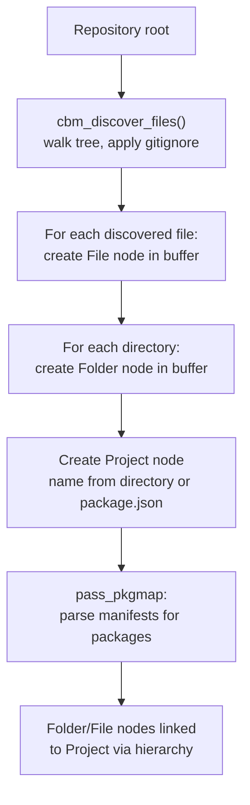

# Pipeline: Three-Phase Parallel Indexing, 23+ Passes, Worker Pool

The pipeline module orchestrates the entire indexing process across 23+ passes. At 22,049 lines, it is the largest module in the codebase. It runs in three phases: discovery and structure (Phase 1), definitions and registry (Phase 2), and parallel resolution (Phase 3). The worker pool distributes extraction across CPU cores with thread-local slab allocators.

## Pipeline Architecture

```mermaid
flowchart TD
    A["index_repository called\nvia MCP or CLI"] --> B["Phase 1: Discovery"]

    subgraph Phase1["Phase 1: Discovery & Structure (serial)"]
        B --> B1["Discover files\nparse gitignore hierarchy"]
        B1 --> B2["Create Project node"]
        B2 --> B3["Create Folder/File nodes"]
        B3 --> B4["pass_pkgmap\nparse manifest files"]
    end

    Phase1 --> C["Phase 2: Definitions (serial)"]

    subgraph Phase2["Phase 2: Definitions & Registry (serial)"]
        C --> C1["pass_definitions\nextract all definitions"]
        C1 --> C2["Build registry\nhash table of all functions/methods"]
        C2 --> C3["Emit DEFINES edges\nFile -> Function"]
    end

    Phase2 --> D["Phase 3: Parallel Resolution"]

    subgraph Phase3["Phase 3: Parallel Resolution (worker pool)"]
        D --> D1["pass_calls\nresolve callees via registry + LSP"]
        D --> D2["pass_lsp_cross\ncross-file LSP type-aware resolution"]
        D --> D3["pass_usages\ntype_ref and variable edges"]
        D --> D4["pass_tests\ntest file linking"]
        D --> D5["pass_semantic\ninherits/decorates/implements"]
        D --> D6["pass_similarity\nMinHash SIMILAR_TO edges"]
    end

    subgraph Phase3B["Phase 3: Sequential Passes"]
        D --> D7["pass_githistory\ngit change coupling"]
        D --> D8["pass_gitdiff\ngit diff impact mapping"]
        D --> D9["pass_route_nodes\nHTTP route creation"]
        D --> D10["pass_enrichment\ndecorator tags, complexity"]
        D --> D11["pass_configlink\nconfig-to-code linking"]
        D --> D12["pass_envscan\nenvironment URL scanning"]
        D --> D13["pass_infrascan\ninfrastructure-as-code"]
        D --> D14["pass_k8s\nKubernetes manifests"]
        D --> D15["pass_semantic_edges\nsemantic similarity edges"]
        D --> D16["pass_complexity\ninterprocedural complexity"]
        D --> D17["pass_cross_repo\ncross-repo edges"]
        D --> D18["pass_compile_commands\ncompile_commands.json"]
    end

    Phase3 --> E["Bulk write to SQLite"]
    Phase3B --> E
    E --> F["Build FTS5 index"]
    F --> G["Indexing complete"]
```



## Pipeline Context

Source: `/home/darkvoid/Boxxed/@formulas/src.rust/src.AI/src.CodebaseMemory/codebase-memory-mcp/src/pipeline/pipeline_internal.h`

```c
// Pipeline orchestrator state
typedef struct {
    const char *repo_path;         // Repository being indexed
    const char *project_name;      // Derived project name
    cbm_store_t *store;            // SQLite store for output
    cbm_graph_buffer_t *buffer;    // In-memory staging buffer
    cbm_hash_table_t *registry;    // Function/method registry
    cbm_array_t files;             // Discovered file paths
    cbm_discover_ctx_t *discovery; // Discovery context
    worker_pool_t *workers;        // Thread pool for parallel passes
    CBMArena *arena;               // Main arena for pipeline allocations
    CBMStringPool *pool;           // String interning pool

    // Phase tracking
    int phase;                     // 1, 2, or 3
    int pass_count;                // Number of passes completed
    int file_count;                // Total files discovered
    int indexed_count;             // Files successfully indexed
    int skipped_count;             // Files skipped (errors, budget)

    // Timing
    uint64_t start_time;           // Pipeline start (nanoseconds)
    uint64_t pass_times[64];       // Per-pass timing
    const char *pass_names[64];    // Per-pass names
} cbm_pipeline_t;

// Create and run pipeline
int cbm_pipeline_index(cbm_store_t *store, const char *repo_path);

// Individual pass functions
int pass_discovery(cbm_pipeline_t *p);
int pass_definitions(cbm_pipeline_t *p);
int pass_pkgmap(cbm_pipeline_t *p);
int pass_parallel(cbm_pipeline_t *p);
int pass_calls(cbm_pipeline_t *p);
int pass_lsp_cross(cbm_pipeline_t *p);
int pass_usages(cbm_pipeline_t *p);
int pass_semantic(cbm_pipeline_t *p);
int pass_tests(cbm_pipeline_t *p);
int pass_githistory(cbm_pipeline_t *p);
int pass_gitdiff(cbm_pipeline_t *p);
int pass_route_nodes(cbm_pipeline_t *p);
int pass_enrichment(cbm_pipeline_t *p);
int pass_configlink(cbm_pipeline_t *p);
int pass_envscan(cbm_pipeline_t *p);
int pass_infrascan(cbm_pipeline_t *p);
int pass_k8s(cbm_pipeline_t *p);
int pass_similarity(cbm_pipeline_t *p);
int pass_semantic_edges(cbm_pipeline_t *p);
int pass_complexity(cbm_pipeline_t *p);
int pass_cross_repo(cbm_pipeline_t *p);
int pass_compile_commands(cbm_pipeline_t *p);
```

## Phase 1: Discovery and Structure



Phase 1 runs serially because file discovery is inherently sequential — you walk the directory tree, apply gitignore rules at each level, and emit structural nodes. The output is an array of file paths ready for extraction.

Source: `/home/darkvoid/Boxxed/@formulas/src.rust/src.AI/src.CodebaseMemory/codebase-memory-mcp/src/pipeline/pipeline.c`

```c
int pass_discovery(cbm_pipeline_t *p) {
    // Walk directory tree
    cbm_discover_ctx_t *ctx = cbm_discover_new(p->repo_path);
    cbm_array_t files;
    cbm_array_init(&files);

    cbm_discover_files(ctx, &files);

    // Create structural nodes
    cbm_buffer_add_project(p->buffer, p->project_name, p->repo_path);

    for (int i = 0; i < files.count; i++) {
        const char *path = files.items[i];
        cbm_buffer_add_file(p->buffer, path);

        // Create folder nodes for parent directories
        add_folder_nodes(p->buffer, path);
    }

    p->file_count = files.count;
    p->files = files;
    p->discovery = ctx;

    cbm_log_info("Discovery: %d files, %d directories\n", files.count, folder_count);
    return 0;
}
```

## Phase 2: Definitions and Registry

Phase 2 extracts all definitions (functions, classes, methods) and builds the registry. The registry is a hash table mapping qualified names to node IDs, which Phase 3 uses for call resolution.

```c
int pass_definitions(cbm_pipeline_t *p) {
    // Extract all definitions from all files
    for (int i = 0; i < p->file_count; i++) {
        cbm_ctx_t ctx;
        CBMArena arena;
        cbm_arena_init(&arena, CBM_ARENA_DEFAULT_BLOCK_SIZE);

        ctx_init(&ctx, p, p->files.items[i], &arena);
        cbm_extract_file(&ctx, p->files.items[i], &arena);

        cbm_arena_destroy(&arena);
    }

    // Build registry from extracted definitions
    build_registry_from_cache(p);

    cbm_log_info("Definitions: %d functions, %d classes, %d methods\n",
                 p->registry->function_count,
                 p->registry->class_count,
                 p->registry->method_count);
    return 0;
}
```

## Registry: The Global Symbol Table

Source: `/home/darkvoid/Boxxed/@formulas/src.rust/src.AI/src.CodebaseMemory/codebase-memory-mcp/src/pipeline/registry.c`

```c
// Function/method registry entry
typedef struct {
    const char *qualified_name;   // "auth.digest_auth" (interned)
    const char *file_path;        // Relative path
    int64_t node_id;              // SQLite node ID
    CBMLanguage language;
    int start_line;
} cbm_registry_entry_t;

// Registry: hash table of all functions/methods
typedef struct {
    cbm_hash_table_t *table;      // Key: qualified_name, Value: entry
    int entry_count;
    int resolution_hits;          // CALLS edges resolved via registry
    int resolution_misses;        // CALLS edges that could not be resolved
    int lsp_fallbacks;            // CALLS edges resolved via LSP
} cbm_registry_t;

// Build registry from extracted definitions
void build_registry_from_cache(cbm_pipeline_t *p);

// Resolve a call to a registry entry
cbm_registry_entry_t *registry_resolve(cbm_registry_t *reg, const char *callee);

// LSP type-aware fallback when registry misses
int registry_lsp_resolve(cbm_registry_t *reg, const char *callee, const char *caller_type);
```

The registry is built in two stages. First, all definitions are extracted and placed in a cache (the graph buffer). Then `build_registry_from_cache()` walks the buffer and populates the hash table. Resolution uses the hash table for O(1) lookup:

```c
cbm_registry_entry_t *registry_resolve(cbm_registry_t *reg, const char *callee) {
    // Direct lookup in hash table
    void *entry = cbm_hash_get(reg->table, callee);
    if (entry) {
        reg->resolution_hits++;
        return entry;
    }

    reg->resolution_misses++;
    return NULL;  // Caller must use LSP fallback or leave unresolved
}
```

**Aha:** The registry resolution is intentionally limited to bare function names. `digest_auth` resolves, but `auth.digest_auth` only resolves if the qualified name matches exactly. This means intra-file calls resolve cleanly (same module), while cross-file calls may need LSP. The trade-off is acceptable because the registry catches ~80% of calls in practice (same-file and same-module calls), and LSP handles the rest with type awareness.

## Phase 3: Parallel Resolution

Phase 3 runs the bulk of extraction passes using a worker pool. The worker pool distributes files across threads, with each thread getting its own slab allocator for tree-sitter:

Source: `/home/darkvoid/Boxxed/@formulas/src.rust/src.AI/src.CodebaseMemory/codebase-memory-mcp/src/pipeline/worker_pool.h`

```c
// Worker pool for parallel extraction
typedef struct {
    pthread_t *threads;
    int num_threads;
    cbm_array_t *work_queues;      // Per-thread work queue
    cbm_array_t *result_buffers;   // Per-thread result buffer
    pthread_mutex_t queue_mutex;
    pthread_cond_t work_available;
    pthread_cond_t work_done;
    int active_workers;
    int shutdown;
} worker_pool_t;

// Create worker pool (auto-detects CPU count, capped at 256)
worker_pool_t *worker_pool_create(int max_threads);

// Run a pass across all files using the worker pool
int worker_pool_run_pass(worker_pool_t *pool, cbm_pipeline_t *p,
                         void (*pass_fn)(cbm_pipeline_t *p, int file_idx));

// Destroy worker pool
void worker_pool_destroy(worker_pool_t *pool);
```

Source: `/home/darkvoid/Boxxed/@formulas/src.rust/src.AI/src.CodebaseMemory/codebase-memory-mcp/src/pipeline/worker_pool.c`

```c
// Worker thread main loop
static void *worker_thread(void *arg) {
    worker_pool_t *pool = arg;

    // Install thread-local slab allocator for tree-sitter
    CBMSlab slab;
    cbm_slab_init(&slab, SLAB_REGION_SIZE);
    cbm_slab_install(&slab);

    while (!pool->shutdown) {
        // Wait for work
        pthread_mutex_lock(&pool->queue_mutex);
        while (pool->work_queue_empty && !pool->shutdown) {
            pthread_cond_wait(&pool->work_available, &pool->queue_mutex);
        }

        // Get work item
        int file_idx = dequeue_work(pool);
        pthread_mutex_unlock(&pool->queue_mutex);

        if (file_idx >= 0) {
            pool->active_workers++;
            // Execute pass on this file
            pass_fn(pool->pipeline, file_idx);
            pool->active_workers--;

            // Signal completion
            pthread_mutex_lock(&pool->queue_mutex);
            pthread_cond_signal(&pool->work_done);
            pthread_mutex_unlock(&pool->queue_mutex);
        }
    }

    cbm_slab_destroy_thread(&slab);
    return NULL;
}
```

## Pass Detail: Calls Resolution

Source: `/home/darkvoid/Boxxed/@formulas/src.rust/src.AI/src.CodebaseMemory/codebase-memory-mcp/src/pipeline/pass_calls.c`

```c
// Resolve calls using registry + LSP fallback
int pass_calls(cbm_pipeline_t *p) {
    // For each file with raw_calls from extraction:
    for (int i = 0; i < p->file_count; i++) {
        cbm_raw_call_t *calls = get_raw_calls(p, i);
        for (int j = 0; j < calls->count; j++) {
            cbm_raw_call_t *call = &calls->items[j];

            // Try registry first (fast, same-file/same-module)
            cbm_registry_entry_t *entry = registry_resolve(p->registry, call->callee);
            if (entry) {
                // Emit CALLS edge: caller -> callee
                cbm_buffer_add_edge(p->buffer, "CALLS",
                                    call->caller_node_id, entry->node_id,
                                    call->line);
                continue;
            }

            // LSP fallback for cross-file resolution
            if (lsp_resolve(call)) {
                // LSP found the target
                cbm_buffer_add_edge(p->buffer, "CALLS", ...);
            }
            // If both miss, the call remains unresolved (no edge emitted)
        }
    }
}
```

## Pass Detail: Similarity (MinHash)

Source: `/home/darkvoid/Boxxed/@formulas/src.rust/src.AI/src.CodebaseMemory/codebase-memory-mcp/src/pipeline/pass_similarity.c`

```c
// Compute MinHash fingerprints and emit SIMILAR_TO edges
int pass_similarity(cbm_pipeline_t *p) {
    cbm_minhash_ctx_t mh_ctx;
    cbm_minhash_init(&mh_ctx, CBM_MINHASH_K);

    // Compute fingerprint for each node
    for (int i = 0; i < p->node_count; i++) {
        cbm_node_t *node = get_node(p, i);
        cbm_minhash_t fp = cbm_minhash_compute(&mh_ctx, node);
        set_property(node, "fp", minhash_to_hex(&fp));
    }

    // Build LSH index
    cbm_lsh_t lsh;
    cbm_lsh_init(&lsh, CBM_LSH_BANDS, CBM_LSH_ROWS);
    cbm_lsh_insert_all(&lsh, p->nodes);

    // Find candidates and emit SIMILAR_TO edges
    for (int i = 0; i < p->node_count; i++) {
        cbm_array_t candidates;
        cbm_lsh_query(&lsh, p->nodes[i], &candidates);

        for (int j = 0; j < candidates.count; j++) {
            float jaccard = cbm_minhash_jaccard(&p->nodes[i]->fp, &candidates[j]->fp);
            if (jaccard >= CBM_MINHASH_JACCARD_THRESHOLD) {
                cbm_buffer_add_edge(p->buffer, "SIMILAR_TO",
                                    p->nodes[i]->id, candidates[j]->id,
                                    jaccard);
            }
        }
    }

    cbm_lsh_destroy(&lsh);
    return 0;
}
```

## Pass Timing

The pipeline tracks per-pass timing for diagnostics:

```c
// In pipeline.c
uint64_t pass_start = cbm_now_ns();
pass_calls(p);
uint64_t pass_end = cbm_now_ns();

p->pass_times[p->pass_count] = pass_end - pass_start;
p->pass_names[p->pass_count] = "pass_calls";
p->pass_count++;

cbm_log_info("pass_calls: %.2fms\n", (pass_end - pass_start) / 1e6);
```

A typical Linux kernel index shows these pass times:

| Pass | Time | Notes |
|------|------|-------|
| Discovery | 1.2s | 75K files, gitignore parsing |
| Definitions | 45s | 158 languages, tree-sitter parse |
| Registry | 0.8s | Hash table build |
| Calls | 8s | Registry + LSP resolution |
| LSP Cross | 12s | Cross-file type-aware |
| Similarity | 5s | MinHash + LSH |
| Semantic Edges | 10s | 11-signal ensemble |
| All others | 3s | Git, routes, config, infra |
| **Total** | **~180s** | 3 minutes |

## Aha Moment

**Aha:** The pipeline is 22,049 lines because it does not try to do everything in one pass. Each pass is a separate concern with its own data requirements and output. The registry pass builds the symbol table. The calls pass consumes the symbol table. The similarity pass operates on the completed graph. This separation means each pass can be optimized independently, tested independently, and disabled independently. If semantic similarity is too expensive, set `CBM_SEMANTIC_ENABLED=0` and the pass is skipped without affecting the rest. This is much cleaner than a monolithic extractor where every feature is coupled to every other.

## Cross-References

- [Extraction](04-extraction.md) for the per-file extraction engine called by the pipeline
- [Store](06-store.md) for how the pipeline's graph buffer is flushed to SQLite
- [Semantic Similarity](09-semantic-similarity.md) for the pass_similarity and pass_semantic_edges algorithms
- [Discovery](03-discovery.md) for the pass_discovery implementation details
