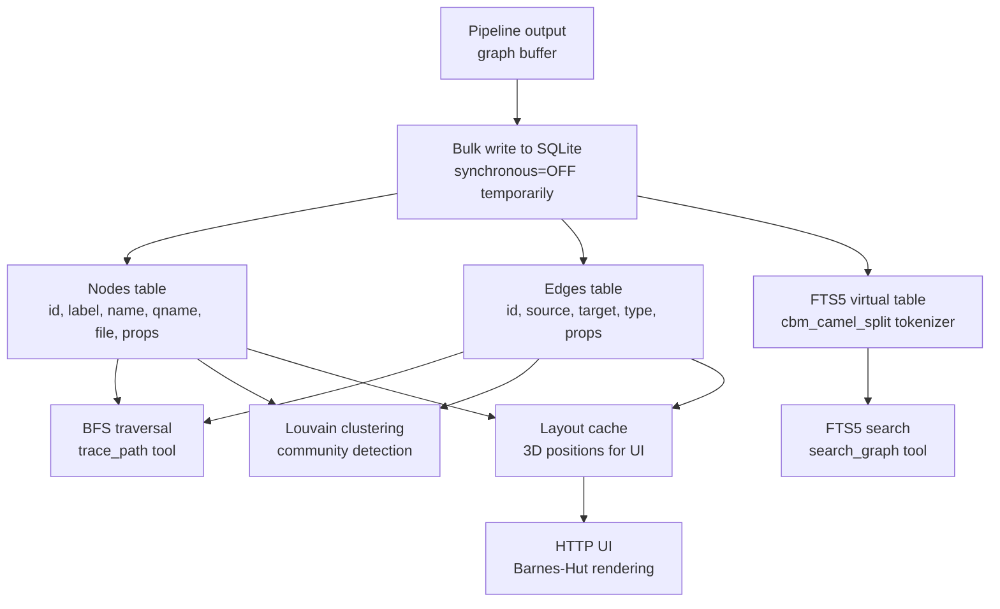
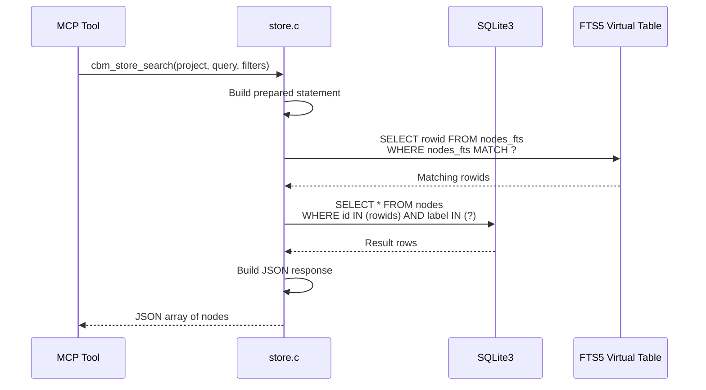

# Store: SQLite Graph Storage, FTS5, Bulk Writes, Louvain

The store module wraps SQLite3 (amalgamation) as a property graph database. It manages nodes, edges, full-text search via FTS5, bulk write optimization, breadth-first search, Louvain community detection, and layout position caching. The store provides the persistence layer for everything above it: the pipeline writes to it, the MCP tools query it, the Cypher engine reads from it.

## Store Architecture



## Query Execution Flow



## SQLite Configuration

The store opens SQLite with specific pragmas optimized for bulk writes and read queries:

Source: `/home/darkvoid/Boxxed/@formulas/src.rust/src.AI/src.CodebaseMemory/codebase-memory-mcp/src/store/store.c`

```c
// Open and configure SQLite database
int cbm_store_open(cbm_store_t **store, const char *cache_dir) {
    char db_path[CBM_PATH_MAX];
    snprintf(db_path, sizeof(db_path), "%s/graph.db", cache_dir);

    sqlite3 *db;
    int rc = sqlite3_open_v2(db_path, &db,
        SQLITE_OPEN_READWRITE | SQLITE_OPEN_CREATE, NULL);

    // WAL mode for crash safety + read concurrency
    sqlite3_exec(db, "PRAGMA journal_mode=WAL", NULL, NULL, NULL);

    // mmap for read performance
    int mmap_size = getenv_int("CBM_SQLITE_MMAP_SIZE", 67108864);  // 64MB default
    char sql[128];
    snprintf(sql, sizeof(sql), "PRAGMA mmap_size=%d", mmap_size);
    sqlite3_exec(db, sql, NULL, NULL, NULL);

    // Cache size
    sqlite3_exec(db, "PRAGMA cache_size=-64000", NULL, NULL, NULL);  // 64MB page cache

    // Prepare all statements
    prepare_statements(db);

    return 0;
}
```

## Database Schema

The schema uses a simple property graph model:

```sql
-- Nodes table
CREATE TABLE IF NOT EXISTS nodes (
    id INTEGER PRIMARY KEY,
    project TEXT NOT NULL,
    label TEXT NOT NULL,           -- Function, Class, File, etc.
    name TEXT NOT NULL,
    qualified_name TEXT,
    file_path TEXT,
    start_line INTEGER,
    end_line INTEGER,
    properties_json TEXT           -- JSON blob for flexible properties
);

-- Edges table
CREATE TABLE IF NOT EXISTS edges (
    id INTEGER PRIMARY KEY,
    project TEXT NOT NULL,
    source_id INTEGER NOT NULL,
    target_id INTEGER NOT NULL,
    type TEXT NOT NULL,            -- CALLS, IMPORTS, USES, etc.
    properties_json TEXT,
    FOREIGN KEY (source_id) REFERENCES nodes(id),
    FOREIGN KEY (target_id) REFERENCES nodes(id)
);

-- FTS5 full-text search index
CREATE VIRTUAL TABLE IF NOT EXISTS nodes_fts USING fts5(
    name, qualified_name, file_path, properties_json,
    content='nodes',
    content_rowid='id',
    tokenize='cbm_camel_split'     -- Custom camelCase/snake_case tokenizer
);

-- FTS5 triggers for automatic sync
CREATE TRIGGER IF NOT EXISTS nodes_fts_insert AFTER INSERT ON nodes
BEGIN
    INSERT INTO nodes_fts(rowid, name, qualified_name, file_path, properties_json)
    VALUES (new.id, new.name, new.qualified_name, new.file_path, new.properties_json);
END;

-- Indexes for common query patterns
CREATE INDEX IF NOT EXISTS idx_nodes_project ON nodes(project);
CREATE INDEX IF NOT EXISTS idx_nodes_label ON nodes(label);
CREATE INDEX IF NOT EXISTS idx_nodes_name ON nodes(name);
CREATE INDEX IF NOT EXISTS idx_nodes_qname ON nodes(qualified_name);
CREATE INDEX IF NOT EXISTS idx_edges_source ON edges(source_id);
CREATE INDEX IF NOT EXISTS idx_edges_target ON edges(target_id);
CREATE INDEX IF NOT EXISTS idx_edges_type ON edges(type);
CREATE INDEX IF NOT EXISTS idx_edges_project ON edges(project);

-- Layout positions for 3D visualization
CREATE TABLE IF NOT EXISTS layout_positions (
    project TEXT NOT NULL,
    node_id INTEGER NOT NULL,
    x REAL,
    y REAL,
    z REAL,
    PRIMARY KEY (project, node_id)
);

-- File hashes for incremental indexing
CREATE TABLE IF NOT EXISTS file_hashes (
    project TEXT NOT NULL,
    file_path TEXT NOT NULL,
    sha256 TEXT NOT NULL,
    PRIMARY KEY (project, file_path)
);

-- ADR table
CREATE TABLE IF NOT EXISTS adr (
    id INTEGER PRIMARY KEY,
    project TEXT NOT NULL,
    title TEXT NOT NULL,
    status TEXT,
    content TEXT,              -- Max 8000 chars
    created_at TEXT,
    updated_at TEXT
);

-- Semantic vectors table (int8 quantized)
CREATE TABLE IF NOT EXISTS semantic_vectors (
    node_id INTEGER PRIMARY KEY,
    vector BLOB NOT NULL,      -- 768 bytes of int8
    FOREIGN KEY (node_id) REFERENCES nodes(id)
);
```

## Prepared Statements

The store manages 30+ prepared statements for performance:

Source: `/home/darkvoid/Boxxed/@formulas/src.rust/src.AI/src.CodebaseMemory/codebase-memory-mcp/src/store/store.c`

```c
// Prepared statements (30+ total)
typedef struct {
    sqlite3_stmt *insert_node;
    sqlite3_stmt *insert_edge;
    sqlite3_stmt *select_node_by_id;
    sqlite3_stmt *select_node_by_qname;
    sqlite3_stmt *select_node_by_name;
    sqlite3_stmt *select_edges_by_source;
    sqlite3_stmt *select_edges_by_target;
    sqlite3_stmt *select_edges_by_type;
    sqlite3_stmt *select_edges_between;
    sqlite3_stmt *select_nodes_by_label;
    sqlite3_stmt *select_nodes_by_project;
    sqlite3_stmt *select_nodes_by_file;
    sqlite3_stmt *select_nodes_by_file_range;
    sqlite3_stmt *fts_search;
    sqlite3_stmt *count_nodes;
    sqlite3_stmt *count_edges;
    sqlite3_stmt *count_nodes_by_label;
    sqlite3_stmt *delete_project;
    sqlite3_stmt *insert_layout_position;
    sqlite3_stmt *select_layout_positions;
    sqlite3_stmt *insert_file_hash;
    sqlite3_stmt *select_file_hash;
    sqlite3_stmt *insert_adr;
    sqlite3_stmt *update_adr;
    sqlite3_stmt *select_adr;
    sqlite3_stmt *delete_adr;
    sqlite3_stmt *insert_semantic_vector;
    sqlite3_stmt *select_semantic_vector;
    sqlite3_stmt *bfs_outbound;
    sqlite3_stmt *bfs_inbound;
    sqlite3_stmt *degree_count;
    // ... more
} cbm_store_stmts_t;
```

## Bulk Write Optimization

The pipeline writes thousands of nodes and edges. To maximize throughput, the store temporarily disables journaling safety during bulk writes:

```c
// Begin bulk write mode
int cbm_store_begin_bulk_write(cbm_store_t *store) {
    // Disable synchronous for bulk writes
    sqlite3_exec(store->db, "PRAGMA synchronous=OFF", NULL, NULL, NULL);

    // Drop indexes for faster inserts
    sqlite3_exec(store->db, "DROP INDEX IF EXISTS idx_nodes_project", NULL, NULL, NULL);
    sqlite3_exec(store->db, "DROP INDEX IF EXISTS idx_nodes_label", NULL, NULL, NULL);
    sqlite3_exec(store->db, "DROP INDEX IF EXISTS idx_edges_source", NULL, NULL, NULL);
    sqlite3_exec(store->db, "DROP INDEX IF EXISTS idx_edges_target", NULL, NULL, NULL);
    sqlite3_exec(store->db, "DROP INDEX IF EXISTS idx_edges_type", NULL, NULL, NULL);

    return 0;
}

// End bulk write mode — restore safety
int cbm_store_end_bulk_write(cbm_store_t *store) {
    // Restore synchronous
    sqlite3_exec(store->db, "PRAGMA synchronous=NORMAL", NULL, NULL, NULL);

    // Recreate indexes
    sqlite3_exec(store->db, "CREATE INDEX IF NOT EXISTS idx_nodes_project ON nodes(project)", NULL, NULL, NULL);
    sqlite3_exec(store->db, "CREATE INDEX IF NOT EXISTS idx_nodes_label ON nodes(label)", NULL, NULL, NULL);
    sqlite3_exec(store->db, "CREATE INDEX IF NOT EXISTS idx_edges_source ON edges(source_id)", NULL, NULL, NULL);
    sqlite3_exec(store->db, "CREATE INDEX IF NOT EXISTS idx_edges_target ON edges(target_id)", NULL, NULL, NULL);
    sqlite3_exec(store->db, "CREATE INDEX IF NOT EXISTS idx_edges_type ON edges(type)", NULL, NULL, NULL);

    return 0;
}
```

The bulk write mode is a critical optimization. Dropping indexes during insertion and recreating them afterward is faster than maintaining them incrementally because index maintenance is O(log N) per insert, while bulk index creation is O(N log N) total — but with a much smaller constant factor since the entire index is built in one pass.

## FTS5 with Camel-Case Tokenizer

The FTS5 index uses a custom tokenizer that splits camelCase and snake_case identifiers into searchable tokens:

```c
// Custom FTS5 tokenizer: cbm_camel_split
// Splits "getUserName" into ["get", "user", "name"]
// Splits "get_user_name" into ["get", "user", "name"]
// Splits "HTTPServer" into ["http", "server"]
static int cbm_camel_split(
    const fts5_tokenizer_api *pApi,
    fts5_tokenizer *pTokenizer,
    const char *text, int nText,
    int (*xToken)(void *pCtx, int tflags, const char *pToken, int nToken, int iStart, int iEnd)
) {
    int i = 0;
    while (i < nText) {
        // Start of token
        int start = i;

        // Check for camelCase transition (lowercase followed by uppercase)
        while (i < nText) {
            if (i > start && isupper(text[i]) && islower(text[i+1])) {
                break;  // Start of new camelCase word
            }
            if (text[i] == '_' || text[i] == '-' || text[i] == '.') {
                break;  // snake_case or kebab-case separator
            }
            i++;
        }

        // Emit token (lowercased)
        if (i > start) {
            char token[256];
            int len = i - start;
            if (len < 256) {
                for (int j = 0; j < len; j++) {
                    token[j] = tolower(text[start + j]);
                }
                token[len] = '\0';
                xToken(pCtx, 0, token, len, start, i);
            }
        }

        // Skip separator
        if (i < nText && (text[i] == '_' || text[i] == '-' || text[i] == '.')) {
            i++;
        }
    }
    return SQLITE_OK;
}
```

This means searching for `get user` matches `getUserName`, `get_user_name`, `get-user-name`, and `getUser`. The tokenizer is essential for code search because identifiers are rarely single dictionary words.

## Breadth-First Search

The `trace_path` tool uses BFS implemented directly in SQL:

Source: `/home/darkvoid/Boxxed/@formulas/src.rust/src.AI/src.CodebaseMemory/codebase-memory-mcp/src/store/store.c`

```c
// BFS from a starting node, depth 1-5
typedef struct {
    int64_t start_id;
    int direction;       // 0 = outbound, 1 = inbound, 2 = both
    int max_depth;       // 1-5
    char *edge_types;    // Filter by edge type (NULL = all)
} cbm_bfs_query_t;

// Execute BFS, return path tree as JSON
int cbm_store_bfs(cbm_store_t *store, cbm_bfs_query_t *query, char **result_json) {
    // Use recursive CTE for BFS
    const char *sql =
        "WITH RECURSIVE bfs(path, depth, current_id) AS ("
        "  VALUES (json_array(?1), 0, ?1)"
        "  UNION ALL"
        "  SELECT json_insert(bfs.path, '$[#]', e.target_id),"
        "         bfs.depth + 1,"
        "         e.target_id"
        "  FROM bfs"
        "  JOIN edges e ON e.source_id = bfs.current_id"
        "  WHERE bfs.depth < ?2"
        "    AND e.target_id NOT IN (SELECT json_extract(p.value, '$[-1]')"
        "                            FROM json_each(bfs.path) p)"
        ") SELECT path FROM bfs ORDER BY depth LIMIT ?3";

    sqlite3_stmt *stmt;
    sqlite3_prepare_v2(store->db, sql, -1, &stmt, NULL);
    sqlite3_bind_int64(stmt, 1, query->start_id);
    sqlite3_bind_int(stmt, 2, query->max_depth);
    sqlite3_bind_int(stmt, 3, 1000);  // Max results

    // Collect results
    cbm_json_builder_t jb;
    cbm_json_init(&jb);
    while (sqlite3_step(stmt) == SQLITE_ROW) {
        const char *path = (const char *)sqlite3_column_text(stmt, 0);
        cbm_json_add_raw(&jb, path);
    }

    *result_json = cbm_json_finish(&jb);
    sqlite3_finalize(stmt);
    return 0;
}
```

## Louvain Community Detection

The store implements Louvain community detection for grouping related nodes:

```c
// Louvain community detection on the graph
// Returns {community_id: [node_ids]}
int cbm_store_louvain(cbm_store_t *store, const char *project,
                      cbm_hash_table_t **communities);
```

Louvain works by:
1. Starting with each node in its own community
2. Iteratively moving nodes to neighbor communities if it improves modularity
3. Aggregating communities into super-nodes
4. Repeating until modularity stops improving

This is used by the UI to color-code related node clusters and by the architecture tool to provide high-level overviews.

## ADR Storage

Architecture Decision Records are stored in a dedicated table:

```c
// ADR operations
int cbm_store_adr_create(cbm_store_t *store, const char *project,
                         const char *title, const char *content,
                         int64_t *new_id);
int cbm_store_adr_update(cbm_store_t *store, int64_t id,
                         const char *title, const char *content, const char *status);
int cbm_store_adr_delete(cbm_store_t *store, int64_t id);
int cbm_store_adr_list(cbm_store_t *store, const char *project,
                       char **result_json);
int cbm_store_adr_get(cbm_store_t *store, int64_t id, char **result_json);
```

ADR content are capped at 8,000 characters to prevent abuse.

## Aha Moment

**Aha:** The bulk write optimization drops all indexes, inserts everything, then recreates them — rather than maintaining indexes incrementally. This is a classic database optimization that most application code gets wrong. The reason it works: maintaining an index during insertion requires B-tree rebalancing per insert (O(log N) each), but building the entire index from scratch is a single sorted pass (O(N log N) total, but with tiny constants). For 500K nodes and 1M edges, this single optimization saves 30-60 seconds of index maintenance time.

## Cross-References

- [Pipeline](05-pipeline.md) for how the pipeline writes to the store
- [Cypher](07-cypher.md) for how the Cypher engine reads from the store
- [MCP Tools](08-mcp-tools.md) for tools that query the store (search_graph, trace_path)
- [Graph UI](11-graph-ui.md) for how layout positions are cached and read by the UI
