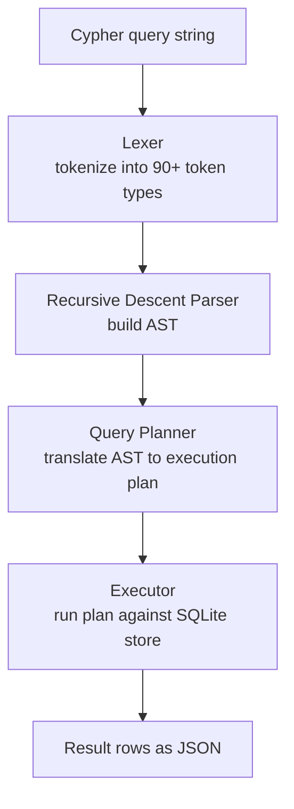
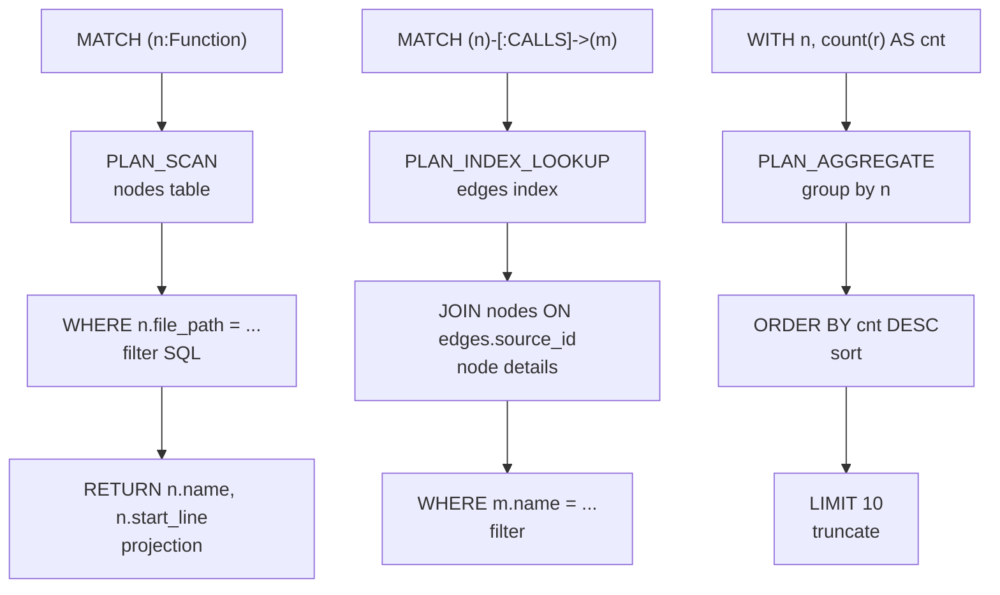

# Cypher Query Engine: 90+ Tokens, Recursive Descent Parser, Planner, Executor

The Cypher engine implements an openCypher read subset with 90+ token types and a recursive descent parser. It translates Cypher queries into SQLite execution plans, supporting MATCH patterns, WHERE filters, WITH clauses, aggregation, and ordered returns. This is the query layer for the `query_graph` MCP tool.

## Engine Architecture



## Query Execution Plan Flow



## Lexer: 90+ Token Types

Source: `/home/darkvoid/Boxxed/@formulas/src.rust/src.AI/src.CodebaseMemory/codebase-memory-mcp/src/cypher/cypher.h`

```c
// Token types — 90+ types for openCypher subset
typedef enum {
    // Keywords
    TOK_MATCH,
    TOK_OPTIONAL,
    TOK_WHERE,
    TOK_WITH,
    TOK_RETURN,
    TOK_ORDER,
    TOK_BY,
    TOK_SKIP,
    TOK_LIMIT,
    TOK_DISTINCT,
    TOK_UNWIND,
    TOK_UNION,
    TOK_ALL,
    TOK_AS,
    TOK_NULL,
    TOK_TRUE,
    TOK_FALSE,
    TOK_EXISTS,
    TOK_CASE,
    TOK_WHEN,
    TOK_THEN,
    TOK_ELSE,
    TOK_END,
    TOK_NOT,
    TOK_AND,
    TOK_OR,
    TOK_XOR,
    TOK_IN,

    // Operators
    TOK_EQ,           // =
    TOK_NEQ,          // <> or !=
    TOK_LT,           // <
    TOK_GT,           // >
    TOK_LTE,          // <=
    TOK_GTE,          // >=
    TOK_PLUS,         // +
    TOK_MINUS,        // -
    TOK_STAR,         // *
    TOK_SLASH,        // /
    TOK_PERCENT,      // %
    TOK_CONTAINS,
    TOK_STARTS_WITH,
    TOK_ENDS_WITH,

    // Pattern tokens
    TOK_LPAREN,       // (
    TOK_RPAREN,       // )
    TOK_LBRACKET,     // [
    TOK_RBRACKET,     // ]
    TOK_LBRACE,       // {
    TOK_RBRACE,       // }
    TOK_COMMA,        // ,
    TOK_COLON,        // :
    TOK_DOT,          // .
    TOK_ARROW_RIGHT,  // ->
    TOK_ARROW_LEFT,   // <-
    TOK_DASH,         // -
    TOK_DOTDOT,       // .. (range)

    // Literals
    TOK_IDENT,        // Variable name
    TOK_STRING,       // "string literal"
    TOK_NUMBER,       // 123, 45.6
    TOK_LABEL,        // :LabelName

    // Functions
    TOK_COUNT,
    TOK_SUM,
    TOK_AVG,
    TOK_MIN,
    TOK_MAX,
    TOK_COLLECT,
    TOK_LABELS,
    TOK_TYPE,
    TOK_ID,
    TOK_KEYS,
    TOK_PROPERTIES,
    TOK_TO_LOWER,
    TOK_TO_UPPER,
    TOK_TO_STRING,
    TOK_TO_INTEGER,
    TOK_TO_FLOAT,
    TOK_TO_BOOLEAN,
    TOK_SIZE,
    TOK_LENGTH,
    TOK_TRIM,
    TOK_LTRIM,
    TOK_RTRIM,
    TOK_REVERSE,
    TOK_COALESCE,
    TOK_SUBSTRING,
    TOK_REPLACE,
    TOK_LEFT,
    TOK_RIGHT,
    TOK_REGEX,        // =~

    // End
    TOK_EOF,
    TOK_ERROR
} CypherTokenType;

// Lexer state
typedef struct {
    const char *input;
    const char *ptr;
    const char *token_start;
    int token_len;
    CypherTokenType type;
    int line, column;
} CypherLexer;

// Initialize lexer
void cypher_lexer_init(CypherLexer *lex, const char *input);

// Advance to next token
CypherTokenType cypher_lexer_next(CypherLexer *lex);
```

The lexer handles:
- Keywords (case-insensitive: `MATCH` = `match` = `Match`)
- Operators including compound operators (`<=`, `<>`, `->`, `<-`, `=~`, `..`)
- String literals with escape sequences (`"hello\nworld"`)
- Number literals (integer and float: `123`, `45.6`, `-7`)
- Identifiers (alphanumeric + underscore, not starting with digit)
- Labels (`:Function`, `:Class`, `:File`)
- Comments (`// single line` and `/* multi-line */`)

## Recursive Descent Parser

Source: `/home/darkvoid/Boxxed/@formulas/src.rust/src.AI/src.CodebaseMemory/codebase-memory-mcp/src/cypher/cypher.h`

```c
// AST node types
typedef enum {
    AST_QUERY,
    AST_MATCH,
    AST_OPTIONAL_MATCH,
    AST_WHERE,
    AST_WITH,
    AST_RETURN,
    AST_ORDER_BY,
    AST_SKIP,
    AST_LIMIT,
    AST_UNWIND,
    AST_UNION,
    AST_PATTERN,
    AST_NODE_PATTERN,
    AST_REL_PATTERN,
    AST_VAR_LENGTH,
    AST_EXPR,
    AST_BINARY_OP,
    AST_UNARY_OP,
    AST_LITERAL,
    AST_VAR_REF,
    AST_PROP_ACCESS,
    AST_FUNCTION_CALL,
    AST_CASE_EXPR,
    AST_IN_EXPR,
    AST_CONTAINS_EXPR,
    AST_REGEX_MATCH,
    AST_NULL_CHECK,
    AST_AGGREGATE,
    AST_RETURN_ITEM,
    AST_ORDER_ITEM,
} CypherASTType;

// AST node
typedef struct CypherASTNode {
    CypherASTType type;
    char *string_value;
    double number_value;
    struct CypherASTNode *children[8];
    int child_count;
    int line, column;
} CypherASTNode;

// Parse a query string into an AST
CypherASTNode *cypher_parse(const char *query);

// Free AST
void cypher_ast_free(CypherASTNode *node);
```

The parser is a hand-written recursive descent parser:

Source: `/home/darkvoid/Boxxed/@formulas/src.rust/src.AI/src.CodebaseMemory/codebase-memory-mcp/src/cypher/cypher.c`

```c
// Top-level query parsing
static CypherASTNode *parse_query(CypherLexer *lex) {
    CypherASTNode *query = ast_node_new(AST_QUERY);

    // Parse clauses in order
    while (lex->type != TOK_EOF) {
        switch (lex->type) {
            case TOK_MATCH:
                ast_add_child(query, parse_match(lex));
                break;
            case TOK_OPTIONAL:
                ast_add_child(query, parse_optional_match(lex));
                break;
            case TOK_WHERE:
                ast_add_child(query, parse_where(lex));
                break;
            case TOK_WITH:
                ast_add_child(query, parse_with(lex));
                break;
            case TOK_RETURN:
                ast_add_child(query, parse_return(lex));
                break;
            case TOK_UNION:
                ast_add_child(query, parse_union(lex));
                break;
            case TOK_UNWIND:
                ast_add_child(query, parse_unwind(lex));
                break;
            default:
                parse_error(lex, "unexpected token");
                return NULL;
        }
    }

    return query;
}

// Parse a MATCH clause with pattern
static CypherASTNode *parse_match(CypherLexer *lex) {
    expect(lex, TOK_MATCH);
    CypherASTNode *match = ast_node_new(AST_MATCH);
    ast_add_child(match, parse_pattern(lex));
    return match;
}

// Parse a pattern: (n:Label {key: value})-[r:TYPE]->(m:Label)
static CypherASTNode *parse_pattern(CypherLexer *lex) {
    CypherASTNode *pattern = ast_node_new(AST_PATTERN);

    // Parse node pattern: (n:Label)
    ast_add_child(pattern, parse_node_pattern(lex));

    // Parse optional relationship: -[r:TYPE]-> or -[:TYPE]->
    if (lex->type == TOK_DASH || lex->type == TOK_ARROW_RIGHT || lex->type == TOK_ARROW_LEFT) {
        ast_add_child(pattern, parse_rel_pattern(lex));
        // Parse target node
        ast_add_child(pattern, parse_node_pattern(lex));
    }

    return pattern;
}

// Parse a node pattern: (n:Label|OtherLabel {key: value})
static CypherASTNode *parse_node_pattern(CypherLexer *lex) {
    expect(lex, TOK_LPAREN);

    CypherASTNode *node = ast_node_new(AST_NODE_PATTERN);

    // Optional variable name
    if (lex->type == TOK_IDENT) {
        node->string_value = strdup(lex->token_start);
        cypher_lexer_next(lex);
    }

    // Optional labels (with alternation: :A|B)
    if (lex->type == TOK_COLON) {
        cypher_lexer_next(lex);
        CypherASTNode *labels = ast_node_new(AST_EXPR);
        labels->string_value = strdup(lex->token_start);
        ast_add_child(node, labels);
        cypher_lexer_next(lex);

        // Label alternation
        while (lex->type == TOK_COLON) {
            // Actually, alternation uses |: :A|B
            // Handled within label parsing
        }
    }

    // Optional property map: {key: value}
    if (lex->type == TOK_LBRACE) {
        ast_add_child(node, parse_property_map(lex));
    }

    expect(lex, TOK_RPAREN);
    return node;
}

// Parse variable-length relationship: [*1..3]
static CypherASTNode *parse_var_length(CypherLexer *lex) {
    expect(lex, TOK_LBRACKET);

    CypherASTNode *vl = ast_node_new(AST_VAR_LENGTH);
    cypher_lexer_next(lex);  // skip [

    if (lex->type == TOK_STAR) {
        cypher_lexer_next(lex);

        // Min length
        if (lex->type == TOK_NUMBER) {
            vl->number_value = lex->number_value;
            cypher_lexer_next(lex);
        }

        // Range: 1..3
        if (lex->type == TOK_DOTDOT) {
            cypher_lexer_next(lex);
            if (lex->type == TOK_NUMBER) {
                vl->child_count = 1;
                vl->children[0] = ast_number(lex->number_value);
                cypher_lexer_next(lex);
            }
        }
    }

    expect(lex, TOK_RBRACKET);
    return vl;
}
```

## Query Planner

The planner translates the AST into an execution plan that operates on the SQLite store:

```c
// Execution plan operations
typedef enum {
    PLAN_SCAN,           // Full table scan with filter
    PLAN_INDEX_LOOKUP,   // Index-based lookup
    PLAN_BFS,            // Breadth-first traversal
    PLAN_FILTER,         // WHERE filter
   _PLAN_PROJECT,        // Column projection
   _PLAN_AGGREGATE,      // GROUP BY aggregate
   _PLAN_SORT,           // ORDER BY
   _PLAN_SKIP,
   _PLAN_LIMIT,
   _PLAN_DISTINCT,
   _PLAN_UNION,
   _PLAN_UNION_ALL,
} PlanOpType;

// Execution plan node
typedef struct PlanNode {
    PlanOpType type;
    char *table;
    char *filter_sql;    // SQL WHERE clause
    struct PlanNode *children[4];
    int child_count;
    char **columns;
    int column_count;
} PlanNode;

// Plan a query: AST -> execution plan
PlanNode *cypher_plan(CypherASTNode *ast, cbm_store_t *store);
```

The planner generates SQL fragments for each plan operation. A MATCH with WHERE becomes a SELECT with WHERE, a WITH becomes a subquery, and RETURN becomes the outer projection.

```c
// Plan a MATCH clause
static PlanNode *plan_match(CypherASTNode *match, cbm_store_t *store) {
    CypherASTNode *pattern = match->children[0];
    PlanNode *scan = plan_node_new(PLAN_SCAN);
    scan->table = "nodes";

    // Generate SQL WHERE from pattern labels
    char filter[1024];
    snprintf(filter, sizeof(filter), "label IN (%s)",
             pattern_labels_to_sql(pattern));
    scan->filter_sql = strdup(filter);

    return scan;
}
```

## Executor

The executor runs the plan against SQLite:

```c
// Execute plan and return results
int cypher_execute_plan(cbm_store_t *store, PlanNode *plan,
                        cbm_cypher_result_t *result) {
    // Build final SQL from plan tree
    char sql[4096];
    plan_to_sql(plan, sql, sizeof(sql));

    sqlite3_stmt *stmt;
    int rc = sqlite3_prepare_v2(store->db, sql, -1, &stmt, NULL);
    if (rc != SQLITE_OK) {
        return -1;
    }

    // Execute and collect
    result->num_columns = plan->column_count;
    result->columns = plan->columns;

    while (sqlite3_step(stmt) == SQLITE_ROW) {
        // Build JSON array for each row
        char row_json[2048];
        row_to_json(stmt, row_json, sizeof(row_json));
        result->rows_json = realloc(result->rows_json,
                                   (result->num_rows + 1) * sizeof(char *));
        result->rows_json[result->num_rows++] = strdup(row_json);
    }

    sqlite3_finalize(stmt);
    return 0;
}
```

## Supported Clauses

| Clause | Syntax | Description |
|--------|--------|-------------|
| MATCH | `MATCH (n:Function)` | Pattern match |
| OPTIONAL MATCH | `OPTIONAL MATCH (n)-[r]->(m)` | Pattern with null-tolerant match |
| WHERE | `WHERE n.name = "foo"` | Filter |
| WITH | `WITH n, count(r) AS call_count` | Intermediate projection |
| WITH...WHERE | `WITH n WHERE n.start_line > 10` | Intermediate filter |
| RETURN | `RETURN n.name, n.file_path` | Output columns |
| ORDER BY | `ORDER BY n.name DESC` | Sort |
| SKIP | `SKIP 10` | Pagination offset |
| LIMIT | `LIMIT 20` | Pagination limit |
| DISTINCT | `RETURN DISTINCT n.label` | Deduplicate |
| UNWIND | `UNWIND n.labels AS label` | Flatten list |
| UNION | `MATCH... RETURN ... UNION MATCH... RETURN ...` | Combine results (dedup) |
| UNION ALL | `... UNION ALL ...` | Combine results (no dedup) |
| CASE | `CASE WHEN n.start_line < 10 THEN "small" ELSE "large" END` | Conditional |
| EXISTS | `WHERE EXISTS { (n)-[:CALLS]->() }` | Subquery existence |

## WHERE Operators

| Operator | Syntax | Description |
|----------|--------|-------------|
| Equality | `n.name = "foo"` | String/number equality |
| Inequality | `n.name <> "foo"` or `!=` | Not equal |
| Comparison | `n.start_line > 100` | `<`, `>`, `<=`, `>=` |
| Boolean | `AND`, `OR`, `XOR`, `NOT` | Logical operators |
| IN | `n.label IN ["Function", "Class"]` | Membership |
| CONTAINS | `n.name CONTAINS "test"` | Substring |
| STARTS WITH | `n.name STARTS WITH "get_"` | Prefix |
| ENDS WITH | `n.name ENDS WITH "_test"` | Suffix |
| IS NULL | `n.qualified_name IS NULL` | Null check |
| IS NOT NULL | `n.qualified_name IS NOT NULL` | Not null |
| Regex | `n.name =~ "^get.*"` | Regex match |
| EXISTS | `EXISTS { (n)-[:CALLS]->() }` | Single-hop subquery |

## Functions

| Category | Functions |
|----------|-----------|
| Aggregates | `count()`, `count(DISTINCT x)`, `sum()`, `avg()`, `min()`, `max()`, `collect()` |
| Node info | `labels(n)`, `type(r)`, `id(n)`, `keys(n)`, `properties(n)` |
| Type conversion | `toLower()`, `toUpper()`, `toString()`, `toInteger()`, `toFloat()`, `toBoolean()` |
| String | `size()`, `length()`, `trim()`, `ltrim()`, `rtrim()`, `reverse()`, `coalesce()`, `substring()`, `replace()`, `left()`, `right()` |

## Example Queries

```cypher
-- Find all functions in a specific file
MATCH (n:Function)
WHERE n.file_path = "src/auth/digest.c"
RETURN n.name, n.start_line, n.end_line

-- Find all callers of a function
MATCH (caller:Function)-[:CALLS]->(target:Function)
WHERE target.name = "digest_auth"
RETURN caller.name, caller.file_path

-- Find functions with high complexity
MATCH (n:Function)
WHERE n.complexity > 10
RETURN n.name, n.complexity, n.file_path
ORDER BY n.complexity DESC
LIMIT 20

-- Find all tests for a module
MATCH (t:Test)-[:TESTS]->(n:Function)
WHERE n.file_path STARTS WITH "src/auth/"
RETURN n.name, t.name

-- Count calls per function
MATCH (n:Function)-[:CALLS]->(m)
RETURN n.name, count(m) AS call_count
ORDER BY call_count DESC
LIMIT 10

-- Find similar functions
MATCH (n:Function)-[:SIMILAR_TO]->(m:Function)
WHERE n.name = "parse_request"
RETURN m.name, m.file_path

-- Union of two queries
MATCH (n:Function) WHERE n.complexity > 10 RETURN n.name
UNION
MATCH (n:Class) WHERE n.method_count > 5 RETURN n.name
```

## Aha Moment

**Aha:** The Cypher parser is a hand-written recursive descent parser, not a generated one (no yacc/bison). The reason is control: the author can produce precise error messages ("expected label at line 3, column 12") that generated parsers cannot. It also means the AST structure is exactly what the planner needs — no intermediate conversion step from a generated AST to a planned form. The parser and planner share the same AST types, so a MATCH clause in the parser produces exactly the PlanNode the executor needs.

## Cross-References

- [Store](06-store.md) for the SQLite schema that the Cypher engine queries
- [MCP Tools](08-mcp-tools.md) for the `query_graph` tool that uses this engine
- [Architecture](01-architecture.md) for how the Cypher engine fits into the overall module map
