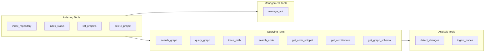
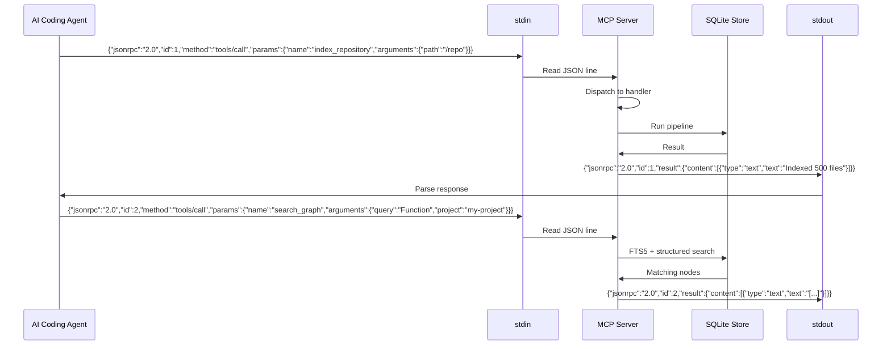

# MCP Tools: 14 Tools Over JSON-RPC 2.0 stdio

The MCP (Model Context Protocol) server exposes 14 tools over JSON-RPC 2.0 on stdin/stdout. AI coding agents call these tools to index repositories, query the knowledge graph, trace code paths, and manage architecture decision records. The server reads JSON-RPC requests from stdin, dispatches to the appropriate handler, and writes JSON-RPC responses to stdout. stderr is reserved exclusively for logging.

## Tool Category Map



## MCP Protocol



The MCP server reads one JSON-RPC request per line from stdin. Each request has this shape:

```json
{
  "jsonrpc": "2.0",
  "id": 1,
  "method": "tools/call",
  "params": {
    "name": "tool_name",
    "arguments": { ... }
  }
}
```

And responses follow:

```json
{
  "jsonrpc": "2.0",
  "id": 1,
  "result": {
    "content": [
      {
        "type": "text",
        "text": "Tool output as text"
      }
    ]
  }
}
```

Errors return an error object:

```json
{
  "jsonrpc": "2.0",
  "id": 1,
  "error": {
    "code": -32601,
    "message": "Tool not found: nonexistent_tool"
  }
}
```

## Tool Dispatch

Source: `/home/darkvoid/Boxxed/@formulas/src.rust/src.AI/src.CodebaseMemory/codebase-memory-mcp/src/mcp/mcp.c`

```c
// MCP tool handler function type
typedef int (*mcp_handler_fn)(const char *params_json, char **result_json, cbm_store_t *store);

// Tool registration
typedef struct {
    const char *name;
    mcp_handler_fn handler;
    const char *description;
    const char *input_schema;  // JSON Schema for tool arguments
} mcp_tool_t;

// 14 registered tools
static mcp_tool_t tools[] = {
    {"index_repository",   handle_index_repository,   "Index a repository",        index_schema},
    {"list_projects",      handle_list_projects,      "List indexed projects",     list_schema},
    {"delete_project",     handle_delete_project,     "Remove a project",          delete_schema},
    {"index_status",       handle_index_status,       "Check indexing status",     status_schema},
    {"search_graph",       handle_search_graph,       "Structured search",         search_schema},
    {"trace_path",         handle_trace_path,         "BFS traversal",             trace_schema},
    {"detect_changes",     handle_detect_changes,     "Git diff impact mapping",   changes_schema},
    {"query_graph",        handle_query_graph,        "Cypher-like query",         cypher_schema},
    {"get_graph_schema",   handle_get_graph_schema,   "Schema introspection",      schema_schema},
    {"get_code_snippet",   handle_get_code_snippet,   "Read source by name",       snippet_schema},
    {"get_architecture",   handle_get_architecture,   "Codebase overview",         arch_schema},
    {"search_code",        handle_search_code,        "Grep-like text search",     grep_schema},
    {"manage_adr",         handle_manage_adr,         "ADR CRUD",                  adr_schema},
    {"ingest_traces",      handle_ingest_traces,      "Runtime trace ingestion",   traces_schema},
};

// Tool lookup by name
static mcp_tool_t *find_tool(const char *name) {
    for (int i = 0; i < sizeof(tools) / sizeof(tools[0]); i++) {
        if (strcmp(tools[i].name, name) == 0) return &tools[i];
    }
    return NULL;
}
```

## Tool Reference

### 1. index_repository

Index a repository into the knowledge graph.

```json
{
  "name": "index_repository",
  "arguments": {
    "path": "/path/to/repository",
    "project": "optional-project-name"
  }
}
```

| Parameter | Required | Type | Description |
|-----------|----------|------|-------------|
| path | Yes | string | Absolute path to repository root |
| project | No | string | Override project name (default: directory name) |

Returns the number of nodes and edges created, along with timing information.

### 2. list_projects

List all indexed projects.

```json
{
  "name": "list_projects",
  "arguments": {}
}
```

Returns a JSON array of projects with file counts, node counts, and last indexed time.

### 3. delete_project

Remove a project from the graph.

```json
{
  "name": "delete_project",
  "arguments": {
    "project": "project-name"
  }
}
```

Deletes all nodes, edges, layout positions, and ADRs for the project.

### 4. index_status

Check indexing status for a project.

```json
{
  "name": "index_status",
  "arguments": {
    "project": "project-name"
  }
}
```

Returns file count, indexed count, skipped count, and per-pass timing.

### 5. search_graph

Structured search with filters.

```json
{
  "name": "search_graph",
  "arguments": {
    "query": "search terms",
    "project": "project-name",
    "labels": ["Function", "Class"],
    "file_pattern": "src/auth/*.c",
    "degree_min": 3,
    "degree_max": 50,
    "limit": 100
  }
}
```

| Parameter | Type | Default | Description |
|-----------|------|---------|-------------|
| query | string | "" | FTS5 search terms |
| project | string | "" | Filter by project (empty = all) |
| labels | string[] | [] | Filter by node labels |
| file_pattern | string | "" | Glob pattern for file paths |
| degree_min | int | 0 | Minimum edge count |
| degree_max | int | 999999 | Maximum edge count |
| limit | int | 200 | Max results (`CBM_DEFAULT_SEARCH_LIMIT`) |

### 6. trace_path

Breadth-first traversal from a node.

```json
{
  "name": "trace_path",
  "arguments": {
    "node_id": 123,
    "direction": "outbound",
    "depth": 3,
    "edge_types": ["CALLS", "IMPORTS"],
    "project": "project-name"
  }
}
```

| Parameter | Type | Default | Description |
|-----------|------|---------|-------------|
| node_id | int | required | Starting node ID |
| direction | string | "outbound" | "outbound", "inbound", or "both" |
| depth | int | 2 | BFS depth (1-5) |
| edge_types | string[] | [] | Filter by edge types (empty = all) |
| project | string | "" | Filter by project |

Returns a tree of paths as JSON, with node and edge details at each level.

### 7. detect_changes

Map git diff to affected graph nodes.

```json
{
  "name": "detect_changes",
  "arguments": {
    "project": "project-name",
    "base": "main",
    "head": "feature-branch"
  }
}
```

Returns the list of functions, classes, and files affected by the diff, along with their callers (for impact analysis).

### 8. query_graph

Execute a Cypher query against the graph.

```json
{
  "name": "query_graph",
  "arguments": {
    "query": "MATCH (n:Function)-[:CALLS]->(m) WHERE m.name = 'parse' RETURN n.name",
    "project": "project-name"
  }
}
```

| Parameter | Type | Required | Description |
|-----------|------|----------|-------------|
| query | string | Yes | Cypher query string |
| project | string | No | Default project for unqualified queries |

Returns columns and rows as JSON. See [Cypher](07-cypher.md) for the full grammar.

### 9. get_graph_schema

Introspect the graph schema.

```json
{
  "name": "get_graph_schema",
  "arguments": {
    "project": "project-name"
  }
}
```

Returns node label counts, edge type counts, and property schemas.

### 10. get_code_snippet

Read source code by qualified name.

```json
{
  "name": "get_code_snippet",
  "arguments": {
    "qualified_name": "auth.digest_auth",
    "project": "project-name"
  }
}
```

Returns the source code text for the identified function, including line numbers.

### 11. get_architecture

Get a high-level codebase overview.

```json
{
  "name": "get_architecture",
  "arguments": {
    "project": "project-name"
  }
}
```

Returns the project structure, package hierarchy, top-level modules, and their interconnections. Uses Louvain clustering for module grouping.

### 12. search_code

Grep-like text search across indexed files.

```json
{
  "name": "search_code",
  "arguments": {
    "pattern": "TODO:",
    "project": "project-name",
    "case_sensitive": false,
    "limit": 100
  }
}
```

Searches both the FTS5 index and raw file content. Returns file path, line number, and matching line.

### 13. manage_adr

Architecture Decision Records CRUD.

```json
{
  "name": "manage_adr",
  "arguments": {
    "action": "create",
    "project": "project-name",
    "title": "Use SQLite for graph storage",
    "content": "ADR content (max 8000 chars)...",
    "id": 1
  }
}
```

| action | Required fields | Description |
|--------|----------------|-------------|
| create | project, title, content | Create a new ADR |
| read | id | Read an ADR by ID |
| update | id, title?, content?, status? | Update an existing ADR |
| delete | id | Delete an ADR |
| list | project | List all ADRs for a project |

ADR status values: `proposed`, `accepted`, `deprecated`, `superseded`.

### 14. ingest_traces

Ingest runtime traces for HTTP_CALLS validation.

```json
{
  "name": "ingest_traces",
  "arguments": {
    "project": "project-name",
    "traces": [
      {"method": "GET", "path": "/api/users", "caller": "frontend"},
      {"method": "POST", "path": "/api/auth/login", "caller": "web-app"}
    ]
  }
}
```

Traces are matched against HTTP route nodes in the graph. Matching routes get HTTP_CALLS edges from the identified caller. This validates that runtime traffic actually reaches the code paths the extraction engine identified.

## Tool Discovery

The MCP server supports tool discovery via `tools/list`:

```json
// Request
{"jsonrpc": "2.0", "id": 1, "method": "tools/list"}

// Response
{
  "jsonrpc": "2.0",
  "id": 1,
  "result": {
    "tools": [
      {
        "name": "index_repository",
        "description": "Index a repository",
        "inputSchema": { "type": "object", "properties": { ... } }
      },
      // ... 13 more
    ]
  }
}
```

## Server Loop

Source: `/home/darkvoid/Boxxed/@formulas/src.rust/src.AI/src.CodebaseMemory/codebase-memory-mcp/src/mcp/mcp.c`

```c
// Main MCP server loop
int mcp_server_run(cbm_store_t *store, mcp_config_t *config) {
    char line[65536];  // Max request line size

    cbm_log_info("MCP server started on stdin/stdout\n");

    while (fgets(line, sizeof(line), stdin) != NULL) {
        // Parse JSON-RPC request
        yyjson_doc *doc = yyjson_read(line, strlen(line), 0);
        yyjson_val *root = yyjson_doc_get_obj(doc);

        const char *method = yyjson_get_str(yyjson_obj_get(root, "method"));
        yyjson_val *params = yyjson_obj_get(root, "params");
        int id = yyjson_get_int(yyjson_obj_get(root, "id"));

        // Dispatch
        if (strcmp(method, "initialize") == 0) {
            handle_initialize(id, params);
        } else if (strcmp(method, "tools/list") == 0) {
            handle_tools_list(id);
        } else if (strcmp(method, "tools/call") == 0) {
            const char *tool_name = yyjson_get_str(yyjson_obj_get(params, "name"));
            yyjson_val *arguments = yyjson_obj_get(params, "arguments");

            mcp_tool_t *tool = find_tool(tool_name);
            if (tool) {
                char *result = NULL;
                tool->handler(yyjson_write(arguments), &result, store);
                write_response(id, result);
                free(result);
            } else {
                write_error(id, -32601, "Tool not found");
            }
        }

        yyjson_doc_free(doc);
    }

    return 0;
}
```

The server uses yyjson for fast JSON parsing (yyjson is vendored). Each request is parsed, dispatched, and responded to in a tight loop. There is no connection management because stdio is a single pipe.

## Aha Moment

**Aha:** The MCP server runs in a single-threaded loop on stdin/stdout but the indexing pipeline uses a multi-threaded worker pool. The trick is that the MCP thread blocks on `fgets(stdin)` while the pipeline runs in background threads. The pipeline acquires exclusive access to the store during bulk writes, so the MCP thread cannot query while indexing is in progress. This is by design — MCP clients (AI agents) can only call one tool at a time anyway, and indexing is the one long-running operation. The simplicity of single-threaded stdio I/O means zero race conditions in the JSON-RPC layer.

## Cross-References

- [Pipeline](05-pipeline.md) for the indexing pipeline called by `index_repository`
- [Cypher](07-cypher.md) for the query grammar used by `query_graph`
- [Store](06-store.md) for the database schema queried by search and trace tools
- [CLI and Install](10-cli-install.md) for how to configure the MCP server
- [Graph UI](11-graph-ui.md) for how `get_architecture` feeds the visualization
