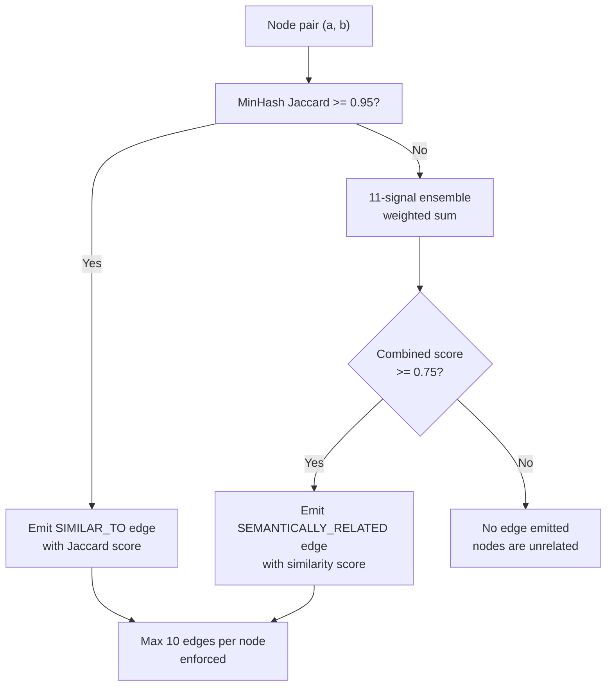
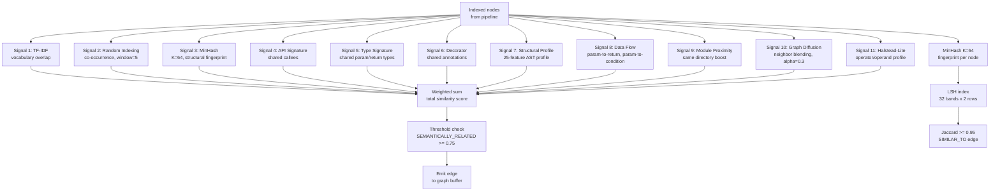

# Semantic Similarity: 11-Signal Ensemble, MinHash/LSH, nomic-embed-code Vectors

The semantic similarity engine computes pairwise similarity between code nodes using an 11-signal weighted ensemble. It combines algorithmic signals (TF-IDF, MinHash, Random Indexing) with pretrained embeddings (nomic-embed-code, 768 dimensions, int8 quantized) and graph-based signals (data flow, diffusion). The result powers two edge types: SIMILAR_TO (MinHash-based) and SEMANTICALLY_RELATED (full ensemble).

## Edge Emission Decision Tree



## Architecture



## Signal Weights

Source: `/home/darkvoid/Boxxed/@formulas/src.rust/src.AI/src.CodebaseMemory/codebase-memory-mcp/src/semantic/semantic.c`

```c
// Signal weights for the 11-signal ensemble
// Weights sum to 1.0
static const float signal_weights[] = {
    0.20f,  // TF-IDF (vocabulary overlap)
    0.25f,  // Random Indexing (co-occurrence)
    0.10f,  // MinHash (structural fingerprint)
    0.15f,  // API Signature (shared callees)
    0.10f,  // Type Signature (shared param/return types)
    0.05f,  // Decorator (shared annotations)
    0.10f,  // Structural Profile (25-feature AST profile)
    0.05f,  // Data Flow (param-to-return, param-to-condition)
    // Module Proximity: additive boost, not weighted
    // Graph Diffusion: pre-computed blending, alpha=0.3
    // Halstead-Lite: profile-based
};
```

The two heaviest signals are Random Indexing (0.25) and TF-IDF (0.20). Together they account for 45% of the similarity score, meaning two functions that use the same vocabulary in similar contexts will score high even if their call graphs differ.

## TF-IDF Signal

```c
// TF-IDF on metadata tokens (function names, parameter names, return types)
// IDF: log2(1 + docs / doc_freq)
float tfidf_similarity(cbm_sem_ctx_t *ctx, int64_t a, int64_t b) {
    const float *vec_a = get_tfidf_vector(ctx, a);
    const float *vec_b = get_tfidf_vector(ctx, b);

    // Cosine similarity
    float dot = 0, norm_a = 0, norm_b = 0;
    for (int i = 0; i < ctx->vocab_size; i++) {
        dot += vec_a[i] * vec_b[i];
        norm_a += vec_a[i] * vec_a[i];
        norm_b += vec_b[i] * vec_b[i];
    }

    if (norm_a == 0 || norm_b == 0) return 0;
    return dot / (sqrtf(norm_a) * sqrtf(norm_b));
}
```

TF-IDF works on the metadata tokens extracted from each node: function names (split by camelCase/snake_case), parameter type names, return type names, and decorator names. The vocabulary is built across the entire project, and IDF uses log base 2 with document frequency:

```
IDF(token) = log2(1 + total_nodes / nodes_containing_token)
```

This downweights common tokens like `get`, `set`, `init` that appear in many functions, and upweights rare tokens that are more discriminative.

## Random Indexing

```c
// Random Indexing with co-occurrence
// Each token gets a random 768-d vector (seeded by xxHash)
// Co-occurrence: tokens within window of 5 positions
// IDF-style subsampling: cap at CBM_SEM_MAX_OCCUR (512)
float random_indexing_similarity(cbm_sem_ctx_t *ctx, int64_t a, int64_t b) {
    // Get co-occurrence vectors for both nodes
    const float *ri_a = get_ri_vector(ctx, a);
    const float *ri_b = get_ri_vector(ctx, b);

    // Cosine similarity
    return cosine_similarity(ri_a, ri_b, CBM_SEM_DIM);
}
```

Random Indexing assigns each token a random 768-dimensional vector (seeded by xxHash with base seed `0x52494E44` = "RIND"). A node's vector is the sum of its tokens' vectors. Co-occurrence is computed within a window of 5 tokens: if tokens A and B appear within 5 positions of each other in any function, their vectors are added together. This captures within-codebase synonym relationships — if `parse` and `deserialize` appear in similar contexts, they develop similar vectors.

Source: `/home/darkvoid/Boxxed/@formulas/src.rust/src.AI/src.CodebaseMemory/codebase-memory-mcp/src/foundation/constants.h`

```c
#define CBM_SEM_DIM          768     // Vector dimension (nomic-embed-code)
#define CBM_SEM_SPARSE_NNZE  8       // Non-zero entries in sparse random vector
#define CBM_SEM_WINDOW       5       // Co-occurrence window half-width
#define CBM_SEM_MAX_OCCUR    512     // Frequent token subsampling cap
```

## MinHash Structural Signal

The MinHash signal extracts structural fingerprints from the AST. The fingerprint is a 64-element vector of uint32 values, where each element is the minimum hash of a trigram of AST node types.

Source: `/home/darkvoid/Boxxed/@formulas/src.rust/src.AI/src.CodebaseMemory/codebase-memory-mcp/src/simhash/minhash.h`

```c
// MinHash fingerprint
typedef struct {
    uint32_t values[CBM_MINHASH_K];  // 64 uint32 values
} cbm_minhash_t;

// LSH index
typedef struct {
    cbm_lsh_bucket_t *buckets[CBM_LSH_BANDS];  // 32 band hash tables
    int total_entries;
} cbm_lsh_t;
```

The MinHash algorithm:

1. Walk the AST and collect trigrams of node types
2. Normalize types: identifiers -> "I", strings -> "S", numbers -> "N", types -> "T"
3. Require at least 30 leaf tokens and 32 unique trigrams (skip small nodes)
4. Compute 64 hash functions (xxHash with distinct seeds)
5. Each hash function returns the minimum hash value across all trigrams
6. Jaccard similarity = fraction of matching hash values

Source: `/home/darkvoid/Boxxed/@formulas/src.rust/src.AI/src.CodebaseMemory/codebase-memory-mcp/src/simhash/minhash.c`

```c
// Compute MinHash fingerprint for a node
cbm_minhash_t cbm_minhash_compute(cbm_minhash_ctx_t *ctx, cbm_node_t *node) {
    cbm_minhash_t fp;
    memset(&fp, 0xFF, sizeof(fp));  // Initialize to max uint32

    // Collect trigrams from AST
    cbm_array_t trigrams;
    cbm_array_init(&trigrams);
    collect_trigrams(node, &trigrams);

    if (trigrams.count < 32) {
        // Too few trigrams — skip (small AST)
        return fp;
    }

    // Compute min hash for each permutation
    for (int k = 0; k < CBM_MINHASH_K; k++) {
        uint32_t seed = MINHASH_SEED_BASE + k;
        for (int i = 0; i < trigrams.count; i++) {
            uint32_t h = xxhash(trigrams.items[i], seed);
            if (h < fp.values[k]) {
                fp.values[k] = h;
            }
        }
    }

    return fp;
}

// Jaccard similarity between two fingerprints
float cbm_minhash_jaccard(const cbm_minhash_t *a, const cbm_minhash_t *b) {
    int matches = 0;
    for (int k = 0; k < CBM_MINHASH_K; k++) {
        if (a->values[k] == b->values[k]) {
            matches++;
        }
    }
    return (float)matches / CBM_MINHASH_K;
}
```

## LSH (Locality-Sensitive Hashing)

LSH avoids O(N^2) pairwise comparison by hashing similar fingerprints into the same bucket:

```c
// LSH: 32 bands x 2 rows
// Threshold ~= (1/32)^(1/2) = 0.177
// Nodes with Jaccard >= 0.95 will likely share a band
void cbm_lsh_insert(cbm_lsh_t *lsh, cbm_node_t *node, const cbm_minhash_t *fp) {
    for (int band = 0; band < CBM_LSH_BANDS; band++) {
        // Hash 2 consecutive values from this band
        uint64_t key = ((uint64_t)fp->values[band * 2] << 32)
                     | fp->values[band * 2 + 1];

        // Insert into band's hash table
        lsh_bucket_add(&lsh->buckets[band], key, node->id);
    }
}

// Query: find candidates in same bands
void cbm_lsh_query(cbm_lsh_t *lsh, cbm_node_t *node, cbm_array_t *candidates) {
    cbm_minhash_t *fp = get_fingerprint(node);
    cbm_hash_set seen;
    hash_set_init(&seen, 16384);  // 14-bit open-addressing hash table

    for (int band = 0; band < CBM_LSH_BANDS; band++) {
        uint64_t key = ((uint64_t)fp->values[band * 2] << 32)
                     | fp->values[band * 2 + 1];

        // All nodes in this bucket are candidates
        lsh_bucket_t *bucket = lsh->buckets[band];
        for (int i = 0; i < bucket->count; i++) {
            if (bucket->entries[i].node_id != node->id) {
                if (!hash_set_contains(&seen, bucket->entries[i].node_id)) {
                    hash_set_add(&seen, bucket->entries[i].node_id);
                    cbm_array_push(candidates, bucket->entries[i]);
                }
            }
        }
    }
}
```

The seen-set uses a 14-bit open-addressing hash table (16,384 slots) with the Knuth multiplicative constant `2654435761` for hashing. This prevents duplicate candidates when a node appears in multiple bands.

## Pretrained Vectors: nomic-embed-code

The engine includes pretrained nomic-embed-code vectors compiled into the binary:

```
vendored/nomic/
  code_vectors.bin      Binary file: 40,856 vectors x 768 dimensions, int8
  code_vectors_blob.S   Assembly blob for linking
  vocabulary.txt        Token -> vector index mapping
```

Vectors are int8 quantized (not float32), reducing storage from 768 * 4 = 3,072 bytes per vector to 768 bytes. With 40,856 vectors, this is about 31MB total.

Similarity with pretrained vectors:

```c
// Cosine similarity with int8 vectors
float pretrained_similarity(const int8_t *a, const int8_t *b, int dim) {
    int dot = 0, norm_a = 0, norm_b = 0;
    for (int i = 0; i < dim; i++) {
        dot += (int)a[i] * (int)b[i];
        norm_a += (int)a[i] * (int)a[i];
        norm_b += (int)b[i] * (int)b[i];
    }
    if (norm_a == 0 || norm_b == 0) return 0;
    return (float)dot / (sqrtf((float)norm_a) * sqrtf((float)norm_b));
}
```

## AST Structural Profile

The AST profile extracts 25 features from each function's syntax tree:

Source: `/home/darkvoid/Boxxed/@formulas/src.rust/src.AI/src.CodebaseMemory/codebase-memory-mcp/src/semantic/ast_profile.c`

```c
// 25-dimensional AST structural profile
// Features include:
// 0-3:   Control flow (if, for, while, switch counts)
// 4-7:   Nesting depth (max, avg, variance, count of deep nesting)
// 8-11:  Expression types (arithmetic, logical, call, literal counts)
// 12-15: Complexity indicators (cyclomatic, Halstead volume, effort, difficulty)
// 16-19: Structure indicators (return count, parameter count, local variable count, decorator count)
// 20-24: Type indicators (has_return_type, has_generics, has_error_handling, has_async, has_recursive_call)
typedef struct {
    float features[CBM_SEM_AST_PROFILE_DIMS];  // 25 floats
} cbm_ast_profile_t;

// Extract AST profile from a function node
cbm_ast_profile_t cbm_ast_profile_extract(cbm_node_t *node, TSTree *tree);

// Cosine similarity between two profiles
float cbm_ast_profile_similarity(const cbm_ast_profile_t *a, const cbm_ast_profile_t *b);
```

## Combined Similarity

The final similarity score combines all signals:

```c
float cbm_semantic_similarity(cbm_sem_ctx_t *ctx, int64_t a, int64_t b) {
    float score = 0;

    score += signal_weights[0] * tfidf_similarity(ctx, a, b);
    score += signal_weights[1] * random_indexing_similarity(ctx, a, b);
    score += signal_weights[2] * minhash_similarity(ctx, a, b);
    score += signal_weights[3] * api_signature_similarity(ctx, a, b);
    score += signal_weights[4] * type_signature_similarity(ctx, a, b);
    score += signal_weights[5] * decorator_similarity(ctx, a, b);
    score += signal_weights[6] * ast_profile_similarity(ctx, a, b);
    score += signal_weights[7] * dataflow_similarity(ctx, a, b);

    // Module proximity: additive boost
    if (same_directory(a, b)) {
        score += 0.10f;  // Max +0.10 for same directory
    }

    // Graph diffusion is pre-computed (alpha=0.3 blending)
    score += graph_diffusion_score(ctx, a, b);

    // Halstead-lite profile similarity
    score += halstead_similarity(ctx, a, b);

    return clamp(score, 0, 1);
}
```

Edges are emitted when the score exceeds the threshold:

```c
#define CBM_SEM_EDGE_THRESHOLD  0.75f  // SEMANTICALLY_RELATED edge threshold
#define CBM_SEM_MAX_EDGES       10     // Max semantic edges per node
```

Each node gets at most 10 SEMANTICALLY_RELATED edges, keeping the graph sparse and navigable.

## Aha Moment

**Aha:** Random Indexing uses co-occurrence within a window of 5, not document-level co-occurrence. This means if `parse` and `deserialize` appear near each other in multiple function bodies, they develop similar vectors — even if they are in different files and different languages. This is the within-codebase synonym bridge that TF-IDF alone cannot provide. TF-IDF knows `parse` is common across functions (low IDF), but Random Indexing knows `parse` and `deserialize` are related because they co-occur in similar contexts. Together, they capture both "what this function is" (TF-IDF vocabulary) and "what this function does in context" (Random Indexing co-occurrence).

## Cross-References

- [Pipeline](05-pipeline.md) for pass_similarity and pass_semantic_edges
- [Store](06-store.md) for how semantic vectors are persisted
- [Extraction](04-extraction.md) for how AST data feeds the structural profile
