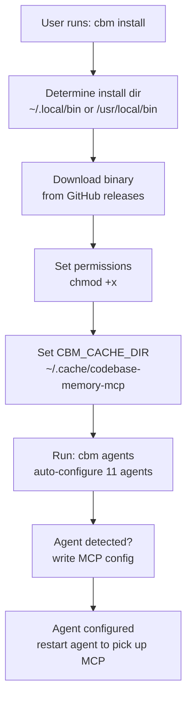
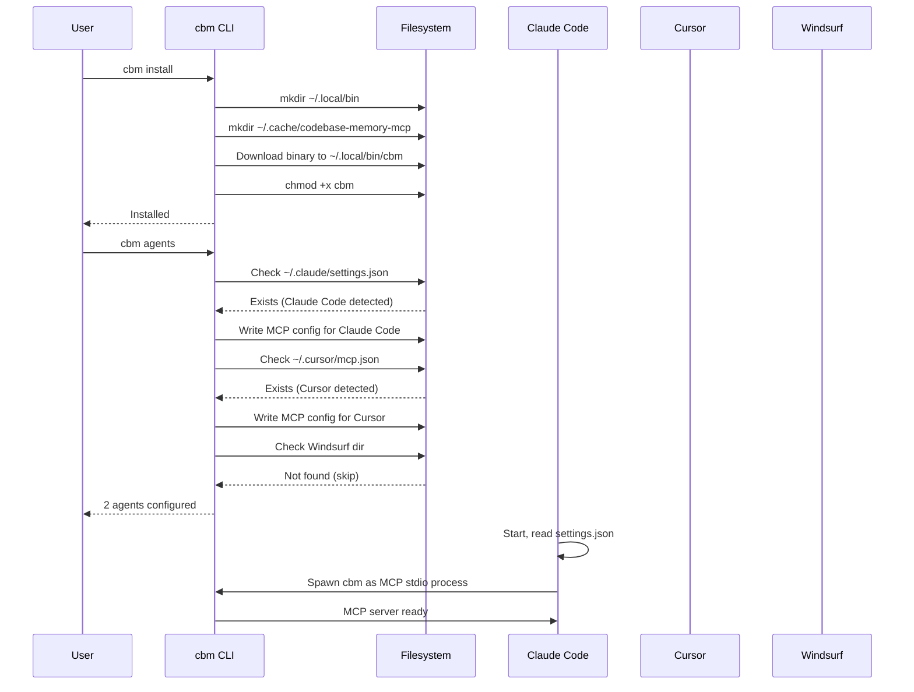
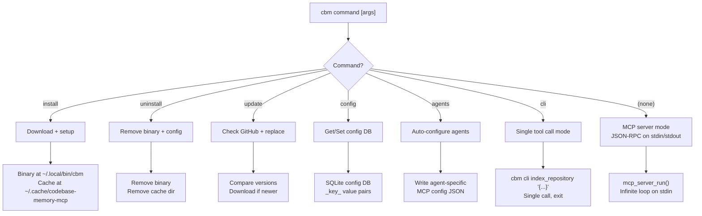

# CLI and Install: Auto-Config for 11 Coding Agents, Update Mechanism

The CLI module provides install, uninstall, update, and config commands. The most notable feature is automatic configuration of 11 coding agents (Claude Code, Cursor, Windsurf, Cline, Continue, Roo Code, GitHub Copilot, Amazon Q, JetBrains AI, VS Code, and custom MCP clients). The CLI downloads the binary, sets up the cache directory, and writes agent-specific configuration files.

## Installation Flow



## Agent Configuration Matrix

| Agent | Config File Path | Detection Method | MCP Format |
|-------|-----------------|-----------------|------------|
| Claude Code | `~/.claude/settings.json` | Directory exists | JSON mcpServers |
| Cursor | `~/.cursor/mcp.json` | Binary in PATH | JSON mcpServers |
| Windsurf | `~/.codeium/windsurf/mcp_config.json` | Directory exists | JSON mcpServers |
| Cline | VS Code extension dir | Extension installed | JSON mcpServers |
| Continue | `~/.continue/config.json` | Directory exists | JSON mcpServers |
| Roo Code | `~/.roo-code/mcp_config.json` | Directory exists | JSON mcpServers |

## Agent Configuration Lifecycle



## CLI Command Flow



## CLI Entry Point

Source: `/home/darkvoid/Boxxed/@formulas/src.rust/src.AI/src.CodebaseMemory/codebase-memory-mcp/src/main.c`

```c
// CLI mode dispatch
int main(int argc, char **argv) {
    if (argc >= 3 && strcmp(argv[1], "cli") == 0) {
        // Single tool call mode (for testing)
        return cli_tool_call(argv[2], argc > 3 ? argv[3] : NULL);
    }

    if (argc >= 2 && strcmp(argv[1], "--version") == 0) {
        printf("codebase-memory-mcp %s\n", CBM_VERSION);
        return 0;
    }

    if (argc >= 2 && strcmp(argv[1], "--help") == 0) {
        print_usage();
        return 0;
    }

    // Default: MCP server on stdin/stdout
    // Parse --ui and --port flags
    bool ui_enabled = check_flag(argv, "--ui=true");
    int port = parse_port_flag(argv, 9749);  // Default port

    return mcp_server_run(store, &config);
}
```

The default mode (no arguments) runs the MCP server on stdin/stdout. The `cli` subcommand runs a single tool call and exits.

## CLI Commands

Source: `/home/darkvoid/Boxxed/@formulas/src.rust/src.AI/src.CodebaseMemory/codebase-memory-mcp/src/cli/cli.h`

```c
// CLI command dispatch
int cli_dispatch(int argc, char **argv) {
    if (argc < 2) {
        print_usage();
        return 1;
    }

    const char *cmd = argv[1];

    if (strcmp(cmd, "install") == 0)    return cli_install();
    if (strcmp(cmd, "uninstall") == 0)  return cli_uninstall();
    if (strcmp(cmd, "update") == 0)     return cli_update();
    if (strcmp(cmd, "config") == 0)     return cli_config(argc, argv);
    if (strcmp(cmd, "agents") == 0)     return cli_agents();

    fprintf(stderr, "Unknown command: %s\n", cmd);
    return 1;
}
```

## Install

The install command downloads the binary and sets up the environment:

Source: `/home/darkvoid/Boxxed/@formulas/src.rust/src.AI/src.CodebaseMemory/codebase-memory-mcp/src/cli/cli.c`

```c
int cli_install(void) {
    // Determine install location
    const char *install_dir = get_install_dir();  // ~/.local/bin or /usr/local/bin
    const char *cache_dir = get_cache_dir();       // ~/.cache/codebase-memory-mcp

    // Create directories
    mkdir_p(install_dir);
    mkdir_p(cache_dir);

    // Download binary
    const char *url = getenv("CBM_DOWNLOAD_URL")
                    : "https://github.com/DeusData/codebase-memory-mcp/releases/latest/download/cbm";

    printf("Downloading from %s...\n", url);
    int rc = download_file(url, install_dir, "cbm");
    if (rc != 0) {
        fprintf(stderr, "Download failed\n");
        return rc;
    }

    // Make executable
    chmod(install_dir "/cbm", 0755);

    // Set up environment
    setenv("CBM_CACHE_DIR", cache_dir, 0);  // Don't override if already set

    printf("Installed to %s/cbm\n", install_dir);
    printf("Cache directory: %s\n", cache_dir);
    printf("\nConfigure your AI agent:\n");
    printf("  cbm agents\n");

    return 0;
}
```

## Agent Auto-Configuration

The `cbm agents` command auto-configures 11 coding agents:

Source: `/home/darkvoid/Boxxed/@formulas/src.rust/src.AI/src.CodebaseMemory/codebase-memory-mcp/src/cli/cli.c`

```c
// Agent configurations
typedef struct {
    const char *name;
    const char *config_path;   // Where the MCP config lives
    const char *config_json;   // JSON to add
    int (*detect)(void);       // Returns 1 if agent is installed
} agent_config_t;

static agent_config_t agents[] = {
    {
        .name = "Claude Code",
        .config_path = "~/.claude/settings.json",
        .config_json = "{\"mcpServers\":{\"codebase-memory\":{\"command\":\"cbm\"}}}",
        .detect = detect_claude_code,
    },
    {
        .name = "Cursor",
        .config_path = "~/.cursor/mcp.json",
        .config_json = "{\"mcpServers\":{\"codebase-memory\":{\"command\":\"cbm\"}}}",
        .detect = detect_cursor,
    },
    {
        .name = "Windsurf",
        .config_path = "~/.codeium/windsurf/mcp_config.json",
        .config_json = "{\"mcpServers\":{\"codebase-memory\":{\"command\":\"cbm\"}}}",
        .detect = detect_windsurf,
    },
    {
        .name = "Cline",
        .config_path = "~/.vscode/extensions/saoudrizwan.claude-dev-*/mcp_config.json",
        .config_json = "{\"mcpServers\":{\"codebase-memory\":{\"command\":\"cbm\"}}}",
        .detect = detect_cline,
    },
    {
        .name = "Continue",
        .config_path = "~/.continue/config.json",
        .config_json = "{\"mcpServers\":{\"codebase-memory\":{\"command\":\"cbm\"}}}",
        .detect = detect_continue,
    },
    {
        .name = "Roo Code",
        .config_path = "~/.roo-code/mcp_config.json",
        .config_json = "{\"mcpServers\":{\"codebase-memory\":{\"command\":\"cbm\"}}}",
        .detect = detect_roo_code,
    },
    // ... 5 more agents
};

int cli_agents(void) {
    printf("Configuring AI coding agents...\n\n");

    for (int i = 0; i < sizeof(agents) / sizeof(agents[0]); i++) {
        if (agents[i].detect()) {
            printf("[%s] ", agents[i].name);
            int rc = write_agent_config(&agents[i]);
            printf("%s\n", rc == 0 ? "configured" : "failed");
        } else {
            printf("[%s] not detected\n", agents[i].name);
        }
    }

    return 0;
}
```

Each agent config is a JSON object with the MCP server definition pointing to `cbm`. The agent is detected by checking if its config directory or binary exists.

## Update

The update command checks for newer releases and downloads them:

```c
int cli_update(void) {
    // Get current version
    const char *current = CBM_VERSION;

    // Check GitHub releases
    const char *latest = get_latest_release();
    if (strcmp(latest, current) == 0) {
        printf("Already up to date (%s)\n", current);
        return 0;
    }

    printf("Updating from %s to %s...\n", current, latest);

    // Download and replace binary
    int rc = download_and_replace(latest);
    if (rc == 0) {
        printf("Updated to %s\n", latest);
    }

    return rc;
}
```

## Config Store

The CLI maintains a persistent config store:

Source: `/home/darkvoid/Boxxed/@formulas/src.rust/src.AI/src.CodebaseMemory/codebase-memory-mcp/src/cli/cli.c`

```c
// Config store backed by _config.db in cache directory
typedef struct {
    sqlite3 *db;
    const char *cache_dir;
} cbm_config_store_t;

// Well-known config keys
static const char *CONFIG_AUTO_INDEX = "auto_index";
static const char *CONFIG_AUTO_INDEX_LIMIT = "auto_index_limit";
static const char *CONFIG_UI_LANG = "ui-lang";

int cli_config(int argc, char **argv) {
    if (argc < 3) {
        // List all config
        list_config();
        return 0;
    }

    const char *action = argv[2];
    if (strcmp(action, "get") == 0) {
        return config_get(argv[3]);
    }
    if (strcmp(action, "set") == 0) {
        return config_set(argv[3], argv[4]);
    }
    if (strcmp(action, "unset") == 0) {
        return config_unset(argv[3]);
    }

    return 1;
}
```

Default config values:

| Key | Default | Description |
|-----|---------|-------------|
| `auto_index` | `false` | Auto-index on repository open |
| `auto_index_limit` | `50000` | Max files for auto-index |
| `ui-lang` | `en` | UI language |

## Environment Variables

Full environment variable reference:

| Variable | Default | Description |
|----------|---------|-------------|
| `CBM_CACHE_DIR` | `~/.cache/codebase-memory-mcp` | Database and config storage directory |
| `CBM_DIAGNOSTICS` | `false` | Enable memory diagnostics output to stderr |
| `CBM_DOWNLOAD_URL` | GitHub releases | Override binary download URL |
| `CBM_LOG_LEVEL` | `info` | Log level: debug, info, warn, error, none |
| `CBM_WORKERS` | auto-detected | Parallel worker count (1-256) |
| `CBM_DUMP_VERIFY_MIN_RATIO` | `0.5` | Node count verification ratio for dump/verify |
| `CBM_SEMANTIC_ENABLED` | off | Enable semantic embeddings (opt-in) |
| `CBM_SEMANTIC_THRESHOLD` | `0.75` | Semantic edge threshold |
| `CBM_UI_MAX_RENDER_NODES` | `2000` | UI node rendering cap (max `10000`) |
| `CBM_SQLITE_MMAP_SIZE` | `67108864` | SQLite mmap size (64MB) |

## Hook Augmenter

The CLI includes a hook augmenter for Claude Code's PreToolUse hook:

Source: `/home/darkvoid/Boxxed/@formulas/src.rust/src.AI/src.CodebaseMemory/codebase-memory-mcp/src/cli/hook_augment.c`

```c
// Claude Code PreToolUse hook augmenter
// Injects codebase context into tool use prompts
int hook_augment(const char *tool_name, const char *tool_input, char **augmented) {
    // Get relevant codebase context from the graph
    char *context = get_relevant_context(tool_name, tool_input);

    // Prepend context to tool input
    *augmented = malloc(strlen(context) + strlen(tool_input) + 256);
    sprintf(*augmented, "# Codebase context:\n%s\n\n---\n\n%s", context, tool_input);

    return 0;
}
```

This hook runs before each tool use in Claude Code and injects relevant codebase context from the knowledge graph, so the agent has structured knowledge available when deciding which tools to call.

## Progress Sink

The progress sink provides user-visible progress during indexing:

Source: `/home/darkvoid/Boxxed/@formulas/src.rust/src.AI/src.CodebaseMemory/codebase-memory-mcp/src/cli/progress_sink.c`

```c
// Progress output for CLI mode
typedef struct {
    int total_files;
    int indexed_files;
    int current_pass;
    const char *pass_name;
    uint64_t start_time;
} progress_sink_t;

void progress_update(progress_sink_t *sink, const char *event, int data) {
    if (strcmp(event, "file_indexed") == 0) {
        sink->indexed_files++;
        printf("\r[%d/%d] %s", sink->indexed_files, sink->total_files, sink->pass_name);
    }
    if (strcmp(event, "pass_start") == 0) {
        sink->current_pass = data;
        sink->pass_name = get_pass_name(data);
        printf("\nPass %d: %s\n", data, sink->pass_name);
    }
}
```

## Aha Moment

**Aha:** The CLI detects agents by checking for their config directories or binaries, not by asking the user which agents they use. This is zero-friction installation: `cbm install && cbm agents` configures every agent the user already has, silently skipping the ones they don't. The agent configs are all identical JSON objects (pointing to `cbm` as the command), so the same template works for all 11 agents. The only variation is the config file path, which is agent-specific.

## Cross-References

- [MCP Tools](08-mcp-tools.md) for the tools the agent configuration enables
- [Overview](00-overview.md) for the quick-start installation guide
- [Graph UI](11-graph-ui.md) for the `--ui` flag and port configuration
