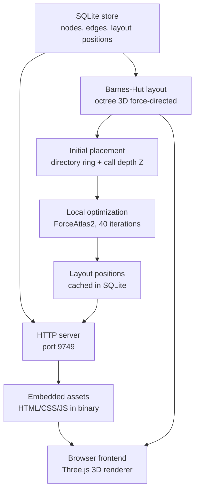
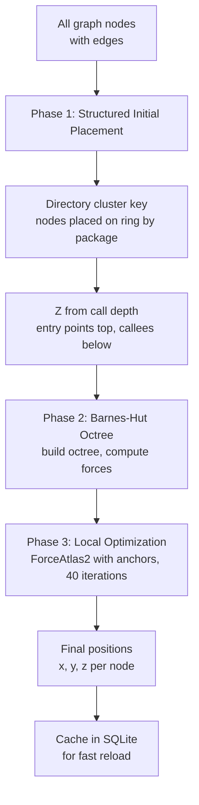

# Graph UI: Barnes-Hut 3D Layout, Embedded HTTP Server, Frontend

The graph visualization module provides an embedded HTTP server with an interactive 3D force-directed layout of the knowledge graph. It uses Barnes-Hut octree approximation for efficient N-body simulation, structured initial placement by directory cluster and call depth, and stellar spectral color mapping by node degree. The entire frontend (HTML, CSS, JS) is compiled into the binary as embedded assets.

## Architecture



## Embedded HTTP Server

Source: `/home/darkvoid/Boxxed/@formulas/src.rust/src.AI/src.CodebaseMemory/codebase-memory-mcp/src/ui/http_server.c`

```c
// HTTP server entry point
int http_server_start(cbm_store_t *store, int port) {
    int sock = socket(AF_INET, SOCK_STREAM, 0);
    struct sockaddr_in addr = {0};
    addr.sin_family = AF_INET;
    addr.sin_port = htons(port);
    addr.sin_addr.s_addr = INADDR_ANY;

    bind(sock, (struct sockaddr *)&addr, sizeof(addr));
    listen(sock, 128);

    cbm_log_info("HTTP server started on port %d\n", port);

    // Accept connections in a thread
    pthread_create(&server_thread, NULL, http_accept_loop, &sock);
    return 0;
}
```

The server handles these routes:

| Route | Response |
|-------|----------|
| `/` | Main HTML page with Three.js renderer |
| `/styles.css` | CSS styles |
| `/app.js` | Frontend JavaScript |
| `/api/nodes` | JSON array of nodes (capped at `CBM_UI_MAX_RENDER_NODES`) |
| `/api/edges` | JSON array of edges |
| `/api/layout` | JSON array of layout positions |
| `/api/project` | Project metadata |
| `/api/schema` | Graph schema summary |

Embedded assets are compiled into the binary:

Source: `/home/darkvoid/Boxxed/@formulas/src.rust/src.AI/src.CodebaseMemory/codebase-memory-mcp/src/ui/embedded_assets.h`

```c
// Embedded frontend assets (generated from build process)
// These are compiled into the binary as const char * strings
extern const char *EMBEDDED_INDEX_HTML;
extern const char *EMBEDDED_STYLES_CSS;
extern const char *EMBEDDED_APP_JS;

// Serve embedded asset by path
const char *get_embedded_asset(const char *path, size_t *size);
```

## Barnes-Hut Layout Algorithm

Source: `/home/darkvoid/Boxxed/@formulas/src.rust/src.AI/src.CodebaseMemory/codebase-memory-mcp/src/ui/layout3d.h`

```c
// 3D layout configuration
#define BH_THETA       1.2f   // Barnes-Hut opening criterion
#define BH_REPULSION   8.0f   // Repulsion strength
#define BH_ATTRACTION  1.0f   // Attraction strength (spring)
#define BH_ANCHOR_SPR  0.25f  // Anchor spring strength
#define BH_ITERATIONS  40     // Local optimization iterations
#define BH_Z_SPACING   50.0f  // Z depth spacing per call level
```

The layout algorithm has three phases:



### Phase 1: Structured Initial Placement

```c
// Phase 1: Place nodes on a ring by directory cluster, Z by call depth
void layout_initial_place(cbm_store_t *store, layout_node_t *nodes, int count) {
    // Group nodes by directory cluster key
    cbm_hash_table_t *clusters = cluster_by_directory(nodes, count);

    // Place each cluster at equal angles on a ring
    float angle_step = 2.0f * M_PI / clusters->count;
    int cluster_idx = 0;

    cbm_hash_foreach(clusters, assign_cluster_position,
                     &(struct { float angle_step, cluster_idx, radius }){
                         .angle_step = angle_step,
                         .radius = 500.0f
                     });
}
```

Nodes are placed on a ring (radius 500 units) with equal angular spacing per cluster. The cluster key is the top-level directory path, so `src/auth/` files cluster together, `src/api/` files cluster together, etc.

Z is assigned by call depth: entry points (no inbound calls) are at Z=0, their callees are at Z=50, callees of callees are at Z=100, and so on.

### Phase 2: Barnes-Hut Octree

The Barnes-Hut algorithm builds an octree over the nodes, then computes repulsive forces between all pairs using the octree approximation:

```c
// Barnes-Hut octree node
typedef struct BHNode {
    struct BHNode *children[8];  // 8 octants
    float center_x, center_y, center_z;
    float size;                  // Half-width of octant
    float mass_x, mass_y, mass_z;  // Center of mass
    float total_mass;            // Number of nodes in octant
    int leaf_count;              // Nodes if this is a leaf
    int leaf_nodes[MAX_LEAF];    // Node indices if leaf
} BHNode;

// Build octree
BHNode *bh_build(layout_node_t *nodes, int count, BHNode *parent, int depth) {
    if (count <= MAX_LEAF) {
        // Leaf node
        return make_leaf(nodes, count);
    }

    // Subdivide into 8 octants
    BHNode *node = make_internal();
    for (int i = 0; i < 8; i++) {
        node->children[i] = bh_subdivide(nodes, count, i);
    }

    return node;
}

// Compute repulsive forces using octree
void bh_compute_repulsion(BHNode *tree, layout_node_t *target, float *fx, float *fy, float *fz) {
    // Barnes-Hut criterion: if size/distance < theta, use center of mass
    float dx = tree->mass_x - target->x;
    float dy = tree->mass_y - target->y;
    float dz = tree->mass_z - target->z;
    float dist = sqrtf(dx*dx + dy*dy + dz*dz);

    if (tree->size / dist < BH_THETA) {
        // Use center of mass approximation
        float force = BH_REPULSION * tree->total_mass / (dist * dist);
        *fx += force * dx / dist;
        *fy += force * dy / dist;
        *fz += force * dz / dist;
    } else if (tree->is_leaf) {
        // Recurse into leaf nodes
        for (int i = 0; i < tree->leaf_count; i++) {
            int idx = tree->leaf_nodes[i];
            if (idx != target->id) {
                repel_one(target, &nodes[idx], fx, fy, fz);
            }
        }
    } else {
        // Recurse into children
        for (int i = 0; i < 8; i++) {
            if (tree->children[i]) {
                bh_compute_repulsion(tree->children[i], target, fx, fy, fz);
            }
        }
    }
}
```

With `BH_THETA = 1.2`, the octree approximation is aggressive — many distant groups of nodes are treated as a single mass. This reduces the N-body computation from O(N^2) to O(N log N), which is essential for graphs with thousands of nodes.

### Phase 3: Local Optimization

```c
// ForceAtlas2 with anchor springs
void layout_optimize(layout_node_t *nodes, int count, int iterations) {
    for (int iter = 0; iter < iterations; iter++) {
        // Build Barnes-Hut octree
        BHNode *tree = bh_build(nodes, count, NULL, 0);

        // Compute forces for each node
        for (int i = 0; i < count; i++) {
            float fx = 0, fy = 0, fz = 0;

            // Repulsion from all other nodes (Barnes-Hut)
            bh_compute_repulsion(tree, &nodes[i], &fx, &fy, &fz);

            // Attraction along edges (spring force)
            for (int j = 0; j < nodes[i].edge_count; j++) {
                int target = nodes[i].edges[j];
                float dx = nodes[target].x - nodes[i].x;
                float dy = nodes[target].y - nodes[i].y;
                float dz = nodes[target].z - nodes[i].z;
                float dist = sqrtf(dx*dx + dy*dy + dz*dz);

                // Spring force (attraction)
                float force = BH_ATTRACTION * dist;
                fx += force * dx / dist;
                fy += force * dy / dist;
                fz += force * dz / dist;

                // Anchor spring (pull toward initial position)
                float ax = nodes[i].initial_x - nodes[i].x;
                float ay = nodes[i].initial_y - nodes[i].y;
                float az = nodes[i].initial_z - nodes[i].z;
                fx += BH_ANCHOR_SPR * ax;
                fy += BH_ANCHOR_SPR * ay;
                fz += BH_ANCHOR_SPR * az;
            }

            // Apply forces
            nodes[i].x += fx * 0.1f;
            nodes[i].y += fy * 0.1f;
            nodes[i].z += fz * 0.1f;
        }

        bh_destroy(tree);
    }
}
```

The anchor springs prevent nodes from drifting too far from their structured initial positions. Without anchors, the force-directed layout can produce aesthetically pleasing but semantically meaningless arrangements. The anchors keep related nodes (same directory, similar call depth) near each other.

## Node Visuals

Node size and color are determined by type and degree:

| Node Type | Size | Color |
|-----------|------|-------|
| Project | 20 | Stellar O (blue giant) |
| Package | 15 | Stellar B (blue-white) |
| Module | 15 | Stellar B (blue-white) |
| Folder | 12 | Stellar A (white) |
| File | 8 | Stellar F (yellow-white) |
| Class/Struct/Interface | 6 | Stellar G (yellow) |
| Function/Method | 4 | Stellar K (orange) |
| Leaf (degree < 5) | 2 | Stellar M (red dwarf) |

The stellar spectral mapping is a clever visual encoding: hub nodes (high degree) appear as bright blue stars, while leaf nodes appear as dim red dots. This immediately communicates the graph's topology — you can see the hubs and the periphery at a glance.

## UI Configuration

Source: `/home/darkvoid/Boxxed/@formulas/src.rust/src.AI/src.CodebaseMemory/codebase-memory-mcp/src/ui/config.h`

```c
// UI configuration
typedef struct {
    int port;                    // HTTP server port (default 9749)
    int max_render_nodes;        // Node rendering cap (default 2000, max 10000)
    bool enabled;                // UI enabled (default true)
    const char *theme;           // "dark" or "light"
} cbm_ui_config_t;

// Environment variable overrides
int ui_config_from_env(cbm_ui_config_t *config);
```

## HTTP Handler

Source: `/home/darkvoid/Boxxed/@formulas/src.rust/src.AI/src.CodebaseMemory/codebase-memory-mcp/src/ui/httpd.c`

```c
// HTTP request handler
int httpd_handle_request(const char *method, const char *path,
                         const char *query, char *response, size_t resp_size) {
    if (strcmp(path, "/") == 0) {
        return serve_index(response, resp_size);
    }
    if (strcmp(path, "/styles.css") == 0) {
        return serve_css(response, resp_size);
    }
    if (strcmp(path, "/app.js") == 0) {
        return serve_js(response, resp_size);
    }
    if (strcmp(path, "/api/nodes") == 0) {
        return api_nodes(response, resp_size);
    }
    if (strcmp(path, "/api/edges") == 0) {
        return api_edges(response, resp_size);
    }
    if (strcmp(path, "/api/layout") == 0) {
        return api_layout(response, resp_size);
    }

    return 404;
}
```

The `/api/nodes` endpoint enforces the rendering cap:

```c
int api_nodes(char *response, size_t resp_size) {
    int max = ui_config.max_render_nodes;  // Default 2000

    // Query nodes from store, capped
    sqlite3_stmt *stmt;
    sqlite3_prepare_v2(store->db,
        "SELECT id, label, name, qualified_name, file_path "
        "FROM nodes ORDER BY id LIMIT ?",
        -1, &stmt, NULL);
    sqlite3_bind_int(stmt, 1, max);

    // Build JSON array
    json_builder_t jb;
    json_init(&jb);
    while (sqlite3_step(stmt) == SQLITE_ROW) {
        json_object_begin(&jb);
        json_key_value_int(&jb, "id", sqlite3_column_int64(stmt, 0));
        json_key_value_str(&jb, "label", (const char *)sqlite3_column_text(stmt, 1));
        json_key_value_str(&jb, "name", (const char *)sqlite3_column_text(stmt, 2));
        // ...
        json_object_end(&jb);
    }

    return json_finish(&jb, response, resp_size);
}
```

## Aha Moment

**Aha:** The layout starts with structured placement (directory ring + call depth Z) before running Barnes-Hut optimization, rather than starting from random positions. Random initialization produces different layouts on every run and often separates related nodes. The structured start ensures that `src/auth/` functions cluster together and `src/api/` functions cluster together — the Barnes-Hut optimization just fine-tunes positions within that semantic structure. The anchor springs (ForceAtlas2 with BH_ANCHOR_SPR = 0.25) prevent drift, so the final layout preserves the initial semantic grouping.

## Cross-References

- [Store](06-store.md) for how layout positions are cached in SQLite
- [MCP Tools](08-mcp-tools.md) for the `get_architecture` tool that feeds the UI
- [CLI and Install](10-cli-install.md) for the `--ui` and `--port` flags
