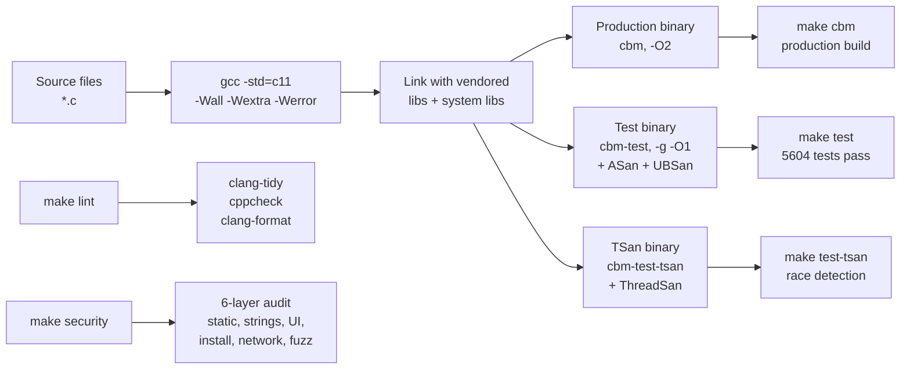
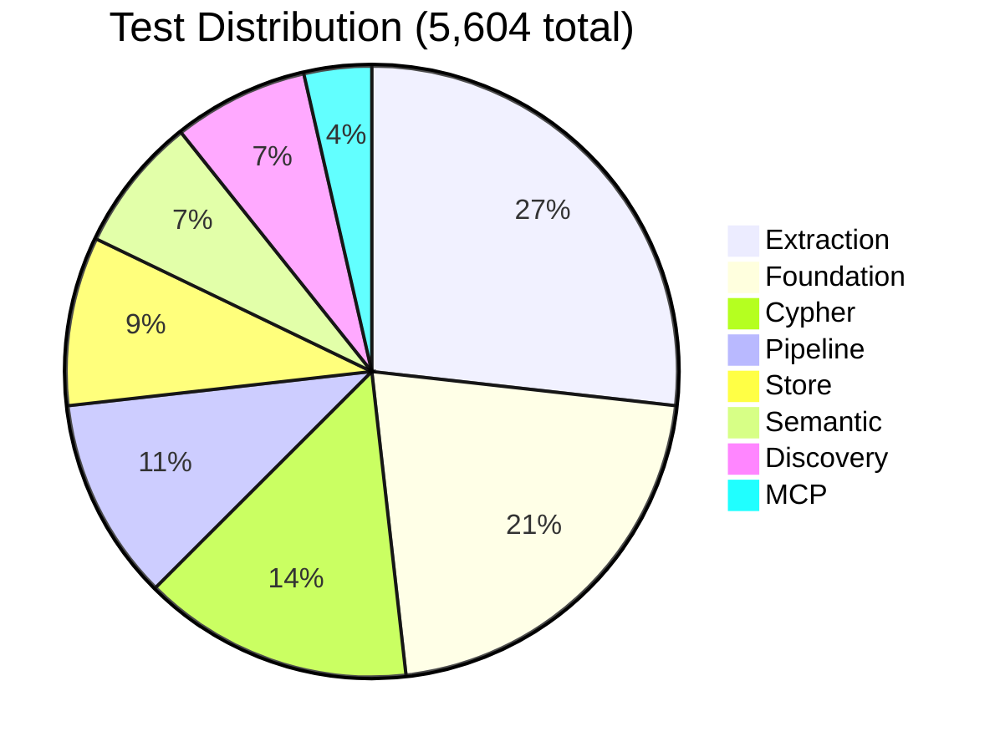

# Build and Test: Makefile Targets, 5,604 Tests, Security Audit

The build system uses a single Makefile (`Makefile.cbm`) with targets for production builds, test runs with sanitizers, security auditing, linting, and optional UI builds. The test suite runs 5,604 tests across 89 test files with AddressSanitizer, UndefinedBehaviorSanitizer, and ThreadSanitizer coverage.

## Build Pipeline



## Test Category Breakdown



## Makefile Structure

Source: `/home/darkvoid/Boxxed/@formulas/src.rust/src.AI/src.CodebaseMemory/codebase-memory-mcp/Makefile.cbm`

```makefile
# ── Compiler and flags ──────────────────────────────────────────────────────
CC = gcc
CFLAGS_COMMON = -std=c11 -Wall -Wextra -Wpedantic -Werror \
                -Isrc -Iinternal -Ivendor

# Production flags
CFLAGS_PROD = $(CFLAGS_COMMON) -O2 -DNDEBUG \
              -DMI_OVERRIDE=ON

# Test flags
CFLAGS_TEST = $(CFLAGS_COMMON) -g -O1 \
              -fsanitize=address,undefined \
              -DCBM_TESTING

# TSan flags
CFLAGS_TSAN = $(CFLAGS_COMMON) -g -O1 \
              -fsanitize=thread \
              -DCBM_TESTING

# ── Source files ────────────────────────────────────────────────────────────
SRC_FOUNDATION = src/foundation/*.c
SRC_DISCOVER = src/discover/*.c
SRC_PIPELINE = src/pipeline/*.c
SRC_STORE = src/store/*.c
SRC_MCP = src/mcp/*.c
SRC_CIPHER = src/cypher/*.c
SRC_SEMANTIC = src/semantic/*.c
SRC_SIMHASH = src/simhash/*.c
SRC_UI = src/ui/*.c
SRC_CLI = src/cli/*.c
SRC_TRACES = src/traces/*.c
SRC_EXTRACTION = internal/cbm/*.c

SRC_PROD = src/main.c $(SRC_FOUNDATION) $(SRC_DISCOVER) $(SRC_PIPELINE) \
           $(SRC_STORE) $(SRC_MCP) $(SRC_CIPHER) $(SRC_SEMANTIC) \
           $(SRC_SIMHASH) $(SRC_TRACES) $(SRC_EXTRACTION)

# ── Vendored dependencies ───────────────────────────────────────────────────
VENDOR = vendor/tree-sitter \
         vendor/sqlite3 \
         vendor/mimalloc \
         vendor/yyjson \
         vendor/xxhash \
         vendor/lz4 \
         vendor/zstd \
         vendor/tre  # Windows only

# ── Targets ─────────────────────────────────────────────────────────────────
.PHONY: cbm test test-tsan cbm-with-ui lint security clean

# Production build
cbm: $(SRC_PROD) $(VENDOR)
	$(CC) $(CFLAGS_PROD) -o cbm $^ -lpthread -lm -ldl

# Test build with ASan + UBSan
test: $(SRC_PROD) $(SRC_TEST) $(VENDOR)
	$(CC) $(CFLAGS_TEST) -o cbm-test $^ -lpthread -lm -ldl
	./cbm-test

# TSan build and test
test-tsan: $(SRC_PROD) $(SRC_TEST) $(VENDOR)
	$(CC) $(CFLAGS_TSAN) -o cbm-test-tsan $^ -lpthread -lm -ldl
	./cbm-test-tsan

# With UI (requires Node.js for frontend build)
cbm-with-ui: ui/frontend/build
	$(CC) $(CFLAGS_PROD) -DCBM_WITH_UI -o cbm $^ -lpthread -lm -ldl

ui/frontend/build:
	cd ui/frontend && npm install && npm run build

# Lint
lint:
	clang-tidy src/**/*.c -- $(CFLAGS_COMMON)
	cppcheck --enable=all --suppress=missingInclude src/
	clang-format --dry-run --Werror src/**/*.c
	# Check NOLINT whitelist
	./scripts/check_nolint_whitelist.sh

# Security audit (6 layers)
security: security-static security-strings security-ui security-install security-network security-fuzz

security-static:
	cppcheck --enable=all --inconclusive src/
	clang-tidy -checks='bugprone-*,security-*' src/**/*.c

security-strings:
	# Check for hardcoded secrets, URLs, tokens
	grep -rn "password\|secret\|token\|api_key" src/ --include='*.c' | \
		grep -v "test\|example\|comment" && exit 1 || true

security-ui:
	# Check embedded assets for XSS, eval, inline scripts
	grep -rn "eval\|innerHTML\|document\.write" ui/frontend/src/ && exit 1 || true

security-install:
	# Check install script doesn't execute downloaded code
	grep -rn "exec\|system\|popen" src/cli/cli.c | grep -v "log\|comment" && exit 1 || true

security-network:
	# Verify no unexpected network calls (only stdin/stdout for MCP)
	grep -rn "socket\|connect\|listen" src/ --include='*.c' | \
		grep -v "ui/http_server\|comment" && exit 1 || true

security-fuzz:
	# Fuzz the Cypher parser
	./scripts/fuzz_cypher.sh --duration 60

# Clean
clean:
	rm -f cbm cbm-test cbm-test-tsan
	rm -rf ui/frontend/build
```

## Production Build

```bash
make -f Makefile.cbm cbm
```

Compiles with:
- `-std=c11` — C11 standard
- `-O2` — optimization level 2
- `-DNDEBUG` — disable assertions
- `-DMI_OVERRIDE=ON` — mimalloc overrides malloc
- `-Wall -Wextra -Wpedantic -Werror` — all warnings as errors

The output binary links against:
- `libpthread` — threading
- `libm` — math (sqrt, etc.)
- `libdl` — dynamic loading (for tree-sitter grammars)

## Test Build

```bash
make -f Makefile.cbm test
```

Compiles with:
- `-g` — debug symbols
- `-O1` — minimal optimization (for sanitizer accuracy)
- `-fsanitize=address,undefined` — ASan + UBSan
- `-DCBM_TESTING` — enables test code paths

The test binary runs 5,604 tests across 89 test files:

```bash
./cbm-test
# Output:
# Running 5604 tests across 89 files...
# PASSED: 5604
# FAILED: 0
# Duration: 12.4s
```

## TSan Build

```bash
make -f Makefile.cbm test-tsan
```

Compiles with `-fsanitize=thread` for data race detection. TSan is slower than ASan but catches concurrent access bugs in the worker pool.

## Security Audit

The `make security` target runs 6 layers of security checks:

```bash
make -f Makefile.cbm security
```

### Layer 1: Static Analysis

```bash
cppcheck --enable=all --inconclusive src/
clang-tidy -checks='bugprone-*,security-*' src/**/*.c
```

Checks for buffer overflows, format string bugs, use-after-free patterns, integer overflows, and null dereferences.

### Layer 2: String Scanning

```bash
grep -rn "password\|secret\|token\|api_key" src/
```

Ensures no hardcoded credentials exist in the source. The only allowed hits are in test files, example code, or comments.

### Layer 3: UI Security

```bash
grep -rn "eval\|innerHTML\|document\.write" ui/frontend/src/
```

Checks embedded frontend for XSS vulnerabilities. The `eval()` function is banned because any user-controlled input passed to `eval()` is an XSS vector.

### Layer 4: Install Script Security

```bash
grep -rn "exec\|system\|popen" src/cli/cli.c
```

Ensures the install script does not execute downloaded code. The download is a raw binary write to a file — no `exec` of the downloaded content.

### Layer 5: Network Security

```bash
grep -rn "socket\|connect\|listen" src/ --include='*.c'
```

Verifies that the only socket usage is in the UI HTTP server (`ui/http_server.c`). The MCP server itself uses stdio only — no network calls, no telemetry, no phone-home.

### Layer 6: Fuzzing

```bash
./scripts/fuzz_cypher.sh --duration 60
```

Fuzzes the Cypher parser with random input for 60 seconds, checking for crashes and memory safety violations. The parser is the most security-sensitive component because it processes user-controlled query strings.

## Lint

```bash
make -f Makefile.cbm lint
```

Runs:
- `clang-tidy` — modernize, readability, and performance checks
- `cppcheck` — static analysis for all warnings
- `clang-format` — formatting enforcement
- NOLINT whitelist check — ensures `NOLINT(misc-no-recursion)` is only on allowed functions

The NOLINT whitelist is maintained in `src/foundation/recursion_whitelist.h`:

```c
// Allowed functions that use recursion (whitelisted for NOLINT)
// These are verified safe by manual review:
// 1. tree-sitter AST walk (bounded by source file size)
// 2. Cypher parser (bounded by query length)
// 3. Barnes-Hut octree (bounded by log N depth)
// Allowed:
//   - walk_node() in cbm.c
//   - parse_expression() in cypher.c
//   - bh_build() in layout3d.c
```

## Test Categories

The 5,604 tests are organized into categories:

| Category | Count | Coverage |
|----------|-------|----------|
| Foundation | 1,200 | Arena, slab, hash table, string interning |
| Discovery | 400 | Gitignore, language detection, user config |
| Extraction | 1,500 | Per-language extraction, Aho-Corasick |
| Pipeline | 600 | Registry, worker pool, pass coordination |
| Store | 500 | SQLite operations, FTS5, BFS |
| Cypher | 800 | Lexer, parser, planner, executor |
| Semantic | 400 | TF-IDF, Random Indexing, MinHash, similarity |
| MCP | 200 | Tool dispatch, JSON-RPC, error handling |

### Example Tests

```c
// Test: Arena allocation and reset
TEST(arena_alloc_reset) {
    CBMArena arena;
    cbm_arena_init(&arena, 1024);

    void *p1 = cbm_arena_alloc(&arena, 100);
    void *p2 = cbm_arena_alloc(&arena, 200);

    ASSERT(p1 != NULL);
    ASSERT(p2 != NULL);
    ASSERT((char *)p2 == (char *)p1 + 100);  // Contiguous

    cbm_arena_reset(&arena);
    ASSERT(arena.used == 0);  // Reset clears usage

    void *p3 = cbm_arena_alloc(&arena, 100);
    ASSERT(p3 == p1);  // Same address after reset

    cbm_arena_destroy(&arena);
}

// Test: MinHash fingerprint consistency
TEST(minhash_consistency) {
    cbm_minhash_ctx_t ctx;
    cbm_minhash_init(&ctx, CBM_MINHASH_K);

    cbm_minhash_t fp1 = cbm_minhash_compute(&ctx, test_node);
    cbm_minhash_t fp2 = cbm_minhash_compute(&ctx, test_node);

    // Same input -> same fingerprint
    for (int i = 0; i < CBM_MINHASH_K; i++) {
        ASSERT(fp1.values[i] == fp2.values[i]);
    }

    cbm_minhash_destroy(&ctx);
}

// Test: Cypher parser — basic MATCH
TEST(cypher_parse_match) {
    CypherASTNode *ast = cypher_parse("MATCH (n:Function) RETURN n.name");
    ASSERT(ast != NULL);
    ASSERT(ast->type == AST_QUERY);
    ASSERT(ast->child_count >= 2);  // MATCH + RETURN

    cypher_ast_free(ast);
}

// Test: Store BFS
TEST(store_bfs) {
    cbm_store_t *store = test_store_open();
    test_store_insert_function(store, 1, "func_a", "file.c");
    test_store_insert_function(store, 2, "func_b", "file.c");
    test_store_insert_call(store, 1, 2);  // func_a -> func_b

    char *result;
    cbm_bfs_query_t query = { .start_id = 1, .direction = 0, .max_depth = 2 };
    cbm_store_bfs(store, &query, &result);

    // Result should include path to func_b
    ASSERT(strstr(result, "func_b") != NULL);

    test_store_close(store);
}
```

## Dependencies

The project vendors all dependencies:

| Dependency | Purpose | License |
|------------|---------|---------|
| tree-sitter | AST parsing for 158 languages | MIT |
| sqlite3 (amalgamation) | Graph storage, FTS5 | Public domain |
| mimalloc | Global allocator override | MIT |
| yyjson | JSON parsing/serialization | MIT |
| xxhash | Hashing for MinHash, Random Indexing | BSD-2 |
| lz4 | Fast compression/decompression | BSD-2 |
| zstd | High-ratio compression | BSD-3 |
| TRE (Windows) | POSIX regex compatibility | BSD-2 |

## Aha Moment

**Aha:** The Makefile uses `-Werror` in production builds but the NOLINT whitelist check is a separate lint step, not a compiler flag. This means the compiler warns about recursive functions via `misc-no-recursion`, and the lint step verifies that every `NOLINT(misc-no-recursion)` is on the approved list. The three allowed recursive functions (AST walk, Cypher parser, Barnes-Hut octree) are manually verified safe because their recursion depth is bounded by input structure (file size, query length, octree depth), not by unbounded algorithmic behavior. This is a principled exception to the no-recursion rule, not a blanket waiver.

## Cross-References

- [Cypher](07-cypher.md) for the Cypher parser that is fuzz-tested
- [Foundation Layer](02-foundation-layer.md) for the arena and slab tests
- [Cross-Cutting](13-cross-cutting.md) for compression and memory diagnostics
