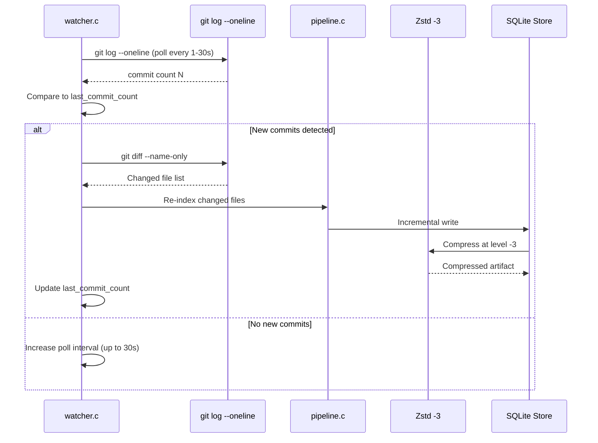
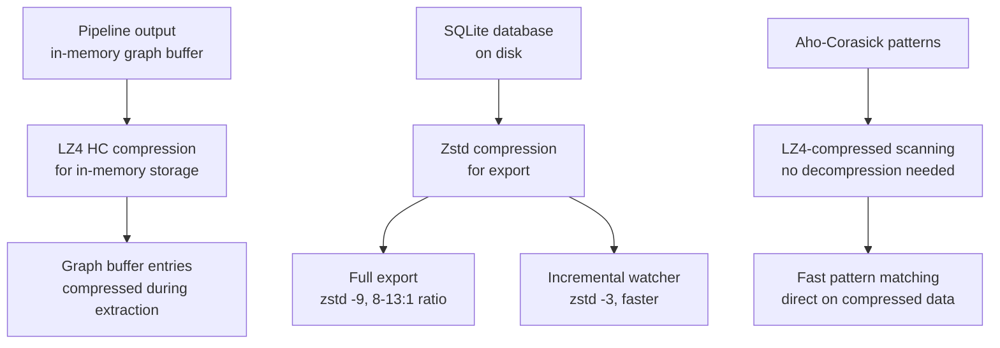

# Cross-Cutting Concerns: Compression, Memory Management, Logging, Diagnostics, Traces

Several concerns span multiple modules in the engine: compression (LZ4 + Zstandard), memory management (budget tracking, diagnostics), structured logging, runtime trace ingestion, and background auto-sync. These are not isolated to a single module — they affect the pipeline, store, extraction, and UI layers.

## Watcher Auto-Sync Flow



## Compression Architecture



The engine uses two compression strategies for different purposes:

| Strategy | Algorithm | Use Case | Compression Level | Ratio |
|----------|-----------|----------|-------------------|-------|
| In-memory | LZ4 HC | Graph buffer entries, Aho-Corasick patterns | HC (high compression) | 2-4:1 |
| Export | Zstandard | Database export, incremental writes | -9 (full), -3 (incremental) | 8-13:1 |

## LZ4 Compression

Source: `/home/darkvoid/Boxxed/@formulas/src.rust/src.AI/src.CodebaseMemory/codebase-memory-mcp/internal/cbm/lz4_store.c`

```c
// LZ4 compressed storage for graph buffer entries
typedef struct {
    char *compressed_data;
    int compressed_size;
    int original_size;
} cbm_lz4_entry_t;

// Compress data using LZ4 HC
int cbm_lz4_compress(const char *input, int input_size,
                     char *output, int output_capacity);

// Decompress LZ4 data
int cbm_lz4_decompress(const char *input, int input_size,
                       char *output, int output_capacity);

// Get compressed size for pre-allocation
int cbm_lz4_compress_bound(int input_size);
```

LZ4 HC (high compression) is used for in-memory compression during the pipeline. It compresses graph buffer entries (node and edge arrays) before they are flushed to SQLite, reducing memory pressure during large repository indexing. The HC variant trades speed for better compression ratio compared to LZ4 fast.

Aho-Corasick can scan LZ4-compressed data directly:

```c
// Scan LZ4-compressed buffer without decompression
uint64_t cbm_ac_scan_lz4(cbm_ac_t *ac, const char *compressed, int compressed_len) {
    // Decompress block-by-block and scan each block
    // LZ4 block structure: [tag][literals][match_offset][match_length]
    // We can identify string boundaries in compressed form and scan them
    uint64_t result_mask = 0;
    const char *p = compressed;
    const char *end = compressed + compressed_len;

    while (p < end) {
        uint8_t token = *p++;
        int lit_len = (token >> 4) + 24;

        // Scan literals portion directly
        result_mask |= cbm_ac_scan(ac, p, lit_len);
        p += lit_len;

        if (p >= end) break;

        // Skip match (we don't scan matches — they're references to already-scanned data)
        p += 2;  // offset
        if (p < end) p += 1;  // length
    }

    return result_mask;
}
```

This avoids decompressing the entire buffer just to scan for patterns. Since the Aho-Corasick automaton only needs to see the original data (the literals in LZ4 blocks), and the match portions are references to already-scanned data, we can skip decompression entirely. This is a significant optimization for large graphs.

## Zstandard Compression

Source: `/home/darkvoid/Boxxed/@formulas/src.rust/src.AI/src.CodebaseMemory/codebase-memory-mcp/internal/cbm/zstd_store.c`

```c
// Zstandard compression for database export
int cbm_zstd_compress(const char *input, int input_size,
                      char *output, int output_capacity, int level);

int cbm_zstd_decompress(const char *input, int input_size,
                        char *output, int output_capacity);
```

Two compression levels are used:
- **Level -9** for full export: maximum compression, used when the user requests a complete database export
- **Level -3** for incremental writes in the watcher: faster compression with acceptable ratio, used when writing updated data after git commits

The export format is `.codebase-memory/graph.db.zst` — a single Zstandard-compressed SQLite database file.

## Memory Management

### RSS Budget Tracking

Source: `/home/darkvoid/Boxxed/@formulas/src.rust/src.AI/src.CodebaseMemory/codebase-memory-mcp/src/foundation/mem.c`

```c
// Memory budget enforcement
int cbm_mem_init(CBMMemBudget *budget, double ram_fraction) {
    size_t total_ram = mi_os_stat_total_memory();
    budget->budget_bytes = (size_t)(total_ram * ram_fraction);
    budget->current_rss = 0;
    budget->peak_rss = 0;
    budget->collect_count = 0;

    cbm_log_info("Memory budget: %zu MB (%.0f%% of %zu MB)\n",
                 budget->budget_bytes / (1024*1024),
                 ram_fraction * 100.0,
                 total_ram / (1024*1024));
    return 0;
}

// Collect memory between files
size_t cbm_mem_collect(void) {
    // mimalloc returns unused pages to OS
    size_t collected = mi_collect(true /* force */);
    budget->collect_count++;
    return collected;
}

// Check if within budget
int cbm_mem_within_budget(const CBMMemBudget *budget) {
    return mi_os_stat_rss() <= budget->budget_bytes;
}
```

The budget is calculated as 25% of total physical RAM. On a 32GB machine, this is 8GB. Between file extractions, `cbm_mem_collect()` forces mimalloc to return unused pages to the OS, keeping RSS within budget.

### Memory Diagnostics

Source: `/home/darkvoid/Boxxed/@formulas/src.rust/src.AI/src.CodebaseMemory/codebase-memory-mcp/src/foundation/diagnostics.c`

```c
// Memory diagnostics output (CBM_DIAGNOSTICS=1)
void cbm_diagnostics_print(void) {
    mi_stats_print(NULL);  // mimalloc stats

    // Arena diagnostics
    for (int i = 0; i < arena_count; i++) {
        CBMArena *a = &arenas[i];
        cbm_log_info("Arena %d: %d blocks, %zu bytes used, %zu total alloc\n",
                     i, a->nblocks, a->used, a->total_alloc);
    }

    // Slab diagnostics
    cbm_log_info("Slab: %d free slots, %d capacity\n",
                 slab.free_count, slab.capacity);

    // Peak RSS
    cbm_log_info("Peak RSS: %zu MB\n", budget.peak_rss / (1024*1024));
}
```

Enabled via `CBM_DIAGNOSTICS=true`, diagnostics print mimalloc statistics, arena usage, slab utilization, and peak RSS at the end of indexing.

### Dump and Verify

Source: `/home/darkvoid/Boxxed/@formulas/src.rust/src.AI/src.CodebaseMemory/codebase-memory-mcp/src/foundation/dump_verify.c`

```c
// Post-indexing verification
int cbm_dump_verify(cbm_store_t *store, const char *project) {
    // Count nodes and edges
    int node_count = cbm_store_count_nodes(store, project);
    int edge_count = cbm_store_count_edges(store, project);

    // Verify: edge count >= node_count * min_ratio
    int expected_min_edges = (int)(node_count * CBM_DUMP_VERIFY_MIN_RATIO);
    if (edge_count < expected_min_edges) {
        cbm_log_warn("Verification failed: too few edges (%d < %d)\n",
                     edge_count, expected_min_edges);
        return -1;
    }

    // Verify: no orphan edges (source/target must exist)
    int orphan_count = cbm_store_count_orphan_edges(store, project);
    if (orphan_count > 0) {
        cbm_log_warn("Verification warning: %d orphan edges\n", orphan_count);
    }

    cbm_log_info("Verification passed: %d nodes, %d edges\n", node_count, edge_count);
    return 0;
}
```

The verification uses `CBM_DUMP_VERIFY_MIN_RATIO = 0.5` — the edge count should be at least 50% of the node count. If not, something went wrong during extraction (likely a language detection failure or extraction budget cutoff).

## Structured Logging

Source: `/home/darkvoid/Boxxed/@formulas/src.rust/src.AI/src.CodebaseMemory/codebase-memory-mcp/src/foundation/log.c`

```c
// Log output always goes to stderr (stdout reserved for MCP JSON-RPC)
void cbm_log_info(const char *fmt, ...) {
    if (log_level < CBM_LOG_INFO) return;

    fprintf(stderr, "[INFO]  ");
    va_list args;
    va_start(args, fmt);
    vfprintf(stderr, fmt, args);
    va_end(args);
    fflush(stderr);
}

void cbm_log_warn(const char *fmt, ...) {
    if (log_level < CBM_LOG_WARN) return;

    fprintf(stderr, "[WARN]  ");
    va_list args;
    va_start(args, fmt);
    vfprintf(stderr, fmt, args);
    va_end(args);
    fflush(stderr);
}

void cbm_log_error(const char *fmt, ...) {
    // Errors always print, regardless of log level
    fprintf(stderr, "[ERROR] ");
    va_list args;
    va_start(args, fmt);
    vfprintf(stderr, fmt, args);
    va_end(args);
    fflush(stderr);
}
```

Log levels are controlled by `CBM_LOG_LEVEL`:

| Level | Value | Output |
|-------|-------|--------|
| none | 0 | Nothing |
| error | 1 | Errors only |
| warn | 2 | Warnings + errors |
| info | 3 | Info + warnings + errors (default) |
| debug | 4 | Everything |

The separation of stderr (logging) from stdout (MCP responses) is critical. If logging wrote to stdout, it would corrupt the JSON-RPC protocol and cause agent parsing failures.

## Profiling

Source: `/home/darkvoid/Boxxed/@formulas/src.rust/src.AI/src.CodebaseMemory/codebase-memory-mcp/src/foundation/profile.c`

```c
// Profile timing helper
typedef struct {
    const char *name;
    uint64_t start_ns;
    uint64_t total_ns;
    int call_count;
} cbm_profile_t;

// Start profiling a section
void cbm_profile_start(cbm_profile_t *profile, const char *name) {
    profile->name = name;
    profile->start_ns = cbm_now_ns();
}

// End profiling
void cbm_profile_end(cbm_profile_t *profile) {
    profile->total_ns = cbm_now_ns() - profile->start_ns;
    profile->call_count++;
}

// Print profile results
void cbm_profile_print(cbm_profile_t *profiles, int count) {
    for (int i = 0; i < count; i++) {
        cbm_log_info("%s: %.2fms (calls: %d)\n",
                     profiles[i].name,
                     profiles[i].total_ns / 1e6,
                     profiles[i].call_count);
    }
}
```

The pipeline uses profiling to track per-pass timing, which is exposed via the `index_status` MCP tool.

## Runtime Trace Ingestion

Source: `/home/darkvoid/Boxxed/@formulas/src.rust/src.AI/src.CodebaseMemory/codebase-memory-mcp/src/traces/traces.h`

```c
// Runtime trace for HTTP_CALLS validation
typedef struct {
    const char *method;       // GET, POST, PUT, DELETE
    const char *path;         // /api/users, /api/auth/login
    const char *caller;       // frontend, web-app, mobile
    uint64_t timestamp;       // Trace timestamp
} cbm_trace_t;

// Ingest traces and match against HTTP route nodes
int cbm_traces_ingest(cbm_store_t *store, const char *project,
                      cbm_trace_t *traces, int count);
```

Traces are matched against HTTP route nodes in the graph. When a trace's method + path matches a route node, an HTTP_CALLS edge is created from the identified caller to the route. This validates that runtime traffic actually reaches the code paths identified during extraction.

## Background Watcher

Source: `/home/darkvoid/Boxxed/@formulas/src.rust/src.AI/src.CodebaseMemory/codebase-memory-mcp/src/watcher/watcher.h`

```c
// Background auto-sync via git polling
typedef struct {
    const char *repo_path;
    const char *project;
    int poll_interval_ms;     // Adaptive: 1000-30000
    int last_commit_count;
    int changes_detected;
} cbm_watcher_t;

// Start background watcher
int cbm_watcher_start(cbm_watcher_t *watcher);

// Stop watcher
void cbm_watcher_stop(cbm_watcher_t *watcher);
```

The watcher polls `git log --oneline` at adaptive intervals (1 second when changes are detected, up to 30 seconds when quiet). When new commits are found, it runs `git diff` to identify changed files and re-indexes only those files. The incremental write uses Zstd level -3 for speed.

## Aha Moment

**Aha:** The Aho-Corasick scanner can operate on LZ4-compressed data without decompression. LZ4's block structure is simple enough that the scanner can identify literal byte sequences (which contain the actual data) and skip match references (which point back to already-scanned data). This means pattern matching on a 1GB compressed graph takes the same time as matching on the compressed representation, not the decompressed one. For a graph with 10 million nodes, this saves both CPU time (no decompression) and memory (no temporary decompression buffer).

## Cross-References

- [Foundation Layer](02-foundation-layer.md) for the arena, slab, and mimalloc allocators
- [Pipeline](05-pipeline.md) for how the pipeline uses compression during extraction
- [Store](06-store.md) for how the store manages SQLite storage
- [Build and Test](12-build-test.md) for the security audit layers
