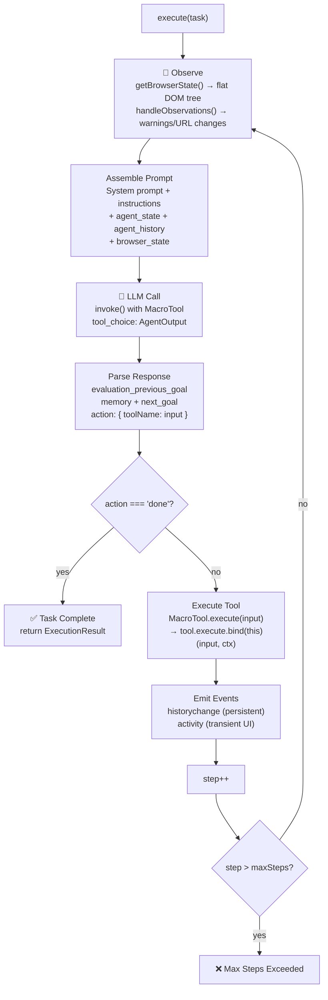

# Page-Agent — AI-Powered Browser Automation Agent

**Page-Agent is an AI agent that lives in your webpage and controls it with natural language.** Built by Alibaba, it uses LLMs through OpenAI-compatible APIs to observe the DOM, reason about what to do, and execute actions like clicking, typing, scrolling, and navigating — all within a structured Re-act (Reasoning + Acting) loop. It runs entirely in-page as JavaScript; no Python, no headless browser, no screenshots required.

Source: `packages/` — 62 TypeScript files across 8 packages, v1.10.0, MIT license

## The Re-act Loop

Page-Agent's core is the Re-act (Reasoning + Acting) loop in `PageAgentCore.execute()`:



**Aha:** The entire tool set is collapsed into a single "MacroTool" with a union schema. The LLM doesn't call individual tools — it calls ONE tool (`AgentOutput`) whose input contains both the reflection state AND the selected action. This forces the LLM to produce reflection (evaluation, memory, next goal) before every action, implementing the "reflection-before-action" mental model at the API level.

## The 8-Package Monorepo

```
page-agent/
├── packages/
│   ├── core/              ← PageAgentCore: Re-act loop, MacroTool, event system
│   ├── page-agent/        ← Entry point: PageAgent class, demo
│   ├── page-controller/   ← DOM operations: flat tree, element indexing, actions
│   ├── llms/              ← LLM client: OpenAI-compatible, retry logic
│   ├── extension/         ← Browser extension: background/content, multi-page
│   ├── mcp/               ← MCP server for external tool orchestration
│   ├── ui/                ← React panel for extension sidebar
│   └── website/           ← Documentation website
```

| Package | npm Name | Purpose | Key Export |
|---------|----------|---------|------------|
| `core` | `@page-agent/core` | Agent loop, MacroTool, events, prompt assembly | `PageAgentCore` |
| `page-agent` | `page-agent` | Entry point, demo script | `PageAgent` |
| `page-controller` | `@page-agent/page-controller` | DOM flattening, element indexing, click/input/scroll | `PageController` |
| `llms` | `@page-agent/llms` | OpenAI client, retry, tool calling | `LLM`, `parseLLMConfig` |
| `extension` | `@page-agent/ext` | Chrome extension, background/content scripts | `MultiPageAgent` |
| `mcp` | `@page-agent/mcp` | MCP server for agent orchestration | MCP server tools |
| `ui` | `@page-agent/ui` | React components for extension panel | `Panel` |
| `website` | `@page-agent/website` | Documentation site (Astro) | — |

## Key Design Decisions

1. **In-page JavaScript, not CDP.** Page-Agent runs directly in the page context. This means it has full access to the DOM, can interact with JavaScript frameworks (React, Vue), and doesn't need Chrome DevTools Protocol or screenshots. The tradeoff: it can't interact with native browser UI (download dialogs, permission prompts).

2. **Text-based DOM, not screenshots.** The PageController flattens the DOM into a textual representation of interactive elements (with index numbers), plus page metadata. This is cheaper (no vision model needed), faster (no image encoding), and more reliable (no OCR errors). The tradeoff: purely visual elements (decorative images, CSS-only layouts) are invisible to the agent.

3. **MacroTool enforces reflection.** By merging all tools into one `AgentOutput` schema with required reflection fields, the architecture ensures the LLM evaluates the previous action, updates memory, and sets the next goal before choosing an action. This prevents the common failure mode where agents act without thinking.

4. **Events, not callbacks.** The agent uses `EventTarget` with four event types (`statuschange`, `historychange`, `activity`, `dispose`) rather than callback props. This allows multiple listeners, clean teardown with `removeEventListener`, and decoupled UI updates.

5. **AbortController throughout.** Every async operation — LLM calls, tool execution, `wait()` delays, `onAskUser` callbacks — receives the agent's `AbortController` signal. This enables cooperative cancellation: `stop()` calls `abort()`, and every pending operation checks `signal.throwIfAborted()`.

## Configuration Surface

```typescript
// packages/core/src/types.ts:10-160
interface AgentConfig extends LLMConfig {
    language?: 'en-US' | 'zh-CN'       // UI and output language
    maxSteps?: number                    // Default: 40
    customTools?: Record<string, PageAgentTool | null>  // Extend or remove tools
    instructions?: {
        system?: string                 // Global system instructions
        getPageInstructions?: (url: string) => string  // Per-page dynamic instructions
    }
    stepDelay?: number                  // Default: 0.4 seconds between steps
    experimentalScriptExecutionTool?: boolean  // Enable execute_javascript tool
    experimentalLlmsTxt?: boolean       // Fetch /llms.txt from sites
    transformPageContent?: (content: string) => Promise<string> | string
    customSystemPrompt?: string         // Override entire system prompt
    // Lifecycle hooks
    onBeforeStep?: (agent, stepCount) => Promise<void> | void
    onAfterStep?: (agent, history) => Promise<void> | void
    onBeforeTask?: (agent) => Promise<void> | void
    onAfterTask?: (agent, result) => Promise<void> | void
    onDispose?: (agent, reason?) => void
}
```

## Event System

| Event | Payload | Persistent? | Purpose |
|-------|---------|-------------|---------|
| `statuschange` | — | No (derived) | Agent status: idle → running → completed/error/stopped |
| `historychange` | `HistoricalEvent` | Yes | Step results, observations, errors, retries |
| `activity` | `AgentActivity` | No | Transient UI feedback: thinking, executing, retrying |
| `dispose` | — | No | Agent cleanup notification |

## Next

→ [Architecture](01-architecture.md) — Full dependency graph, event flow, lifecycle states.
