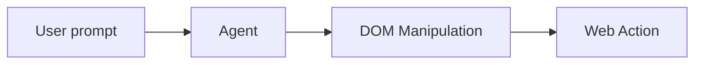

# Page Agent — In-Page Web GUI Agent

**Control web interfaces with natural language, no browser extension needed.**

Source: 65 TypeScript files

## Architecture



## Features

| Feature | Description |
|---------|-------------|
| In-page JS | No Python/headless browser |
| Text-based | No screenshots needed |
| BYO LLM | Any LLM provider |
| Chrome extension | Multi-page tasks |
| MCP Server | External control |

## Quick Start

```html
<script src="page-agent.js"></script>
```

## Use Cases

- SaaS AI Copilot
- Smart Form Filling  
- Accessibility
- Multi-page automation

## Next

Docs: https://alibaba.github.io/page-agent/
