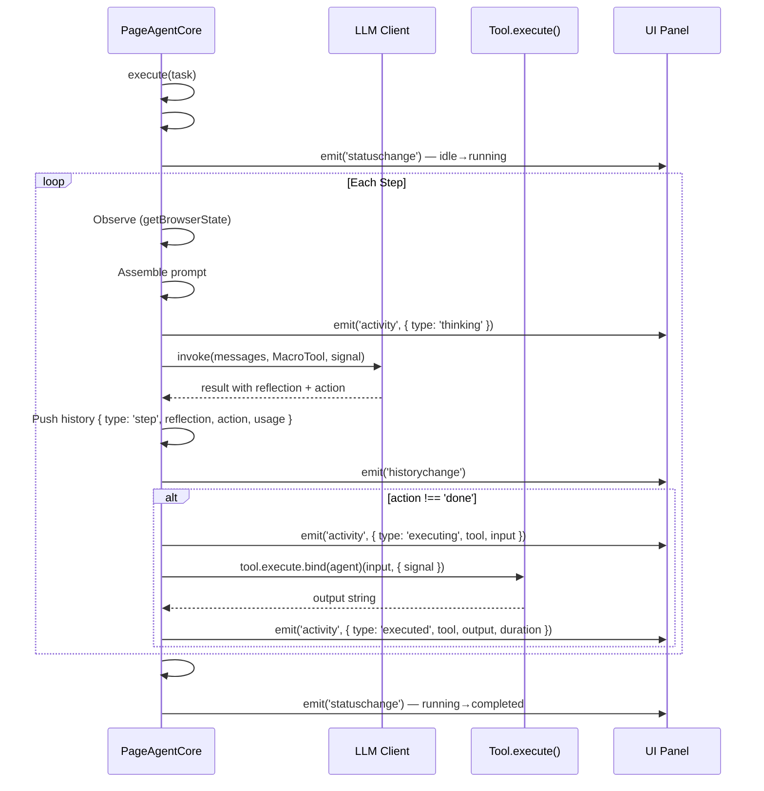
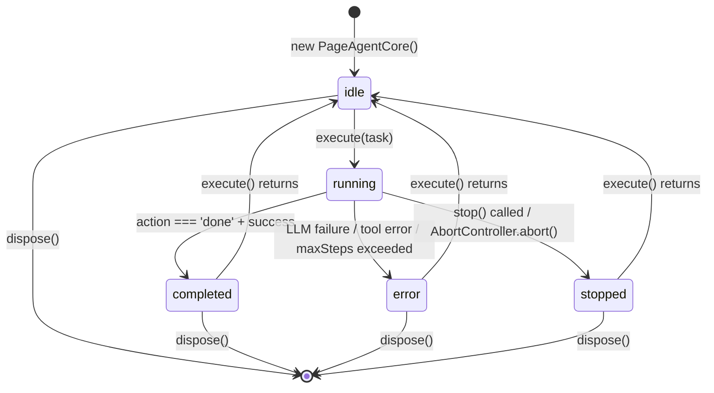

# Page-Agent Architecture — Dependency Graph, Event System, Lifecycle

**Page-Agent's architecture centers on three layers: the agent loop (`PageAgentCore`), the DOM controller (`PageController`), and the LLM client (`LLM`).** These are tied together by a strict dependency graph where `core` depends on `llms` and `page-controller`, while `extension` and `mcp` depend on `core`. The `page-agent` entry package re-exports everything.

Source: `packages/core/src/PageAgentCore.ts` — 661 lines, `packages/page-controller/src/PageController.ts`, `packages/llms/src/index.ts`

## Dependency Graph

```mermaid
flowchart TD
    subgraph External["External Dependencies"]
        Zod["zod/v4<br/>Schema validation"]
        Chalk["chalk<br/>Console formatting"]
    end

    subgraph Foundation["Foundation Packages"]
        LLMs["@page-agent/llms<br/>OpenAI client, retry, tool calling"]
        PC["@page-agent/page-controller<br/>DOM flattening, element actions"]
    end

    subgraph Core["Core Package"]
        Core["@page-agent/core<br/>PageAgentCore, tools, types"]
    end

    subgraph Entry["Entry & Integration"]
        PA["page-agent<br/>PageAgent, demo"]
        Ext["@page-agent/extension<br/>MultiPageAgent, tabs"]
        MCP["@page-agent/mcp<br/>MCP server"]
    end

    subgraph UI["UI Layer"]
        UIPkg["@page-agent/ui<br/>React panel"]
    end

    LLMs --> Core
    PC --> Core
    Zod --> Core
    Chalk --> Core
    Core --> PA
    Core --> Ext
    Core --> MCP
    Ext --> UIPkg
    Core --> UIPkg
```

**Aha:** The dependency graph is strictly layered — `page-controller` and `llms` have zero knowledge of the agent. `PageController` has no LLM imports; `LLM` has no DOM imports. This clean separation enables independent testing: you can unit test DOM flattening without an LLM, and you can test the LLM client with mock HTTP responses without a browser. The `core` package is the only place where LLM and DOM concepts meet.

## The PageAgentCore Class

`PageAgentCore` (`packages/core/src/PageAgentCore.ts`) extends `EventTarget` and contains the entire agent lifecycle:

```typescript
// packages/core/src/PageAgentCore.ts:61-147
export class PageAgentCore extends EventTarget {
    readonly id = uid()
    readonly config: PageAgentCoreConfig & { maxSteps: number }
    readonly tools: typeof tools
    readonly pageController: PageController

    task = ''
    taskId = ''
    history: HistoricalEvent[] = []
    disposed = false

    onAskUser?: (question: string, options?: { signal: AbortSignal }) => Promise<string>

    #status: AgentStatus = 'idle'
    #llm: LLM
    #abortController = new AbortController()
    #observations: string[] = []
    #running: Promise<void> = Promise.resolve()
    #lastResult: ExecutionResult | null = null
    #states = {
        totalWaitTime: 0,
        lastURL: '',
        browserState: null as BrowserState | null,
    }

    constructor(config: PageAgentCoreConfig) {
        super()
        this.config = { ...config, maxSteps: config.maxSteps ?? 40 }
        this.#llm = new LLM(this.config)
        this.tools = new Map(tools)
        this.pageController = config.pageController
        // Set up retry event listener
        // Process customTools (add/override/remove)
        // Optionally remove execute_javascript tool
    }
}
```

### State Management

All state is private (`#` prefix) or readonly:

| Field | Visibility | Purpose |
|-------|-----------|---------|
| `#status` | Private | Current lifecycle state: idle/running/completed/error/stopped |
| `#llm` | Private | LLM client instance |
| `#abortController` | Private | Cancellation signal for current task |
| `#observations` | Private | Queued system observations (flushed each step) |
| `#running` | Private | Promise that resolves when current run settles |
| `#lastResult` | Private | Most recent execution result |
| `#states` | Private | Internal tracking: wait time, URL changes, browser state |
| `history` | Public readonly | Persistent event stream (part of agent memory) |
| `tools` | Public readonly | Tool registry (can be mutated via customTools) |

**Aha:** `#running` is a Promise that only resolves when the current task's `finally` block executes. `stop()` awaits `#running` — this ensures that `stop()` doesn't return until all cleanup (hideMask, cleanUpHighlights, abort) is complete. This prevents the common race condition where `dispose()` is called while a tool is still executing.

## Event System

The event system has four channels, implemented via `EventTarget`:

```typescript
// packages/core/src/PageAgentCore.ts:48-59 (JSDoc)
// ## Event System
// - `statuschange` - Agent status transitions
// - `historychange` - History events updated (persistent, part of agent memory)
// - `activity` - Real-time activity feedback (transient, for UI only)
// - `dispose` - Agent cleanup triggered

// ## Information Streams
// 1. History Events (history array) - Persistent, included in LLM context
// 2. Activity Events (via activity event) - Transient, NOT in LLM context
```



**Aha:** History and Activity are deliberately separate channels. History events go into the LLM context on subsequent steps (they form the agent's memory). Activity events are purely for UI feedback (spinners, status messages) and are explicitly excluded from the LLM context. This prevents the common failure where the agent "sees" its own thinking UI and gets confused.

## Lifecycle States



The status transitions are enforced by `#setStatus()`:

```typescript
// packages/core/src/PageAgentCore.ts:178-183
#setStatus(status: AgentStatus): void {
    if (this.#status !== status) {
        this.#status = status
        this.#emitStatusChange()
    }
}
```

The guard in `execute()` prevents concurrent runs:

```typescript
if (this.#status === 'running') throw new Error('A task is already running.')
```

## Prompt Assembly

The user prompt is assembled dynamically each step by `#assembleUserPrompt()`:

```html
<!-- Simplified structure -->
<instructions>                          ← Optional, from config
  <system_instructions>...</system_instructions>
  <page_instructions>...</page_instructions>    ← Per-URL dynamic
  <llms_txt>...</llms_txt>                      ← From /llms.txt
</instructions>

<agent_state>
  <user_request>Book a flight to SF</user_request>
  <step_info>Step 3 of 40 max possible steps. Current time: ...</step_info>
</agent_state>

<agent_history>
  <step_1>
    Evaluation: ...
    Memory: ...
    Next Goal: ...
    Action Results: ✅ Clicked button
  </step_1>
  <sys>Page navigated to → https://flights.example.com</sys>
  <sys>⚠️ Only 5 steps remaining.</sys>
</agent_history>

<browser_state>
  Page URL: https://flights.example.com
  Page Title: Flight Search
  [Start of page]
  [1] <button>Search</button>
  [2] <input type="text" placeholder="From"/>
  [3] <input type="text" placeholder="To"/>
  ... 300 pixels below ...
  [End of page]
</browser_state>
```

### Observation System

System observations are queued via `pushObservation()` and flushed at the start of each step:

```typescript
// packages/core/src/PageAgentCore.ts:538-576
async #handleObservations(step: number): Promise<void> {
    // Accumulated wait time warning (triggers at 3+ seconds)
    // URL change detection (with 0.5s stabilization delay)
    // Remaining steps warning (at 5 and 2 steps remaining)
    // Flush queued observations to history
}
```

**Aha:** The observation system generates warnings that the AGENT sees in its context. When it's waited 3+ seconds cumulatively, it gets a message saying "DO NOT wait any longer." When 5 steps remain, it sees "Consider wrapping up." At 2 steps, it sees "You must finish the task or call done immediately." This is timeout pressure implemented as LLM context injection rather than hard limits — the model decides how to respond to the pressure.

## Cross-References

- [Agent Loop](02-agent-loop.md) — Step-by-step walkthrough of the Re-act loop
- [Tools](03-tools.md) — How tools are defined, registered, and executed
- [Page Controller](04-page-controller.md) — How the DOM is flattened for LLM consumption

## Next

→ [Agent Loop](02-agent-loop.md) — Deep dive into the Re-act loop implementation.
