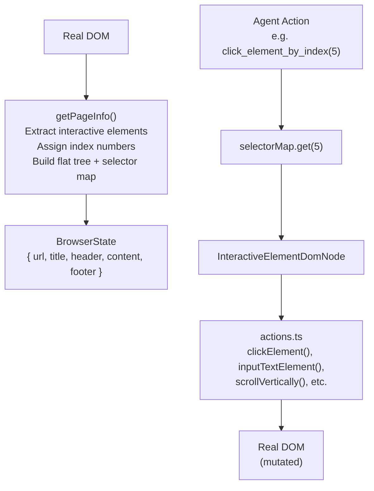

# Page-Agent Page Controller — DOM Operations and Element Interaction

**The PageController is the DOM abstraction layer that translates between structured browser state (for the LLM) and DOM manipulation actions (for the agent).** It flattens the DOM tree into a text representation of interactive elements with index numbers, manages a selector map for element lookup, and provides async methods for click, input, scroll, hover, and drag operations.

Source: `packages/page-controller/src/PageController.ts`, `packages/page-controller/src/actions.ts`, `packages/page-controller/src/dom/`

## Architecture



## BrowserState Structure

```typescript
// packages/page-controller/src/PageController.ts:34-43
export interface BrowserState {
    url: string
    title: string
    header: string       // Page info + scroll position hint
    content: string      // Simplified HTML of interactive elements
    footer: string       // Scroll position hint
}
```

The `content` field is the core — a simplified HTML string tagging only interactive elements:

```html
[1] <button id="search-btn">Search Flights</button>
[2] <input type="text" placeholder="From city"/>
[3] <input type="text" placeholder="To city"/>
[4] <select>
  <option>One-way</option>
  <option selected>Round-trip</option>
</select>
```

Each interactive element gets a unique index number in brackets `[N]`. The LLM references these indices when selecting actions (e.g., "click element 1").

### Scroll Position Hints

The `header` and `footer` provide scroll context:

```
header: "Page info: 1920x1080px, scrolled 0px [Start of page]"
footer: "... 300 pixels below ... [End of page]"
```

Or when scrolled:
```
header: "Page info: 1920x1080px, scrolled 450px [Start of page]"
footer: "... 450 pixels above ... [End of page]"
```

**Aha:** The scroll hints tell the LLM whether there's content above/below the current viewport without needing screenshots. If the footer says "300 pixels below," the agent knows it can scroll down for more content. If both header and footer show "[Start of page]" and "[End of page]," the agent knows the full page is visible and scrolling won't help.

## Flat DOM Tree

The `FlatDomTree` is a simplified representation:

```typescript
// packages/page-controller/src/dom/dom_tree/type.ts
interface FlatDomTree {
    // Flat array of all interactive elements
    // Each with: tagName, attributes, text, boundingBox, isVisible, isEnabled
}

interface InteractiveElementDomNode {
    index: number
    tagName: string
    attributes: Record<string, string>
    text: string
    boundingBox: DOMRect
    isVisible: boolean
    isEnabled: boolean
    element: HTMLElement           // Live reference for actions
}
```

## Element Actions

All actions live in `packages/page-controller/src/actions.ts`:

```typescript
// actions.ts
export function clickElement(element: HTMLElement): ActionResult
export function inputTextElement(element: HTMLElement, text: string): ActionResult
export function scrollVertically(element: HTMLElement, direction, amount): ActionResult
export function scrollHorizontally(element: HTMLElement, direction): ActionResult
export function selectOptionElement(element: HTMLElement, options: string[]): ActionResult
```

Actions return a simple `ActionResult`:

```typescript
interface ActionResult {
    success: boolean
    message: string
}
```

### React Patching

The PageController patches React's internal state to ensure form inputs are properly tracked:

```typescript
// packages/page-controller/src/patches/react.ts
export function patchReact(controller: PageController): void {
    // Intercepts React's value setter to properly trigger onChange
    // This ensures React-controlled inputs register agent-typed text
}
```

**Aha:** Normal `element.value = 'text'` followed by `element.dispatchEvent(new Event('input'))` doesn't work with React's synthetic event system — React tracks values through its fiber tree, not the DOM. The React patch intercepts React's internal value setter to properly update the component state, making `inputTextElement` work on React-controlled forms without triggering React's reconciliation.

## Visual Mask

During automated operations, an optional visual mask prevents user interference:

```typescript
// packages/page-controller/src/PageController.ts:85-97
private mask: SimulatorMask | null = null

constructor(config) {
    if (config.enableMask) this.initMask()
}
```

The `SimulatorMask` (`packages/page-controller/src/mask/SimulatorMask.ts`) overlays a semi-transparent layer with a status indicator, blocking user clicks while the agent works.

## DOM Configuration

```typescript
// packages/page-controller/src/dom/ (DomConfig)
interface DomConfig {
    // Which elements to consider "interactive"
    interactiveSelectors?: string[]
    // Maximum DOM depth to traverse
    maxDepth?: number
    // Whether to include text nodes
    includeTextNodes?: boolean
}
```

## Cross-References

- [Agent Loop](02-agent-loop.md) — How getBrowserState() is called each step
- [Tools](03-tools.md) — Tools that wrap these actions
- [Architecture](01-architecture.md) — How PageController fits in the dependency graph

## Next

→ [LLM Integration](05-llm-integration.md) — How Page-Agent communicates with LLMs via OpenAI-compatible APIs.
