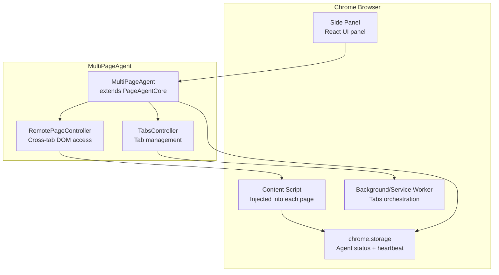

# Page-Agent Extension & MCP — Multi-Page Browser Automation and External Orchestration

**Page-Agent ships as a browser extension for cross-page workflows and exposes an MCP server for external orchestration.** The extension uses Chrome's side panel API with background/service worker coordination. The MCP server wraps Page-Agent tools as MCP tools, enabling AI agents like Claude Code to control browsers through Page-Agent.

Source: `packages/extension/` — Chrome extension, `packages/mcp/` — MCP server

## Browser Extension Architecture



## MultiPageAgent

`MultiPageAgent` (`packages/extension/src/agent/MultiPageAgent.ts`) extends `PageAgentCore` with multi-tab capabilities:

```typescript
export class MultiPageAgent extends PageAgentCore {
    constructor(config: MultiPageAgentConfig) {
        const tabsController = new TabsController()
        const pageController = new RemotePageController(tabsController)
        const customTools = createTabTools(tabsController)

        super({
            ...config,
            pageController,     // Remote DOM access instead of direct
            customTools: { ...config.customTools, ...customTools },
        })
    }
}
```

**Aha:** `MultiPageAgent` swaps the `PageController` for a `RemotePageController`. Instead of directly accessing `document.querySelector`, `RemotePageController` sends messages to the content script via Chrome's messaging API. This is the key abstraction that makes the same agent code work both in-page (direct DOM) and cross-page (via extension messaging).

### Tab Tools

The extension adds tab management tools via `createTabTools()`:

```typescript
// packages/extension/src/agent/tabTools.ts
function createTabTools(tabsController: TabsController) {
    return {
        new_page: tool({
            description: 'Open a URL in a new tab',
            inputSchema: z.object({ url: z.string() }),
            execute: async (input) => {
                const tab = await tabsController.createTab(input.url)
                return `✅ Opened new tab: ${tab.id}`
            },
        }),
        switch_tab: tool({ /* switch to tab by index */ }),
        close_page: tool({ /* close current tab */ }),
    }
}
```

### Heartbeat Mechanism

The extension uses `chrome.storage` as an eventually-consistent status channel:

```typescript
// MultiPageAgent.ts:42-50
/**
 * Project agent status into chrome.storage. The content script polls
 * `isAgentRunning` + `agentHeartbeat` (eventually consistent by design).
 *
 * When the agent is in side-panel and user closed the side-panel.
 * There is no chance for isAgentRunning to be set false.
 * This heartbeat mechanism acts as a backup.
 */
```

The content script polls `chrome.storage` for the heartbeat. If the heartbeat is stale (side panel closed without cleanup), the content script detects the agent has stopped and cleans up. This is a pragmatic solution to Chrome's side panel lifecycle — there's no reliable "side panel closed" event.

## TabsController

`TabsController` (`packages/extension/src/agent/TabsController.ts`) manages tab lifecycle:

```typescript
class TabsController {
    async createTab(url: string): Promise<chrome.tabs.Tab>
    async closeTab(tabId: number): Promise<void>
    async switchToTab(tabId: number): Promise<void>
    async getCurrentTab(): Promise<chrome.tabs.Tab>
    async getAllTabs(): Promise<chrome.tabs.Tab[]>
}
```

## RemotePageController

`RemotePageController` proxies DOM operations to the content script:

```typescript
// packages/extension/src/agent/RemotePageController.ts
class RemotePageController extends PageController {
    async getBrowserState(): Promise<BrowserState> {
        // Sends message to content script → gets flat DOM tree back
        const response = await chrome.tabs.sendMessage(tabId, {
            type: 'GET_BROWSER_STATE'
        })
        return response.browserState
    }

    // All DOM actions are similarly proxied
}
```

## Entry Points

The extension has three entry points (`packages/extension/src/entrypoints/`):

| Entry | File | Purpose |
|-------|------|---------|
| `background.ts` | Service worker | Tab management, message routing |
| `content.ts` | Content script | DOM access, PageController execution |
| `main-world.ts` | Main world script | Direct page context access (bypasses isolated world) |

## MCP Server

The MCP server (`packages/mcp/`) exposes Page-Agent as an MCP tool provider:

```
MCP Client (Claude Desktop, Claude Code, etc.)
    ↓ JSON-RPC over stdio
Page-Agent MCP Server
    ↓ PageAgentCore API
Browser (controlled by agent)
```

The MCP server wraps core agent functionality as MCP tools:
- `page_agent_execute` — Run a task
- `page_agent_status` — Get agent status
- `page_agent_stop` — Stop running task

This enables patterns like Claude Code spawning Page-Agent to interact with web UIs, then reading the results.

## Cross-References

- [Architecture](01-architecture.md) — Full dependency graph
- [Page Controller](04-page-controller.md) — DOM operations (proxied in extension)
- [Overview](00-overview.md) — Project feature summary

## Next

→ Back to [Overview](00-overview.md) for the big picture.
