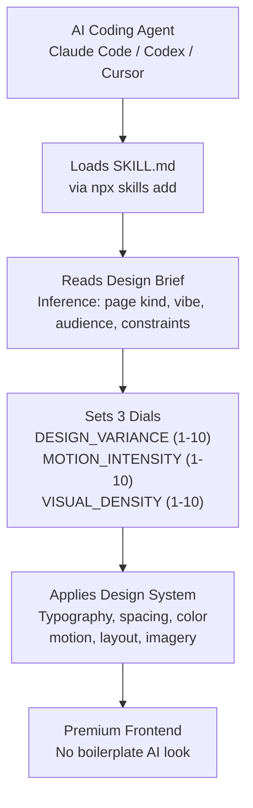
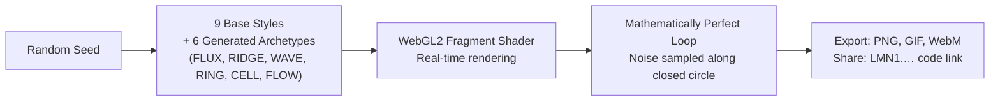

# DesignSkills — Anti-Slop Agent Skills, Generative Shaders, Gemini UI Redesign

**Three design-focused projects that elevate AI-generated interfaces.** **taste-skill** (MIT) provides 10+ portable agent skills that upgrade AI-built frontends with design taste — layout variance, typography, motion, spacing — preventing the "AI slop" look. **lumenshaders** is a self-contained WebGL2 generative shader art studio with 9 art styles and seamless loop animation. **gemini-extension** (MIT) redesigns Google Gemini's UI with a premium dark theme, custom backgrounds, and floating sidebar.

Source: `/home/darkvoid/Boxxed/@formulas/src.rust/src.AI/src.DesignSkills/`

## 1. taste-skill — Anti-Slop Frontend Framework for AI Agents

**10+ composable agent skills that prevent AI-generated UIs from looking boilerplate.** Each skill is a `SKILL.md` file that coding agents (Claude Code, Codex, Cursor) load to calibrate their design output. Skills are installed via `npx skills add`.

### Architecture

### The Core Insight: Design Dials

**Aha:** Instead of telling the LLM "make it look good," taste-skill quantifies aesthetics as three dials:

| Dial | 1 | 5 | 10 |
|------|---|---|-----|
| **DESIGN_VARIANCE** | Perfect symmetry | Moderate asymmetry | Artsy chaos |
| **MOTION_INTENSITY** | Static | Moderate animation | Cinematic physics |
| **VISUAL_DENSITY** | Art gallery / airy | Balanced | Cockpit / packed data |

**Baseline: 8 / 6 / 4.** These are global variables the LLM uses throughout the design process. Different page types get different dial values — a creative agency landing page gets 9/8/3, while a public-sector service site gets 3/2/5. The dials are what make the output feel intentional rather than templated.

### Skill Catalog

| Skill | Purpose |
|-------|---------|
| **taste-skill** | Core: anti-slop frontend, design read inference, 3-dial system |
| **taste-skill-v1** | Legacy v1 with stricter rules |
| **brutalist-skill** | Brutalist web design aesthetic |
| **minimalist-skill** | Minimalist / Swiss design style |
| **soft-skill** | Soft, warm, approachable UI |
| **redesign-skill** | Audit-first redesign workflow |
| **image-to-code-skill** | Convert reference images to HTML/CSS |
| **imagegen-frontend-web** | Image generation prompts for web reference boards |
| **imagegen-frontend-mobile** | Image generation prompts for mobile reference boards |
| **brandkit** | Brand kit image generation |
| **stitch-skill** | Google Stitch integration for UI generation |
| **output-skill** | Output formatting rules (single HTML file, all inline) |
| **gpt-tasteskill** | ChatGPT-specific skill variant |

### Key Design Rules

- **Design Read before code:** The agent must state "Reading this as: \<page kind> for \<audience>, with \<vibe> language" before generating any code
- **Anti-Default Discipline:** Never default to AI-purple gradients, centered heroes over dark mesh, three equal feature cards, generic glassmorphism
- **One question rule:** If the brief is ambiguous, ask exactly one clarifying question — never a multi-question dump
- **Redesign rule:** Always identify what's already good about the existing site before changing anything. Preserve what works

### Research: Understanding LLM Laziness

The `research/laziness/` directory catalogs why LLMs produce slop:
- **Root causes:** RLHF and compute optimization bias toward safe, average outputs; training data disproportionately contains templated designs; cognitive shortcuts in chain-of-thought
- **Remediation:** Architectural patterns to force deliberation, parameter tuning (temperature, top-p), prompt engineering techniques
- **Empirical findings:** Measurement of laziness across models and tasks

## 2. lumenshaders — Generative Shader Art Studio

**A self-contained WebGL2 tool generating looping abstract shader art with zero dependencies** — just an `index.html` and JavaScript files. 9 art styles: liquid chrome, silk ribbons, soft gradient blooms, aura rings, light rays, halftone fields, data glyphs, reeded glass, and pixel mosaics. Every animation is a mathematically perfect loop.

### 12-Gene Style Synthesizer

The "New style" button runs a 12-gene synthesizer that creates novel styles from combinations of:
- 6 field types × 5 domain geometries × 4 color mappings × 4 shading models × 4 overlays

Gem-quality results get **`[GEM]`** certification.

### Palette System

16 curated palettes plus a harmonic generator that creates complementary, analogous, and triadic palettes from a base hue. 4 editable color slots + background with hue/saturation/exposure controls.

### Export & Sharing

- **PNG export:** Single image at current resolution
- **Set export:** 4-12 variations (same style, palette, different seeds) as ZIP of PNGs
- **GIF/WebM export:** Animated looping output with configurable duration
- **Share codes:** `LMN1.…` compact serialization of all parameters. Copy the code, send it, paste to recreate the exact design. URL-based sharing with `?state=LMN1...`

### Controls

- `R` = Randomize (new style, palette, form, lighting, seed)
- `Space` = Pause/Play animation
- `S` = Save PNG
- "Keep style" locks the current art mode while randomizing other parameters

## 3. gemini-extension — Gemini UI Redesign

A Chrome extension (Manifest V3) that transforms Google Gemini into a premium dark experience:

- **Custom background images** for main area, sidebar, input field, and message bubbles
- **Per-zone darkness sliders** to fine-tune overlay opacity per zone
- **Floating sidebar** — rounded, elevated panel with soft shadow
- **Premium dark theme** — menus, dropdowns, chips, buttons all get cohesive dark treatment
- **Canvas compatible** — works correctly when Gemini's Canvas panel is open
- **MIT licensed**, full Chromium family support

## Cross-References

- [src.opendesign](../src.opendesign/markdown/00-overview.md) — Open Design ecosystem (related design tooling)
- [src.Google](../src.Google/markdown/00-overview.md) — Google's design.md format spec and Stitch ecosystem
