# DesignSkills — Anti-Slop Agent Skills, Generative Shader Studio, Gemini UI Redesign

**Three projects by Leon Lin (leonxlnx, MIT) that attack the problem of AI-generated visual mediocrity from different angles.** **taste-skill** (1,206-line SKILL.md) is a prompt-engineering framework that gives coding agents a quantifiable model of "design taste" — 3 dials, 47 mechanical pre-flight checks, and a 1,200-line rulebook banning the specific patterns that make AI output look generic. **lumenshaders** (682-line GLSL shader + 724-line JS engine) is a WebGL2 generative art studio where a 12-gene parametric synthesizer creates novel shader styles and every animation is a mathematically perfect loop via circular orbit in noise space. **gemini-extension** (387-line content.js + 647-line content.css) is a Chrome extension that applies per-zone custom backgrounds and glassmorphism to Google Gemini's UI with `MutationObserver` + `requestAnimationFrame` throttling.

Source: `/home/darkvoid/Boxxed/@formulas/src.rust/src.AI/src.DesignSkills/` — 3 projects, MIT

## 1. taste-skill — The Anti-Slop Framework

### The Problem: Why AI Generates Slop

**Aha:** LLMs default to the statistical center of their training distribution. In frontend design, that center is: Inter font, AI-purple gradients, centered hero over dark mesh, three equal feature cards, generic glassmorphism on everything. These aren't choices — they're the absence of choice. taste-skill forces choice by quantifying aesthetics as numbers the LLM must compute before generating any code.

### The Three Dials

```yaml
DESIGN_VARIANCE: 8    # 1 = Perfect Symmetry, 10 = Artsy Chaos
MOTION_INTENSITY: 6   # 1 = Static, 10 = Cinematic / Physics
VISUAL_DENSITY: 4     # 1 = Art Gallery / Airy, 10 = Cockpit / Packed Data
```

These are global variables. The entire 1,200-line SKILL.md uses them as gating conditions: "Centered Hero is avoided when `DESIGN_VARIANCE > 4`" (Section 4.3, line 210), "reduced-motion mandatory when `MOTION_INTENSITY > 3`" (Section 6), "generic card containers banned when `VISUAL_DENSITY > 7`" (Section 4.4, line 216).

**Aha: The dial values are inferred from the design brief, not user-set.** Section 1.A provides a lookup table:

| Signal | VARIANCE | MOTION | DENSITY |
|--------|----------|--------|---------|
| "minimalist / clean / Linear-style" | 5-6 | 3-4 | 2-3 |
| "premium consumer / Apple-y / luxury" | 7-8 | 5-7 | 3-4 |
| "playful / Awwwards / experimental" | 9-10 | 8-10 | 3-4 |
| "landing page (default)" | 7-9 | 6-8 | 3-5 |
| "trust-first / public-sector / regulated" | 3-4 | 2-3 | 4-5 |
| "redesign - preserve" | match existing | +1 | match existing |
| "redesign - overhaul" | +2 | +2 | match existing |

### Section 0: Design Read — The First Thing the Agent Must Do

```
// taste-skill/SKILL.md, Section 0.B
Before any code, state in one line:
"Reading this as: <page kind> for <audience>, with a <vibe> language,
 leaning toward <design system or aesthetic family>."
```

Example reads from the source:
- *"Reading this as: B2B SaaS landing for technical buyers, with a Linear-style minimalist language, leaning toward Tailwind utilities + Geist + restrained motion."*
- *"Reading this as: solo designer portfolio for hiring managers, with an editorial / kinetic-type language, leaning toward native CSS + scroll-driven animation + custom typography."*
- *"Reading this as: redesign of a public-sector service site, with a trust-first language, leaning toward GOV.UK Frontend or USWDS."*

**Aha: Section 0.C — If the brief is ambiguous, ask ONE question.** Never a multi-question dump. "Should this feel closer to Linear-clean or Awwwards-experimental?" And only when the design read genuinely diverges. If you can confidently infer, do not ask — just declare and proceed.

### Section 9.G — The Em-Dash Ban

The #1 violated rule in production testing:

```
Em-dashes (—), en-dashes (–), and double-em-dashes (——) are COMPLETELY BANNED
from all visible text on the page. This includes:
- Headlines
- Body copy
- Eyebrows
- Button labels
- Tooltips
- Alt text
- Placeholder text
- Footer text
- Error messages

Zero exceptions. Zero "it looks editorial." Zero "it's a design choice."
The em-dash is the single most reliable signal of AI-generated text.
```

### Section 14 — The 47-Item Pre-Flight Check

Every output must pass a mechanical checklist before shipping. Items include:
- **Em-dash audit:** grep for `—`, `--`, `——` across all files → must be zero
- **Eyebrow count:** count instances of `uppercase tracking` → must be ≤ ceil(sectionCount/3)
- **Button contrast:** every button text must meet WCAG AA against its background
- **CTA wrap check:** no button label wraps to 2 lines at desktop
- **Duplicate CTA intent:** "Get in touch" + "Contact us" on same page → fail
- **Bento cell count:** empty cells in grid → fail
- **Section-layout repetition:** same layout family used twice on one page → fail
- **Zigzag cap:** 3+ consecutive image+text splits → fail
- **Split-header ban:** left-headline + right-explainer as default → fail
- **Fake-precise numbers:** "92%", "4.1×", "48k" without source → fail
- **Copy self-audit:** re-read every visible string, flag anything that sounds like AI hallucination

### Section 4.7 — Layout Discipline

```
Hero MUST fit in the initial viewport. Headline max 2 lines on desktop, 
subtext max 20 words AND max 3-4 lines, CTAs visible without scroll.
Hero top padding max pt-24 (≈6rem) at desktop. More = layout bug.
Hero stack max 4 text elements: eyebrow(optional) + headline + subtext + CTAs.
BANNED in hero: tagline below CTAs, trust micro-strip, pricing teaser, 
  feature bullet list, social-proof avatar row.
Navigation MUST render on single line on desktop, max 80px height.
"Used by" logo wall belongs BELOW hero, never inside it.
```

### Skill Catalog (13 skills)

| Skill | Install Name | When to Use |
|-------|-------------|------------|
| taste-skill v2 | `design-taste-frontend` | Default — 1,200 lines, all rules active |
| taste-skill v1 | `design-taste-frontend-v1` | Legacy — original stricter variant |
| gpt-tasteskill | `gpt-taste` | GPT/Codex — Python-simulated randomness, AIDA structure |
| image-to-code | `image-to-code` | Image-first pipeline: generate references → analyze → implement |
| redesign-skill | `redesign-existing-projects` | Audit-first: identify what's good before changing |
| soft-skill | `high-end-visual-design` | Premium: softer contrast, whitespace, expensive fonts |
| output-skill | `full-output-enforcement` | When model ships half-finished work: full output enforcement |
| minimalist-skill | `minimalist-ui` | Editorial: Notion/Linear vibes |
| brutalist-skill | `industrial-brutalist-ui` | Hard mechanical: Swiss type, sharp contrast (Beta) |
| stitch-skill | `stitch-design-taste` | Google Stitch-compatible with DESIGN.md export |
| imagegen-frontend-web | `imagegen-frontend-web` | Reference boards for web design |
| imagegen-frontend-mobile | `imagegen-frontend-mobile` | Reference boards for mobile |
| brandkit | `brandkit` | Brand-kit boards: logos, palettes, type |

## 2. lumenshaders — Generative Shader Art Studio

### Architecture



```mermaid
flowchart TD
    subgraph JS["JavaScript (724 lines, main.js)"]
        P["P: parameter object<br/>~50 fields: colors, forms, lighting, textures, motion"]
        Modes["MODES: 9 base styles<br/>Chrome, Silk, Bloom, Aura, Rays,<br/>Halftone, Glyphs, Reeded, Mosaic"]
        Recipes["RECIPES: per-style randomizer ranges<br/>Controls how far randomize() pushes each param"]
        Genome["FIELDS: 6 × domain × 4 color × 5 shade × 5 overlay<br/>= parametric style synthesizer"]
        Encode["encodeDesign() / decodeDesign()<br/>LMN1.… base64url compact codes<br/>3 format versions"]
    end

    subgraph GLSL["GLSL (682 lines, shaders.js)"]
        Noise["Hash + Value Noise + FBM<br/>hash11, hash21, hash22, vnoise, fbm, ridgedFbm"]
        Loop["LT(): circular orbit in noise space<br/>= mathematically perfect loop"]
        Modes9["9 scene functions:<br/>sceneChrome, sceneSilk, sceneBloom,<br/>sceneAura, sceneRays, sceneHalftone,<br/>sceneGlyphs, sceneReeded, sceneMosaic"]
        Genome2["sceneGenome: 12-gene synthesizer<br/>g1: field, domain, warp, fold<br/>g2: colormap, shade, overlay, scale<br/>g3: ridge, poster, fieldScale, rotation"]
        Post["Post-processing:<br/>tone mapping, grain, halftone density,<br/>chromatic aberration, vignette, softness"]
    end

    subgraph Engine["Engine (291 lines, engine.js)"]
        Boot["Two-stage boot:<br/>1. Base shader (fast, links in ~2s)<br/>2. Genome shader (compiled lazily in background)"]
        Uniforms["~40 uniform pushes per frame"]
        Render["renderAt(phase):<br/>phase = (time / loopLength) % 1<br/>for seamless export at exact frames"]
        Export["PNG, GIF (gifenc.js), WebM (webmmux.js + WebCodecs)"]
    end

    JS --> Engine
    Engine --> GLSL
```

### The Noise Foundation

The shader starts with classic value noise and FBM:

```c
// shaders.js:83-95
float fbm(vec2 p){
  float v = 0.0, a = 0.5, tot = 0.0;
  mat2 R = rot(0.62);
  for (int i = 0; i < 8; i++){
    float w = clamp(u_complex - float(i), 0.0, 1.0);
    if (w <= 0.0) break;
    v += a*w*vnoise(p);
    tot += a*w;
    a *= 0.55;
    p = R*p*2.03 + 11.7;
  }
  return v/max(tot, 1e-4);
}
```

`u_complex` controls octave count (1-8). When `u_complex` is 3.5, octaves 0-3 get full weight, octave 4 gets 0.5 weight, and octaves 5-7 are skipped. This is smooth level-of-detail control.

### The Perfect Loop Mechanism

```c
// shaders.js:98-99
vec2 LT(){ return vec2(cos(TAU*u_phase), sin(TAU*u_phase)) * u_travel; }
vec2 SO(){ return vec2(hash11(u_seed*0.137+0.731)*61.7, hash11(u_seed*0.213+7.0)*47.3); }
```

**Aha: The phase orbits noise space on a circle.** `LT()` returns a 2D offset that traces a circle as `u_phase` goes from 0 to 1. At `u_phase=0` and `u_phase=1`, the offset is identical → the noise values are identical → the frame is identical. `SO()` provides a per-seed deterministic offset so different seeds explore different parts of noise space. This is how every animation becomes a mathematically perfect loop: the noise space is sampled along a closed path.

### The 9 Base Styles

Each mode is a `scene*()` function in the fragment shader:

- **Chrome** (mode 0): FBM → domain warp → Phong-like specular highlights on noise ridges. Liquid metal appearance.
- **Silk** (mode 1): FBM with high anisotropy (`u_stretch` skews coordinates). Long flowing strands.
- **Bloom** (mode 2): Multi-octave noise with soft threshold. Organic blobs with glow.
- **Aura** (mode 3): Polar coordinate noise → concentric rings modulated by phase.
- **Rays** (mode 4): Directional noise with angular intensity falloff from a center point.
- **Halftone** (mode 5): Discretized noise into cell sizes — each cell gets a solid luminance.
- **Glyphs** (mode 6): Grid-based glyph shapes (rectangles) modulated by noise intensity per cell.
- **Reeded** (mode 7): Horizontal line distortion with varying opacity — frosted glass effect.
- **Mosaic** (mode 8): Block-based rendering with bloom around cell edges.

### The 12-Gene Style Synthesizer

The "New Style" button generates a 12-gene configuration:

```
gene[0]: Field type  (0=FBM, 1=Ridged, 2=Wave, 3=Rings, 4=Cellular,
                      5=Flow, 6=Bands, 7=Grid, 8=Hex, 9=Arc, 10=Hatch, 11=Orb)
gene[1]: Domain operator (identity, polar, kaleidoscope, mirror, grid, hex, brick)
gene[2]: Warp amount
gene[3]: Fold count
gene[4]: Color mapping (gradient, cyclic, posterized, duotone, clean, angular)
gene[5]: Shading (embossed, glowing, deep contrast, glass sheen)
gene[6]: Overlay (stripes, dots, scanlines, weave)
gene[7]: Overlay scale
gene[8]: Ridge sharpness
gene[9]: Poster steps
gene[10]: Field scale
gene[11]: Rotation
```

```
FIELD_TYPES × DOMAIN_TYPES × COLOR_MAPS × SHADE_TYPES × OVERLAY_TYPES
 = 12 × 7 × 6 × 5 × 5 = 12,600 possible style combinations
```

**Aha: Gem-quality genomes get `[GEM]` certification.** The code tracks which combinations produce consistently good output and marks them. Users can save favorite genomes as one-click chips in localStorage.

### State Encoding: LMN1 Format

```javascript
// main.js — encodeDesign():
// Serializes the entire P object (mode, colors, params, genome genes)
// to a compact LMN1. base64url-encoded JSON array
// Format versions: v1-v2 (legacy), v3 (current, supports genome)
// Share codes can be pasted in the Share box or loaded via ?state=LMN1... URL param
```

### Export Pipeline

| Format | Implementation | Key Detail |
|--------|---------------|------------|
| **PNG** | `canvas.toBlob()` | Up to 3840×2160 (4K). Single frame at current phase. |
| **GIF** | `gifenc.js` (dependency-free) | Median-cut color quantizer + LZW compressor + ordered dithering. Frame-exact seamless loops. |
| **WebM** | `webmmux.js` + WebCodecs | VP9/VP8 encoding via browser's `VideoEncoder`. Hand-rolled Matroska/EBML muxer. 24/30/60 fps, configurable duration. |
| **Set** | `zip.js` + multiple PNGs | 4-12 variations (same style+palette, different seeds) as ZIP download. |

## 3. gemini-extension — Gemini UI Redesign

### Architecture

The extension has three components:

| Component | File | Lines | Role |
|-----------|------|-------|------|
| **Content Script** | `content.js` | 387 | Injected at `document_idle` on `gemini.google.com/*`. Reads settings from `chrome.storage.local`, applies CSS custom properties + inline styles, uses `MutationObserver` for SPA navigation. |
| **Content Styles** | `content.css` | 647 | Injected at `document_start` to avoid FOUC. Reworks sidebar (floating, rounded, 16px margin), input area (glassmorphism with `backdrop-filter: blur()`), menus, chips, canvas panel. |
| **Popup** | `popup.html` + `popup.js` (306 lines) + `popup.css` (459 lines) | 765 | Settings UI (380px wide): file upload zones with drag-and-drop, darkness sliders per zone (0-100%), glass intensity + blur + glow controls, 7 preset glow colors + custom color picker. |

### Content Script Initialization

```javascript
// content.js:39-73
function loadImagesFromStorage(callback) {
    chrome.storage.local.get([
        'bg_custom', 'sidebar_custom', 'input_custom', 'msg_custom',
        'backgrounds_enabled', 'hide_upgrade',
        'glass_intensity', 'glass_blur', 'glow_intensity', 'glow_color',
        'darkness_bg', 'darkness_sidebar', 'darkness_input', 'darkness_msg'
    ], (data) => {
        BACKGROUNDS_ENABLED = data.backgrounds_enabled !== false;
        GLASS_INTENSITY = data.glass_intensity ?? 0;
        GLASS_BLUR = data.glass_blur ?? 24;
        GLOW_INTENSITY = data.glow_intensity ?? 0;
        GLOW_COLOR = data.glow_color ?? '#a855f7';
        // Per-zone darkness: stored as 0-100, converted to 0-1 range for CSS
        DARKNESS_BG = (data.darkness_bg ?? 60) / 100;
        DARKNESS_SIDEBAR = (data.darkness_sidebar ?? 60) / 100;
        DARKNESS_INPUT = (data.darkness_input ?? 60) / 100;
        DARKNESS_MSG = (data.darkness_msg ?? 60) / 100;
        // ...
    });
}
```

### Glassmorphism — How It Works

```javascript
// content.js:78-99
function applyGlass() {
    if (GLASS_INTENSITY > 0) {
        document.body.classList.add('gemini-ext-glass');
        const opacity = (GLASS_INTENSITY / 100) * 0.7;        // Map 0-100 → 0.0-0.7 opacity
        const blur = (GLASS_INTENSITY / 100) * GLASS_BLUR;    // Map 0-100 → proportional blur
        document.body.style.setProperty('--glass-opacity', opacity);
        document.body.style.setProperty('--glass-blur', blur + 'px');
        // Force-clear input background-image so backdrop-filter blur works
        const inputArea = document.querySelector('input-area-v2');
        if (inputArea) {
            inputArea.style.setProperty('background-image', 'none', 'important');
        }
    } else {
        document.body.classList.remove('gemini-ext-glass');
    }
}
```

**Aha: Glassmorphism requires clearing the input background-image.** Gemini sets a CSS background-image on the input area. `backdrop-filter: blur()` only blurs content BEHIND the element — a foreground background-image blocks it. The extension force-clears the input's background-image when glass is active so the blur can work.

### Per-Zone Darkness — The Math

Each zone gets a darkness overlay: a `linear-gradient(rgba(0,0,0, {darkness}), rgba(0,0,0, {darkness}))` on top of the custom background image. Darkness values are stored as 0-100 integers in `chrome.storage.local`, converted to 0.0-0.8 floats for CSS. The 0.8 cap prevents the background from becoming completely black even at max darkness.

### MutationObserver — SPA Resilience

Gemini is a SPA. Navigation replaces DOM content without full page reloads. The extension uses `MutationObserver` with `requestAnimationFrame` throttling:

```javascript
// content.js (conceptual — the observer pattern)
const observer = new MutationObserver(() => {
    if (!pendingFrame) {
        pendingFrame = requestAnimationFrame(() => {
            applyAllStyles();    // Re-apply CSS variables + backgrounds
            pendingFrame = null;
        });
    }
});
observer.observe(document.body, { childList: true, subtree: true });
```

This prevents style flicker during rapid DOM mutations (chat streaming, canvas resize) — styles are reapplied at most once per animation frame.

### Popup — Image Upload with Auto-Resize

Uploaded images are automatically resized to max 1920px and converted to WebP at 85% quality to fit within Chrome's ~10MB `storage.local` quota. Each image goes to a specific zone slot (Background, Sidebar, Input Field, Messages). Changes are pushed to open Gemini tabs via `chrome.tabs.sendMessage({type: 'REFRESH_BACKGROUNDS'})`.
