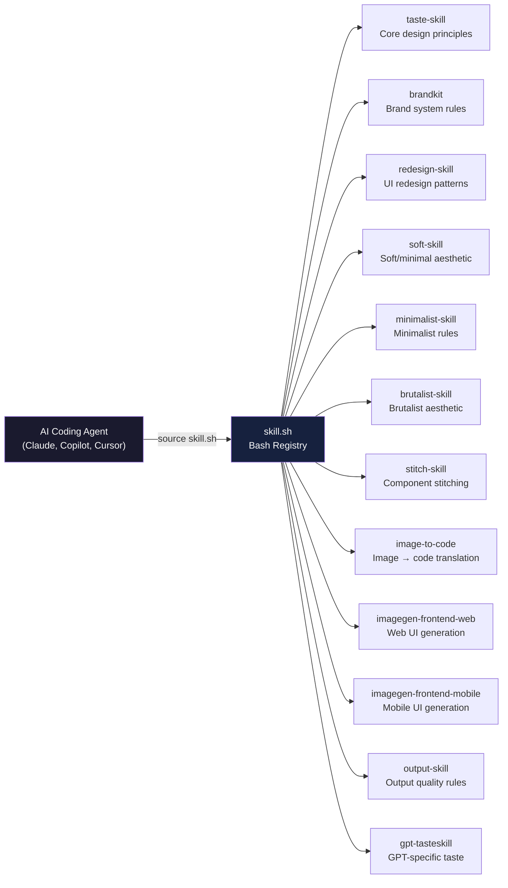

# taste-skill — Anti-Slop Agent Skills for AI Design Agents

**taste-skill is a bash-based skill registry for AI coding agents (Claude Code, GitHub Copilot, Cursor) that enforces "anti-slop" design principles — preventing generic, template-looking AI output in favor of polished, production-quality design.** It works by injecting design skill files (SKILL.md) into the agent's context, each containing specific design rules, typography guidance, color system principles, and layout patterns.

Source: `taste-skill/` — skill.sh registry + 11 SKILL.md files, Apache 2.0

## Architecture



## Skill Registry

The registry is a simple bash associative array:

```bash
# taste-skill/skill.sh:3-17
declare -A SKILLS=(
  [taste-skill]="skills/taste-skill/SKILL.md"
  [taste-skill-v1]="skills/taste-skill-v1/SKILL.md"
  [gpt-taste]="skills/gpt-tasteskill/SKILL.md"
  [image-to-code-skill]="skills/image-to-code-skill/SKILL.md"
  [imagegen-frontend-web]="skills/imagegen-frontend-web/SKILL.md"
  [imagegen-frontend-mobile]="skills/imagegen-frontend-mobile/SKILL.md"
  [brandkit]="skills/brandkit/SKILL.md"
  [redesign-skill]="skills/redesign-skill/SKILL.md"
  [soft-skill]="skills/soft-skill/SKILL.md"
  [output-skill]="skills/output-skill/SKILL.md"
  [minimalist-skill]="skills/minimalist-skill/SKILL.md"
  [brutalist-skill]="skills/brutalist-skill/SKILL.md"
  [stitch-skill]="skills/stitch-skill/SKILL.md"
)
```

Aha: The registry uses `source ./skill.sh <name>` rather than a binary or API call. This means AI agents can execute it natively using their shell tool — no special setup required. The SKILL.md files are plain markdown, which the agent reads as system instructions, making the entire system a "prompt-as-code" pattern.

## Core Design Skill (taste-skill)

The core taste-skill SKILL.md establishes the "anti-slop" principle:

- **Typography**: Specific font size scales, line-height ratios, and weight conventions
- **Color**: HSL-based color system with accessible contrast ratios
- **Spacing**: Consistent spacing scale (4px/8px/16px/24px/32px/48px/64px)
- **Border radius**: Contextual rounding — small for buttons, larger for cards
- **Shadows**: Layered shadow system for depth
- **Layout**: Grid and flexbox patterns, responsive breakpoints

## Specialized Skills

| Skill | Focus | Key Rules |
|-------|-------|-----------|
| brandkit | Brand design systems | Logo usage, color palettes, typography hierarchy |
| redesign-skill | UI redesign | Take existing UI → apply taste-skill principles |
| soft-skill | Soft aesthetic | Gentle shadows, warm colors, organic shapes |
| minimalist-skill | Minimalist design | Remove decoration, maximize whitespace |
| brutalist-skill | Brutalist aesthetic | Raw borders, system fonts, high contrast |
| stitch-skill | Component assembly | How to combine individual components into cohesive layouts |
| image-to-code | Image → code | Extract design tokens from images |
| imagegen-frontend-web | Web UI gen | Generate web UIs from image prompts |
| imagegen-frontend-mobile | Mobile UI gen | Generate mobile UIs from image prompts |
| output-skill | Quality gates | Review output against taste principles |
| gpt-tasteskill | GPT-specific | Adapted for GPT's generation patterns |

## Integration with AI Agents

The skill integrates via multiple channels:

| Channel | File | Agent |
|---------|------|-------|
| Claude Code Plugin | `.claude-plugin/plugin.json` | Claude Code |
| GitHub Copilot | `.github/copilot-instructions.md` | GitHub Copilot |
| Skills Directory | `skills/*/SKILL.md` | Any agent |
| LLMs.txt | `skills/llms.txt` | LLM discovery |

```json
// taste-skill/.claude-plugin/plugin.json
{
  "name": "taste-skill",
  "description": "Anti-slop design skills for AI agents"
}
```

## The "Anti-Slop" Philosophy

Aha: "Slop" refers to the generic, template-like output that AI models produce when asked to design UIs — default Tailwind colors, predictable border radii, generic shadows, and safe typography. The anti-slop principle enforces specific, opinionated design choices: named color palettes instead of `gray-100`, deliberate spacing instead of arbitrary values, and intentional aesthetic choices instead of defaults.

## Usage

```bash
# List available skills
source ./skill.sh

# Load a specific skill into your agent's context
source ./skill.sh taste-skill
source ./skill.sh brandkit
source ./skill.sh redesign-skill
```

For AI agents that read files directly, reference the SKILL.md files:
- `skills/taste-skill/SKILL.md` — core design principles
- `skills/brandkit/SKILL.md` — brand system rules
- `skills/stitch-skill/SKILL.md` — component composition

## Cross-References

- [Gemini UI Redesign](02-gemini-extension.md) — UI customization for Gemini
- [LumenShaders](03-lumenshaders.md) — generative shader art studio

Next: Read about the [Gemini UI Redesign](02-gemini-extension.md) extension.
