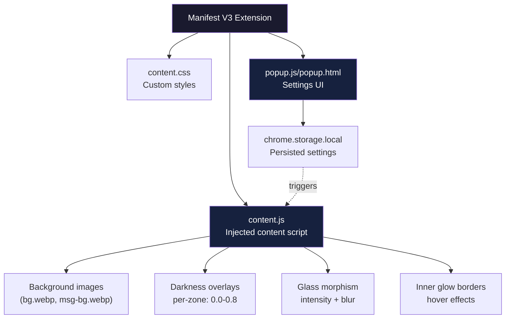

# Gemini UI Redesign — Browser Extension for Gemini Interface Customization

**Gemini UI Redesign is a Manifest V3 Chrome extension that customizes the Gemini web interface with custom backgrounds, per-zone darkness overlays, glass morphism effects, and inner glow borders.** It runs as a content script injected at `document_start`, meaning UI modifications happen before the page renders — avoiding flash of unstyled content.

Source: `gemini-extension/` — 14 files, Manifest V3, version 0.2.29

## Architecture



## Content Script

The content script runs at `document_start` to inject styles before Gemini renders:

```json
// gemini-extension/manifest.json:22-28
"content_scripts": [
  {
    "matches": ["https://gemini.google.com/*"],
    "css": ["content.css"],
    "run_at": "document_start"
  },
  {
    "matches": ["https://gemini.google.com/*"],
    "js": ["content.js"],
    "run_at": "document_idle"
  }
]
```

Aha: Two content scripts with different `run_at` values is a deliberate boot strategy. CSS at `document_start` ensures styles exist before any DOM renders (no flash). JS at `document_idle` waits for the DOM to be ready before injecting custom elements (the floating sidebar, controls, etc.). This split prevents the race condition where JS tries to modify DOM elements that haven't been created yet.

## Configuration System

The extension manages 12+ settings through `chrome.storage.local`:

```javascript
// gemini-extension/content.js:31-43
let BACKGROUNDS_ENABLED = true;
let HIDE_UPGRADE = false;
let GLASS_INTENSITY = 0;     // 0-100
let GLASS_BLUR = 24;         // px
let GLOW_INTENSITY = 0;      // 0-100
let GLOW_COLOR = '#a855f7';  // purple default

// Per-zone darkness (0.0 – 0.8)
let DARKNESS_BG = 0.6;
let DARKNESS_SIDEBAR = 0.6;
let DARKNESS_INPUT = 0.6;
let DARKNESS_MSG = 0.6;
```

Aha: Per-zone darkness is the key insight. Rather than a single "dark mode" toggle, the extension controls 4 independent zones (background, sidebar, input, messages) with separate darkness values. This lets users create nuanced themes — e.g., dark messages with a lighter sidebar, or vice versa.

## Effect System

The content script applies effects via CSS custom properties and inline styles:

| Effect | Control | Implementation |
|--------|---------|----------------|
| Background images | Custom URL or bundled `bg.webp` | `background-image` on root |
| Glass morphism | Intensity (0-100) + blur (px) | `backdrop-filter: blur()`, `background: rgba()` |
| Inner glow | Intensity + color | `box-shadow: inset` on hover |
| Darkness overlays | Per-zone 0.0-0.8 | Semi-transparent overlays with z-index |

## Popup Settings UI

```json
// gemini-extension/manifest.json:9-15
"action": {
  "default_popup": "popup.html",
  "default_title": "Gemini UI Redesign",
  "default_icon": { ... }
}
```

The popup (`popup.html` + `popup.js` + `popup.css`) provides a settings interface:
- Background image picker (custom upload or bundled defaults)
- Glass intensity slider
- Darkness controls per zone
- Glow color picker
- Toggle for hiding the "Upgrade" button

## Context Script Guard

```javascript
// gemini-extension/content.js:12-13
if (!chrome.runtime?.id) return;
```

Aha: This guard handles extension reload scenarios. When Chrome reloads an extension, old content scripts lose their runtime context — `chrome.runtime.id` becomes undefined. Without this guard, the script would throw errors trying to access destroyed extension APIs.

## Permissions

```json
"permissions": ["storage", "tabs"]
```

Minimal permissions — just `storage` for settings persistence and `tabs` for detecting the active Gemini tab. No network access, no host permissions beyond the content script match.

## Bundled Resources

| Resource | Purpose |
|----------|---------|
| `bg.webp` | Default background image |
| `msg-bg.webp` | Default message bubble background |
| `icon16/48/128.png` | Extension icons |
| `content.css` | Custom styles for Gemini UI |

## Web Accessible Resources

```json
"web_accessible_resources": [
  {
    "resources": ["*.png", "*.webp", "*.jpg", "*.svg"],
    "matches": ["https://gemini.google.com/*"]
  }
]
```

Images are exposed as web-accessible resources so the content script can reference them via `chrome.runtime.getURL()`. The match pattern restricts access to Gemini's domain only.

## Cross-References

- [taste-skill](01-taste-skill.md) — Anti-slop design agent skills
- [LumenShaders](03-lumenshaders.md) — Generative shader art studio

Next: Read about [LumenShaders](03-lumenshaders.md) — a generative shader art studio.
