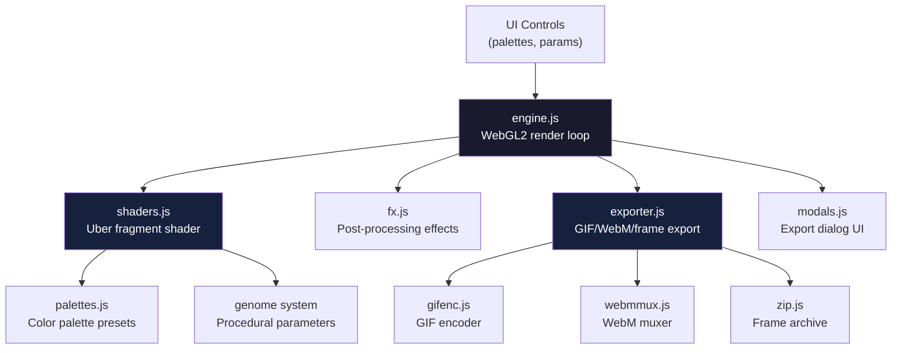

# LumenShaders — Generative Shader Art Studio with WebGL2 and Export

**LumenShaders is a self-contained WebGL2 generative art tool that renders real-time shader art with an uber-shader approach — a single fragment shader with 35+ uniform parameters controlled by a visual UI, with export to GIF, WebM video, and individual frames.** No build step, no dependencies — just vanilla JS, HTML, and WebGL2.

Source: `lumenshaders/` — 9 JS files + HTML/CSS, vanilla JS (no frameworks)

## Architecture



## Two-Stage Shader Boot

Aha: The engine uses a clever two-stage boot to avoid blocking the main thread on shader compilation. A slim "base" shader links in ~1 second and gets pixels on screen immediately. Meanwhile, the full uber shader compiles in the background using `KHR_parallel_shader_compile`. When the driver finishes, the engine swaps in the full program — the user never sees a blank canvas:

```javascript
// lumenshaders/js/engine.js:48-78
function buildProgram(fragSrc, parallel, cb) {
  var prog = gl.createProgram();
  gl.attachShader(prog, compile(gl.VERTEX_SHADER, VERT_SRC));
  gl.attachShader(prog, compile(gl.FRAGMENT_SHADER, fragSrc));
  gl.linkProgram(prog);

  if (parallel) {
    (function poll() {
      if (gl.getProgramParameter(prog, parallel.COMPLETION_STATUS_KHR)) check();
      else setTimeout(poll, 80);
    })();
  } else {
    setTimeout(check, 30);
  }
}
```

## Uber Shader with 35+ Uniforms

The fragment shader exposes 35+ uniform parameters for real-time control:

```javascript
// lumenshaders/js/engine.js:16-26
var UNIFORM_NAMES = [
  "u_res", "u_phase", "u_seed", "u_mode",
  "u_c1", "u_c2", "u_c3", "u_c4", "u_bg",
  "u_hue", "u_sat", "u_exposure", "u_contrast",
  "u_scale", "u_complex", "u_warp", "u_flow", "u_stretch",
  "u_light", "u_gloss", "u_lightAngle", "u_irid", "u_glow",
  "u_grain", "u_cell", "u_lines", "u_ca", "u_vig", "u_soft",
  "u_travel",
  "u_synth", "u_modeB", "u_mixOp", "u_blend",
  "u_genome", "u_g1", "u_g2", "u_g3"
];
```

| Group | Uniforms | Purpose |
|-------|----------|---------|
| Core | `u_res`, `u_phase`, `u_seed`, `u_mode` | Resolution, animation time, random seed, render mode |
| Color | `u_c1`-`u_c4`, `u_bg`, `u_hue`, `u_sat` | 4-color palette + background + hue/saturation |
| Tone | `u_exposure`, `u_contrast` | Exposure and contrast mapping |
| Geometry | `u_scale`, `u_complex`, `u_warp`, `u_flow`, `u_stretch` | Pattern scale, complexity, warp effects |
| Lighting | `u_light`, `u_gloss`, `u_lightAngle`, `u_irid`, `u_glow` | Fake 3D lighting, gloss, iridescence |
| Texture | `u_grain`, `u_cell`, `u_lines`, `u_ca`, `u_vig`, `u_soft` | Grain, cellular patterns, lines, chromatic aberration, vignette |
| Synth | `u_synth`, `u_modeB`, `u_mixOp`, `u_blend` | Secondary synth layer blending |
| Genome | `u_genome`, `u_g1`, `u_g2`, `u_g3` | Procedural parameter encoding |

## Genome System

Aha: The "genome" is a single number that encodes a complete visual configuration. Changing `u_genome` produces a completely different visual — like a seed in procedural generation. The three additional `u_g1`-`u_g3` parameters provide finer control over the genome's expression. This means users can share a single genome number and reproduce exact visuals.

## Render Loop

```javascript
// lumenshaders/js/engine.js:12-14
var loopT = 0;            // seconds into current loop
var maxFps = 60, minFrameMs = 1000 / 60, lastDraw = 0;
```

The render loop runs at up to 60fps with FPS tracking:

```javascript
function render(timestamp) {
  if (timestamp - lastDraw < minFrameMs) { requestAnimationFrame(render); return; }
  lastDraw = timestamp;
  loopT += 1 / 60;
  gl.uniform1f(uniforms.u_phase, loopT);
  gl.drawArrays(gl.TRIANGLES, 0, 3);
  requestAnimationFrame(render);
}
```

## Export System

Three export targets:

| Format | Module | Size |
|--------|--------|------|
| GIF | `gifenc.js` | Animated GIF with palette optimization |
| WebM | `webmmux.js` | VP8 video with audio track support |
| Frames | `zip.js` | Individual PNG frames in ZIP archive |

### Deterministic Rendering

Aha: Exports use `renderAt(phase)` — a deterministic render function that takes a specific phase (time) value. This ensures frame-perfect exports: every call to `renderAt(0.5)` produces the exact same pixels, regardless of when it's called. This is critical for GIF/WebM export where frame timing must be consistent.

```javascript
// Engine exposes this for exporters:
Engine.renderAt = function(phase) {
  gl.uniform1f(uniforms.u_phase, phase);
  gl.drawArrays(gl.TRIANGLES, 0, 3);
};
```

## Module Breakdown

| File | Lines | Responsibility |
|------|-------|----------------|
| `engine.js` | ~200 | WebGL2 context, shader compilation, render loop, FPS tracking |
| `shaders.js` | ~400 | Uber fragment shader GLSL code |
| `palettes.js` | ~100 | Color palette presets and interpolation |
| `ui.js` | ~300 | Parameter control panel UI |
| `modals.js` | ~150 | Export dialog UI |
| `fx.js` | ~100 | Post-processing effects |
| `exporter.js` | ~200 | Export orchestration (GIF/WebM/frames) |
| `gifenc.js` | ~200 | GIF encoding with palette quantization |
| `webmmux.js` | ~150 | WebM video muxing |

## Cross-References

- [taste-skill](01-taste-skill.md) — Anti-slop design agent skills
- [Gemini UI Redesign](02-gemini-extension.md) — Gemini interface customization

Next: Review the [task.md status](../../../task.md) to see what needs work across all AI projects.
