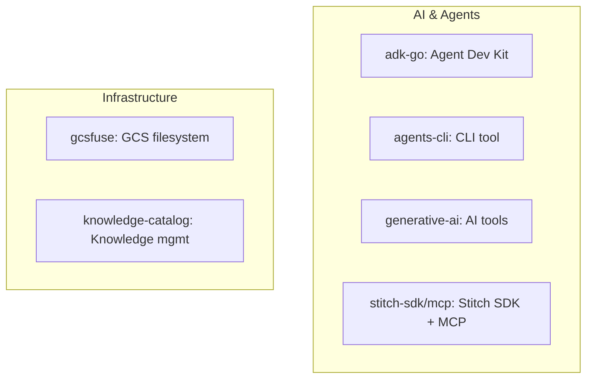

# src.Google Projects Overview

**Collection of 10+ Google AI and infrastructure projects.**

Source: 6,014 files

## Projects

## Project Breakdown

| Project | Language | Description |
|---------|----------|-------------|
| adk-go | Go | Agent Development Kit |
| adk-go-example | Go | ADK examples |
| agents-cli | ? | Agents CLI |
| Centravity | ? | Centravity |
| gcsfuse | Go | Google Cloud Storage FUSE |
| generative-ai | Python | Generative AI tools |
| knowledge-catalog | ? | Knowledge catalog |
| stitchkit | ? | Stitch Kit |
| stitch-mcp | TypeScript | Stitch MCP server |
| stitch-sdk | TypeScript | Stitch SDK |

## Notes

- Multi-project collection
- Mix of Go, TypeScript, Python
- AI agent development tools + infrastructure

## Next

See individual project documentation (when created)
