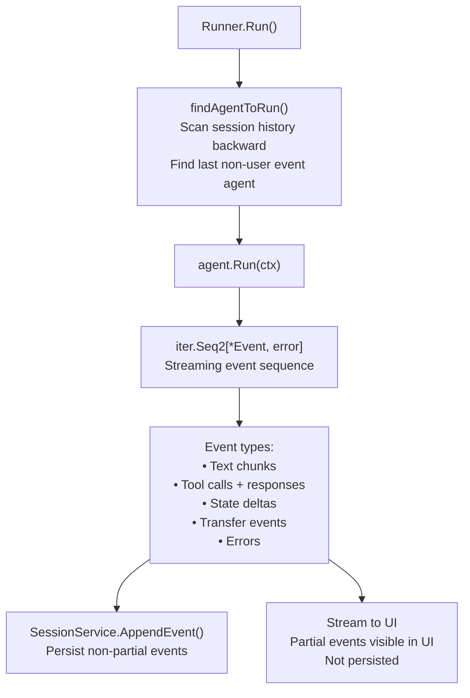
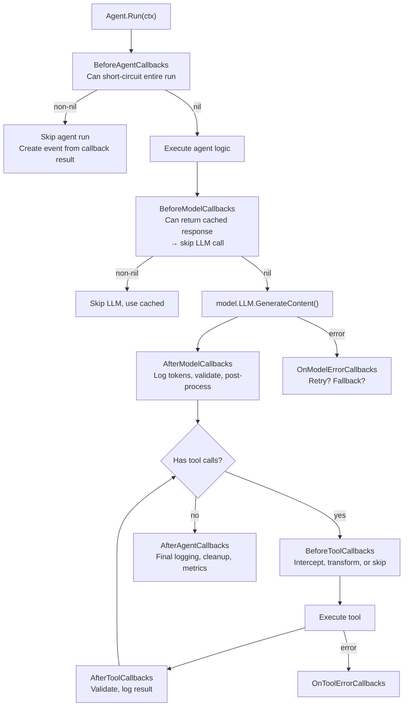

# adk-go — Google's Agent Development Kit for Go

**adk-go is Google's official Go SDK for building, evaluating, and deploying AI agents.** It's a code-first, modular, multi-agent framework optimized for Gemini but model-agnostic. The architecture separates agents (the `Agent` interface), models (the `model.LLM` interface), sessions (persistent conversation storage), memory (cross-session knowledge), and artifacts (versioned file storage). The runner ties everything together: it finds the correct agent in the tree via `findAgentToRun()`, manages session persistence, streams events, and handles agent-to-agent transfers.

Source: `adk-go/` — `agent/agent.go` (core interface), `agent/llmagent/llmagent.go` (primary agent type), `runner/runner.go` (orchestration)

## The Agent Interface — Universal Contract

```go
// agent/agent.go:43-52
type Agent interface {
    Name() string
    Description() string
    Run(InvocationContext) iter.Seq2[*session.Event, error]
    SubAgents() []Agent
    FindAgent(name string) Agent
    FindSubAgent(name string) Agent
    internal() *agent
}
```

**Every agent in the ADK ecosystem implements these 6 methods.** `Run()` returns an `iter.Seq2` — a Go 1.23 rangefunc-style iterator that yields `*session.Event` values with potential errors. This is the streaming primitive: instead of returning a single result, the agent produces a sequence of events (tool calls, text chunks, state changes) that the runner can stream to the UI or persist to storage.



### Agent::New — the Custom Agent Constructor

```go
// agent/agent.go:55-74
func New(cfg Config) (Agent, error) {
    subAgentSet := make(map[Agent]bool)
    for _, subAgent := range cfg.SubAgents {
        if _, ok := subAgentSet[subAgent]; ok {
            return nil, fmt.Errorf("subagent %q appears multiple times", subAgent.Name())
        }
        subAgentSet[subAgent] = true
    }
    return &agent{
        name: cfg.Name, description: cfg.Description,
        subAgents: cfg.SubAgents,
        beforeAgentCallbacks: cfg.BeforeAgentCallbacks,
        run: cfg.Run,
        afterAgentCallbacks: cfg.AfterAgentCallbacks,
    }, nil
}
```

**Aha:** Duplicate sub-agents are detected at construction time, not at runtime. The check `subAgentSet[subAgent]` uses a set to catch the most common configuration error — registering the same agent twice — before any LLM calls are made.

### Config — What Defines an Agent

```go
// agent/agent.go:77-107
type Config struct {
    Name        string           // Must be non-empty, unique in tree. Cannot be "user"
    Description string           // One-liner. LLM uses this to decide delegation
    SubAgents   []Agent          // Child agents. ADK auto-sets parent relationship
    
    BeforeAgentCallbacks []BeforeAgentCallback  // Can short-circuit: return non-nil → skip agent run
    Run func(InvocationContext) iter.Seq2[*session.Event, error]
    AfterAgentCallbacks  []AfterAgentCallback   // Post-run: logging, metrics, cleanup
}
```

**Aha:** Agent names cannot be `"user"` — it's reserved. The LLM uses the `Description` field (one line) to determine whether to transfer control to a sub-agent. This is the delegation mechanism: the LLM sees sub-agent descriptions and decides which one should handle the current task.

## LLMAgent — The Primary Agent Type

`LLMAgent` is the agent type that wraps an LLM model. It's created via `llmagent.New(cfg Config)`:

```go
// agent/llmagent/llmagent.go:34-127
func New(cfg Config) (agent.Agent, error) {
    // Convert public callbacks → internal callbacks
    beforeModelCallbacks := make([]llminternal.BeforeModelCallback, 0, len(cfg.BeforeModelCallbacks))
    // ... same for afterModel, onModelError, beforeTool, afterTool, onToolError
    
    a := &llmAgent{
        model: cfg.Model,
        beforeModelCallbacks:  beforeModelCallbacks,
        afterModelCallbacks:   afterModelCallbacks,
        onModelErrorCallbacks: onModelErrorCallbacks,
        beforeToolCallbacks:   beforeToolCallbacks,
        afterToolCallbacks:    afterToolCallbacks,
        onToolErrorCallbacks:  onToolErrorCallback,
        instruction:           cfg.Instruction,
        inputSchema:           cfg.InputSchema,
        outputSchema:          cfg.OutputSchema,
        State: llminternal.State{
            Model: cfg.Model,
            GenerateContentConfig: cfg.GenerateContentConfig,
            Tools: cfg.Tools, Toolsets: cfg.Toolsets,
            DisallowTransferToParent: cfg.DisallowTransferToParent,
            DisallowTransferToPeers:  cfg.DisallowTransferToPeers,
            IncludeContents:      string(cfg.IncludeContents),
            Instruction:          cfg.Instruction,
            GlobalInstruction:    cfg.GlobalInstruction,
            OutputKey:            cfg.OutputKey,
        },
    }
    // ... wraps in base agent.New
}
```

### LLMAgent Config — Every Option

```go
// agent/llmagent/llmagent.go:130-200+
type Config struct {
    Name, Description string
    Model  model.LLM                     // The LLM to use
    Tools  []tool.Tool                   // Inline tool definitions
    Toolsets []tool.Toolset              // Tool sets (can include MCP toolsets)
    SubAgents []agent.Agent
    
    Instruction              string       // System instruction
    InstructionProvider      func(ctx) string  // Dynamic instruction
    GlobalInstruction        string       // Root-only, applies to entire agent tree
    GlobalInstructionProvider func(ctx) string
    
    GenerateContentConfig *genai.GenerateContentConfig  // Temperature, topP, etc.
    
    InputSchema  *genai.Schema  // Structured input validation
    OutputSchema *genai.Schema  // Structured output enforcement
    OutputKey    string          // Auto-save final output to session state
    
    IncludeContents IncludeContents  // "default", "all", "none"
    
    DisallowTransferToParent bool  // Prevent transfer up the tree
    DisallowTransferToPeers  bool  // Prevent transfer to sibling agents
    
    // Callback chains — each can return non-nil to short-circuit
    BeforeModelCallbacks  []BeforeModelCallback   // Cache, transform, or skip LLM call
    AfterModelCallbacks   []AfterModelCallback    // Log, validate, post-process
    OnModelErrorCallbacks []OnModelErrorCallback  // Retry, fallback, report
    BeforeToolCallbacks   []BeforeToolCallback    // Intercept or transform tool calls
    AfterToolCallbacks    []AfterToolCallback     // Log, validate tool results
    OnToolErrorCallbacks  []OnToolErrorCallback   // Handle tool failures
    BeforeAgentCallbacks  []agent.BeforeAgentCallback
    AfterAgentCallbacks   []agent.AfterAgentCallback
}
```

**Aha: OutputKey.** When `OutputKey` is set, the agent's final text output is automatically saved to session state under that key. Downstream agents and tools can read it. This is the composition primitive — agent A produces `OutputKey: "analysis"`, agent B reads `state["analysis"]` from session state.

**Aha: DisallowTransferToParent/Peers.** These two booleans define the security boundary of agent delegation. `DisallowTransferToParent: true` means a sub-agent can't escalate to the parent. `DisallowTransferToPeers: true` means sibling agents can't call each other. Together they create strict hierarchical routing.

### Callback Lifecycle



## Runner — The Orchestration Layer

```go
// runner/runner.go:79-111
func New(cfg Config) (*Runner, error) {
    if cfg.Agent == nil { return nil, fmt.Errorf("root agent is required") }
    if cfg.SessionService == nil { return nil, fmt.Errorf("session service is required") }
    
    parents, err := parentmap.New(cfg.Agent)  // Build agent tree
    // ... create plugin manager
    
    return &Runner{
        appName: cfg.AppName, rootAgent: cfg.Agent,
        sessionService: cfg.SessionService,
        artifactService: cfg.ArtifactService,
        memoryService: cfg.MemoryService,
        parents: parents, pluginManager: pluginManager,
        autoCreateSession: cfg.AutoCreateSession,
    }, nil
}
```

### Config — What the Runner Needs

```go
type Config struct {
    AppName            string            // Application identifier
    Agent              agent.Agent       // Root agent (required)
    SessionService     session.Service   // Persistence (required)
    ArtifactService    artifact.Service  // Optional: file storage
    MemoryService      memory.Service    // Optional: cross-session memory
    PluginConfig       PluginConfig      // Optional: plugins
    AutoCreateSession  bool              // Auto-create session on first message
}
```

### findAgentToRun() — The Agent Router

The runner doesn't always call the root agent. It scans session history backward to find the agent that produced the last non-user event, then routes to that agent. This is how agent-to-agent transfer works:

```
Session History:
  [user]: "build a React app"
  [root_agent]: "I'll delegate to the coding agent"  ← transfer event
  [coding_agent]: "Running npm create vite..."        ← LAST non-user event
  
findAgentToRun() → returns coding_agent, not root_agent
```

The runner checks `DisallowTransferToParent` on each LLMAgent in the chain. If transfer to parent is blocked, the runner stays at the current agent level.

## InvocationContext — What Agents Receive

```go
// agent/context.go
type InvocationContext interface {
    context.Context  // Standard Go context
    
    Agent() Agent                           // Current agent
    Artifacts() Artifacts                   // Versioned file storage
    Memory() Memory                         // Cross-session memory
    Session() Session                       // Current session
    InvocationID() string                   // Unique invocation ID
    Branch() string                         // Agent branch path
    UserContent() *genai.Content            // The user's message
    RunConfig() *RunConfig                  // Runtime configuration
    EndInvocation()                         // Signal completion
    State() map[string]any                  // Session state (shared across agents)
}
```

**Aha:** `State()` is a shared `map[string]any` across all agents in the tree. When agent A sets `state["analysis"] = result`, agent B can read it. This plus `OutputKey` form the composition mechanism — agents communicate through session state, not through function returns or message passing.

## Session — Persistence

```go
// session/service.go (interface)
type Service interface {
    Create(ctx context.Context, req *CreateRequest) (*CreateResponse, error)
    Get(ctx context.Context, req *GetRequest) (*GetResponse, error)
    List(ctx context.Context, req *ListRequest) (*ListResponse, error)
    Delete(ctx context.Context, req *DeleteRequest) error
    AppendEvent(ctx context.Context, session *Session, event *Event) error
}

type Session struct {
    ID        string
    AppName   string
    UserID    string
    State     map[string]any
    Events    []*Event
    CreatedAt time.Time
    UpdatedAt time.Time
}
```

### Event Types

```go
type Event struct {
    ID           string
    Author       string    // "user" or agent name
    Content      *genai.Content
    Partial      bool      // Streaming partial: stream to UI, don't persist
    TurnComplete bool      // LLM finished this turn
    Error        error
    Actions      EventActions
}
```

**Aha:** `Partial` events are streamed to the UI but NOT persisted to session storage. This means the user sees streaming text, but only complete turns are stored. The runner handles this automatically — partial events pass through, complete events are appended.

## Memory — Cross-Session Knowledge

```go
// memory/service.go
type Service interface {
    AddSessionToMemory(ctx context.Context, req *AddRequest) error
    SearchMemory(ctx context.Context, req *SearchRequest) (*SearchResponse, error)
    // ...
}
```

Memory is scoped to `user_id + app_name`. An agent can add the current session summary to memory and search past memories. This enables long-term context across sessions.

## Artifacts — Versioned File Storage

```go
// artifact/service.go
type Service interface {
    Save(ctx context.Context, name string, data *genai.Part) (*SaveResponse, error)
    Load(ctx context.Context, name string) (*LoadResponse, error)
    LoadVersion(ctx context.Context, name string, version int) (*LoadResponse, error)
    List(context.Context) (*ListResponse, error)
    Delete(ctx context.Context, name string) error
}
```

Files are versioned. `Save` creates a new version; `LoadVersion` retrieves a specific version. Agents can use artifacts to store generated files (code, images, reports) with full version history.

## Model — The LLM Abstraction

```go
// model/llm.go
type LLM interface {
    GenerateContent(ctx context.Context, req *LLMRequest) iter.Seq2[*LLMResponse, error]
}

type LLMRequest struct {
    Contents []*genai.Content
    Config   *genai.GenerateContentConfig
    Tools    []*genai.Tool
}

type LLMResponse struct {
    Content           *genai.Content
    UsageMetadata     *genai.UsageMetadata
    FinishReason      genai.FinishReason
    GroundingMetadata *genai.GroundingMetadata
    CitationMetadata  *genai.CitationMetadata
}
```

**Aha:** The `LLM` interface has ONE method: `GenerateContent`. It returns an `iter.Seq2` for streaming. This is deliberately minimal — any LLM provider that can produce `genai.Content` from `genai.Content` with `genai.Config` can implement this interface. There's no OpenAI vs Anthropic vs Gemini branching in agent code.

## Built-in Agent Types

| Agent | Package | Purpose |
|-------|---------|---------|
| **LLMAgent** | `llmagent` | Primary: LLM + tools + callbacks |
| **Custom Agent** | `agent.New(cfg)` | Any logic via `Run` function |
| **LoopAgent** | `workflowagents/loopagent` | Loop until condition met |
| **ParallelAgent** | `workflowagents/parallelagent` | Run sub-agents concurrently |
| **ChainAgent** | `workflowagents/chainagent` | Sequential sub-agent execution |
| **RemoteAgent (A2A)** | `remoteagent/v2` | Agent-to-Agent protocol agent |

### ParallelAgent

```go
// agent/workflowagents/parallelagent/agent.go
// Sub-agents run concurrently via goroutines
// Events from all sub-agents are merged into a single stream
// Used when multiple independent tasks can run at once
```

### A2A Remote Agent

```go
// agent/remoteagent/v2/a2a_agent.go
// Implements Agent-to-Agent protocol
// ADK agent can delegate to a remote agent over HTTP
// Remote agent can be in any language (Python, JS, etc.)
```

## MCP Integration

The `tool` package supports MCP toolsets:

```go
// Toolset wraps MCP server connections as ADK tools
// MCP tools appear alongside inline tools
// Agent doesn't know which tools are local vs MCP
type Toolset interface {
    Tools(ctx context.Context) ([]Tool, error)
    Close() error
}
```

## Cross-References

- [stitch-sdk](02-stitch-sdk.md) — Google's AI UI generation SDK
- [Centravity](03-centravity.md) — Open-source agentic IDE with similar multi-agent patterns
- [Goose](../src.block/markdown/00-overview.md) — Block's agent (compares with ADK's agent architecture)

## Next

→ [stitch-sdk](02-stitch-sdk.md) — Google's TypeScript SDK for AI-powered UI design generation.
