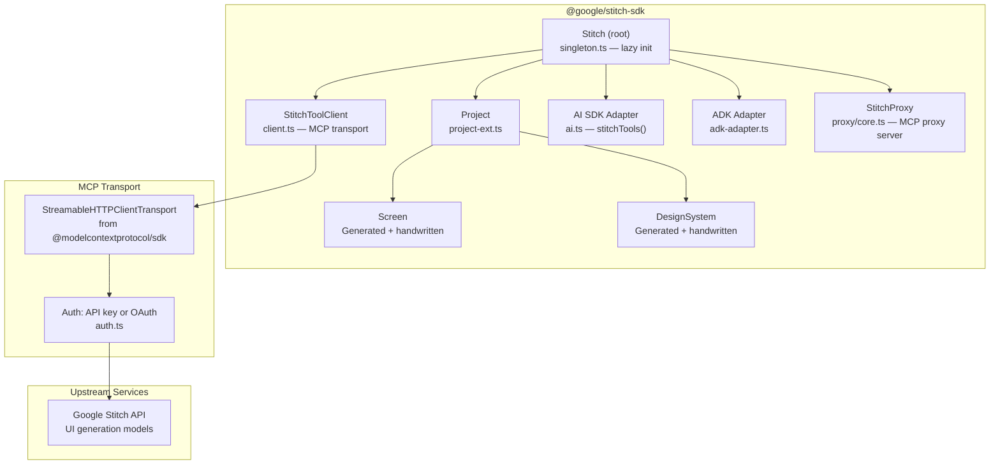

# stitch-sdk — Google's TypeScript SDK for AI-Powered UI Generation

**The Stitch SDK (`@google/stitch-sdk`, v0.3.5, Apache 2.0) is Google's official TypeScript library for programmatic AI-powered UI design generation.** It wraps the Stitch MCP server behind a lazy-loading domain model (`Stitch → Project → Screen → DesignSystem`), provides MCP transport with automatic schema repair, ships AI SDK and ADK adapters, and supports virtual tools that compose multiple upstream API calls. The SDK is code-generated from upstream tool manifests but with handwritten infrastructure layers.

Source: `stitch-sdk/packages/sdk/src/` — 31 TypeScript files

## Architecture



## Domain Model — Lazy-Loading Hierarchy

```typescript
// packages/sdk/src/index.ts — exports
export class Stitch {
    static async create(config?: StitchConfig): Promise<Stitch>
    async projects(): Promise<Project[]>
    project(id: string): Project  // Lazy — no API call
}

export class Project {
    id: string
    name: string
    async generate(prompt: string): Promise<Screen>     // Creates screen from prompt
    async screens(): Promise<Screen[]>                    // Lists existing screens
    async getScreen(id: string): Promise<Screen>
    async createDesignSystem(config): Promise<DesignSystem>
    async designSystem(): Promise<DesignSystem | undefined>
}

export class Screen {
    id: string
    name: string
    async edit(prompt: string): Promise<Screen>
    async variants(prompt: string, options?): Promise<Screen[]>
    async getHtml(): Promise<string>         // Auto-fetches if loaded from listing
    async getImage(): Promise<Buffer>        // Cached from generation response
}

export class DesignSystem {
    id: string
    async update(config): Promise<DesignSystem>
    async apply(screenIds?: string[]): Promise<void>
}
```

**Aha:** Domain objects are lightweight references. Calling `project(id)` returns immediately — no API call. The API call happens when you call `screens()` or `getHtml()`. `getImage()` is cached from the generation response: if the screen was loaded from a listing (which doesn't include images), calling `getImage()` auto-fetches. This is lazy-loading at the domain model level — you pay API costs only for the data you actually consume.

## StitchToolClient — MCP Transport Layer

```typescript
// packages/sdk/src/client.ts
export class StitchToolClient {
    private transport: StreamableHTTPClientTransport
    private client?: Client  // MCP client — lazily connected
    
    async connect(): Promise<void> {
        // Creates StreamableHTTPClientTransport
        // Handles auth: API key or OAuth
        // Connects lazily on first callTool()
    }
    
    async callTool(name: string, args: Record<string, unknown>): Promise<ToolResult>
    async listTools(): Promise<Tool[]>      // With schema repair
    async downloadAssets(screenId: string): Promise<Asset[]>
    
    // REST endpoints not available as MCP tools
    async httpPost<T>(path: string, body: unknown): Promise<T>
}
```

### Schema Repair — Resilience Against Broken $ref

**Aha:** The upstream Stitch MCP server sometimes returns tool schemas with broken `$ref` references that crash AJV validation. The SDK implements `repairToolSchemas()` (`schema-repair.ts`) that injects missing `$defs` before any AJV compilation:

```typescript
// packages/sdk/src/schema-repair.ts (conceptual)
function repairToolSchemas(tools: Tool[]): Tool[] {
    // 1. Scan all tool schemas for $ref references
    // 2. Collect referenced $defs that are missing from their parent schema
    // 3. Inject missing $defs into the appropriate schema nodes
    // 4. Return repaired tools ready for AJV compilation
    // Uses raw request() instead of client.listTools() to avoid AJV crashes
}
```

This is a defensive design choice — the SDK handles malformed upstream schemas gracefully rather than crashing. The raw `request()` bypass is used specifically to avoid triggering AJV compilation on broken schemas during `listTools()`.

## Virtual Tools — Composition Over Raw API

```typescript
// packages/sdk/src/proxy/virtual-tools.ts
export const downloadAssetsTool: VirtualToolDefinition = {
    name: "download_assets",
    description: "Download all assets for a screen",
    execute: async (args, client) => {
        // 1. Call list_assets MCP tool
        // 2. For each asset, call download_asset MCP tool
        // 3. Combine results into a single response
        // A single call from the agent perspective
    }
}
```

**Aha:** Virtual tools are NOT upstream Stitch MCP tools — they're composed by the SDK from multiple upstream calls. `downloadAssetsTool` combines `list_assets` + N × `download_asset` into one tool call. This reduces the number of LLM tool-calling round trips — the agent asks for assets once and gets everything.

## AI SDK Adapter — Vercel AI SDK Integration

```typescript
// packages/sdk/src/ai.ts
import { tool as aiTool } from 'ai'

export function stitchTools(config?: StitchConfig): Record<string, Tool> {
    // 1. Connect to Stitch
    // 2. List all available tools
    // 3. Convert each to Vercel AI SDK Tool format
    // 4. Return as Record<string, Tool>
    // Models can call stitchTools() inside generateText()/streamText()
}

// Usage:
const { text } = await generateText({
    model: gemini('gemini-2.0-flash'),
    tools: stitchTools(),
    prompt: "Design a landing page for a SaaS product"
})
```

### Tool Filtering

```typescript
// Filter tools by name pattern
const designTools = stitchTools({ include: ['generate_screen', 'edit_screen'] })
const assetTools = stitchTools({ exclude: ['delete_*'] })
```

## ADK Adapter — Google ADK Integration

```typescript
// packages/sdk/src/adk-adapter.ts
export function stitchAdkTools(config?: StitchConfig): Tool[] {
    // Converts Stitch tools to Google ADK TypeScript tool format
    // Compatible with adk-go's TypeScript agent runners
}
```

## StitchProxy — MCP Proxy Server

```typescript
// packages/sdk/src/proxy/core.ts
export class StitchProxy {
    // An MCP proxy server that:
    // 1. Accepts MCP client connections (like coding agents)
    // 2. Forwards tool calls to upstream Stitch MCP
    // 3. Adds virtual tools (downloadAssets, buildSite)
    // 4. Handles auth and schema repair
    // Enables custom MCP server deployment
}
```

## Configuration

```typescript
// packages/sdk/src/types.ts
interface StitchConfig {
    apiKey?: string          // API key auth
    projectId?: string       // Default project
    baseUrl?: string         // Custom endpoint
    auth?: AuthConfig        // OAuth configuration
}
```

### Singleton Convenience

```typescript
// packages/sdk/src/singleton.ts
let _stitch: Promise<Stitch> | undefined

export function getStitch(config?: StitchConfig): Promise<Stitch> {
    if (!_stitch) {
        _stitch = Stitch.create(config ?? { apiKey: process.env.STITCH_API_KEY })
    }
    return _stitch
}
```

A pre-configured singleton reads `STITCH_API_KEY` from env and lazily initializes on first use.

## Code Generation Architecture

Parts of the SDK are code-generated from upstream tool manifests:

```
packages/sdk/
├── generated/
│   ├── stitch-sdk.lock          # Generation state tracking
│   ├── tools-manifest.json      # Upstream tool definitions
│   └── domain-map.json          # Tool → domain class mapping
├── scripts/generate-sdk.ts      # Code generation script
└── src/
    ├── generated/               # Generated domain classes (screen.ts, stitch.ts)
    └── *.ts                     # Handwritten infrastructure
```

**Aha:** Domain classes are generated from tool manifests. Infrastructure (client, proxy, entity manager) is handwritten. The `generated/` directory has a lock file tracking the generation state. This means when the upstream API adds new tools or changes schemas, re-running the generator updates the domain model without touching the transport/auth/proxy layers.

## Error Handling

```typescript
// packages/sdk/src/spec/errors.ts
enum StitchErrorCode {
    AUTH_FAILED = 'AUTH_FAILED',
    NOT_FOUND = 'NOT_FOUND',
    PERMISSION_DENIED = 'PERMISSION_DENIED',
    RATE_LIMITED = 'RATE_LIMITED',
    NETWORK_ERROR = 'NETWORK_ERROR',
    VALIDATION_ERROR = 'VALIDATION_ERROR',
    UNKNOWN_ERROR = 'UNKNOWN_ERROR',
}

class StitchError extends Error {
    code: StitchErrorCode
    statusCode?: number
    retryable: boolean  // Rate limits + network errors are retryable
}
```

## Cross-References

- [adk-go](01-adk-go.md) — Google's Go agent framework (ADK adapter target)
- [Centravity](03-centravity.md) — Open-source IDE with similar MCP integration patterns
- [design.md](04-design-md.md) — Design system format used with Stitch

## Next

→ [Centravity](03-centravity.md) — Open-source agentic IDE with liquid neural memory.
