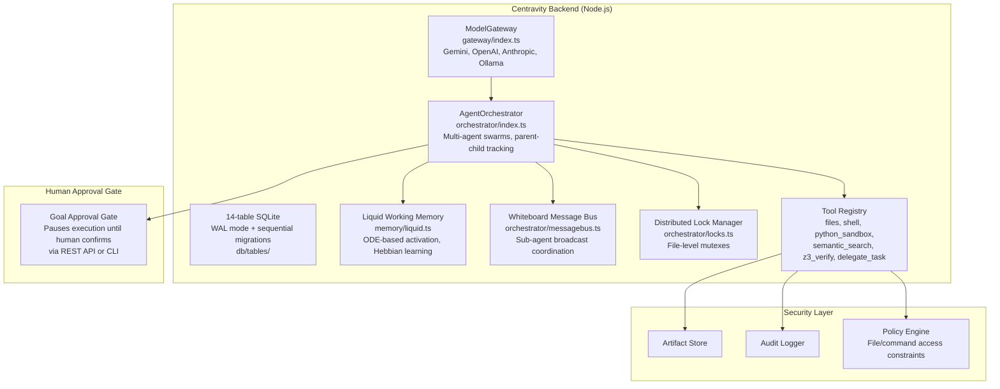

# Centravity — Open-Source Agentic IDE with Universal LLM Gateway

**Centravity (Open Anticentravity) is an independent open-source agentic IDE with a universal LLM gateway, multi-agent orchestration, and a Liquid Working Memory model inspired by Liquid Neural Networks.** It's a Node.js backend (v0.2.0, MIT) that provides a 14-table SQLite database, pluggable LLM providers (Gemini, OpenAI, Anthropic, Ollama), distributed lock management for parallel agents, and tools including a Docker Python sandbox, semantic search, and Z3 SMT formal verification. Agents operate in swarms with hierarchical parent-child tracking.

Source: `Centravity/newcore/src/` — TypeScript, MIT

## Architecture



## ModelGateway — Universal LLM Abstraction

```typescript
// gateway/index.ts
class ModelGateway {
    private providers: Map<string, Provider>

    async complete(request: CompletionRequest): Promise<CompletionResponse> {
        const provider = this.resolveProvider(request.model)
        const response = await provider.complete(request)
        this.costRecorder.record(request, response)  // Track tokens + cost
        return response
    }
}

interface CompletionRequest {
    model: string
    messages: Message[]
    tools?: Tool[]
    maxTokens?: number
    temperature?: number
}
```

### Provider Implementations

| Provider | File | Key Detail |
|----------|------|------------|
| **GeminiProvider** | `providers/gemini.ts` | Google AI Studio + Vertex AI |
| **OpenAIProvider** | `providers/openai.ts` | Chat Completions API |
| **AnthropicProvider** | `providers/anthropic.ts` | Messages API with tool use |
| **OllamaProvider** | `providers/ollama.ts` | Local models, OpenAI-compatible |
| **MockProvider** | `providers/mock.ts` | Deterministic responses for testing |

### CostRecorder — Per-Call Budget Enforcement

```typescript
// gateway/cost-recorder.ts
class CostRecorder {
    private totalCost: number = 0
    private maxCostUSD: number

    record(request: CompletionRequest, response: CompletionResponse): void {
        const cost = this.calculateCost(response.usage, request.model)
        this.totalCost += cost
        if (this.totalCost > this.maxCostUSD) {
            throw new CostLimitExceededError(
                `Total cost $${this.totalCost.toFixed(2)} exceeds limit $${this.maxCostUSD}`
            )
        }
        // Persist to cost_events table in SQLite
    }
}
```

**Aha:** `MAX_COST_USD` is a hard cap — when exceeded, the agent stops. This prevents runaway costs from infinite loops. Each call's cost is persisted to SQLite for audit trails.

## AgentOrchestrator — Multi-Agent Swarms

```typescript
// orchestrator/index.ts
class AgentOrchestrator {
    async executePlan(plan: ExecutionPlan): Promise<ExecutionResult> {
        // 1. Pause at Goal Approval Gate — wait for human confirmation
        await this.goalGate.awaitApproval(plan)

        // 2. Spawn sub-agents according to plan
        const agents = plan.steps.map(step => this.spawnAgent(step))

        // 3. Run agents concurrently with lock coordination
        const results = await Promise.all(agents.map(a => a.run()))

        // 4. Merge results, update LWM
        return this.mergeResults(results)
    }

    private spawnAgent(step: PlanStep): Agent {
        return new Agent({
            model: step.model,
            tools: step.tools,
            parentId: this.currentAgentId,  // Hierarchical tracking
            workingDirectory: step.workingDir,
        })
    }
}
```

### Agent Hierarchy

Agents track parent-child relationships:
```
Root Agent
├── Sub-Agent A (code review)
│   ├── Sub-Sub-Agent A1 (lint check)
│   └── Sub-Sub-Agent A2 (security scan)
└── Sub-Agent B (test generation)
```

All sub-agents report to parent. The orchestrator tracks this in the `swarms` SQLite table.

## Liquid Working Memory (LWM) — Neural-Inspired Memory

**Aha:** The LWM is NOT a vector database. It's a continuous-time memory graph modeled on Liquid Neural Networks — mathematical ODEs with Hebbian plasticity, running in plain TypeScript with zero external dependencies.

```typescript
// memory/liquid.ts
class LiquidMemory {
    private nodes: Map<string, MemoryNode>
    private edges: Map<string, MemoryEdge>

    // Core differential equation (discretized):
    // dx/dt = -x/τ + σ(W·x + b)
    // where x = activation vector, τ = time constant per node
    // σ = sigmoid activation, W = edge weight matrix

    activate(nodeId: string, stimulus: number): void {
        const node = this.nodes.get(nodeId)!
        // Forward Euler integration of ODE:
        // x(t+Δt) = x(t) + Δt * (-x/τ + stimulus)
        node.activation += this.dt * (-node.activation / node.tau + stimulus)
        node.activation = clamp(node.activation, 0, 1)
    }

    // Hebbian learning: nodes that fire together, wire together
    strengthenEdge(source: string, target: string): void {
        const key = `${source}→${target}`
        const edge = this.edges.get(key)!
        // Δw = η * x_source * x_target
        edge.weight += this.learningRate * 
            this.nodes.get(source)!.activation * 
            this.nodes.get(target)!.activation
    }

    decay(): void {
        for (const node of this.nodes.values()) {
            // Goals decay slowly (τ = 60 steps)
            // Transient logs decay rapidly (τ = 5 steps)
            node.activation *= Math.exp(-this.dt / node.tau)
        }
    }
}
```

### Time Constants by Node Type

| Node Type | τ (time constant) | Decay Behavior |
|-----------|-------------------|----------------|
| **Goal** | 60 | Slow decay — persists across many steps |
| **Finding** | 30 | Medium decay — relevant for current task |
| **Context** | 15 | Moderate decay — recent observations |
| **Log** | 5 | Fast decay — transient events |

**Aha:** Goals persist while transient logs fade. This means the agent "remembers what it's trying to do" even after hundreds of intermediate steps, but doesn't get cluttered by old observations. The Hebbian learning strengthens connections between co-active concepts — ideas that are used together become more strongly associated.

## 14-Table SQLite Database

```sql
-- db/tables/ structure (conceptual)
agents        -- Agent instances: id, name, model, parent_id
swarms        -- Swarm sessions: id, root_agent_id, status
messages      -- Conversation history: id, session_id, role, content
tool_calls    -- Tool execution log: id, message_id, tool_name, args, result
artifacts     -- Generated files: id, name, version, content_hash
audit         -- Security audit trail: id, event_type, details, timestamp
cost_events   -- Token + cost tracking: id, model, tokens_in, tokens_out, cost_usd
locks         -- Distributed mutexes: id, file_path, holder_agent_id
lwm_snapshots -- LWM state snapshots: id, node_states_json, edge_weights_json
whiteboard    -- Inter-agent messages: id, sender_id, content, timestamp
```

All tables use WAL (Write-Ahead Logging) mode. Migrations are sequential (0001-0014) and additive — columns are added, never dropped.

## Tool Registry

| Tool | Implementation | Key Detail |
|------|---------------|------------|
| `read_file` | Direct FS | Scoped to working directory |
| `write_file` | Direct FS | Policy-checked before write |
| `run_command` | Child process | Timeout-enforced, output-captured |
| `python_sandbox` | Docker container | **Pass-by-reference**: data stays on disk in shared volumes, LLM never touches raw data |
| `semantic_search` | Gemini embeddings | Vector RAG with cosine similarity over embedded corpus |
| `z3_verify` | Z3 WASM | Formal verification: bounds checks, null safety, integer overflow proofs |
| `delegate_task` | Orchestrator spawn | Creates sub-agent with restricted tool set |

**Aha: Pass-by-reference Python sandbox.** Large data stays on disk in shared Docker volumes. The LLM never touches raw data — it just instructs the sandbox what to compute. This avoids token bloat entirely. The sandbox receives a Python script and a path to input data; it computes and writes results to a shared output path.

**Aha: Z3 formal verification via WASM.** Rather than just linting or testing, agents can mathematically prove code correctness using the Z3 SMT solver compiled to WebAssembly. This is an unusual capability in an agent framework — formal verification of generated code.

## Policy Engine

```typescript
// Policy engine constrains:
// 1. File paths: must be within working directory or explicit allowlist
// 2. Commands: blocklist of dangerous commands (curl to unknown hosts, sudo, chmod 777)
// 3. Network: egress allowlisting for API calls
// 4. File types: certain extensions (.env, .pem, .key) are read-only
```

Policy violations are logged to the `audit` table and block the tool call — advisory warnings aren't enough.

## Human-in-the-Loop Goal Approval

The execution plan pauses at `waiting_goal_approval` state:

```typescript
// The goal gate:
// 1. Agent generates execution plan
// 2. Plan enters WAITING_GOAL_APPROVAL state
// 3. Human reviews via REST API or CLI
// 4. Human approves → plan executes
// 5. Human rejects → agent replans with feedback
```

This is baked into the orchestrator — not an optional callback. Every execution plan that modifies files or runs commands must pass through human approval.

## Cross-References

- [adk-go](01-adk-go.md) — Google's Go agent framework (similar multi-agent patterns)
- [stitch-sdk](02-stitch-sdk.md) — Google's UI generation SDK
- [Goose](../src.block/markdown/02-extensions.md) — Goose's MCP ExtensionManager

## Next

→ [gcsfuse](05-gcsfuse.md) — Google Cloud Storage FUSE with ML optimizations.
