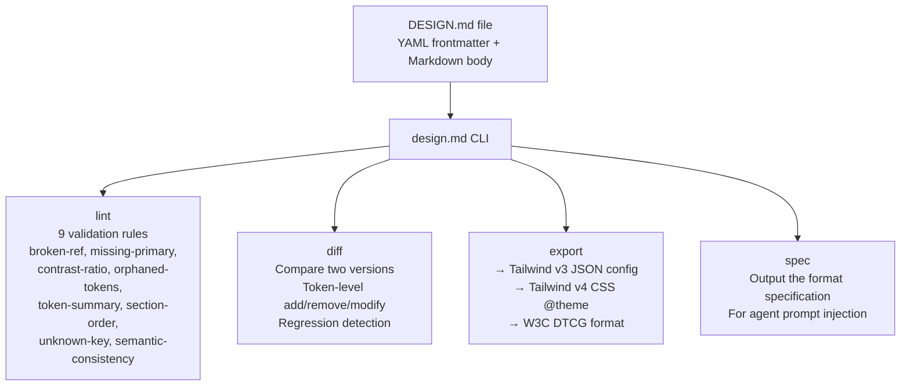

# design.md — Design System Format Specification for Coding Agents

**DESIGN.md is a format specification and CLI tool for describing visual identities to coding agents.** It combines machine-readable YAML design tokens with human-readable design rationale in a single markdown file. The philosophy: tokens are context, not rendering instructions. The quality of generated designs comes from how clearly intent is described in prose, not from token precision.

Source: `design.md/packages/cli/src/` — TypeScript, Apache 2.0

## The Format

```markdown
---
# YAML frontmatter: the tokens
colors:
  primary: '#3B82F6'
  background: '#0F172A'
  text: '#F8FAFC'
typography:
  heading: 'Geist'
  body: 'Inter'
spacing:
  unit: 4
  scale: 'major-third'
---

# Design rationale: the prose

## Brand Personality
We are a developer-first infrastructure company. Our visual language
should feel precise, technical, and trustworthy — like a well-designed
API, not a consumer app.

## Typography Philosophy
Geist for headings because it's the Vercel design system font — it signals
"modern web infrastructure." Inter for body because it's the most readable
sans-serif at small sizes on screens. Never use serif fonts — they signal
"academic" or "editorial," which is wrong for our audience.

## Spacing Rules
Every component starts at 16px padding. Inner spacing uses the major-third
scale (4, 5, 6.5, 8, 10.5, 13.5, 17.5). Never use arbitrary pixel values
— always pick from the scale.
```

## Architecture



## CLI Commands

```bash
design-md lint design.md          # Validate against 9 rules
design-md diff v1.md v2.md        # Token-level comparison
design-md export design.md        # Convert to Tailwind config
design-md export --format dtcg    # Convert to W3C DTCG format
design-md spec                    # Output the format spec itself
```

## Validation Rules

| Rule | What It Checks |
|------|---------------|
| `broken-ref` | Internal references resolve to valid tokens |
| `missing-primary` | Required tokens (primary color, body font) are present |
| `contrast-ratio` | Color combinations meet WCAG AA minimum (4.5:1 for text) |
| `orphaned-tokens` | Every token is referenced somewhere in the prose |
| `token-summary` | Token sections have a human-readable summary |
| `section-order` | Sections follow the standard order |
| `unknown-key` | No undefined YAML keys (warns, doesn't error — forward-compatible) |
| `semantic-consistency` | Token names follow naming conventions |

## Philosophy — Prose Over Tokens

**Aha:** The `PHILOSOPHY.md` makes clear that tokens alone produce mediocre designs. The prose — brand personality, typography philosophy, spacing rationale — is what gives the AI enough context to make non-obvious design decisions. A specific reference like "1970s graduate lecture handout" carries more design information than a dozen metric values.

**Aha: Negative constraints carry design character.** Intentional lists of "don'ts" (never use serif fonts, no rounded corners above 4px, no gradients on buttons) define the personality of a design more sharply than positive descriptions. The format embraces "Design Don'ts" as a first-class section.

## Export Targets

| Format | Command | Output |
|--------|---------|--------|
| **Tailwind v3** | `export --format tailwind` | `tailwind.config.js` with `theme.extend` |
| **Tailwind v4** | `export --format tailwind-v4` | CSS `@theme { ... }` block |
| **W3C DTCG** | `export --format dtcg` | Design Tokens Community Group JSON |

## Design Principles

1. **Prose over tokens** — Tokens are context; quality comes from intent descriptions
2. **Extensible by design** — Unknown YAML keys and section headings are accepted, not errors
3. **Negative constraints** — "Don'ts" define character more sharply than "Dos"
4. **Component variants as flat entries** — Hover/active/pressed states are separate entries, not nested variant objects
5. **Concrete over abstract** — "1970s graduate lecture handout" > "vintage academic style"

## Cross-References

- [stitch-sdk](02-stitch-sdk.md) — Google Stitch uses DESIGN.md for brand configuration
- [adk-go](01-adk-go.md) — ADK agents can consume DESIGN.md for system prompt injection

## Next

→ [gcsfuse](05-gcsfuse.md) — Google Cloud Storage FUSE with ML optimizations.
