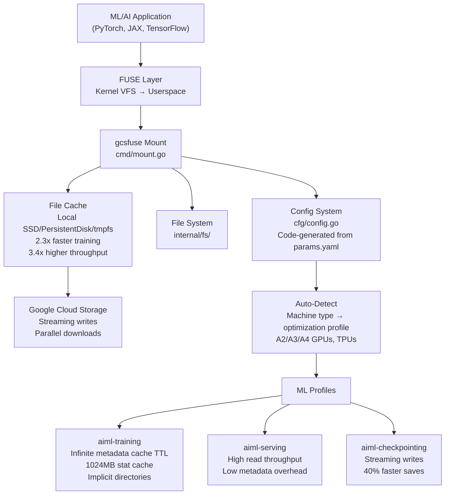

# gcsfuse — Google Cloud Storage FUSE with ML Optimizations

**gcsfuse mounts Google Cloud Storage buckets as local filesystems, with specialized optimizations for ML/AI workloads.** It supports streaming writes (40% faster checkpoint saves), parallel downloads (up to 9x faster model loads), automatic machine-type detection for performance profiling, and three ML-specific optimization profiles. The configuration system is code-generated from `params.yaml` to keep hundreds of CLI flags and config file options in sync.

Source: `gcsfuse/` — Go, Apache 2.0

## Architecture



## Key Optimizations

### Streaming Writes (v3)

Traditional FUSE writes buffer locally, then upload. gcsfuse v3 streams directly to GCS:

```
Write → chunk → upload → write → chunk → upload
         (streaming, no local staging)
```

Result: **40% faster checkpoint writes** for ML training jobs.

### Parallel Downloads

Multiple workers download file chunks in parallel:

```
File → split into chunks → worker 1: chunk 0-3
                         → worker 2: chunk 4-7
                         → worker 3: chunk 8-11
                         → reassemble in file cache
```

Result: **up to 9x faster model load times.** The file cache acts as a prefetch buffer — chunks are downloaded in parallel and assembled locally.

### File Cache

Repeat reads serve from local cache (SSD, Persistent Disk, or tmpfs):

```
First read:  GCS → gcsfuse → file cache → application
Second read: file cache → application (no GCS call)
```

Result: **2.3x faster training throughput, 3.4x higher I/O throughput.**

## Auto-Optimization

gcsfuse detects the machine type at runtime and applies performance profiles:

```go
// cfg/config.go — ApplyOptimizations()
func ApplyOptimizations(config *Config) {
    machineType := detectMachineType()  // Read from GCE metadata or /proc/cpuinfo
    
    switch {
    case isHighPerformanceMachine(machineType):
        // A2, A3, A4 GPUs, TPU v4/v5
        config.FileCache.MaxSizeMB = 1024 * 1024  // 1TB cache
        config.MetadataCache.TTL = 0               // Infinite TTL
        config.ImplicitDirs = true
        
    case isBalancedMachine(machineType):
        // n1-standard, n2-standard, etc.
        config.FileCache.MaxSizeMB = 100 * 1024
        config.MetadataCache.TTL = 60
        
    case isSmallMachine(machineType):
        // e2, f1, g1
        config.FileCache.MaxSizeMB = 10 * 1024
        config.MetadataCache.TTL = 5
    }
}
```

**Aha:** Optimization rules run AFTER config parsing but BEFORE mount. They only modify values that the user didn't explicitly set (checked via `viper.IsSet()`). User-set values always win. This means you get sensible defaults for your hardware, but can override anything.

## Configuration System

Hundreds of config flags are code-generated from `cfg/params.yaml`:

```yaml
# params.yaml (conceptual)
- name: file-cache-max-size-mb
  type: int
  default: 100
  description: "Maximum size of the file cache in megabytes"
  category: file-cache

- name: metadata-cache-ttl-secs
  type: int
  default: 60
  description: "TTL for metadata cache entries in seconds"
  category: metadata-cache
```

Running `go generate` produces:
1. Go struct fields in `Config`
2. CLI flags via `pflag`
3. Viper bindings for config file support
4. Documentation

## Config Sections

```go
type Config struct {
    FileSystem      FileSystemConfig      // Type (fuse/gcsfuse), temp dir
    FileCache       FileCacheConfig       // Max size, cache dir, eviction policy
    MetadataCache   MetadataCacheConfig   // TTL, type (stat/type), capacity
    GcsConnection   GcsConnectionConfig   // HTTP client config, retries
    GcsRetries      GcsRetriesConfig      // Max retries, backoff
    Write           WriteConfig           // Streaming, chunk size
    Read            ReadConfig            // Parallel downloads, read-ahead
    Metrics         MetricsConfig         // Cloud Monitoring
    Logging         LoggingConfig         // Severity, format, file
    CloudProfiler   ProfilerConfig        // Stackdriver Profiler
    Trace           TraceConfig           // Cloud Trace
}
```

## ML Profiles

| Profile | Optimizations | Use Case |
|---------|--------------|----------|
| **aiml-training** | Infinite metadata TTL, 1024MB stat cache, implicit dirs, parallel reads | Training jobs reading datasets |
| **aiml-serving** | High read throughput, low metadata overhead, aggressive caching | Model serving with frequent reads |
| **aiml-checkpointing** | Streaming writes enabled, large chunk sizes, write buffer tuning | Periodic model checkpoint saves |

### Profile Application

```bash
# Via CLI flag
gcsfuse --profile aiml-training my-bucket /mnt/data

# Via config file
echo 'profile: aiml-training' > /etc/gcsfuse/config.yaml
```

**Aha:** Profiles are additive — you can combine multiple profiles. `--profile aiml-training,aiml-checkpointing` applies optimizations for both training reads and checkpoint writes.

## Machine Type Detection

gcsfuse maintains a hardcoded map of GCE machine types to performance groups:

```go
// Maintained in generated code; updated with new machine types
var highPerformanceMachines = map[string]bool{
    "a2-highgpu-1g":  true, "a2-highgpu-2g":  true,
    "a2-highgpu-4g":  true, "a2-highgpu-8g":  true,
    "a2-megagpu-16g": true,
    "a3-highgpu-8g":  true, "a3-megagpu-8g": true,
    "a4-highgpu-8g":  true,
    "ct4-hightpu-4t": true, "ct5p-hightpu-4t": true,
    // ... all current-gen ML accelerators
}
```

## CSI Driver Integration

gcsfuse works as a Kubernetes CSI driver for GKE:

```yaml
apiVersion: v1
kind: PersistentVolume
spec:
  csi:
    driver: gcsfuse.csi.storage.gke.io
    volumeHandle: my-bucket
    volumeAttributes:
      gcsfuseProfile: aiml-training
```

This enables ML workloads on GKE to mount GCS buckets without node-level gcsfuse installation.

## Cross-References

- [Centravity](03-centravity.md) — Uses Docker volumes for AI data (similar pass-through storage patterns)
- [Mirage VFS](../src.strukto-ai/markdown/00-overview.md) — Virtual filesystem that mounts S3/GCS alongside other services

## Next

→ [generative-ai](06-generative-ai.md) — Google's Gemini notebooks and examples across all modalities.
