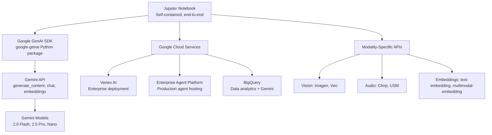

# generative-ai — Google's Gemini Notebooks and Examples Across All Modalities

**The official Google repository of Jupyter notebooks, code samples, and sample apps demonstrating the full Gemini API surface.** It covers 30+ topics in the `gemini/` subdirectory alone — from basic chat to advanced agent orchestration — plus vision (Imagen, Veo), audio (Chirp/USM speech), embeddings (text + multimodal, vector search), translation, RAG grounding, and workshops. The primary delivery mechanism is self-contained Jupyter notebooks, not a library or framework.

Source: `generative-ai/` — Python/Jupyter, Apache 2.0

## Repository Structure

```
generative-ai/
├── gemini/              ← 30+ topics covering the full Gemini API surface
├── vision/              ← Imagen (image generation), Veo (video generation)
├── audio/               ← Chirp/USM speech recognition and synthesis
├── embeddings/          ← Text + multimodal embeddings, vector search, anomaly sampling
├── translation/         ← LLM-based translation workflows
├── search/              ← Grounding with Google Search
├── rag-grounding/       ← RAG with Gemini's built-in grounding
├── agents/              ← Agent building with Gemini
├── workshops/           ← Hands-on workshop materials
├── scripts/             ← Utility scripts
├── setup-env/           ← Environment setup helpers
└── tools/               ← Evaluation and benchmarking tools
```

## Gemini Topics (30+)

| Category | Topics |
|----------|--------|
| **Core** | getting-started, chat-completions, prompts, thinking, controlled-generation, logprobs, long-context, context-caching |
| **Multimodal** | multimodal-dataset, multimodal-live-api, vision-understanding, audio-understanding, video-understanding |
| **Advanced** | function-calling, code-execution, grounding, URL-context, batch-prediction, model-optimizer, tuning |
| **Agents** | agent-engine, agents, orchestration, MCP-integration |
| **Enterprise** | global-endpoint, responsible-ai, evaluation, sample-apps, use-cases |
| **Experimental** | nano-banana (lightweight models), reasoning-engine, autocal |

## Architecture



## Key Workflows

### Function Calling

```python
# gemini/function-calling/ — Define tools as Python functions
def get_weather(city: str) -> dict:
    """Get current weather for a city"""
    return {"city": city, "temp": 72, "condition": "sunny"}

# Gemini automatically decides when to call the function
response = model.generate_content(
    "What's the weather in Paris?",
    tools=[get_weather]
)
# Response contains: function_call { name: "get_weather", args: {city: "Paris"} }
```

### Context Caching

```python
# gemini/context-caching/ — Cache large context for repeated queries
cache = genai.caching.CachedContent.create(
    model="gemini-2.0-flash",
    contents=[document1, document2, document3],  # Large documents
    ttl=datetime.timedelta(hours=1)
)
# Subsequent queries use cached context — faster, cheaper
response = model.generate_content("Summarize the documents", cached_content=cache)
```

### Multimodal Live API

```python
# gemini/multimodal-live-api/ — Real-time bidirectional streaming
client = genai.Client()
async with client.live.connect(model="gemini-2.0-flash") as session:
    # Send audio chunks from microphone
    await session.send(audio_chunk)
    # Receive text responses in real time
    async for response in session:
        print(response.text)
```

### Controlled Generation

```python
# gemini/controlled-generation/ — Enforce output structure
response = model.generate_content(
    "List 3 books about AI",
    generation_config=genai.GenerationConfig(
        response_mime_type="application/json",
        response_schema={
            "type": "array",
            "items": {
                "type": "object",
                "properties": {
                    "title": {"type": "string"},
                    "author": {"type": "string"},
                    "year": {"type": "integer"}
                }
            }
        }
    )
)
# Response is guaranteed valid JSON matching the schema
```

### RAG with Grounding

```python
# gemini/grounding/ — Ground responses in Google Search or custom data
response = model.generate_content(
    "What's the latest on quantum computing?",
    tools=[{"google_search": {}}]
)
# Response includes grounding metadata: sources, confidence scores
```

## Vision — Imagen and Veo

| Product | Capability | Example Notebook |
|---------|-----------|-----------------|
| **Imagen** | Text-to-image generation | `vision/imagen/` |
| **Veo** | Text-to-video generation | `vision/veo/` |

```python
# Imagen: generate images from text descriptions
from vertexai.preview.vision_models import ImageGenerationModel
model = ImageGenerationModel.from_pretrained("imagen-3")
images = model.generate_images(
    prompt="A serene mountain lake at sunset, digital art style",
    number_of_images=4
)
```

## Audio — Chirp and USM

| Product | Capability |
|---------|-----------|
| **Chirp** | Speech-to-text (100+ languages) |
| **USM** | Universal Speech Model — transcription + translation |

```python
# Chirp: transcribe audio
from vertexai.preview.audio_models import ChirpModel
model = ChirpModel.from_pretrained("chirp-2")
result = model.transcribe("meeting-recording.wav")
print(result.text)  # Full transcript
```

## Embeddings

| Model | Dimensions | Use Case |
|-------|-----------|----------|
| `text-embedding-004` | 768 | Text similarity, classification, clustering |
| `multimodal-embedding` | 1408 | Image + text similarity, cross-modal search |

```python
# Text embeddings for semantic search
result = genai.embed_content(
    model="models/text-embedding-004",
    content="What is machine learning?",
    task_type="RETRIEVAL_QUERY"
)
vector = result['embedding']  # 768-dimensional float array
```

## Key Design Decisions

1. **Notebook-first distribution** — Each topic is a self-contained notebook demonstrating an end-to-end workflow. No library API to learn — just run the notebook.
2. **Multimodal by design** — The repository structure reflects Gemini's multimodal nature. Text, vision, audio, and embeddings are separate directories but use the same unified Gemini API.
3. **Enterprise migration path** — README redirects to the newer `Google-Cloud-AI/agent-platform` repository for agent building, indicating an ongoing shift from Vertex AI branding to the Agent Platform.

## Cross-References

- [adk-go](01-adk-go.md) — Build agents with Gemini using ADK
- [stitch-sdk](02-stitch-sdk.md) — Generate UIs with Gemini-powered Stitch
- [gcsfuse](05-gcsfuse.md) — Store training data on GCS mounted via FUSE

## Next

→ Back to [Overview](00-overview.md) for the project map.
