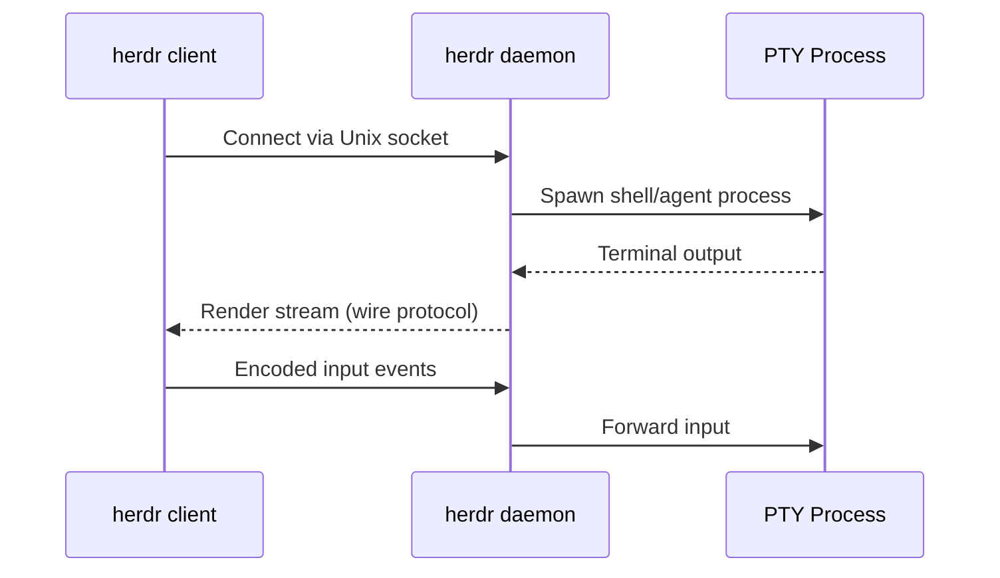

# Herdr — Terminal Workspace Manager for AI Coding Agents

**Herdr is a terminal workspace manager purpose-built for AI coding agents.** It's a Rust TUI (ratatui + crossterm, v0.6.8, AGPL-3.0) that auto-detects 20+ AI agents by analyzing terminal screen output, provides mouse-first workspace/tab/pane management with PTY isolation, and enables remote terminal attach/detach via Unix socket IPC. The architecture separates pure state (`AppState`) from runtime (`PaneRuntime`) — workspace logic is testable without real PTYs.

Source: `src/` — ~130 Rust files, AGPL-3.0

## Architecture

```mermaid
flowchart TD
    subgraph UI["TUI Layer (ratatui + crossterm)"]
        Tabs["Tab Bar"]
        Sidebar["Sidebar (pane tree)"]
        Status["Status Bar"]
        Panes["Pane Grid"]
        Dialogs["Dialogs + Settings + Onboarding"]
    end

    subgraph Core["Core State"]
        AppState["AppState<br/>Pure data: tabs, panes, workspaces<br/>Testable without PTYs"]
        Workspace["Workspace<br/>Git discovery + status<br/>Tab management"]
        Persist["Persist<br/>Snapshot + restore<br/>bincode serialization"]
    end

    subgraph Runtime["PTY Runtime"]
        PaneRuntime["PaneRuntime<br/>portable-pty processes<br/>async I/O via tokio"]
        AgentDetect["Agent Detection<br/>20+ detectors<br/>Screen snapshot analysis"]
        GhosttyVT["libghostty-vt<br/>Vendored terminal parser<br/>ANSI → structured output"]
    end

    subgraph Server["Server/Client"]
        Server["Server<br/>Unix socket IPC<br/>Client connections"]
        Remote["Remote Handoff<br/>Attach/detach terminals<br/>Headless mode"]
        Protocol["Wire Protocol<br/>Render stream<br/>Input encoding"]
    end

    UI --> AppState
    AppState --> Workspace
    AppState --> Persist
    PaneRuntime --> AgentDetect
    PaneRuntime --> GhosttyVT
    Server --> Remote
    Server --> Protocol
```

## Key Design Decisions

### 1. State Separated from Runtime

**Aha:** `AppState` is pure data with no PTY or async dependencies. `PaneRuntime` handles all the messy terminal I/O. This means you can write unit tests for workspace logic (tab splitting, pane focus, git status parsing) without spawning real terminals. The render function takes `&AppState` and only draws — it never mutates state during render.

```rust
// Architecture principle (from AGENTS.md)
// AppState: pure data, testable without PTYs or async
// PaneState: separate from PaneRuntime
// compute_view(): handles geometry and mutations
// render(): takes &AppState, only draws
```

### 2. Agent Detection from Screen Snapshots

Herdr detects 20+ AI agents by analyzing terminal output:

| Agent | Detector File | Detection Method |
|-------|--------------|-----------------|
| Claude Code | `claude_code.rs` | Bottom-buffer pattern matching |
| Codex | `codex.rs` | OpenAI-specific output patterns |
| Cursor | `cursor.rs` | Cursor-specific terminal output |
| Gemini CLI | `gemini.rs` | Google-specific patterns |
| GitHub Copilot | `github_copilot.rs` | Copilot output markers |
| Grok | `grok.rs` | xAI-specific patterns |
| OpenCode | `opencode.rs` | OpenCode agent patterns |
| Cline | `cline.rs` | Cline extension patterns |
| Antigravity | `antigravity.rs` | Google Antigravity patterns |
| Hermes | `hermes.rs` | Hermes agent patterns |
| Kilo | `kilo.rs` | Kilo agent patterns |
| Kimi | `kimi.rs` | Moonshot Kimi patterns |
| Kiro | `kiro.rs` | Kiro agent patterns |
| Qoder CLI | `qodercli.rs` | Qoder CLI patterns |
| AMP | `amp.rs` | AMP agent patterns |
| Droid | `droid.rs` | Droid agent patterns |
| Pi | `pi.rs` | Pi agent patterns |

**Aha:** Detection is evidence-based and decoupled from rendering. The detector reads a screen snapshot, never touches the parser or viewport state. Detection rules use explicit AND/OR gates on visible controls rather than matching whole-pane incidental text. The user-visible viewport is explicitly not used for agent status detection because users can scroll it.

### 3. Server/Client Architecture



- **Unix socket IPC** — Server listens on a socket; clients connect and attach to sessions
- **Headless mode** — Server runs without TUI; clients connect remotely
- **Detach/reattach** — Clients can disconnect and reconnect to existing sessions
- **Multi-client** — Multiple clients can view the same session simultaneously
- **Wire protocol** — Custom binary protocol for render stream + input encoding

### 4. Workspace Model

```rust
// Conceptual workspace structure
Workspace {
    tabs: Vec<Tab>,           // Ordered tab list
    active_tab: TabId,
    git_status: GitStatus,    // Auto-detected from working directory
}

Tab {
    panes: Vec<Pane>,         // Split panes
    layout: Layout,           // Split direction + ratios
    active_pane: PaneId,
    working_dir: PathBuf,
}

Pane {
    state: PaneState,         // Pure data: title, cursor, scrollback
    runtime: PaneRuntime,     // PTY process, I/O handles
    terminal: Terminal,       // libghostty-vt parser state
}
```

## Platform Isolation

```rust
// src/platform/
// mod.rs     — Platform trait
// macos.rs   — macOS-specific: process groups, signals
// linux.rs   — Linux-specific: /proc, cgroups
// fallback.rs — Generic fallback implementations
```

OS-specific code is isolated in `src/platform/`. Core modules never use `#[cfg(target_os)]`. This keeps the codebase portable and testable — new platform support requires only implementing the `Platform` trait.

## Key Dependencies

| Crate | Purpose |
|-------|---------|
| `ratatui` 0.30 | Terminal UI framework (tabs, panes, dialogs, scrollbar) |
| `crossterm` 0.29 | Terminal input/output, cursor control |
| `portable-pty` 0.9 | Cross-platform pseudo-terminal management |
| `tokio` 1.x | Async runtime for PTY I/O |
| `libghostty-vt` (vendored) | Terminal parser — ANSI escape sequences to structured output |
| `serde` + `bincode` | Session snapshot serialization |
| `sha2` | Content checksums for file integrity |

## Vendored libghostty-vt

Herdr vendors Ghostty's terminal parser with tracked local patches:

- `vendor/libghostty-vt.vendor.json` — upstream source commit reference
- `vendor/libghostty-vt.patches.md` — patch index with rationale, issue links, and removal conditions
- `vendor/patches/libghostty-vt/` — actual patch files

Maintenance tests verify patches are indexed and reverse-apply cleanly.

## CLI

```bash
herdr                        # Start TUI
herdr server                 # Start daemon (headless)
herdr client                 # Connect to daemon
herdr pane read --source recent --format text   # Capture bottom-buffer for agent detection dev
herdr workspace              # Workspace management
herdr tab                    # Tab management
```

## Cross-References

- [Goose](../src.block/markdown/00-overview.md) — Block's AI agent (herdr can host goose sessions)
- [src.jeremychone](../src.jeremychone/markdown/00-overview.md) — AIP stack (herdr hosts aipack sessions)
