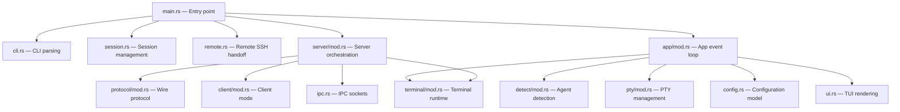

# Herdr — Architecture and Layer Map

**Herdr is a terminal workspace manager for AI coding agents.** It provides a ratatui TUI with workspace/tab/pane management, auto-detection of 20+ AI agents, PTY isolation via portable-pty, and server/client handoff over Unix sockets. Version 0.6.8, AGPL-3.0, ~130 Rust files.

Source: `/home/darkvoid/Boxxed/@formulas/src.rust/src.AI/src.Hedr/herdr/`

See [00-overview.md](00-overview.md) for a high-level introduction. This document maps every layer, module, and data path in the codebase.

## Layer Architecture

Herdr is organized into five layers with strict dependency ordering. Each layer depends only on layers below it.

```mermaid
flowchart TD
    subgraph L0["Layer 0: Platform"]
        P1["platform/mod.rs — Platform trait"]
        P2["platform/linux.rs — Linux /proc parsing"]
        P3["platform/macos.rs — macOS process groups"]
        P4["platform/fallback.rs — Generic fallbacks"]
    end

    subgraph L1["Layer 1: Core Types & Config"]
        C1["config.rs — Config model (TOML → Rust)"]
        C2["config/*.rs — Keybinds, themes, sound, I/O"]
        C3["events.rs — AppEvent enum (256-cap channel)"]
        C4["layout.rs — PaneId, Layout, Split geometry"]
        C5["input/*.rs — Key/mouse parsing & encoding"]
        C6["detect/*.rs — Agent detection (17 agents)"]
        C7["selection.rs — Text selection types"]
    end

    subgraph L2["Layer 2: State & PTY Runtime"]
        S1["app/state.rs — AppState (pure, ~90 fields)"]
        S2["app/actions.rs — State mutations (testable)"]
        S3["app/creation.rs — Workspace/tab/pane creation"]
        S4["pty/*.rs — Actor, backend, fd management"]
        S5["pane/*.rs — Pane state, terminal, OSC, XTGETTCAP"]
        S6["terminal/*.rs — TerminalRuntime registry"]
        S7["persist/*.rs — Snapshot/restore (bincode)"]
    end

    subgraph L3["Layer 3: Server & IPC"]
        V1["server/*.rs — Unix socket, clients, handoff"]
        V2["server/autodetect.rs — Launch auto-detection"]
        V3["server/render_stream.rs — Render wire protocol"]
        V4["server/handoff.rs — Live terminal handoff"]
        V5["protocol/*.rs — Wire format (ANSI + binary)"]
        V6["ipc.rs — IPC socket types"]
        V7["client/*.rs — Client input forwarding"]
    end

    subgraph L4["Layer 4: TUI Rendering"]
        U1["ui.rs — Render orchestration"]
        U2["ui/panes.rs — Terminal pane rendering"]
        U3["ui/tabs.rs — Tab bar rendering"]
        U4["ui/status.rs — Status bar rendering"]
        U5["ui/sidebar.rs — Workspace sidebar"]
        U6["ui/dialogs.rs — Modal dialogs"]
        U7["ui/widgets.rs — Reusable UI components"]
    end

    L0 --> L1
    L1 --> L2
    L2 --> L3
    L2 --> L4
    L3 --> L4
```



The key architectural invariant is that **Layer 2 state (`AppState`) is pure data** with no PTY or async dependencies. `PaneRuntime` handles all terminal I/O separately. This means workspace logic (tab splitting, pane focus, git status parsing) is unit-testable without spawning real terminals.

**Aha:** The `AppState` is deliberately separated from `TerminalRuntimeRegistry` at the struct level. `App::run()` holds both, but `render()` only takes `&AppState`. The `compute_view()` function takes `&mut AppState` to update geometry. This means the rendering pipeline is a pure function of state — no side effects, no async, no PTY handles.

Source: `/home/darkvoid/Boxxed/@formulas/src.rust/src.AI/src.Hedr/herdr/src/app/mod.rs:86-125` — `App` struct holds both `state: AppState` and `terminal_runtimes: TerminalRuntimeRegistry`, but `ui::render_with_runtime_registry(&self.state, ...)` only reads state.

## Module Dependency Graph



## Entry Point Flow (`main.rs`)

`main()` at line 332 of `src/main.rs` follows this decision tree:

1. Parse args via `session::configure_from_args()` → `remote::extract_remote_args()`
2. Handle subcommands first (exit immediately):
   - `remote-client-bridge` → `remote::run_remote_client_bridge()`
   - `server` → `server::headless::run_server()`
   - `client` → `client::run_client()`
   - `update` → `update::self_update()`
   - `--help` → print usage, exit
   - `--version` → print version, exit
   - `--default-config` → print TOML template, exit
3. If `--remote <target>` → `remote::run_remote()`
4. If NOT `--no-session` → `server::autodetect::auto_detect_launch()` (server/client mode)
5. If `--no-session` → monolithic mode:
   - Create tokio runtime
   - Initialize ratatui terminal
   - Create `App::new()` with session restore
   - Call `app.run(&mut terminal)` — the main event loop
   - Shutdown runtime, restore terminal

Source: `/home/darkvoid/Boxxed/@formulas/src.rust/src.AI/src.Hedr/herdr/src/main.rs:332-706`

## Event Loop Architecture

The main event loop in `App::run()` (`app/mod.rs:713`) uses `tokio::select!` to multiplex five event sources:

| Source | Channel | Purpose |
|--------|---------|---------|
| API requests | `UnboundedReceiver<ApiRequestMessage>` | External socket commands |
| Internal events | `mpsc::Receiver<AppEvent>` | Pane death, state changes, git status |
| Raw input | `mpsc::Receiver<RawInputEvent>` | Key/mouse/paste from terminal |
| Timer deadlines | `tokio::time::sleep_until()` | Animation, git refresh, session save |
| Render notify | `Arc<Notify>` | Async-triggered redraws |

Source: `/home/darkvoid/Boxxed/@formulas/src.rust/src.AI/src.Hedr/herdr/src/app/mod.rs:870-888`

```rust
// app/mod.rs:870-888
let event = {
    let input_rx = self.input_rx.as_mut();
    tokio::select! {
        maybe_api = self.api_rx.recv() => match maybe_api {
            Some(msg) => LoopEvent::Api(msg),
            None => LoopEvent::Timer,
        },
        maybe_ev = self.event_rx.recv() => match maybe_ev {
            Some(ev) => LoopEvent::Internal(ev),
            None => LoopEvent::Timer,
        },
        maybe_input = recv_raw_input_or_pending(input_rx) => match maybe_input {
            Some(input) => LoopEvent::RawInput(input),
            None => LoopEvent::InputClosed,
        },
        _ = sleep_until_or_pending(next_deadline) => LoopEvent::Timer,
        _ = self.render_notify.notified() => LoopEvent::RenderRequested,
    }
};
```

The render loop caps at 60fps (`MIN_RENDER_INTERVAL = 16ms`) with a dirty-flag optimization. `SyncOutputGuard` uses terminal synchronized output (`\x1b[?2026h`/`\x1b[?2026l`) to prevent frame tearing.

Source: `/home/darkvoid/Boxxed/@formulas/src.rust/src.AI/src.Hedr/herdr/src/app/mod.rs:30-43`

## Key Data Flow

```mermaid
sequenceDiagram
    participant User as User Input
    participant Term as Terminal (crossterm)
    participant Raw as raw_input module
    participant App as App event loop
    mutant State as AppState
    participant PTY as PTY Runtime
    participant UI as UI Renderer

    User->>Term: Keypress
    Term->>Raw: RawInputEvent (Key/Mouse/Paste)
    Raw->>App: Channel send
    App->>App: route_client_events()
    alt Mode == Terminal
        App->>PTY: try_send_bytes(encoded)
        PTY-->>Term: Terminal output
    else Mode == Navigate/Settings/etc
        App->>State: State mutation (focus, scroll)
    end
    App->>App: mark render_dirty
    App->>UI: compute_view() + render()
    UI-->>Term: Ratatui frame buffer
```

## Config System Architecture

The config system loads from `~/.config/herdr/config.toml` with these sections:

| Section | Source File | Key Types |
|---------|-------------|-----------|
| `[theme]` | `config/theme.rs` | `ThemeConfig`, `CustomThemeColors`, palette override |
| `[terminal]` | `config/model.rs:160-169` | `TerminalConfig`, `ShellModeConfig`, `NewTerminalCwdConfig` |
| `[update]` | `config/model.rs:28-40` | `UpdateConfig`, `UpdateChannelConfig` (stable/preview) |
| `[keys]` | `config/keybinds.rs` | Keybind parsing, prefix key, custom commands |
| `[ui]` | `config/model.rs` | Sidebar width, mobile threshold, mouse, toast, sound |
| `[ui.toast]` | `config/model.rs` | `ToastDelivery` (off/herdr/terminal/system) |
| `[ui.sound]` | `config/sound.rs` | `SoundConfig`, per-agent mute |
| `[session]` | `config/model.rs:171-185` | `SessionConfig.resume_agents_on_restore` (default: true) |
| `[remote]` | `config/model.rs` | `manage_ssh_config` (default: true) |
| `[experimental]` | `config/model.rs` | `allow_nested`, `kitty_graphics`, `pane_history`, CJK IME |
| `[advanced]` | `config/model.rs` | `scrollback_limit_bytes` (default: 10MB) |
| `[worktrees]` | `config/model.rs` | `directory` (default: `~/.herdr/worktrees`) |

Source: `/home/darkvoid/Boxxed/@formulas/src.rust/src.AI/src.Hedr/herdr/src/config/model.rs` and `src/main.rs:65-301` (DEFAULT_CONFIG template)

**Aha:** Config sections are validated independently during live reload. If `[keys]` has a bad binding, only that section is rejected — `[ui]`, `[theme]`, and other sections still apply. This is implemented in `apply_live_config()` which checks `invalid_section("keys")`, `invalid_section("ui")`, etc. before applying each section's updates.

Source: `/home/darkvoid/Boxxed/@formulas/src.rust/src.AI/src.Hedr/herdr/src/app/mod.rs:1122-1286`

## Cross-References

- [00-overview.md](00-overview.md) — High-level introduction
- [02-agent-detection.md](02-agent-detection.md) — Agent detector system deep dive
- [03-pty-management.md](03-pty-management.md) — PTY runtime architecture
- [04-workspace-tabs-panes.md](04-workspace-tabs-panes.md) — Workspace model deep dive
- [05-tui-rendering.md](05-tui-rendering.md) — TUI rendering system
- [06-server-client.md](06-server-client.md) — Server/client and handoff
- [07-configuration.md](07-configuration.md) — Configuration system deep dive
- [08-cli-commands.md](08-cli-commands.md) — CLI command reference
- [09-data-flow.md](09-data-flow.md) — End-to-end data flows
- [10-error-handling.md](10-error-handling.md) — Error handling and recovery

→ Next: [02-agent-detection.md](02-agent-detection.md) — The agent detector system
