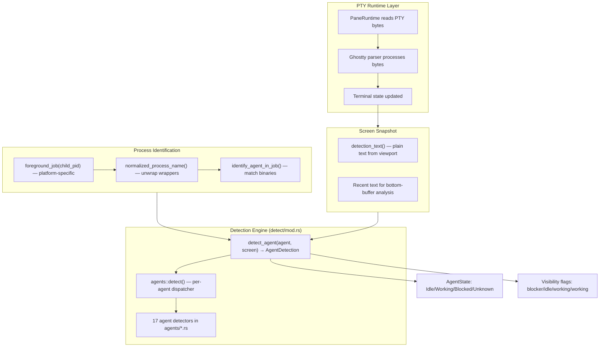

# Herdr — Agent Detector System (17 AI Agents)

**Herdr auto-detects 17 AI coding agents running in terminal panes by analyzing screen snapshots and process trees.** Detection is decoupled from rendering, evidence-based with explicit AND/OR gates, and uses a hierarchical state model (Idle/Working/Blocked/Unknown) with five visibility signals.

Source: `/home/darkvoid/Boxxed/@formulas/src.rust/src.AI/src.Hedr/herdr/src/detect/`

See [01-architecture.md](01-architecture.md) for the overall system architecture. This document covers the agent detection subsystem end-to-end.

## Detection Architecture



**Aha:** Detection reads a screen snapshot — a plain-text slice of the terminal viewport — and never touches the parser or viewport state. The detector is a pure function: `fn detect_agent(agent: Option<Agent>, screen_content: &str) -> AgentDetection`. This means it is trivially unit-testable with string fixtures. The 100+ tests in `detect/mod.rs` (lines 526-2804) prove every detector against real agent output patterns.

Source: `/home/darkvoid/Boxxed/@formulas/src.rust/src.AI/src.Hedr/herdr/src/detect/mod.rs:175-186`

```rust
// detect/mod.rs:175-186
/// Detect state and whether a visible blocker is present on the current screen.
pub fn detect_agent(agent: Option<Agent>, screen_content: &str) -> AgentDetection {
    let Some(agent) = agent else {
        return AgentDetection {
            state: AgentState::Unknown,
            skip_state_update: false,
            visible_blocker: false,
            visible_idle: false,
            visible_working: false,
        };
    };
    agents::detect(agent, screen_content)
}
```

## The Agent Enum (17 Agents)

Source: `/home/darkvoid/Boxxed/@formulas/src.rust/src.AI/src.Hedr/herdr/src/detect/mod.rs:43-62`

| Agent | Display Label | Detector File | Detection Complexity |
|-------|--------------|---------------|---------------------|
| `Pi` | `pi` | `agents/pi.rs` | Low — "Working..." literal |
| `Claude` | `claude` | `agents/claude_code.rs` | Very High — prompt box, transcript viewer, blocked forms, background agents, question UI |
| `Codex` | `codex` | `agents/codex.rs` | Very High — transcript viewer, queued inputs, approval requests, background terminals |
| `Gemini` | `gemini` | `agents/gemini.rs` | Medium — confirmation prompts, box-drawing dialogs |
| `Cursor` | `cursor` | `agents/cursor.rs` | Medium — spinner detection, command approval |
| `Antigravity` | `agy` | `agents/antigravity.rs` | Medium — permission prompts, spinner, background tasks |
| `Cline` | `cline` | `agents/cline.rs` | Low — tool use prompts, "ready" text |
| `OpenCode` | `opencode` | `agents/opencode.rs` | Medium — permission, progress bars, question prompts |
| `GithubCopilot` | `copilot` | `agents/github_copilot.rs` | Medium — permission dialogs, plan review, autopilot |
| `Kimi` | `kimi` | `agents/kimi.rs` | High — moon phase emojis, approval panels, editor prompt box |
| `Kiro` | `kiro` | `agents/kiro.rs` | Medium — tool/subagent approval, spinner |
| `Droid` | `droid` | `agents/droid.rs` | Medium — EXECUTE blocks, braille spinner |
| `Amp` | `amp` | `agents/amp.rs` | Medium — approval actions, tool headers |
| `Grok` | `grok` | `agents/grok.rs` | Medium — permission whitelist, braille spinner |
| `Hermes` | `hermes` | `agents/hermes.rs` | Medium — modal approval dialogs |
| `Kilo` | `kilo` | `agents/kilo.rs` | Low — delegates to OpenCode, "esc interrupt" |
| `Qodercli` | `qodercli` | `agents/qodercli.rs` | Medium — braille spinner, exit hints, permission prompts |

Source: `/home/darkvoid/Boxxed/@formulas/src.rust/src.AI/src.Hedr/herdr/src/detect/agents/mod.rs:21-60`

## AgentDetection: Five Visibility Signals

Source: `/home/darkvoid/Boxxed/@formulas/src.rust/src.AI/src.Hedr/herdr/src/detect/mod.rs:22-40`

```rust
// detect/mod.rs:22-40
pub struct AgentDetection {
    pub state: AgentState,
    /// True when the current screen is an agent-owned viewer (transcript/history)
    /// that shows transcript/history instead of the live prompt state.
    pub skip_state_update: bool,
    /// True when the current screen visibly shows live UI chrome that needs
    /// human input. Stronger than arbitrary prompt-like text in scrollback.
    pub visible_blocker: bool,
    /// True when the current screen visibly shows the agent's idle input UI.
    /// Lets Herdr recover from integrations that miss an interrupt/stop event.
    pub visible_idle: bool,
    /// True when the current screen visibly shows live working chrome.
    /// Guards against stale hook idle reports.
    pub visible_working: bool,
}
```

**Aha:** The five-signal model (`state` + four visibility flags) solves a critical problem: screen text is ambiguous. The string "Do you want to proceed?" could be a live permission prompt OR a transcript replay of a past conversation. `visible_blocker` is opt-in per-agent (only Claude, Codex, and Kimi implement it) and requires detecting the full context of a live prompt — not just matching keywords in scrollback. This prevents false positives from agent output history.

Source: `/home/darkvoid/Boxxed/@formulas/src.rust/src.AI/src.Hedr/herdr/src/detect/agents/mod.rs:70-111`

## Per-Agent Detection Detail

### Claude Code (Most Complex Detector)

Source: `/home/darkvoid/Boxxed/@formulas/src.rust/src.AI/src.Hedr/herdr/src/detect/agents/claude_code.rs`

Claude detection at line 12-43 checks in priority order:

1. **Search mode** — "search" or "search..." text
2. **Ctrl+R toggle** — "ctrl+r" toggle text
3. **Blocked form** — `has_claude_blocked_prompt()` checks: "do you want to", "would you like to", "do you want to proceed?", "waiting for permission", "tab to amend", "ctrl+e to explain", "review your answers"
4. **Working chrome** — `has_working_chrome()` checks content above the prompt box for interrupt patterns ("esc to interrupt", "ctrl+c to interrupt") or spinner activity
5. **Blocked prompt** — selection prompts with numbered options
6. **Prompt box** — `has_prompt_box()` finds the second-to-last horizontal rule and checks if "❯" appears between border lines

The prompt box detection is key:

```rust
// claude_code.rs:80-90
pub(crate) fn has_prompt_box(content: &str) -> bool {
    let lines: Vec<&str> = content.lines().collect();
    let Some(top_border) = claude_prompt_box_top_border_index(&lines) else {
        return false;
    };
    let prompt_line = &lines[top_border + 1..].iter()
        .find(|line| line.trim().starts_with('❯'));
    prompt_line.is_some()
}
```

The prompt box is defined by horizontal rules (3+ "─" characters). The detector looks for the **second-to-last** horizontal rule from the bottom, then checks for the "❯" prompt character between the top and bottom borders.

**Claude Transcript Viewer Skip:** When Claude shows its detailed transcript view ("Showing detailed transcript · ctrl+o to toggle"), the detector sets `skip_state_update = true`. This prevents Herdr from incorrectly classifying a history viewer as idle/working. The check examines bottom 3 non-empty lines for the transcript control tail.

```rust
// claude_code.rs:66-78
fn is_transcript_viewer(content: &str) -> bool {
    let bottom = bottom_non_empty_lines(content, 3);
    if bottom.is_empty() { return false; }
    let last = normalize_lines(&bottom);
    last.contains("showing detailed transcript")
        && last.contains("ctrl+o to toggle")
        && (last.contains("collapse") || last.contains("show all") || last.contains("verbose"))
        && bottom.iter().any(|l| transcript_control_tail(l))
}
```

### Codex (Second Most Complex)

Source: `/home/darkvoid/Boxxed/@formulas/src.rust/src.AI/src.Hedr/herdr/src/detect/agents/codex.rs`

Codex detection checks:

1. **Strong blocked** — "press enter to confirm or esc to cancel", "enter to submit answer", "enter to submit all", "allow command?"
2. **Live working at current prompt** — "Working (Ns", "Waiting for background terminal (", "reviewing approval request (", "Booting MCP server:"
3. **Idle prompt** — current prompt region (last "›" line with no block markers after)
4. **Weak blocked** — "[y/n]", "yes (y)", generic confirmation patterns
5. **Interrupt pattern / working header** — "esc to interrupt"

The current prompt detection is sophisticated:

```rust
// codex.rs:157-169
fn codex_current_prompt_region(content: &str) -> Option<(Vec<&str>, usize)> {
    // Finds the last "›" prompt line with no block markers after it.
    // Block markers: "•", "■", "✗", "✓"
    let lines: Vec<&str> = content.lines().collect();
    // ... walks from bottom, finds prompt line, returns region
}
```

Codex also has its own transcript viewer detection with scroll/page/jump/quit controls and "q to quit" + "esc to edit prev" patterns.

### Process Identification

Source: `/home/darkvoid/Boxxed/@formulas/src.rust/src.AI/src.Hedr/herdr/src/detect/mod.rs:351-520`

Herdr doesn't just look at screen text — it also identifies agents by analyzing the process tree:

```rust
// detect/mod.rs:351-374
fn normalized_process_name(process: &ForegroundProcess) -> String {
    let effective = process.argv0.as_deref().unwrap_or(&process.name);
    let lower_effective = effective.to_lowercase();

    // 1. If runtime is a generic shell/interpreter, unwrap the script arg
    if is_generic_runtime_or_shell(&lower_effective) {
        if let Some(wrapped_agent) =
            wrapped_agent_name_from_runtime_argv(&lower_effective, process.argv.as_deref())
        {
            return wrapped_agent;
        }
    }

    // 2. Direct identification
    if identify_agent(effective).is_some() {
        return effective.to_string();
    }

    // 3. Try argv[0] and cmdline argv0 (for Nix-wrapped binaries)
    if let Some(wrapped_agent) = argv0_agent_name(process.argv.as_deref())
        .or_else(|| cmdline_argv0_agent_name(process.cmdline.as_deref().unwrap_or_default()))
    {
        return wrapped_agent;
    }

    effective.to_string()
}
```

**Aha:** The process identification system handles wrapped agents gracefully. When an agent runs under `node`, `python3`, `bash`, or `zsh`, the detector unwraps the script argument to find the actual agent binary. It also handles Nix-wrapped binaries by resolving symlinks and canonicalizing paths. The priority scoring (3 for argv0 mismatch, 2 for non-generic runtime, 1 for generic) ensures the process group leader wins when it's a known agent, falling back to other processes when needed.

Source: `/home/darkvoid/Boxxed/@formulas/src.rust/src.AI/src.Hedr/herdr/src/detect/mod.rs:504-513`

### Shared Detection Helpers

Source: `/home/darkvoid/Boxxed/@formulas/src.rust/src.AI/src.Hedr/herdr/src/detect/mod.rs:279-310`

```rust
// detect/mod.rs:279-289
fn has_confirmation_prompt(lower_content: &str) -> bool {
    if let Some(pos) = lower_content
        .find("do you want to")
        .or_else(|| lower_content.find("would you like to"))
    {
        let after = &lower_content[pos..];
        return after.contains("yes") || after.contains('❯');
    }
    false
}

// detect/mod.rs:306-310
fn has_interrupt_pattern(lower_content: &str) -> bool {
    lower_content.contains("esc to interrupt")
        || lower_content.contains("ctrl+c to interrupt")
        || lower_content.contains("press esc to interrupt")
}
```

**Aha:** The confirmation prompt helper is deliberately scoped: it looks for "do you want to" or "would you like to" AND requires "yes" or "❯" to appear **after** the match position in the same string. This prevents false positives from old scrollback text where a confirmation appeared but was already answered.

### Braille Spinner Detection

Source: `/home/darkvoid/Boxxed/@formulas/src.rust/src.AI/src.Hedr/herdr/src/detect/mod.rs:252-263`

```rust
fn has_braille_spinner(content: &str) -> bool {
    for line in content.lines() {
        let trimmed = line.trim();
        if let Some(c) = trimmed.chars().next() {
            if ('\u{2800}'..='\u{28FF}').contains(&c) {
                return true;
            }
        }
    }
    false
}
```

The braille spinner check uses the Unicode braille pattern range (U+2800–U+28FF) to detect animated spinners. Claude Code uses its own spinner character set (line 212 of `claude_code.rs`): `"·❱❲❳❴❵❶❷❸❹❺❻❼❽❾❿➀➁➃..."` plus various geometric shapes.

### Agent State Stabilization

Source: `/home/darkvoid/Boxxed/@formulas/src.rust/src.AI/src.Hedr/herdr/src/terminal/state.rs:781-811`

```rust
// terminal/state.rs:781-811
fn stabilize_agent_state(
    agent: Option<Agent>,
    previous: AgentState,
    raw: AgentState,
    now: Instant,
    last_claude_working_at: Option<Instant>,
) -> AgentState {
    // Claude gets a 1200ms working hold after last working signal
    // to prevent flicker between Working and Idle during brief gaps
    // in spinner output.
    if agent == Some(Agent::Claude) && previous == AgentState::Working {
        if let Some(last) = last_claude_working_at {
            if now.duration_since(last) < Duration::from_millis(1200) {
                return AgentState::Working;
            }
        }
    }
    // ... non-Claude passthrough
    raw
}
```

**Aha:** Claude Code gets a 1200ms "working hold" — if the previous state was Working and the last working signal was within 1200ms, the state stays Working even if the current screen snapshot doesn't show working indicators. This prevents flicker between Working and Idle during brief gaps in Claude's spinner output (e.g., between tool calls). No other agent gets this treatment.

## The Central Dispatcher

Source: `/home/darkvoid/Boxxed/@formulas/src.rust/src.AI/src.Hedr/herdr/src/detect/agents/mod.rs:21-60`

```rust
// agents/mod.rs:21-60
pub fn detect(agent: Agent, screen_content: &str) -> AgentDetection {
    let state = match agent {
        Agent::Pi => pi::detect(screen_content),
        Agent::Claude => claude_code::detect(screen_content),
        Agent::Codex => codex::detect(screen_content),
        // ... 14 more agents
    };

    let skip_state_update = should_skip_state_update(agent, screen_content);
    let visible_blocker = has_visible_blocker(agent, screen_content, state);
    let visible_idle = has_visible_idle(agent, screen_content, state);
    let visible_working = has_visible_working(agent, screen_content, state);

    AgentDetection { state, skip_state_update, visible_blocker, visible_idle, visible_working }
}
```

The dispatcher calls the per-agent `detect()` function, then computes the four visibility flags. Only Claude, Codex, and Kimi implement `has_visible_blocker`, `has_visible_idle`, and `has_visible_working`. All other agents return `false` for these flags.

## State Priority and Rollup

When multiple panes exist in a workspace or tab, Herdr rolls up states using priority:

```
Blocked > Working > Idle > Unknown
```

This is implemented in `app/actions.rs` via `state_priority()`:

```rust
// app/actions.rs — state priority
fn state_priority(state: AgentState) -> u8 {
    match state {
        AgentState::Blocked => 3,
        AgentState::Working => 2,
        AgentState::Idle => 1,
        AgentState::Unknown => 0,
    }
}
```

The tab and workspace aggregate states use the highest-priority state among their panes. This means a single blocked pane makes the entire tab show as "blocked" in the sidebar.

## Agent Labels and Aliases

Source: `/home/darkvoid/Boxxed/@formulas/src.rust/src.AI/src.Hedr/herdr/src/detect/mod.rs:86-108`

The `parse_agent_label()` function handles multiple aliases per agent:

| Agent | Aliases |
|-------|---------|
| Claude | `claude`, `claude-code` |
| Cursor | `cursor`, `cursor-agent` |
| Antigravity | `agy`, `antigravity`, `antigravity-cli` |
| OpenCode | `opencode`, `open-code` |
| GithubCopilot | `copilot`, `github-copilot`, `ghcs` |
| Kimi | `kimi`, `kimi-code`, `kimi code` |
| Kiro | `kiro`, `kiro-cli` |
| Amp | `amp`, `amp-local` |
| Grok | `grok`, `grok-build` |
| Hermes | `hermes`, `hermes-agent` |
| Kilo | `kilo`, `kilo-code`, `kilo code` |
| Qodercli | `qodercli`, `qoderclicn`, `qoder`, `qodercn` |

Normalization is case-insensitive and strips `.exe` suffixes (for Windows compatibility).

## Cline: The Only Agent Defaulting to Working

**Key insight:** Cline is the **only** agent whose detector defaults to `Working` instead of `Idle`. This is because Cline's terminal output doesn't have a clear idle prompt — it mostly shows tool execution output, and the absence of output is more likely a brief gap than true idleness.

Source: `/home/darkvoid/Boxxed/@formulas/src.rust/src.AI/src.Hedr/herdr/src/detect/agents/cline.rs:3-22`

## Cross-References

- [01-architecture.md](01-architecture.md) — Overall system architecture
- [03-pty-management.md](03-pty-management.md) — How PTY bytes flow to detection
- [04-workspace-tabs-panes.md](04-workspace-tabs-panes.md) — How detected states affect workspace UI
- [09-data-flow.md](09-data-flow.md) — End-to-end detection data flow
- [10-error-handling.md](10-error-handling.md) — Error handling in detection

→ Next: [03-pty-management.md](03-pty-management.md) — The PTY runtime system
