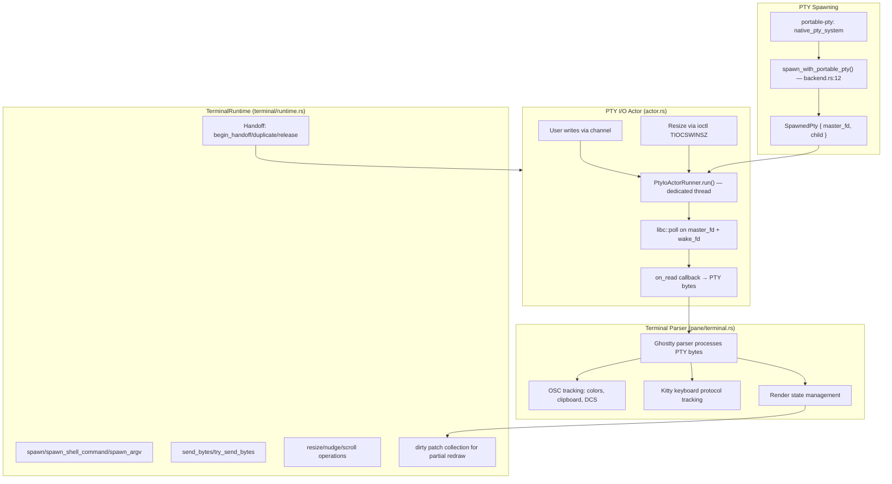
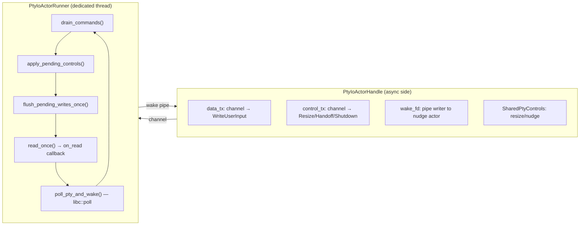

# Herdr — PTY Management and Terminal Runtime

**Herdr uses portable-pty (v0.9) for cross-platform pseudo-terminal spawning and a custom actor model for PTY I/O multiplexing.** The PTY actor owns the master file descriptor, handles reads/writes via `libc::poll`, and supports live terminal handoff without disconnecting child processes.

Source: `/home/darkvoid/Boxxed/@formulas/src.rust/src.AI/src.Hedr/herdr/src/pty/`, `/home/darkvoid/Boxxed/@formulas/src.rust/src.AI/src.Hedr/herdr/src/pane/`, `/home/darkvoid/Boxxed/@formulas/src.rust/src.AI/src.Hedr/herdr/src/terminal/`

See [02-agent-detection.md](02-agent-detection.md) for agent detection. This document covers the PTY runtime system from spawning to I/O to handoff.

## PTY Architecture Overview



## PTY Spawning (backend.rs)

Source: `/home/darkvoid/Boxxed/@formulas/src.rust/src.AI/src.Hedr/herdr/src/pty/backend.rs:12-42`

```rust
// pty/backend.rs:12-42
pub struct SpawnedPty {
    pub master_fd: OwnedFd,
    pub child: Box<dyn Child + Send + Sync>,
}

pub fn spawn_with_portable_pty(
    rows: u16, cols: u16,
    cmd: CommandBuilder,
) -> io::Result<SpawnedPty> {
    let pty_system = native_pty_system(false); // client=false → create master
    let pair = pty_system.openpty(&PtySize { rows, cols, ..Default::default() })?;
    let master_fd = pair.master;
    // Duplicate with CLOEXEC to prevent fd leak to child
    let master_fd = duplicate_cloexec_fd(master_fd)?;
    let child = pair.slave.spawn_command(cmd)?;
    Ok(SpawnedPty { master_fd, child })
}
```

The `native_pty_system(false)` call uses the platform's native PTY implementation (not a client connection). The master fd is duplicated with CLOEXEC before spawning the child, ensuring the child doesn't inherit the master fd. A test verifies this:

Source: `/home/darkvoid/Boxxed/@formulas/src.rust/src.AI/src.Hedr/herdr/src/pty/backend.rs:44-94`

```rust
#[test]
fn portable_pty_setup_leaves_one_parent_pty_fd() {
    // Spawns a process and checks /proc/self/fd in the parent.
    // Verifies only ONE PTY master fd exists (the one we opened),
    // not leaked to the child or duplicated incorrectly.
}
```

## The PTY Actor (actor.rs)

Source: `/home/darkvoid/Boxxed/@formulas/src.rust/src.AI/src.Hedr/herdr/src/pty/actor.rs`

The PTY actor is a dedicated thread that owns the PTY master fd and multiplexes all I/O. This is the core of Herdr's terminal runtime.

### Actor Architecture



### Key Structs

Source: `/home/darkvoid/Boxxed/@formulas/src.rust/src.AI/src.Hedr/herdr/src/pty/actor.rs:22-98`

```rust
// actor.rs:22-27
enum ActorState { Running, Quiesced, Released }

// actor.rs:45-51
struct PtyResize {
    rows: u16, cols: u16,
    cell_width_px: Option<u16>, cell_height_px: Option<u16>,
}

// actor.rs:59-63
struct SharedPtyControls {
    resize: Option<PtyResizeRequest>,
    nudge: Option<PtyResize>,
}

// actor.rs:77-84
enum PtyIoControlCommand {
    BeginHandoff,
    DuplicateForHandoff,
    ForegroundProcessGroup,
    RollbackHandoff,
    ReleaseAfterCommit,
    Shutdown,
}

// actor.rs:86-93
struct PtyIoActorHandle {
    data_tx: mpsc::Sender<PtyIoDataCommand>,
    control_tx: mpsc::Sender<PtyIoControlCommand>,
    wake: fd::WakeWriter,
    user_writes: UserWriteGate,
    controls: Arc<Mutex<SharedPtyControls>>,
}
```

### The Actor Run Loop

Source: `/home/darkvoid/Boxxed/@formulas/src.rust/src.AI/src.Hedr/herdr/src/pty/actor.rs:410-465`

```rust
// actor.rs:411-465
fn run(&mut self) {
    loop {
        if self.drain_commands() {
            self.apply_pending_controls();
            self.flush_pending_writes_once();
            continue;
        }

        let readiness = fd::poll_pty_and_wake(
            self.file.as_raw_fd(),
            self.wake_read_fd.as_raw_fd(),
            true,  // poll for read
            !self.pending_writes.is_empty(), // poll for write only if pending
            1000,  // 1s timeout
        );
        // ... handle readiness: read once, flush writes
    }
}
```

**Aha:** The actor uses a two-fd `libc::poll`: the PTY master fd and a wake pipe fd. The wake pipe is written to whenever a control or data command arrives on the channels. This avoids busy-waiting — the thread sleeps in `poll()` until either PTY data arrives or a command needs processing. The write side of `poll` is only enabled when there are pending writes, reducing unnecessary wakeups.

### Wake Pipe Mechanism

Source: `/home/darkvoid/Boxxed/@formulas/src.rust/src.AI/src.Hedr/herdr/src/pty/fd.rs:52-82`

```rust
// fd.rs:52-82
struct WakeWriter { fd: RawFd }
struct WakePipe { read_fd: OwnedFd, writer: WakeWriter }

fn create_wake_pipe() -> io::Result<WakePipe> {
    let mut fds = [0i32; 2];
    unsafe { libc::pipe(fds.as_mut_ptr()) };
    // Set CLOEXEC and NONBLOCK on both ends
    set_cloexec(fds[0])?;
    set_nonblocking(fds[0])?;
    set_cloexec(fds[1])?;
    set_nonblocking(fds[1])?;
    Ok(WakePipe { read_fd: OwnedFd::from(fds[0]), writer: WakeWriter { fd: fds[1] } })
}
```

The wake pipe is created with CLOEXEC and NONBLOCK flags. `WakeWriter::wake()` writes a single byte to wake the actor thread. The actor drains all pending wake bytes after processing.

### Handoff Flow

Source: `/home/darkvoid/Boxxed/@formulas/src.rust/src.AI/src.Hedr/herdr/src/pty/actor.rs:208-309`

The handoff system allows transferring a live PTY to another Herdr instance without disconnecting the child process:

1. **`begin_handoff(timeout)`** — Closes the input gate (stops accepting new writes), waits for the actor to quiesce (drain pending writes). Auto-rolls back on timeout.
2. **`duplicate_for_handoff()`** — Duplicates the master fd via `libc::dup`. The duplicate can be sent over a Unix socket to another Herdr instance.
3. **`rollback_handoff()`** — Re-opens the input gate if handoff is aborted.
4. **`release_after_commit()`** — Transitions the actor to `Released` state. After the handoff is committed, this actor stops managing the PTY; the new instance takes over.

```rust
// actor.rs:208-243
fn begin_handoff(&self, timeout: Duration) -> io::Result<()> {
    // 1. Close the user write gate — no new input accepted
    self.user_writes.close();
    // 2. Send BeginHandoff control command
    self.control_tx.blocking_send(PtyIoControlCommand::BeginHandoff)?;
    // 3. Wait for quiesce (state transitions to Quiesced)
    // 4. Auto-rollback on timeout
}
```

**Aha:** The handoff protocol is designed for zero data loss. `begin_handoff()` doesn't just close the input gate — it waits for the actor to flush all pending writes (with a 2s timeout) before transitioning to `Quiesced` state. If the handoff fails or times out, `rollback_handoff()` reopens the gate and the original instance resumes normal operation. This means a failed handoff is invisible to the user.

### The Nudge Mechanism

Source: `/home/darkvoid/Boxxed/@formulas/src.rust/src.AI/src.Hedr/herdr/src/pty/actor.rs:686-730`

After handoff, the child process needs to redraw its screen to match the new terminal dimensions. The "nudge" mechanism forces a redraw:

```rust
// actor.rs:686-730
fn nudge(&mut self, resize: PtyResize) {
    // 1. Temporarily shrink dimensions by 1 row/col
    let shrunk = PtyResize {
        rows: resize.rows.saturating_sub(1),
        cols: resize.cols.saturating_sub(1),
        ..resize
    };
    self.resize(shrunk);
    // 2. Wait 30ms for the child to react
    std::thread::sleep(Duration::from_millis(30));
    // 3. Restore original dimensions — child redraws at new size
    self.resize(resize);
}
```

**Aha:** The nudge works because most TUI applications (vim, htop, Claude Code) redraw their entire screen on SIGWINCH. By briefly shrinking the terminal by 1 row/col and then restoring it, Herdr forces the child to repaint at the correct dimensions. The 30ms delay is enough time for the child to process the first SIGWINCH before the second one arrives.

## Pane Terminal (pane/terminal.rs)

Source: `/home/darkvoid/Boxxed/@formulas/src.rust/src.AI/src.Hedr/herdr/src/pane/terminal.rs`

The `PaneTerminal` wraps the Ghostty terminal parser and handles all PTY byte processing, rendering, and input encoding.

### PTY Byte Processing Pipeline

Source: `/home/darkvoid/Boxxed/@formulas/src.rust/src.AI/src.Hedr/herdr/src/pane/terminal.rs:408-512`

```rust
// pane/terminal.rs:408-512
fn process_pty_bytes(
    &self, pane_id, shell_pid, bytes: &[u8], response_writer,
) -> ProcessBytesResult {
    // 1. Filter droid scrollback clear sequences (\x1b[3J)
    let filtered = maybe_filter_primary_screen_scrollback_clear(
        bytes, alternate_screen, foreground_job,
    );

    // 2. Observe bytes for Kitty keyboard protocol tracking
    self.core.kitty_keyboard.observe(&filtered);

    // 3. Track default color changes (OSC 10/11)
    // 4. Track OSC52 clipboard writes
    // 5. Write bytes to Ghostty terminal parser
    terminal.write(&filtered);

    // 6. Drain pending query responses (XTGETTCAP, default colors)
    let terminal_responses = self.drain_pending_pty_responses();

    // 7. Return: render_needed, clipboard_writes, terminal_responses
}
```

**Aha:** Droid compatibility: Herdr filters out `\x1b[3J` (scrollback clear) sequences when the foreground process is Droid. Droid's TUI clears scrollback on every render, which would erase Herdr's scrollback buffer. The filter only applies to the primary screen (not alternate screen) and only when Droid is the foreground process.

Source: `/home/darkvoid/Boxxed/@formulas/src.rust/src.AI/src.Hedr/herdr/src/pane/osc.rs:402-431`

### OSC Tracking

Source: `/home/darkvoid/Boxxed/@formulas/src.rust/src.AI/src.Hedr/herdr/src/pane/osc.rs`

Herdr tracks several OSC sequences as PTY bytes flow through:

| OSC | Purpose | Tracker |
|-----|---------|---------|
| OSC 10/11 | Default foreground/background color | `DefaultColorEventTracker` |
| OSC 4 | Palette color queries | `DefaultColorEventTracker` |
| OSC 52 | Clipboard writes (base64) | `Osc52Forwarder` (256KB max) |
| DCS +q | XTGETTCAP terminfo queries | `XtgettcapQueryTracker` |

The `DefaultColorEventTracker` uses a state machine to parse OSC bodies:

```rust
// pane/osc.rs:44-55
enum DefaultColorOscTrackerState {
    Ground, Escape, OscBody, OscEscape,
    IgnoreString, IgnoreStringEscape,
    OversizedOsc, OversizedOscEscape,
}
```

The tracker handles split sequences (where an OSC body arrives in multiple byte chunks) by maintaining state across calls.

### Input State

Source: `/home/darkvoid/Boxxed/@formulas/src.rust/src.AI/src.Hedr/herdr/src/pane/terminal.rs:80-91`

```rust
// pane/terminal.rs:80-91
struct InputState {
    alternate_screen: bool,
    application_cursor: bool,
    bracketed_paste: bool,
    focus_reporting: bool,
    mouse_protocol_mode: MouseProtocolMode,
    mouse_protocol_encoding: MouseProtocolEncoding,
    mouse_alternate_scroll: bool,
    modify_other_keys: Option<u8>,
}
```

This struct captures the terminal's current input mode flags. It is serialized during handoff and restored on the receiving end so the new terminal instance knows what keyboard/mouse protocols the child process expects.

### Dirty Patch Collection

Source: `/home/darkvoid/Boxxed/@formulas/src.rust/src.AI/src.Hedr/herdr/src/pane/terminal.rs:1173-1327`

For partial redraw optimization, Herdr collects dirty patches:

```rust
// pane/terminal.rs:1173-1327
fn ghostty_collect_dirty_patch(
    core: &GhosttyPaneCore,
    area_width: u16, area_height: u16,
) -> TerminalDirtyPatchOutcome {
    // Compares current frame cells against the previous render state.
    // Returns either:
    // - Clean: no changes
    // - Patch(TerminalDirtyPatch): only changed rows
    // - Fallback: too many changes, full redraw needed
}
```

This enables efficient partial redraws when only a few rows change (e.g., a single line of output).

## TerminalRuntime (terminal/runtime.rs)

Source: `/home/darkvoid/Boxxed/@formulas/src.rust/src.AI/src.Hedr/herdr/src/terminal/runtime.rs`

`TerminalRuntime` wraps `PaneRuntime` (the actual PTY actor + terminal parser) and provides the async-compatible interface used by `App`.

```rust
// terminal/runtime.rs:15
pub struct TerminalRuntime(PaneRuntime);

impl TerminalRuntime {
    pub fn spawn(...) -> io::Result<Self>
    pub fn spawn_with_initial_history(...) -> io::Result<Self>
    pub fn send_bytes(&self, bytes: Bytes)
    pub fn try_send_bytes(&self, bytes: Bytes) -> Result<(), TrySendError<Bytes>>
    pub fn resize(&self, rows, cols, ...)
    pub fn begin_graceful_release(&self)
    // ... many more delegates
}
```

All methods delegate to the inner `PaneRuntime`. The async/sync boundary is at `send_bytes` (async channel send) vs `try_send_bytes` (non-blocking).

## TerminalRuntimeRegistry (terminal/runtime_registry.rs)

Source: `/home/darkvoid/Boxxed/@formulas/src.rust/src.AI/src.Hedr/herdr/src/terminal/runtime_registry.rs`

```rust
// terminal/runtime_registry.rs:10-13
pub struct TerminalRuntimeRegistry {
    runtimes: HashMap<TerminalId, TerminalRuntime>,
}
```

The registry owns all PTY runtimes keyed by `TerminalId`. It supports handoff operations:

- `drain_for_handoff()` — Removes and returns runtimes for a specific pane, preparing them for handoff
- `assume_handoff_ownership()` — Takes ownership of imported runtimes after handoff
- `set_handoff_readers_paused(bool)` — Pauses/resumes PTY readers during handoff transition

## TerminalId

Source: `/home/darkvoid/Boxxed/@formulas/src.rust/src.AI/src.Hedr/herdr/src/terminal/id.rs`

```rust
// terminal/id.rs:10-25
pub struct TerminalId(String);

impl TerminalId {
    pub fn alloc() -> Self {
        // Format: term_{micros:x}{counter:x}
        // Uses atomic counter for uniqueness within the same microsecond
    }
}
```

Terminal IDs are globally unique strings formatted as `term_{microseconds_hex}{counter_hex}`. The atomic counter ensures uniqueness even when multiple terminals are allocated in the same microsecond.

## TerminalState: State Arbitration (terminal/state.rs)

Source: `/home/darkvoid/Boxxed/@formulas/src.rust/src.AI/src.Hedr/herdr/src/terminal/state.rs`

`TerminalState` is the central state struct for a single terminal. It manages three sources of state information:

1. **Detected agent** — from screen snapshot analysis
2. **Hook authority** — from agent integration hooks (more authoritative than detection)
3. **Persisted session** — from restored session data

### State Precedence

Source: `/home/darkvoid/Boxxed/@formulas/src.rust/src.AI/src.Hedr/herdr/src/terminal/state.rs:697-734`

The effective state is computed with this precedence:

```
visible_blocker (screen)  → Blocked  (strongest override)
visible_working (screen)  → Working  (overrides hook if fresh enough)
stale_hook_idle (screen)  → clears stale hook idle
hook authority            → hook's reported state
fallback state            → last known state
```

**Aha:** The hook authority system allows agent integrations to report their own state directly (e.g., "I'm waiting for a tool call"). But the screen detection can override hooks: if the screen shows a visible blocker (permission dialog), that wins over a hook reporting "working". If the screen shows live working chrome and the hook reports "idle" but the hook hasn't been updated recently, the visible working overrides the stale hook. This arbitration prevents false states when integrations miss events.

### Agent Metadata with TTL

Source: `/home/darkvoid/Boxxed/@formulas/src.rust/src.AI/src.Hedr/herdr/src/terminal/metadata.rs`

Agent metadata (title, custom status, display agent, state labels) is managed with TTL expiry:

```rust
// metadata.rs:8-24
struct AgentMetadata {
    source: String,
    agent_label: Option<String>,
    applies_to_source: Option<String>, // guard: only applies to specific hook source
    title: Option<String>,
    display_agent: Option<String>,
    custom_status: Option<String>,
    state_labels: Vec<String>,
    reported_at: Instant,
    ttl: Duration, // metadata expires after this duration
    expiry_event_pending: bool,
}
```

Metadata reports can be partial (only updating some fields) and include clear flags to explicitly remove specific fields. The `applies_to_source` guard ensures metadata from one integration doesn't accidentally override metadata from another.

## Cross-References

- [01-architecture.md](01-architecture.md) — Overall system architecture
- [02-agent-detection.md](02-agent-detection.md) — Agent detection from terminal output
- [04-workspace-tabs-panes.md](04-workspace-tabs-panes.md) — How panes are managed in workspaces
- [06-server-client.md](06-server-client.md) — How PTY handoff works over Unix sockets
- [09-data-flow.md](09-data-flow.md) — End-to-end PTY data flow

→ Next: [04-workspace-tabs-panes.md](04-workspace-tabs-panes.md) — Workspace, tab, and pane architecture
