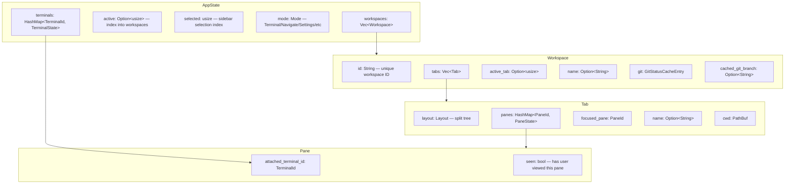

# Herdr — Workspace, Tab, and Pane Architecture

**Herdr organizes terminal sessions into workspaces (top-level containers), tabs (within workspaces), and panes (split terminals within tabs).** The workspace model supports git integration, agent state tracking, sidebar navigation, and drag-to-reorder.

Source: `/home/darkvoid/Boxxed/@formulas/src.rust/src.AI/src.Hedr/herdr/src/workspace/`, `/home/darkvoid/Boxxed/@formulas/src.rust/src.AI/src.Hedr/herdr/src/layout.rs`, `/home/darkvoid/Boxxed/@formulas/src.rust/src.AI/src.Hedr/herdr/src/app/actions.rs`

See [03-pty-management.md](03-pty-management.md) for the PTY runtime system. This document covers how workspaces, tabs, and panes are structured and managed.

## Workspace Model



Source: `/home/darkvoid/Boxxed/@formulas/src.rust/src.AI/src.Hedr/herdr/src/workspace.rs` and `src/workspace/tab.rs`

## Layout System

Source: `/home/darkvoid/Boxxed/@formulas/src.rust/src.AI/src.Hedr/herdr/src/layout.rs`

The layout system uses a binary split tree. Each node is either a leaf (a pane) or an internal node (a split with two children and a split ratio).

```rust
// layout.rs
pub struct Layout {
    // Binary split tree:
    // - Leaf: contains a single PaneId
    // - Split: direction (Horizontal/Vertical), ratio, left child, right child
}

pub enum LayoutNode {
    Leaf(PaneId),
    Split {
        direction: SplitDirection, // Horizontal | Vertical
        ratio: f32,                // 0.0–1.0, split position
        first: Box<LayoutNode>,
        second: Box<LayoutNode>,
    },
}
```

Pane operations (split, close, resize) modify this tree. The `compute_view()` function in `ui.rs` walks the tree to compute actual screen rectangles for each pane.

## Workspace Operations

Source: `/home/darkvoid/Boxxed/@formulas/src.rust/src.AI/src.Hedr/herdr/src/app/actions.rs:732-1350`

### Creation

Source: `/home/darkvoid/Boxxed/@formulas/src.rust/src.AI/src.Hedr/herdr/src/app/creation.rs:134-167`

```rust
// app/creation.rs:134-167
fn create_workspace_with_options(
    &mut self, initial_cwd: PathBuf, focus: bool,
) -> io::Result<usize> {
    // 1. Create new Workspace with default tab + root pane
    // 2. Spawn PTY for root pane via TerminalRuntime::spawn()
    // 3. Register TerminalId in AppState.terminals
    // 4. Add workspace to AppState.workspaces
    // 5. Set active if focus=true
    // 6. Log workspace creation
    // 7. Schedule session save
}
```

### Navigation

Source: `/home/darkvoid/Boxxed/@formulas/src.rust/src.AI/src.Hedr/herdr/src/app/actions.rs`

| Operation | Method | Description |
|-----------|--------|-------------|
| Switch workspace | `switch_workspace(idx)` | Set active workspace index |
| Next workspace | `next_workspace()` | Cycle to next visible workspace |
| Previous workspace | `previous_workspace()` | Cycle to previous visible workspace |
| Move workspace | `move_workspace(source, insert)` | Reorder workspaces (drag) |
| Close workspace | `close_selected_workspace()` | Remove active workspace, focus next |
| Next tab | `next_tab()` | Cycle tabs in active workspace |
| Previous tab | `previous_tab()` | Cycle tabs backward |
| Switch tab | `switch_tab(idx)` | Set active tab index |
| Close tab | `close_tab()` | Remove active tab, focus next |
| Move tab | `move_tab(source, insert)` | Reorder tabs (drag) |

### Pane Operations

Source: `/home/darkvoid/Boxxed/@formulas/src.rust/src.AI/src.Hedr/herdr/src/app/actions.rs:1353-1587`

| Operation | Method | Description |
|-----------|--------|-------------|
| Focus left/down/up/right | `navigate_pane(direction)` | Move focus to adjacent pane |
| Resize pane | `resize_pane(direction)` | Grow/shrink focused pane |
| Cycle pane | `cycle_pane(reverse)` | Cycle through all panes |
| Last pane | `last_pane()` | Switch back-and-forth between last two |
| Toggle zoom | `toggle_zoom()` | Fullscreen/unzoom focused pane |
| Close pane | `close_pane()` | Remove focused pane, redistribute space |
| Focus by index | `focus_pane_in_workspace(ws_idx, pane_id)` | Focus specific pane |

### Agent Navigation

Source: `/home/darkvoid/Boxxed/@formulas/src.rust/src.AI/src.Hedr/herdr/src/app/actions.rs`

| Operation | Method | Description |
|-----------|--------|-------------|
| Next agent | `next_agent()` | Cycle to next agent pane |
| Previous agent | `previous_agent()` | Cycle to previous agent pane |
| Focus agent | `focus_agent_entry(idx)` | Focus agent by index |
| Cycle agent | `cycle_agent_entry(forward)` | Cycle through agent entries |

**Aha:** The agent cycling operations (`next_agent`, `previous_agent`, `focus_agent_entry`) work across all workspaces and tabs, not just the active one. They scan through all panes, filter to those with detected agents, and cycle through them. This is why Herdr can host 20+ AI agent sessions simultaneously — you can jump between them with a single keybinding.

## Workspace State Aggregation

Source: `/home/darkvoid/Boxxed/@formulas/src.rust/src.AI/src.Hedr/herdr/src/workspace/aggregate.rs`

The aggregate module computes workspace-level summaries:

```rust
// workspace/aggregate.rs
fn tab_aggregate_state(panes: &[PaneState]) -> AgentState {
    // Returns highest priority state among all panes in tab
    // Priority: Blocked(3) > Working(2) > Idle(1) > Unknown(0)
}

fn workspace_activity_summary(panes: &[PaneState]) -> String {
    // Returns summary like "2 working, 1 blocked" or "all idle"
}
```

## Git Integration

Source: `/home/darkvoid/Boxxed/@formulas/src.rust/src.AI/src.Hedr/herdr/src/workspace/git/`

Herdr auto-detects git repositories for each workspace and displays branch name and ahead/behind counts in the sidebar.

### Git Discovery

Source: `/home/darkvoid/Boxxed/@formulas/src.rust/src.AI/src.Hedr/herdr/src/workspace/git/discovery.rs`

```rust
// workspace/git/discovery.rs
pub fn git_branch(cwd: &Path) -> Option<String> {
    // Runs `git symbolic-ref --short HEAD` or `git rev-parse --short HEAD`
    // Returns branch name or commit hash
}

pub fn git_status(cwd: &Path) -> Option<WorkspaceGitStatus> {
    // Runs `git status --branch --porcelain`
    // Returns branch, ahead/behind counts, file changes
}
```

### Git Status Refresh

Source: `/home/darkvoid/Boxxed/@formulas/src.rust/src.AI/src.Hedr/herdr/src/app/runtime.rs:436-464`

Git status is refreshed periodically (`GIT_REMOTE_STATUS_REFRESH_INTERVAL = 1500ms`):

```rust
// app/runtime.rs:436-464
fn start_git_status_refresh_if_due(&mut self, now: Instant) {
    if self.git_refresh_in_flight { return; }
    if now < self.git_refresh_deadline() { return; }

    // Spawn a thread to run git status for each workspace
    // Deduplicate workspaces sharing the same git root
    // Send GitStatusRefreshed event with results
}
```

**Aha:** Git status refresh is deduplicated across workspaces. If two workspaces share the same git repository root, Herdr runs `git status` only once and applies the result to both workspaces. This is implemented in `deduplicate_git_refresh_items()` which groups workspaces by their git root path.

Source: `/home/darkvoid/Boxxed/@formulas/src.rust/src.AI/src.Hedr/herdr/src/app/runtime.rs:573-601`

## Worktree Support

Source: `/home/darkvoid/Boxxed/@formulas/src.rust/src.AI/src.Hedr/herdr/src/worktree.rs` and `src/app/worktrees.rs`

Herdr supports git worktrees, allowing multiple branches of the same repository to be opened as separate workspaces.

```rust
// worktree.rs
pub fn expand_tilde_absolute_path(path: &str) -> PathBuf {
    // Expands ~/.herdr/worktrees to absolute path
}
```

Worktree operations:
- `open_new_linked_worktree_dialog(ws_idx)` — Create a new worktree linked to a workspace
- `open_existing_worktree_dialog(ws_idx)` — Open an existing worktree
- `open_remove_linked_worktree_confirmation(ws_idx)` — Remove a linked worktree
- `start_worktree_add()`, `start_worktree_remove()` — Execute worktree operations

Worktree groups are tracked so closing the last workspace in a group prompts for confirmation.

Source: `/home/darkvoid/Boxxed/@formulas/src.rust/src.AI/src.Hedr/herdr/src/app/actions.rs:1422-1450`

## Session Save and Restore

Source: `/home/darkvoid/Boxxed/@formulas/src.rust/src.AI/src.Hedr/herdr/src/persist/`

Herdr saves workspace state to disk for restoration on restart:

### Snapshot Structure

Source: `/home/darkvoid/Boxxed/@formulas/src.rust/src.AI/src.Hedr/herdr/src/persist/snapshot.rs`

```rust
// persist/snapshot.rs
pub struct SessionSnapshot {
    pub version: u32,              // snapshot format version
    pub workspaces: Vec<WorkspaceSnapshot>,
    pub active: Option<usize>,     // active workspace index
    pub selected: usize,           // sidebar selection index
    pub agent_panel_scope: AgentPanelScope,
    pub sidebar_width: Option<u16>,
    pub sidebar_section_split: Option<f32>,
    pub collapsed_space_keys: HashSet<String>,
}

pub struct WorkspaceSnapshot {
    pub id: String,
    pub name: Option<String>,
    pub tabs: Vec<TabSnapshot>,
    pub active_tab: Option<usize>,
    pub cwd: Option<PathBuf>,
}
```

Sessions are saved using bincode serialization. The save is debounced (`SESSION_SAVE_DEBOUNCE = 5s`) — changes mark the session as dirty, and the actual save happens 5 seconds later.

### Restore

Source: `/home/darkvoid/Boxxed/@formulas/src.rust/src.AI/src.Hedr/herdr/src/persist/restore.rs`

The restore process:
1. Load the snapshot from disk
2. Recreate workspaces with their tab/pane structure
3. For each pane, either:
   - Restore from saved history (if `pane_history` is enabled)
   - Spawn a new PTY with the original command
4. Restore terminal states (scroll position, input modes)
5. Rebuild the `TerminalRuntimeRegistry`

**Aha:** Session restore is designed to be resilient. If a PTY cannot be restored (e.g., the original command is no longer available), Herdr falls back to spawning a shell. The `resume_agents_on_restore` config option (default: true) controls whether agent panes are resumed into their native conversation sessions.

Source: `/home/darkvoid/Boxxed/@formulas/src.rust/src.AI/src.Hedr/herdr/src/config/model.rs:171-185`

## Copy Mode and Selection

Source: `/home/darkvoid/Boxxed/@formulas/src.rust/src.AI/src.Hedr/herdr/src/app/actions.rs:1588-1996` and `src/app/input/copy_mode.rs`

Herdr supports text selection and copy mode for copying text from terminal panes:

### Double-Click Word Copy

```rust
// app/actions.rs:1598-1667
fn copy_word_at_pane_cell(
    terminal_runtimes: &TerminalRuntimeRegistry,
    pane_id: PaneId,
    viewport_row: u16, col: u16,
) -> bool {
    // 1. Get text cells at the pane's viewport
    // 2. Find word bounds at the clicked column
    // 3. Detect URLs, quoted paths, or tokens
    // 4. Copy the selected text to clipboard
}
```

The word detection algorithm handles:
- URLs (http/https only)
- Quoted paths (`"/path/to/file"`)
- Shell tokens (words separated by whitespace and special characters)
- CJK characters (treated as word boundaries)

### Selection Mode

Source: `/home/darkvoid/Boxxed/@formulas/src.rust/src.AI/src.Hedr/herdr/src/app/input/selection.rs`

The selection mode supports:
- `Character` selection — character-by-character
- `Linewise` selection — entire lines from anchor row

Selection autoscrolls when the cursor approaches the viewport edge (`SELECTION_AUTOSCROLL_INTERVAL = 30ms`).

## Navigator

Source: `/home/darkvoid/Boxxed/@formulas/src.rust/src.AI/src.Hedr/herdr/src/app/actions.rs:110-230` and `src/app/input/navigate.rs`

The Navigator provides a hierarchical view of all workspaces, tabs, and panes:

```
workspace: my-project
├── tab: main
│   ├── pane: claude (Working)
│   └── pane: bash (Idle)
└── tab: tests
    └── pane: pytest (Blocked)
```

The navigator supports:
- Text search across all labels
- State filter (Blocked/Working/Idle/Done)
- Expandable/collapsible workspaces
- Keyboard navigation (up/down, enter to focus)

Source: `/home/darkvoid/Boxxed/@formulas/src.rust/src.AI/src.Hedr/herdr/src/app/state.rs:763-800`

```rust
// app/state.rs:763-800
pub enum NavigatorTarget {
    Workspace { ws_idx: usize },
    Tab { ws_idx: usize, tab_idx: usize },
    Pane { ws_idx: usize, tab_idx: usize, pane_id: PaneId },
}

pub enum NavigatorStateFilter {
    Blocked, Working, Idle, Done,
}

pub struct NavigatorState {
    pub query: String,
    pub selected: usize,
    pub scroll: usize,
    pub search_focused: bool,
    pub state_filter: NavigatorStateFilter,
    pub expanded_workspaces: HashSet<usize>,
}
```

## Cross-References

- [01-architecture.md](01-architecture.md) — Overall system architecture
- [03-pty-management.md](03-pty-management.md) — PTY runtime for pane terminals
- [05-tui-rendering.md](05-tui-rendering.md) — How workspaces/tabs/panes are rendered
- [06-server-client.md](06-server-client.md) — How workspace state is serialized for handoff
- [09-data-flow.md](09-data-flow.md) — End-to-end workspace lifecycle

→ Next: [05-tui-rendering.md](05-tui-rendering.md) — The TUI rendering system
