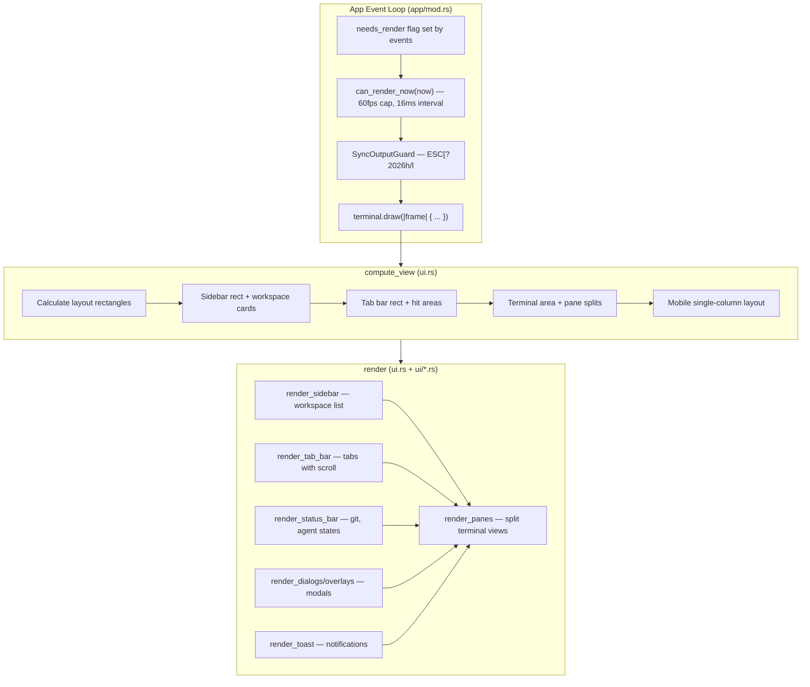

# Herdr — TUI Rendering with ratatui

**Herdr uses ratatui 0.30 and crossterm 0.29 to render a full TUI with tab bars, split panes, sidebar navigation, status bar, dialogs, and settings panels.** The rendering pipeline separates geometry computation (`compute_view`) from drawing (`render`), and uses terminal synchronized output to prevent frame tearing.

Source: `/home/darkvoid/Boxxed/@formulas/src.rust/src.AI/src.Hedr/herdr/src/ui/`, `/home/darkvoid/Boxxed/@formulas/src.rust/src.AI/src.Hedr/herdr/src/ui.rs`

See [04-workspace-tabs-panes.md](04-workspace-tabs-panes.md) for the workspace model. This document covers the TUI rendering system.

## Rendering Pipeline



Source: `/home/darkvoid/Boxxed/@formulas/src.rust/src.AI/src.Hedr/herdr/src/app/mod.rs:817-866`

```rust
// app/mod.rs:817-866
if needs_render && self.can_render_now(now) {
    self.render_dirty.swap(false, Ordering::AcqRel);
    let _sync_output = SyncOutputGuard::begin()?; // ESC[?2026h
    if self.full_redraw_pending {
        if kitty_graphics_enabled {
            crate::kitty_graphics::clear_all_host_graphics()?;
        }
        terminal.clear()?;
        self.full_redraw_pending = false;
    }
    terminal.draw(|frame| {
        let area = frame.area();
        crate::ui::compute_view_with_runtime_registry(&mut self.state, &self.terminal_runtimes, area);
        crate::ui::render_with_runtime_registry(&self.state, &self.terminal_runtimes, frame);
    })?;
    // ... kitty graphics painting
    self.last_render_at = Some(now);
    needs_render = false;
}
```

**Aha:** The `SyncOutputGuard` uses the terminal synchronized output escape sequence (`\x1b[?2026h` to begin, `\x1b[?2026l` to end). This is a DEC private mode that tells the terminal to buffer all output until the guard ends, preventing frame tearing. The guard is a RAII type — it begins synchronization on construction and ends it on drop, ensuring cleanup even during panics.

Source: `/home/darkvoid/Boxxed/@formulas/src.rust/src.AI/src.Hedr/herdr/src/app/mod.rs:139-156`

## Render Rate Control

Source: `/home/darkvoid/Boxxed/@formulas/src.rust/src.AI/src.Hedr/herdr/src/app/mod.rs:30-34`

| Constant | Value | Purpose |
|----------|-------|---------|
| `MIN_RENDER_INTERVAL` | 16ms | Cap render rate at ~60fps |
| `ANIMATION_INTERVAL` | 16ms | Animation tick interval (interactive mode) |
| `HEADLESS_ANIMATION_INTERVAL` | 128ms | Animation tick in headless server mode |
| `HEADLESS_ANIMATION_TICK_STEP` | 8 | Animation step multiplier for headless |

The `can_render_now()` method checks if at least 16ms has passed since the last render, preventing excessive CPU usage when events fire rapidly.

## Compute View

Source: `/home/darkvoid/Boxxed/@formulas/src.rust/src.AI/src.Hedr/herdr/src/ui.rs`

The `compute_view` function calculates all layout rectangles and stores them in `AppState.view`:

```rust
// ui.rs
pub fn compute_view_with_runtime_registry(
    state: &mut AppState,
    terminal_runtimes: &TerminalRuntimeRegistry,
    area: Rect,
) {
    // 1. Determine layout: Desktop vs Mobile
    // 2. Calculate sidebar rect
    // 3. Calculate tab bar rect + hit areas
    // 4. Calculate terminal area (remaining space)
    // 5. Walk pane layout tree, compute rects for each pane
    // 6. Calculate status bar rect
    // 7. Calculate dialog/overlay rects
}
```

### Mobile Layout Detection

Source: `/home/darkvoid/Boxxed/@formulas/src.rust/src.AI/src.Hedr/herdr/src/app/state.rs:716`

```rust
// app/state.rs:716
pub enum ViewLayout {
    Desktop,  // Full sidebar + tab bar + panes
    Mobile,   // Single-column, header + focused pane
}
```

The mobile layout activates when terminal width is at or below `mobile_width_threshold` (default: 64 columns). This is configurable in `[ui]` section.

## UI Modules

Source: `/home/darkvoid/Boxxed/@formulas/src.rust/src.AI/src.Hedr/herdr/src/ui/`

| File | Lines | Purpose |
|------|-------|---------|
| `ui/panes.rs` | ~500 | Terminal pane rendering with borders, labels, agent status |
| `ui/tabs.rs` | ~200 | Tab bar with scroll, active indicator, close buttons |
| `ui/status.rs` | ~150 | Status bar with git branch, ahead/behind, agent states |
| `ui/sidebar.rs` | ~400 | Workspace sidebar with cards, agent panel, scroll |
| `ui/dialogs.rs` | ~300 | Modal dialogs (confirm close, rename, etc.) |
| `ui/widgets.rs` | ~200 | Reusable UI components (borders, labels, scrollbars) |
| `ui/navigator.rs` | ~200 | Hierarchical navigator view |
| `ui/onboarding.rs` | ~150 | First-run onboarding screen |
| `ui/settings.rs` | ~400 | Settings panel (theme, sound, toast, experiments) |
| `ui/scrollbar.rs` | ~100 | Scrollbar rendering for scrollable content |
| `ui/menus.rs` | ~150 | Context menus and global menus |
| `ui/keybind_help.rs` | ~100 | Keybinding help overlay |
| `ui/mobile.rs` | ~200 | Mobile single-column layout rendering |
| `ui/release_notes.rs` | ~100 | Release notes viewer |

## Pane Rendering

Source: `/home/darkvoid/Boxxed/@formulas/src.rust/src.AI/src.Hedr/herdr/src/ui/panes.rs`

Each terminal pane is rendered with:

1. **Border** — Split borders show connections between panes
2. **Title** — Manual label > detected agent label > default
3. **Terminal content** — Via `TerminalRuntime::render()` which uses Ghostty's cell renderer
4. **Cursor** — Only visible on the focused pane (hidden on unfocused panes)
5. **Agent status indicator** — Working/Blocked/Idle badge

```rust
// ui/panes.rs — conceptual
fn render_pane(frame: &mut Frame, state: &AppState, pane_id: PaneId, area: Rect) {
    // 1. Get terminal runtime for pane
    let runtime = state.runtime_for_pane(&terminal_runtimes, pane_id);
    let Some(runtime) = runtime else { return; };

    // 2. Render terminal content into the pane area
    runtime.render(frame, area, is_focused);

    // 3. Draw border with title
    let border = Paragraph::new("")
        .block(Block::bordered().title(title).border_style(border_style));
    frame.render_widget(border, area);

    // 4. Draw agent status badge
    if state.show_agent_labels_on_pane_borders {
        if let Some(label) = state.border_label(pane_id) {
            // Render label on border
        }
    }
}
```

**Aha:** The unfocused panes hide their cursors during render. Only the focused pane's cursor is visible. This prevents the "multiple cursors" visual confusion that can occur in multiplexed terminal UIs.

## Tab Bar Rendering

Source: `/home/darkvoid/Boxxed/@formulas/src.rust/src.AI/src.Hedr/herdr/src/ui/tabs.rs`

The tab bar shows tabs for the active workspace with:
- Active tab highlight
- Scroll indicators (when tabs overflow)
- Close buttons on each tab
- State indicators (agent status per tab)

The tab bar supports horizontal scrolling when there are more tabs than fit in the available width.

## Sidebar Rendering

Source: `/home/darkvoid/Boxxed/@formulas/src.rust/src.AI/src.Hedr/herdr/src/ui/sidebar.rs`

The sidebar displays:
- **Workspace cards** — Each workspace as a card with name, git branch, agent states
- **Agent panel** — List of all agent sessions across workspaces
- **Section split** — Adjustable ratio between workspace cards and agent panel

The sidebar width is auto-scaled based on workspace names, with configurable min/max bounds:
- `sidebar_width` (default: 26)
- `sidebar_min_width` (default: 18)
- `sidebar_max_width` (default: 36)

Source: `/home/darkvoid/Boxxed/@formulas/src.rust/src.AI/src.Hedr/herdr/src/app/state.rs:1178`

```rust
// app/state.rs:1178
pub enum SidebarWidthSource {
    ConfigDefault,  // From config or default value
    Persisted,      // From saved session
    Manual,         // User dragged the divider
}
```

## Status Bar Rendering

Source: `/home/darkvoid/Boxxed/@formulas/src.rust/src.AI/src.Hedr/herdr/src/ui/status.rs`

The status bar shows:
- **Git branch** — Current branch name with ahead/behind counts
- **Agent states** — Working/Blocked/Idle indicators for active pane
- **Session info** — Herdr version, session name
- **Update indicator** — Available update notification

## Terminal Rendering (Ghostty Integration)

Source: `/home/darkvoid/Boxxed/@formulas/src.rust/src.AI/src.Hedr/herdr/src/pane/terminal.rs:1039-1141`

Terminal rendering uses the vendored Ghostty parser:

```rust
// pane/terminal.rs:1039-1141
fn render(&self, frame: &mut Frame, area: Rect, show_cursor: bool) {
    // 1. Populate rows/cells from Ghostty terminal state
    // 2. Resolve colors (default fg/bg, palette, RGB)
    // 3. Apply modifiers (bold, italic, underline, inverse)
    // 4. Handle Kitty graphics placeholders
    // 5. Render cursor if focused
    // 6. Render to ratatui frame buffer
}
```

The render path resolves colors in this priority:
1. Explicit cell foreground/background (from SGR escape sequences)
2. Default foreground/background (from OSC 10/11 or host terminal theme)
3. Palette colors (from theme)
4. RGB colors (24-bit true color)

## Dirty Patch Optimization

Source: `/home/darkvoid/Boxxed/@formulas/src.rust/src.AI/src.Hedr/herdr/src/pane/terminal.rs:1143-1153`

For partial redraw, Herdr collects dirty patches:

```rust
fn collect_dirty_patch(&self, area_width: u16, area_height: u16) -> TerminalDirtyPatchOutcome {
    // Compares current frame against previous render state
    // Returns:
    // - Clean: no changes, skip render
    // - Patch: only changed rows, partial redraw
    // - Fallback: too many changes, full redraw
}
```

This optimization is particularly effective for terminal output where only the bottom few rows change.

## Kitty Graphics Rendering

Source: `/home/darkvoid/Boxxed/@formulas/src.rust/src.AI/src.Hedr/herdr/src/kitty_graphics.rs`

When `experimental.kitty_graphics = true`, Herdr supports Kitty's graphics protocol:

- `set_enabled(bool)` — Enable/disable graphics rendering
- `HostCellSize::from_terminal(area)` — Calculate cell size from terminal area
- `clear_all_host_graphics()` — Clear all graphics placements from terminal
- `paint_local_pane_graphics(state, runtimes, cell_size)` — Render graphics in focused pane

This is used for clipboard image display and potentially other image content.

## Dialog and Modal Rendering

Source: `/home/darkvoid/Boxxed/@formulas/src.rust/src.AI/src.Hedr/herdr/src/ui/dialogs.rs`

Dialogs are rendered as overlays on top of the main UI:
- Confirm close workspace
- Rename workspace/tab/pane
- New workspace CWD selection
- Worktree create/open/remove

Each dialog captures keyboard input and blocks interaction with the underlying UI.

## Settings Panel

Source: `/home/darkvoid/Boxxed/@formulas/src.rust/src.AI/src.Hedr/herdr/src/ui/settings.rs`

The settings panel has sections:
- **Theme** — 18 built-in themes + custom color overrides
- **Sound** — Notification sounds, per-agent mute
- **Toast** — Notification delivery mode (off/herdr/terminal/system)
- **Pane Labels** — Show agent labels on pane borders
- **Experiments** — Pane history, CJK IME support, Kitty graphics
- **Integrations** — Agent integration install status

## Cross-References

- [01-architecture.md](01-architecture.md) — Overall system architecture
- [04-workspace-tabs-panes.md](04-workspace-tabs-panes.md) — Workspace model being rendered
- [06-server-client.md](06-server-client.md) — Virtual rendering in headless server mode
- [09-data-flow.md](09-data-flow.md) — Render event flow

→ Next: [06-server-client.md](06-server-client.md) — Server/client and terminal handoff
