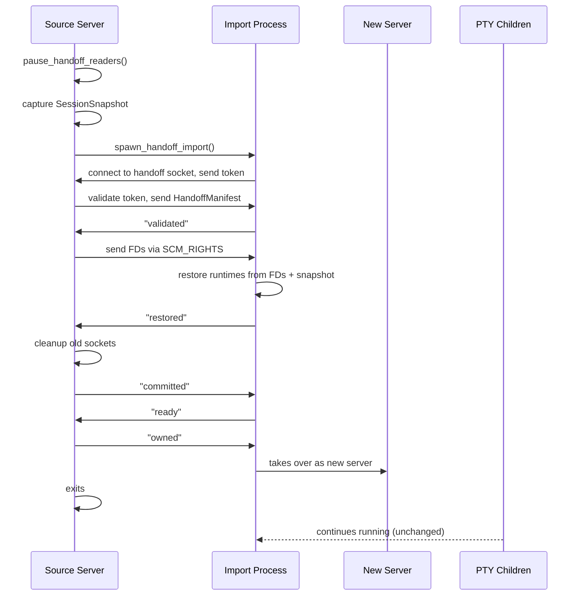

# Herdr — Server/Client and Terminal Handoff

**Herdr runs as a headless server daemon with thin clients connecting over Unix domain sockets.** This enables detach/reattach, multi-client viewing, live terminal handoff during updates, and remote SSH bridging. The server renders to in-memory ratatui buffers and streams frames to clients.

Source: `/home/darkvoid/Boxxed/@formulas/src.rust/src.AI/src.Hedr/herdr/src/server/`, `/home/darkvoid/Boxxed/@formulas/src.rust/src.AI/src.Hedr/herdr/src/protocol/`, `/home/darkvoid/Boxxed/@formulas/src.rust/src.AI/src.Hedr/herdr/src/client/`

See [05-tui-rendering.md](05-tui-rendering.md) for the monolithic TUI rendering. This document covers the server/client split architecture.

## Server/Client Architecture

```mermaid
flowchart TD
    subgraph Server["HeadlessServer (no terminal)"]
        S1["HeadlessServer struct — 4400+ lines"]
        S2["App state — same as monolithic"]
        S3["API server — JSON-RPC socket"]
        S4["Client listener — Unix domain socket"]
        S5["Clients HashMap — active connections"]
        S6["Foreground client — drives size/theme"]
    end

    subgraph Transport["Client Transport (per client)"]
        T1["Handshake thread — validate version"]
        T2["Writer thread — control + render channels"]
        T3["Read thread — parse input → ServerEvent"]
    end

    subhandoff["Live Handoff"]
        H1["Capture SessionSnapshot"]
        H2["Dup PTY FDs via SCM_RIGHTS"]
        H3["Spawn import process"]
        H4["Transfer manifest + FDs"]
        H5["Import restores runtimes"]
    end

    subgraph Client["Thin Client"]
        C1["herdr client — connect to server"]
        C2["herdr (default) — auto-detect + attach"]
        C3["Render frame display"]
        C4["Input forwarding"]
    end

    S1 --> S2
    S1 --> S3
    S1 --> S4
    S4 --> Transport
    Transport --> S5
    S5 --> S6
    S1 --> Handoff
    C1 --> Transport
    C2 --> C1
    C1 --> C3
    C1 --> C4
```

Source: `/home/darkvoid/Boxxed/@formulas/src.rust/src.AI/src.Hedr/herdr/src/server/headless.rs`

## Launch Auto-Detection

Source: `/home/darkvoid/Boxxed/@formulas/src.rust/src.AI/src.Hedr/herdr/src/server/autodetect.rs`

When you run `herdr` without `--no-session`, Herdr auto-detects the launch mode:

1. Check if a server is already running (via socket test)
2. If running → connect as client
3. If not running → spawn server, then connect as client

This is implemented in `auto_detect_launch()`:

```rust
// server/autodetect.rs
pub fn auto_detect_launch() -> io::Result<()> {
    // 1. Check if server socket exists and is responsive
    // 2. If yes → client::run_client()
    // 3. If no → spawn server process, wait for it, then connect
}
```

## Headless Server (4400+ Lines)

Source: `/home/darkvoid/Boxxed/@formulas/src.rust/src.AI/src.Hedr/herdr/src/server/headless.rs`

The `HeadlessServer` struct is the core of the server mode. It runs the same `App` event loop as monolithic mode, but renders to in-memory buffers instead of a real terminal.

### Key Struct

Source: `/home/darkvoid/Boxxed/@formulas/src.rust/src.AI/src.Hedr/herdr/src/server/headless.rs:163-199`

```rust
// server/headless.rs:163-199
struct HeadlessServer {
    app: App,                          // Same App as monolithic mode
    api_tx: UnboundedSender<ApiRequestMessage>,
    api_server: JsonApiServer,         // JSON-RPC API over Unix socket
    client_listener: UnixListener,     // Accepts thin client connections
    clients: HashMap<ClientId, ClientConnection>,
    foreground_client_id: Option<ClientId>,
    server_keybindings: Option<Keybinds>,
    terminal_attach_owners: HashMap<TerminalId, ClientId>,
    effective_size: (u16, u16),        // Effective terminal size
    shutting_down: bool,
    handoff_in_progress: bool,
    should_quit: bool,
    // ... event channels
}
```

### Server Event Loop

Source: `/home/darkvoid/Boxxed/@formulas/src.rust/src.AI/src.Hedr/herdr/src/server/headless.rs:341-601`

The server event loop is similar to the monolithic `App::run()` but adds client management:

```rust
// server/headless.rs — main loop
async fn run(&mut self) -> io::Result<()> {
    while !self.should_quit {
        // 1. Drain internal events and API requests
        // 2. Accept new client connections
        // 3. Handle server events (client input, resize, detach, etc.)
        // 4. Render to virtual buffers
        // 5. Stream frames to clients
        // 6. Check for handoff/shutdown
    }
}
```

### Virtual Rendering

Source: `/home/darkvoid/Boxxed/@formulas/src.rust/src.AI/src.Hedr/herdr/src/server/render_stream.rs`

The server renders to virtual ratatui buffers (no real terminal):

```rust
// server/render_stream.rs
fn render_virtual(state: &AppState, terminal_runtimes: &TerminalRuntimeRegistry, area: Rect) -> FrameData {
    // Renders to a TestBackend (in-memory ratatui buffer)
    // Returns FrameData: cells, width, height, cursor, hyperlinks, graphics
}
```

The `FrameData` is then encoded for clients using one of two methods:

1. **SemanticFrame** — Full `FrameData` serialized as bincode
2. **TerminalAnsi** — Diffed ANSI escape sequences via `BlitEncoder`

**Aha:** The `BlitEncoder` in `protocol/render_ansi.rs` diffs the current frame against the previously sent frame and only encodes changed cells as ANSI escape sequences. This dramatically reduces bandwidth for typical terminal usage where only a few rows change per frame. The encoder tracks cursor position and shape to hide/restore the cursor during blits, preventing cursor flicker.

Source: `/home/darkvoid/Boxxed/@formulas/src.rust/src.AI/src.Hedr/herdr/src/protocol/render_ansi.rs:57-97`

```rust
// protocol/render_ansi.rs:57-97
fn encode(&mut self, frame: &FrameData) -> EncodedBlit {
    // 1. Wrap in synchronized output (ESC[?2026h/l)
    // 2. Hide cursor
    // 3. Write changed cells (diff against baseline)
    // 4. Restore cursor
    // 5. Update baseline
}
```

## Client Connection

Source: `/home/darkvoid/Boxxed/@formulas/src.rust/src.AI/src.Hedr/herdr/src/server/clients.rs`

Each connected client is tracked as a `ClientConnection`:

```rust
// server/clients.rs:23-56
struct ClientConnection {
    mode: ClientConnectionMode,     // App or TerminalAttach
    keybindings: Option<Keybinds>,
    terminal_size: (u16, u16),
    cell_size: Option<(u16, u16)>,
    host_theme: Option<TerminalTheme>,
    outer_focus: Option<bool>,
    render_state: ClientRenderState,
    graphics_cache: GraphicsCache,
    control_tx: mpsc::Sender<Vec<u8>>,   // Reliable channel
    render_tx: mpsc::SyncSender<Vec<u8>>, // Droppable channel (cap=1)
}

enum ClientConnectionMode {
    App,                        // Full app client
    TerminalAttach { terminal_id: TerminalId }, // Single terminal attach
}
```

The foreground client (the most recently interactive App client) drives the effective terminal size, keybindings, and host terminal theme for all clients.

## Client Transport

Source: `/home/darkvoid/Boxxed/@formulas/src.rust/src.AI/src.Hedr/herdr/src/server/client_transport.rs`

Each client connection spawns three threads:

1. **Handshake thread** (`handle_client_handshake`) — Validates client version, sends Welcome, spawns writer and read threads
2. **Writer thread** (`client_writer_loop`) — Sends frames and control messages to the client
3. **Read thread** (`client_read_loop`) — Parses client input and sends `ServerEvent`s to the main loop

The handshake validates that the client protocol version matches the server:

```rust
// server/client_transport.rs:133-282
fn handle_client_handshake(stream: UnixStream, server_events: Sender<ServerEvent>) {
    // 1. Read Hello message from client
    // 2. Validate protocol version (exact match required)
    // 3. Send Welcome message with server info
    // 4. Spawn writer thread
    // 5. Enter read loop → ServerEvents
}
```

## Wire Protocol (v12)

Source: `/home/darkvoid/Boxxed/@formulas/src.rust/src.AI/src.Hedr/herdr/src/protocol/wire.rs`

### Framing

All messages use length-prefixed bincode:

```
[u32 little-endian length][bincode payload]
```

| Constant | Value | Purpose |
|----------|-------|---------|
| `PROTOCOL_VERSION` | 12 | Current protocol version |
| `MAX_FRAME_SIZE` | 2 MiB | Max frame payload |
| `MAX_GRAPHICS_FRAME_SIZE` | 32 MiB | Max graphics frame |
| `MAX_CLIPBOARD_IMAGE_PAYLOAD` | 16 MiB | Max clipboard image |
| `LENGTH_PREFIX_BYTES` | 4 | u32 length prefix |

### Client-to-Server Messages

Source: `/home/darkvoid/Boxxed/@formulas/src.rust/src.AI/src.Hedr/herdr/src/protocol/wire.rs:66-139`

| Message | Purpose |
|---------|---------|
| `Hello` | Client identification (version, encoding, keybindings, mode) |
| `Input` | Key/mouse/paste input bytes |
| `ClipboardImage` | Paste clipboard image (up to 16 MiB) |
| `Resize` | Client terminal size change |
| `Detach` | Disconnect from server (keep session alive) |
| `AttachTerminal` | Connect to a specific terminal pane |
| `AttachScroll` | Scroll within attached terminal |

### Server-to-Client Messages

Source: `/home/darkvoid/Boxxed/@formulas/src.rust/src.AI/src.Hedr/herdr/src/protocol/wire.rs:340-392`

| Message | Purpose |
|---------|---------|
| `Welcome` | Server identification (version, protocol, session name) |
| `Frame` | Semantic frame (full FrameData) |
| `Terminal` | Terminal ANSI diff (BlitEncoder output) |
| `Graphics` | Kitty graphics placement |
| `ServerShutdown` | Server is shutting down |
| `Notify` | Notification (sound/toast/system) |
| `Clipboard` | Clipboard content write |
| `ReloadSoundConfig` | Sound configuration changed |
| `MouseCapture` | Mouse capture state changed |

### Cell Data

Source: `/home/darkvoid/Boxxed/@formulas/src.rust/src.AI/src.Hedr/herdr/src/protocol/wire.rs:163-176`

```rust
// protocol/wire.rs:163-176
struct CellData {
    symbol: String,       // Display character(s)
    fg: Option<u32>,      // Foreground color (encoded)
    bg: Option<u32>,      // Background color (encoded)
    modifier: u16,        // Bold, italic, underline, etc.
    skip: bool,           // Skip rendering (part of wide char)
    hyperlink: Option<String>, // OSC 8 hyperlink URI
}
```

Colors are encoded as u32:
- Named colors: `0x00RRGGBB`
- Indexed: `0x01` prefix
- RGB: `0x02` prefix

## Live Terminal Handoff

Source: `/home/darkvoid/Boxxed/@formulas/src.rust/src.AI/src.Hedr/herdr/src/server/handoff.rs`

Live handoff transfers running PTY sessions from one server instance to another without disconnecting child processes. This is used for zero-downtime updates and remote attach.

### Handoff Protocol

Source: `/home/darkvoid/Boxxed/@formulas/src.rust/src.AI/src.Hedr/herdr/src/server/handoff.rs:22-32`

| Constant | Value | Purpose |
|----------|-------|---------|
| `HANDOFF_VERSION` | 1 | Handoff protocol version |
| `READY_TIMEOUT` | 30s | Wait for import server ready |
| `OWNED_ACK_TIMEOUT` | 500ms | Wait for owned acknowledgment |
| `MAX_FDS_PER_HANDOFF` | 64 | Maximum PTY FDs per handoff |
| `MAX_REPLAY_BYTES_PER_PANE` | 8 KiB | Max history replay per pane |
| `COMMIT_TIMEOUT` | 30s | Wait for commit acknowledgment |

### Handoff Flow



### Handoff Manifest

Source: `/home/darkvoid/Boxxed/@formulas/src.rust/src.AI/src.Hedr/herdr/src/server/handoff.rs:36-51`

```rust
// server/handoff.rs:36-44
struct HandoffManifest {
    version: u32,                   // HANDOFF_VERSION = 1
    source_version: String,         // herdr version string
    source_protocol: u32,           // PROTOCOL_VERSION = 12
    expected_version: String,       // Expected version after handoff
    expected_protocol: u32,         // Expected protocol after handoff
    session: SessionSnapshot,       // Full session state
    pane_runtimes: Vec<(u32, HandoffRuntimeState)>,
}
```

The manifest is sent as a JSON line over the handoff socket. The import process validates that versions and protocols match before accepting the handoff.

### FD Transfer via SCM_RIGHTS

Source: `/home/darkvoid/Boxxed/@formulas/src.rust/src.AI/src.Hedr/herdr/src/server/handoff.rs:372-456`

PTY master file descriptors are transferred using `sendmsg`/`recvmsg` with `SCM_RIGHTS` control messages:

```rust
// server/handoff.rs:372-403
fn send_fds(stream: &UnixStream, fds: &[RawFd]) -> io::Result<()> {
    // Uses sendmsg with SCM_RIGHTS control message
    // Transfers ownership of FDs to the receiving process
}

fn recv_fds(stream: &UnixStream, count: usize) -> io::Result<Vec<RawFd>> {
    // Uses recvmsg to receive FDs
    // Returns the received FDs (now owned by this process)
}
```

**Aha:** The handoff protocol is designed for zero data loss and zero downtime. The source server pauses PTY readers before capturing the snapshot, sends all FDs in a single `sendmsg` call, and waits for the import to confirm restoration before committing. If the handoff fails at any point, the source server rolls back and continues serving clients normally.

## Remote SSH Bridging

Source: `/home/darkvoid/Boxxed/@formulas/src.rust/src.AI/src.Hedr/herdr/src/remote.rs`

Herdr supports remote terminal sessions over SSH:

```bash
herdr --remote user@server     # SSH to remote server, attach to session
herdr --remote user@server --handoff  # Live handoff to remote server
```

The remote flow:
1. Detect remote platform (OS + arch)
2. Check for existing Herdr binary on remote, install if needed
3. Ensure remote server is running (spawn if needed)
4. Start local SSH bridge (forwards local socket to remote socket)
5. Connect local client to bridge

### Remote Update

Source: `/home/darkvoid/Boxxed/@formulas/src.rust/src.AI/src.Hedr/herdr/src/remote.rs:455-520`

Herdr can install itself on a remote machine:
1. Fetch release manifest from GitHub
2. Download appropriate binary for remote platform
3. Verify SHA-256 checksum
4. Install to `~/.local/bin/herdr`

## Server Auto-Detect

Source: `/home/darkvoid/Boxxed/@formulas/src.rust/src.AI/src.Hedr/herdr/src/server/autodetect.rs`

When you run `herdr` without arguments:
1. Check if server socket exists and responds
2. If yes, connect as client
3. If no, spawn `herdr server` in background
4. Wait for server to be ready
5. Connect as client

This is the default behavior — most users never need to think about server vs client.

## Socket Paths

Source: `/home/darkvoid/Boxxed/@formulas/src.rust/src.AI/src.Hedr/herdr/src/server/socket_paths.rs`

| Socket | Path Pattern | Purpose |
|--------|-------------|---------|
| API socket | `herdr.sock` | JSON-RPC API for CLI commands |
| Client socket | `herdr-client.sock` | Thin client connections |
| Handoff socket | `herdr-handoff-{pid}.sock` | Live handoff FD transfer |

Socket paths can be overridden with environment variables:
- `HERDR_CONFIG_PATH` — Override config file path
- `HERDR_CLIENT_SOCKET_PATH` — Override client socket path

## Cross-References

- [01-architecture.md](01-architecture.md) — Overall system architecture
- [03-pty-management.md](03-pty-management.md) — PTY handoff mechanics
- [05-tui-rendering.md](05-tui-rendering.md) — Monolithic vs virtual rendering
- [08-cli-commands.md](08-cli-commands.md) — CLI commands for server management
- [09-data-flow.md](09-data-flow.md) — End-to-end server/client data flow

→ Next: [07-configuration.md](07-configuration.md) — Configuration system deep dive
