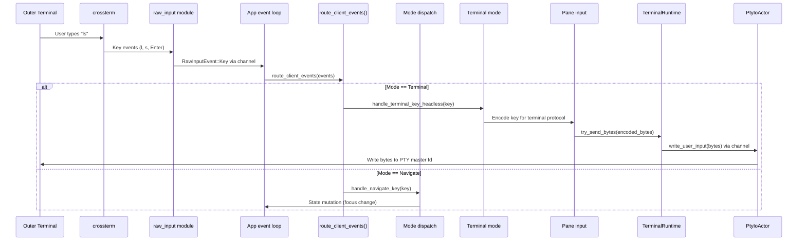
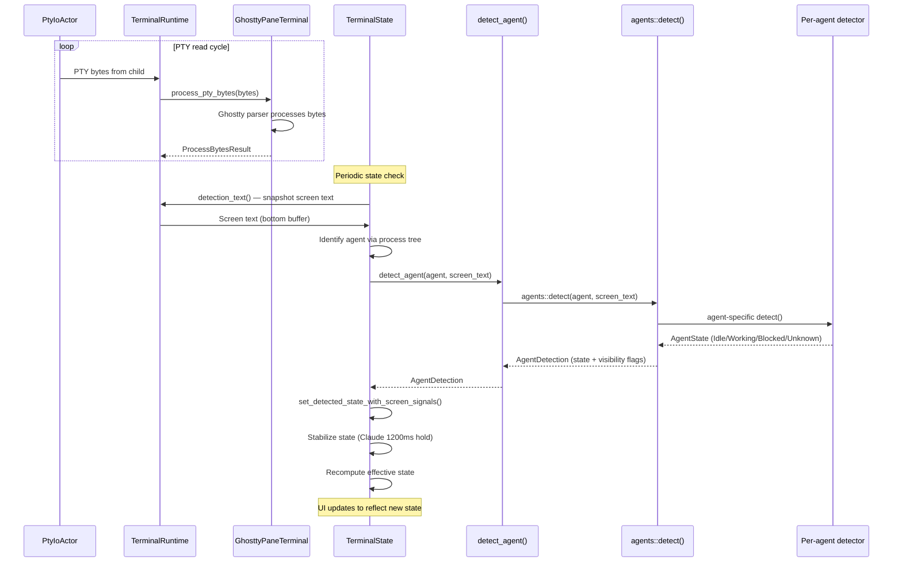
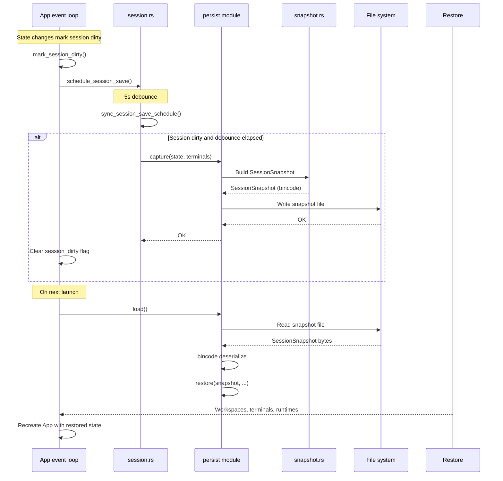
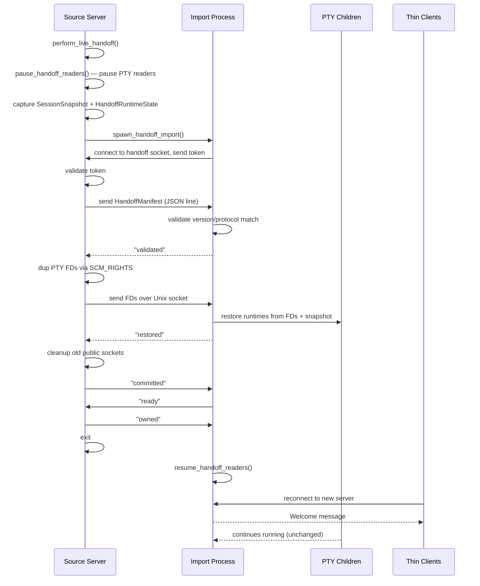
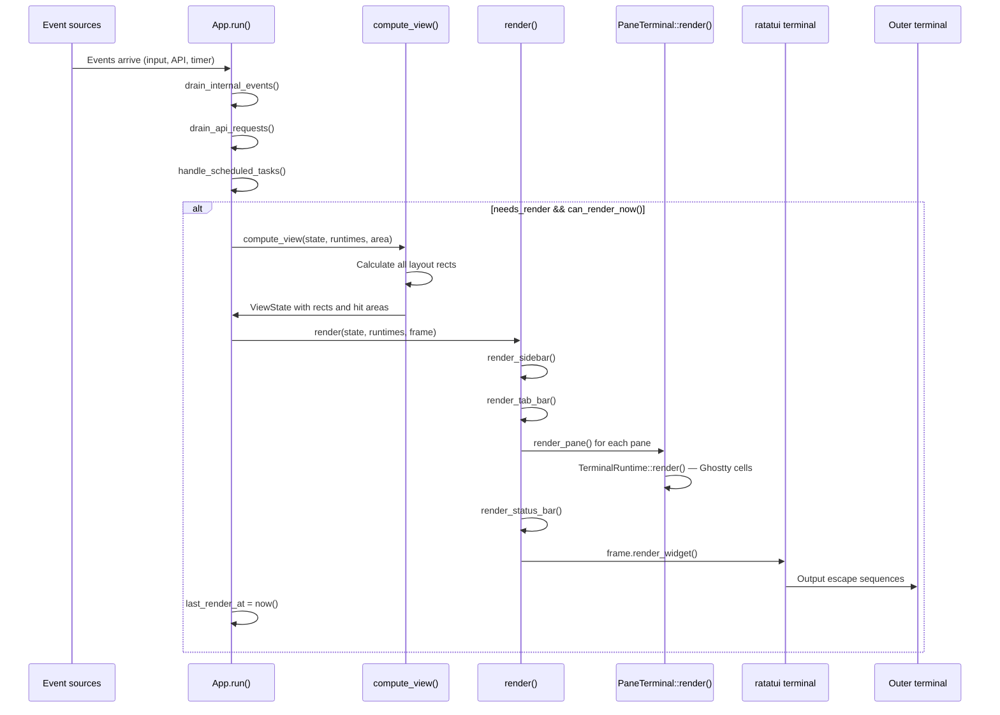
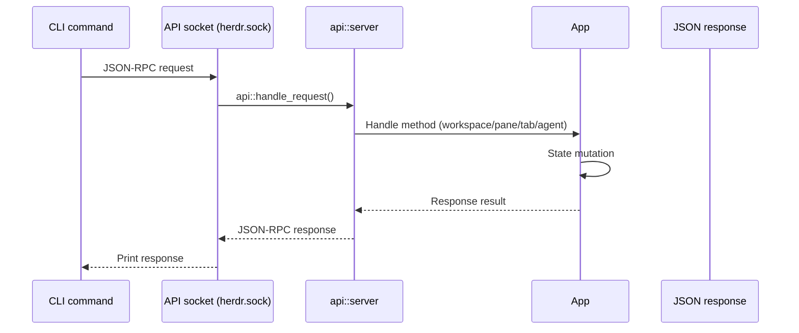
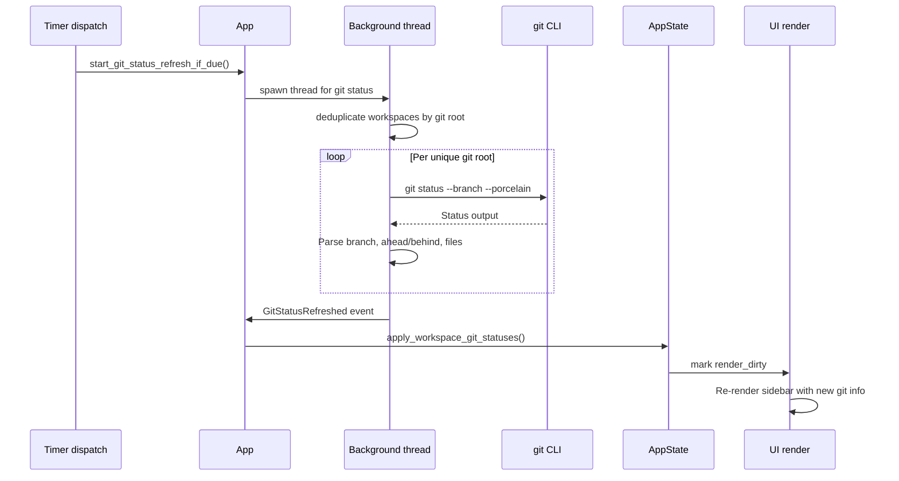

# Herdr — End-to-End Data Flows

**This document traces complete data flows through Herdr: from terminal session creation to input routing, agent detection, session persistence, and live handoff.** Each flow includes sequence diagrams and concrete step-by-step walkthroughs.

See [01-architecture.md](01-architecture.md) for the system architecture. This document shows how data moves through the system.

## Flow 1: Terminal Session Creation

```mermaid
sequenceDiagram
    participant User
    participant Main as main.rs
    participant App as App::new()
    participant Create as create_workspace()
    participant WS as Workspace::new()
    participant Tab as Tab::new_with_runtime()
    participant PTY as TerminalRuntime::spawn()
    participant PtyActor as PtyIoActor::spawn()
    participant Backend as spawn_with_portable_pty()

    User->>Main: herdr (or first launch)
    Main->>App: App::new(config, no_session, ...)
    App->>App: Try session restore (persist::load)
    alt Session exists
        App->>App: persist::restore() — recreate workspaces/panes
    else No session
        App->>App: Ensure default workspace
    end
    App->>Create: create_workspace_with_options(cwd, focus)
    Create->>WS: Workspace::new()
    WS->>Tab: Tab::new_with_runtime(cwd)
    Tab->>PTY: TerminalRuntime::spawn(cmd, cwd, rows, cols)
    PTY->>Backend: spawn_with_portable_pty(rows, cols, cmd)
    Backend-->>PTY: SpawnedPty { master_fd, child }
    PTY->>PtyActor: PtyIoActor::spawn(config)
    PtyActor-->>PTY: PtyIoActorHandle
    PTY-->>Tab: TerminalRuntime
    Tab-->>WS: Tab with root pane
    WS-->>Create: Workspace with tab
    Create->>App: Register TerminalId, add workspace
    App-->>User: Workspace visible with terminal pane
```

Source: `/home/darkvoid/Boxxed/@formulas/src.rust/src.AI/src.Hedr/herdr/src/app/creation.rs:134-167`

### Step-by-Step

1. **`App::new()`** is called with config, session flag, and API channels
2. **Session restore** is attempted: `persist::load()` reads the saved snapshot
3. If no session exists, **`ensure_default_workspace()`** creates the initial workspace
4. **`create_workspace_with_options()`**:
   - Creates a new `Workspace` with a default tab
   - Resolves the CWD using `resolve_new_terminal_cwd()` (follows the configured policy)
   - Calls `Tab::new_with_runtime()` which spawns the terminal
5. **`TerminalRuntime::spawn()`**:
   - Builds a `CommandBuilder` from the configured shell
   - Calls `spawn_with_portable_pty()` to create the PTY
   - Spawns the `PtyIoActor` thread to own the master fd
   - Creates a `TerminalRuntime` wrapping the `PaneRuntime`
6. The `TerminalId` is registered in `AppState.terminals`
7. The workspace is added to `AppState.workspaces`
8. If `focus=true`, the workspace becomes active

## Flow 2: Input Processing



Source: `/home/darkvoid/Boxxed/@formulas/src.rust/src.AI/src.Hedr/herdr/src/app/mod.rs:1307-1387`

### Terminal Mode Input

When in terminal mode (`Mode::Terminal`), key events are encoded for the focused pane's negotiated keyboard protocol:

1. **Key event received** from crossterm via raw input channel
2. **Mode check** — if terminal mode, proceed to encoding
3. **Protocol selection** — use ghostty encoding for char keys, herdr encoding for function keys
4. **Bracketed paste** — if bracketed paste is enabled, wrap paste content in `\x1b[200~...\x1b[201~`
5. **Send to PTY** — `try_send_bytes()` sends encoded bytes to the PTY actor
6. **PTY actor writes** — the actor thread writes bytes to the master fd

Source: `/home/darkvoid/Boxxed/@formulas/src.rust/src.AI/src.Hedr/herdr/src/app/mod.rs:1349-1374`

```rust
// app/mod.rs:1349-1374
RawInputEvent::Paste(text) => {
    if self.state.mode == Mode::Terminal {
        // ... find focused pane runtime
        let _ = runtime.try_send_bytes(bytes::Bytes::from(
            if runtime.input_state().map(|s| s.bracketed_paste).unwrap_or(false) {
                format!("\x1b[200~{text}\x1b[201~")
            } else {
                text
            },
        ));
    }
}
```

### Non-Terminal Mode Input

When not in terminal mode (Navigate, Settings, etc.), key events are dispatched to the appropriate handler:

| Mode | Handler |
|------|---------|
| `Navigate` | `handle_navigate_key()` — workspace/tab/pane navigation |
| `Prefix` | `handle_prefix_key()` — prefix-mode actions |
| `Copy` | `handle_copy_mode_key()` — text selection |
| `Resize` | `handle_resize_key()` — pane resizing |
| `Settings` | `handle_settings_key()` — settings navigation |
| `Navigator` | `handle_navigator_key()` — hierarchical navigator |
| `RenameWorkspace/Tab/Pane` | `handle_rename_key()` — text input |

Source: `/home/darkvoid/Boxxed/@formulas/src.rust/src.AI/src.Hedr/herdr/src/app/mod.rs:1393-1455`

## Flow 3: Agent Detection



Source: `/home/darkvoid/Boxxed/@formulas/src.rust/src.AI/src.Hedr/herdr/src/detect/mod.rs:175-186`

### Detection Timing

Agent detection runs periodically as part of the event loop:

1. **PTY bytes flow** continuously from child processes through the Ghostty parser
2. **Detection snapshots** are taken periodically by reading the terminal's bottom-buffer text
3. **Process tree analysis** identifies the agent binary running in each pane
4. **Pattern matching** determines the agent's current state (Idle/Working/Blocked/Unknown)
5. **State stabilization** applies the Claude 1200ms working hold if applicable
6. **UI update** reflects the new state in the sidebar and pane borders

## Flow 4: Session Save and Restore



Source: `/home/darkvoid/Boxxed/@formulas/src.rust/src.AI/src.Hedr/herdr/src/app/session.rs:19-44`

### Save Process

1. Any state change calls `mark_session_dirty()`
2. `schedule_session_save()` sets a 5-second debounce deadline
3. `sync_session_save_schedule()` checks if the deadline has passed and the session is dirty
4. `persist::capture()` builds a `SessionSnapshot` from the current state
5. The snapshot is serialized with bincode and written to the state directory

### Restore Process

1. `persist::load()` reads the snapshot file from disk
2. `persist::restore()` deserializes and recreates:
   - Workspaces with their tab/pane structure
   - TerminalStates with agent detection data
   - TerminalRuntimes by spawning new PTYs (or restoring from handoff)
3. If `resume_agents_on_restore` is enabled, agent panes attempt to resume their sessions

## Flow 5: Live Terminal Handoff



Source: `/home/darkvoid/Boxxed/@formulas/src.rust/src.AI/src.Hedr/herdr/src/server/headless.rs:711-921`

### Handoff Details

1. **Pause readers** — The source server pauses all PTY reader threads to prevent data loss during the handoff
2. **Capture snapshot** — Full session state including workspace structure, terminal states, and pane runtime metadata
3. **Spawn import** — A new `herdr server --handoff-import` process is spawned
4. **Token validation** — The import connects to the handoff socket and sends a random token; the source validates it
5. **Manifest transfer** — The `HandoffManifest` is sent as a JSON line
6. **FD transfer** — All PTY master FDs are sent via `sendmsg` with `SCM_RIGHTS`
7. **Restore** — The import process recreates `TerminalRuntime` instances from the received FDs and snapshot
8. **Commit** — The source cleans up old sockets and signals the import to take over
9. **Resume** — The import resumes PTY readers and starts accepting client connections

## Flow 6: Render Pipeline



Source: `/home/darkvoid/Boxxed/@formulas/src.rust/src.AI/src.Hedr/herdr/src/app/mod.rs:817-866`

The render pipeline runs at 60fps maximum (`MIN_RENDER_INTERVAL = 16ms`) with dirty-flag optimization. Only frames where `needs_render` is true and at least 16ms have passed since the last render are actually drawn.

## Flow 7: Server/Client Communication



Source: `/home/darkvoid/Boxxed/@formulas/src.rust/src.AI/src.Hedr/herdr/src/cli.rs:683-701`

CLI commands send JSON-RPC requests to the API socket (`herdr.sock`). The API server dispatches to the appropriate handler, which mutates `AppState` and returns a JSON response.

## Flow 8: Git Status Refresh



Source: `/home/darkvoid/Boxxed/@formulas/src.rust/src.AI/src.Hedr/herdr/src/app/runtime.rs:436-464`

Git status is refreshed every 1500ms (if not already in flight). Workspaces sharing the same git root are deduplicated so `git status` runs only once per repository.

## Cross-References

- [01-architecture.md](01-architecture.md) — Overall system architecture
- [03-pty-management.md](03-pty-management.md) — PTY runtime details
- [06-server-client.md](06-server-client.md) — Server/client communication
- [10-error-handling.md](10-error-handling.md) — Error handling in all flows

→ Next: [10-error-handling.md](10-error-handling.md) — Error handling and recovery
