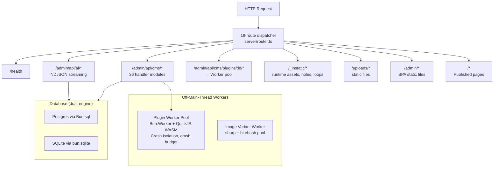
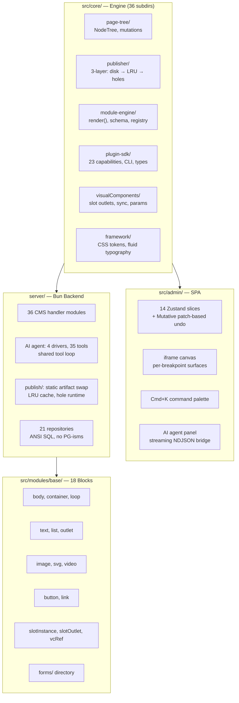

# Instatic — Self-Hosted CMS with Visual Editor

**Instatic is a self-hosted open-source CMS (v0.0.6, MIT) running as a single Bun process that serves the public website, admin editor, CMS API, published pages, and uploaded media — all from one binary.** It outputs plain semantic HTML and hand-authored CSS; no framework runtime is injected into published pages. The architecture centers on four pillars: a **Core Engine** (`NodeTree<T>` primitives, 3-layer publishing pipeline, module block system, Plugin SDK), a **Visual Editor** (React 19 + Zustand/Mutative with 14 store slices and per-breakpoint iframe canvas), an **AI Agent Runtime** (HTTP-only drivers with no vendor SDKs, 35 tools, shared multi-turn tool loop), and a **Plugin System** (QuickJS-WASM sandbox with Bun.Worker isolation, 23 capabilities, runtime permission enforcement).

Source: `Instatic/` — 2,433 TypeScript files, Bun runtime, PostgreSQL or SQLite

## Single Process Architecture



### Key Constraints

- **Single Bun process** — two Worker types off the main thread: plugin QuickJS sandboxes and image processing
- **Dual database engine** — identical ANSI SQL, separate migration files for PG/SQLite, enforced parity
- **No framework in output** — published pages are plain HTML+CSS, no React, no JS framework
- **No vendor AI SDKs** — every LLM driver is raw HTTP/SSE, no `@anthropic-ai/sdk`, no `openai` npm package
- **81 architecture tests** — gatekeeping imports, color tokens, CSS modules, JSON boundaries, migration parity

## Architecture at Depth



## Core Engine Primitives

### NodeTree — The Universal Tree Type

```typescript
// src/core/page-tree/treeSchema.ts
type NodeTree<TNode> = {
  nodes: Record<string, TNode>    // Flat map — O(1) lookup by ID
  rootNodeId: string              // Traversal entry point
}
```

Everything is a `NodeTree<T>`: pages, visual components, slot fills. 11 pure mutation operations (`insertNode`, `deleteNode`, `moveNode`, `duplicateNode`, `wrapNode`, `updateNodeProps`, `setBreakpointOverride`, `clearBreakpointOverride`, `renameNode`, `toggleNodeLocked`, `toggleNodeHidden`) operate on `NodeTree<PageNode>` and are valid for both pages and VCs.

### The 3-Layer Publishing Pipeline

```
Layer A (disk fast path)    →  static HTML on disk, atomic symlink swap
Layer B (memory LRU cache)  →  (urlPath, queryString, publishVersion) keyed
Layer C (server islands)    →  <instatic-hole> + 668B IntersectionObserver runtime
```

Dynamic node detection (`findDynamicNodeIds`) classifies nodes via 4 rules:
1. Module marked `dynamic: true`
2. Node has `dynamicBindings` with request-dependent source
3. Node is `base.loop` with request-dependent source
4. VC reference whose definition tree contains any dynamic node

### Data Model — Two Tables for Everything

```
data_tables  — user-defined collections with kind (page, post, component)
data_rows    — rows with cells typed by data_tables schema
```

Pages are `data_rows` with `body` (pageTree type). Components are `data_rows` with `tree` (pageTree) + `params` (fieldSchema). No separate `pages` or `components` tables — everything is uniform.

## Key Design Decisions

1. **QuickJS-WASM for plugins, not V8 isolates.** QuickJS compiles to WASM, runs in a `Bun.Worker`, and has zero access to Node/Bun APIs. Crash isolation via Worker boundary; crash budget prevents infinite respawn.
2. **HTTP-only AI drivers.** No `@anthropic-ai/sdk`, no `openai` npm package. Each driver is ~200 lines of raw HTTP/SSE. Shared tool loop handles multi-turn conversation; drivers only provide `mapHistory`, `createTranslator`, `buildRequestBody`.
3. **19-route hand-written dispatcher.** No framework router. Routes are tried in order; first non-null response wins. `idleTimeout: 0` because AI streams can pause 10+ seconds between tool calls.
4. **CSS Modules only. No Tailwind.** Enforced by `noTailwindUtilities.test.ts`. Colors use CSS custom properties exclusively; no hardcoded hex/RGB in admin/ui CSS.
5. **Patch-based undo.** Zustand + Mutative middleware tracks patches, not snapshots. Undo is O(change), not O(site).

**Aha:** The entire system is built around **eliminating indirection**. There's no ORM (raw SQL in repositories), no router framework (19-line array), no AI SDK (raw fetch), no CSS framework (custom tokens). Each decision removes a layer between the developer and the actual behavior. This makes the codebase readable: you can trace any request from `Bun.serve` to response without crossing an abstraction boundary you didn't write.

## Next

→ [Core Engine](01-architecture.md) — NodeTree, mutations, page tree, visual components, module engine.
