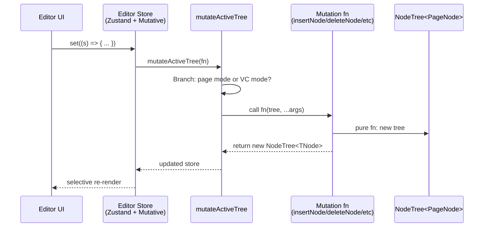
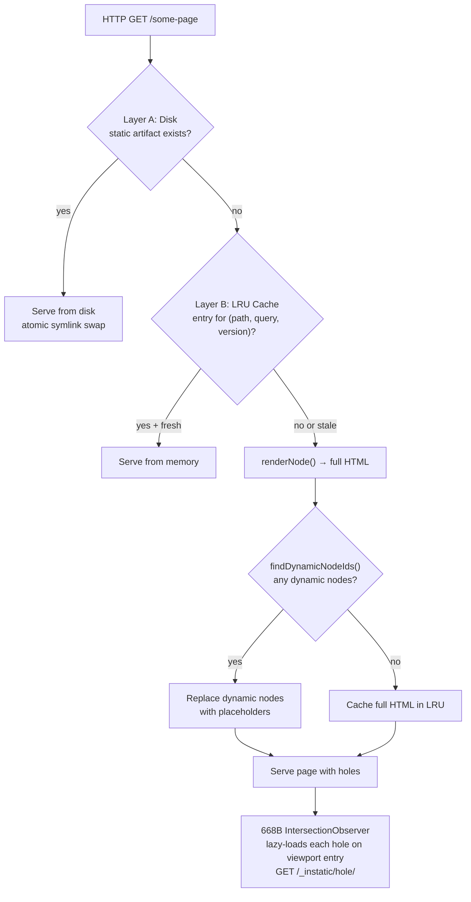

# Instatic Core Engine — NodeTree, Publisher, Module Engine

**The `src/core/` directory (36 subdirectories) contains all host-independent logic.** It defines the universal tree type (`NodeTree<T>`), the 3-layer publishing pipeline (disk → LRU → server islands), the module block system (15 built-in blocks + registry), the Plugin SDK (23 capabilities, QuickJS sandbox), visual components (VCs with slot outlets), the CSS framework (fluid typography, token generation), and data validation (TypeBox throughout). None of these modules import from `server/` or `src/admin/` — they are pure engine code.

Source: `src/core/` — 36 subdirectories

## NodeTree — The Universal Tree Primitive

```typescript
// src/core/page-tree/treeSchema.ts
type NodeTree<TNode> = {
  nodes: Record<string, TNode>    // Flat map for O(1) lookup
  rootNodeId: string              // Entry point for traversal
}
```

**Aha:** The flat map + root ID pattern means node lookup is O(1) regardless of tree depth. There's no recursive `children` array — parent-child relationships are maintained via `parentId` on each node. This makes mutations simple: `deleteNode` removes the node from the flat map and updates the parent's child list; `moveNode` changes the `parentId` — no tree rebalancing, no deep cloning.

### PageNode

**Aha:** The flat map + root ID pattern means node lookup is O(1) regardless of tree depth. There's no recursive `children` array — parent-child relationships are maintained via `parentId` on each node. This makes mutations simple: `deleteNode` removes the node from the flat map and updates the parent's child list; `moveNode` changes the `parentId` — no tree rebalancing, no deep cloning.

### NodeTree Mutation Flow



**Source:** `src/admin/pages/site/store/` (`mutateActiveTree`), `src/core/page-tree/mutations.ts` (11 pure mutation functions).

### PageNode

```typescript
// src/core/page-tree/pageNode.ts — extends BaseNode
interface PageNode extends BaseNode {
  parentId: string | null
  childrenIds: string[]
  breakpointOverrides: Record<BreakpointId, Partial<PageNode>>
  dynamicBindings: DynamicBinding[]
  classIds: string[]
  inlineStyles: Record<string, string>
  hidden: boolean
  locked: boolean
}
```

### 11 Pure Mutations

```typescript
// src/core/page-tree/mutations.ts
// All mutations are pure functions: (NodeTree<PageNode>, ...args) → NodeTree<PageNode>
// Same functions work for pages AND visual components
function insertNode(tree, parentId, node, index): NodeTree<PageNode>
function deleteNode(tree, nodeId): NodeTree<PageNode>
function moveNode(tree, nodeId, newParentId, index): NodeTree<PageNode>
function duplicateNode(tree, nodeId): NodeTree<PageNode>
function wrapNode(tree, nodeId, wrapperModuleId): NodeTree<PageNode>
function updateNodeProps(tree, nodeId, props): NodeTree<PageNode>
function setBreakpointOverride(tree, nodeId, breakpointId, overrides): NodeTree<PageNode>
function clearBreakpointOverride(tree, nodeId, breakpointId): NodeTree<PageNode>
function renameNode(tree, nodeId, name): NodeTree<PageNode>
function toggleNodeLocked(tree, nodeId): NodeTree<PageNode>
function toggleNodeHidden(tree, nodeId): NodeTree<PageNode>
```

**Aha:** Mutations route through `mutateActiveTree(fn)` in the editor store — the ONLY place that branches on whether the editor is in page mode or VC mode. The mutations themselves are mode-agnostic.

## The 3-Layer Publishing Pipeline



### Layer A: Static Artifact Swap

```typescript
// server/publish/staticArtefact.ts
// Atomic publish via dual-slot symlink swap:
// 1. Write new HTML to inactive slot (current/ or staging/)
// 2. Atomically swap symlink
// 3. Old slot becomes the next staging target
```

### Layer B: LRU Cache

```typescript
// server/publish/renderCache.ts
// Key: (urlPath, queryString, publishVersion)
// LRU eviction, single-flight (dedup concurrent renders for same key)
// publishVersion bump invalidates all entries
// canonicalRenderQuery() filters junk params, keeps loop_<nodeId>_page
```

### Layer C: Server Islands (Holes)

```typescript
// server/publish/holeRuntime.ts — 668B runtime
// 1. Find all <instatic-hole> elements
// 2. IntersectionObserver triggers lazy load on viewport entry
// 3. Fetch GET /_instatic/hole/<nodeId>?v=<publishVersion>
// 4. Replace hole with fetched HTML
```

### findDynamicNodeIds — 4 Rules + Pre-Scan

```typescript
// src/core/publisher/dynamicDetection.ts
function findDynamicNodeIds(page, site, registry): Set<string> {
  // Rule 1: Module is marked dynamic: true
  // Rule 2: Node has dynamicBindings with request-dependent source (route.query.*)
  // Rule 2b: String prop value contains {source.field} markers
  // Rule 3: Node is base.loop with requestDependent: true source
  // Rule 3.5 (pre-scan): Static loop whose children contain dynamic nodes
  //   → whole loop upgrades to hole, child IDs suppressed
  // Rule 4: VC reference whose definition tree contains any dynamic node
  //   (recursive, cycle-guarded via seenVcs Set)
}
```

## Module Engine — Block Rendering

```typescript
// src/core/module-engine/
interface AnyModuleDefinition {
  id: string                       // "base.container", "base.image"
  schema: Record<string, PropertyControl>  // TypeBox-backed property controls
  render(props, childrenHTML: string[]): RenderOutput
  publishBehavior?: 'standard' | 'special'  // 'special' bypasses standard rendering
  dynamic?: boolean                 // Dynamic detection Rule 1
  staticPlaceholder?(props): string  // Fallback content for holes
}

interface RenderOutput {
  html: string
  css?: string
  js?: string
}
```

### publishPage — The Main Entry Point

```typescript
// src/core/publisher/render.ts
function publishPage(
  page: Page,
  site: SiteDocument,
  registry: IModuleRegistry,
  options?: PublishPageOptions
): PublishedPage {
  // { filename, html, jsModuleIds }
}
```

### renderNode — The Core Render Function

```typescript
// src/core/publisher/renderNode.ts — conceptual
function renderNode(node, site, registry, ctx): string {
  if (node.hidden) return ''
  if (ctx.dynamicNodeIds.has(node.id)) {
    return `<instatic-hole node-id="${node.id}"></instatic-hole>`
  }
  if (node.moduleId === 'base.visual-component-ref') return renderVCRef(node, ...)
  if (node.moduleId === 'base.loop') return renderLoop(node, ...)

  // Standard node: bottom-up
  const childrenHTML = node.childrenIds.map(id => renderNode(tree.nodes[id], ...))
  const resolvedProps = resolveDynamicProps(node.props, ctx.bindings)
  const escapedProps = escapeProps(resolvedProps)
  const output = registry.get(node.moduleId).render(escapedProps, childrenHTML)
  // Collect deduped CSS by moduleId
  // Inject author CSS classes
  // Inject uid attribute if annotateNodeIds
  return output.html
}
```

### CSS Concatenation Order

```
1. reset.css
2. framework.css  (tokens + generated utilities + module CSS)
3. style.css      (class registry)
4. userStyles.css (user-defined — last, highest specificity)
```

## Plugin System — QuickJS-WASM Sandbox

```typescript
// server/plugins/quickjs/vm.ts
const DISPATCHER_NAMES = [
  '__runLifecycle', '__runMigrate', '__runRoute',
  '__runHookListener', '__runHookFilter', '__runLoopFetch',
  '__runLoopPreview', '__runSchedule', '__updateSettings',
  '__runMediaAdapterCall', '__runMediaUrlTransformer',
] as const
```

### 23 Capabilities with Runtime Enforcement

```typescript
// src/core/plugin-sdk/capabilities.ts
// 23 capabilities at detail levels: dangerous, high, medium, low
// Runtime enforces against grantedPermissions (operator-approved),
// NEVER against the declared permissions array.
// Network access requires networkAllowedHosts with *. wildcard support.
```

### Plugin Manifest

```typescript
interface PluginManifest {
  entrypoints: {
    server: string    // IIFE in QuickJS-WASM sandbox
    editor: string    // Loaded in editor iframe, editor.code permission
    admin: string     // Admin Shell page, admin.navigation permission
    modules: string   // Canvas module blocks, QuickJS module VM
  }
  permissions: Capability[]
  networkAllowedHosts?: string[]
  dataTables?: string[]  // Content tables this plugin can access
}
```

## Data Model — Two Universal Tables

```
data_tables  — user-defined collections with kind (postType, page, component)
               System tables (posts, pages, components, layouts) seeded by baseline migration
               Locked against rename/delete

data_rows    — rows with cells typed by data_tables schema
               Page rows have body (pageTree type)
               Component rows have tree (pageTree) + params (fieldSchema)
               No separate pages/components tables — everything is uniform
```

**Aha:** JSON columns MUST be named `*_json`. The SQLite adapter auto-parses these on read and auto-stringifies on write. This convention is enforced by `db-json-column-naming.test.ts`.

## Visual Components — Slot System

Visual Components have a definition tree and a parameter schema. When a `base.visual-component-ref` is dropped on a page, `syncSlotInstances` auto-generates `base.slot-instance` children for each `base.slot-outlet` in the VC definition. Slot fills live as materialized children in the consumer page tree — there's no separate slot content tree.

The publisher pairs each `base.slot-instance` (consumer fill) with its matching `base.slot-outlet` (VC definition position) by `slotName`. If the VC definition tree contains any dynamic node, the entire VC reference boundary upgrades to `<instatic-hole>`.

## Cross-References

- [Publisher](03-publisher.md) — Deep dive into all 3 publishing layers
- [AI Runtime](06-ai-runtime.md) — HTTP-only LLM drivers with shared tool loop
- [Plugin System](04-plugin-system.md) — QuickJS sandbox, RPC protocol, bootstrap

## Next

→ [Publisher](03-publisher.md) — The full publishing pipeline: disk artifacts, LRU cache, hole runtime.
